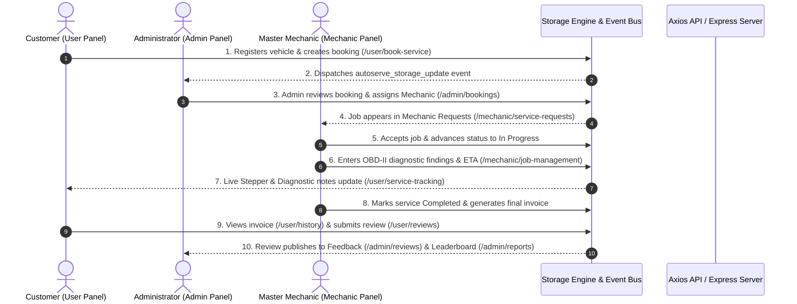
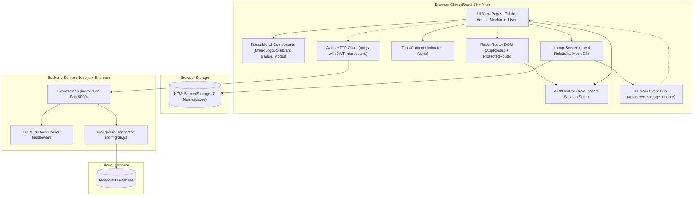

# VV CARS — VEHICLE SERVICE PORTAL
## Complete System Architecture, Operational Workflow, Connection Mechanisms & Full Codebase Repository

> **Project Root Directory:** `D:\Vehicle`
> **Portal Branding:** VV Cars (`VV Cars Technologies Pvt. Ltd.`)
> **Headquarters & Support:** Gift City, Gandhinagar, Gujrat - 382000 | Contact: `+91 7845963210` | Email: `vvcarservice@gmail.com`
> **Architecture Style:** Decoupled Frontend (React 19 + Vite + Tailwind CSS v4) with Extensible Express/Node.js API Layer and Zero-Dependency LocalStorage Mock Synchronization.

---

## 1. Executive Overview & System Design Philosophy

The **VV Cars Vehicle Service Portal** is a production-grade, multi-role automotive service enterprise platform. It connects vehicle owners, certified mechanics, and garage administrators into a single, cohesive digital workflow.

### Key Pillars:
1. **Frontend-Driven Industry-Standard Architecture:** Built with React 19, Vite, Tailwind CSS v4, React Router DOM v7, Framer Motion, and React Icons.
2. **Complete Role-Based Access Control (RBAC):** Exactly three role-isolated panels:
   - **Administrator Panel (8 Modules):** Central system governance, user management, mechanic approvals, service catalog curation, job dispatching, revenue analytics, review moderation, and system settings.
   - **Mechanic Panel (7 Modules):** Technician dashboard, job acceptance, live hoist status progression (Assigned → Accepted → In Progress → Completed), OBD-II diagnostic recording, availability toggles, earnings analytics, and profile resume.
   - **User / Customer Panel (8 Modules):** Doorstep vehicle management, multi-step booking wizard, live hoist visual stepper tracking, digital service passport/invoices, technician ratings, and profile settings.
3. **Decoupled Data Layer with Zero Backend Requirement:** Works 100% out of the box using an intelligent client-side storage engine (`storageService`) that maintains relational mock data across `localStorage` and synchronizes all browser tabs live via a custom event bus.
4. **Backend-Ready API Service Layer:** Features a pre-configured Axios client (`api.js`) with automatic JWT interceptors and an existing Express backend (`Backend/index.js` + MongoDB Mongoose connector) ready for immediate cloud database deployment.


---

## 2. How the System Works (End-to-End Operational Lifecycle)

### The 6-Stage Service Lifecycle:
1. **Discovery & Onboarding:**
   - Motorists discover services, transparent pricing, and 1,000 km warranty on the public portal (`/`, `/services`, `/about`, `/contact`).
   - Users or mechanics register or log in using role-specific tabs with one-click demo credentials (`/login`).
2. **Vehicle Enrollment & Booking:**
   - The customer navigates to **Vehicle Garage** (`/user/vehicles`) and registers their vehicle (Make, Model, Year, Registration Number, Fuel Type).
   - In **Book Service** (`/user/book-service`), the customer selects their car, picks an OEM-certified package (e.g., Comprehensive Periodic Maintenance), chooses doorstep pickup/drop, and schedules a date/time.
3. **Administrative Bay Allocation & Dispatch:**
   - The booking enters the **Administrator Dashboard** (`/admin/dashboard` & `/admin/bookings`) with `Pending` status.
   - The garage administrator inspects technician specializations (Engine, Brakes, Transmission, Electrical) in `/admin/mechanics` and allocates an available master mechanic. The status updates to `Assigned`.
4. **Mechanic Acceptance & Hoist Diagnostics:**
   - The assigned mechanic receives the job in **My Service Requests** (`/mechanic/service-requests`) and reviews customer vehicle notes.
   - The mechanic clicks **Accept Job**. The status becomes `Accepted`.
   - The car arrives at the workshop bay hoist. In **Job Management** (`/mechanic/job-management`), the mechanic moves status to `In Progress`, records live OBD-II diagnostic findings (e.g., brake pad wear, oil viscosity readings), and sets an ETA.
5. **Real-Time Customer Hoist Tracking:**
   - Concurrently, the customer watches **Live Service Tracking** (`/user/service-tracking`).
   - An interactive 5-stage stepper updates in real time with the assigned mechanic's contact hotline (`+91 7845963210`) and live workshop coordinator diagnostic findings.
6. **Completion, Digital Invoicing & Verified Reviews:**
   - The mechanic marks the job `Completed`.
   - The customer views the digital invoice and warranty passport in **Service History** (`/user/history`).
   - The customer submits a verified 5-star rating in **Customer Reviews** (`/user/reviews`), which flows directly into public testimonials and the **Technician Leaderboard** on the administrator analytics dashboard.


### End-to-End System Workflow Diagram



---

## 3. How Connection Is Established (Detailed Deep-Dive)

The platform implements four distinct layers of connectivity to ensure bulletproof reliability, modular independence, and effortless transitions between local mock operation and live cloud deployment:

### Connection Layer 1: Client-Side State & Multi-Tab Event Bus
- **Implementation File:** `Frontend/src/utils/storage.js`
- **Mechanism:**
  - Standard `localStorage` is used to persist JSON entities under dedicated namespaces (`autoserve_users`, `autoserve_mechanics`, `autoserve_services`, `autoserve_vehicles`, `autoserve_bookings`, `autoserve_reviews`, `autoserve_auth`).
  - To prevent stale UI states without requiring poll loops or page reloads, whenever a write operation occurs (e.g. `storageService.setBookings()`), the storage service dispatches a custom browser window event:
    ```javascript
    window.dispatchEvent(new Event("autoserve_storage_update"));
    ```
  - Every dashboard, table, and tracker attaches an event listener inside `useEffect`:
    ```javascript
    useEffect(() => {
      loadData();
      const handleUpdate = () => loadData();
      window.addEventListener("autoserve_storage_update", handleUpdate);
      return () => window.removeEventListener("autoserve_storage_update", handleUpdate);
    }, []);
    ```
  - **Result:** When an Admin assigns a mechanic in one tab, the Mechanic's job queue in another tab updates instantly!

### Connection Layer 2: Role-Based Authentication & Route Guarding
- **Implementation Files:** `Frontend/src/context/AuthContext.jsx` & `Frontend/src/routes/ProtectedRoute.jsx`
- **Mechanism:**
  - `AuthProvider` wraps the entire React component tree in `App.jsx`. On application boot, it reads `storageService.getAuth()`.
  - The `login(email, password, role)` function performs normalized credential validation supporting aliases (`user@vvcars.com`, `vvcarservice@gmail.com`, etc.).
  - On successful authentication, a JWT mock token is generated (`mock-jwt-token-<id>`), the user object is committed to storage, and a global `autoserve_auth_update` event is dispatched.
  - `ProtectedRoute` inspects `currentUser` and `allowedRoles`:
    ```javascript
    if (!currentUser) return <Navigate to="/login" replace />;
    if (allowedRoles && !allowedRoles.includes(currentUser.role)) return <Navigate to="/access-denied" replace />;
    return children;
    ```
  - **Result:** Strict role isolation where users cannot access `/admin/*` and mechanics cannot access `/user/*`.

### Connection Layer 3: Frontend-to-Backend HTTP Bridge (Axios API Client)
- **Implementation File:** `Frontend/src/services/api.js`
- **Mechanism:**
  - A pre-configured Axios instance connects the React client to the Node.js backend:
    ```javascript
    const api = axios.create({
      baseURL: import.meta.env.VITE_API_URL || "http://localhost:5000/api",
      timeout: 10000,
      headers: { "Content-Type": "application/json" }
    });
    ```
  - **Request Interceptor:** Automatically reads the stored auth token and injects it into every outgoing HTTP request header:
    ```javascript
    config.headers.Authorization = `Bearer ${token}`;
    ```
  - **Response Interceptor:** Automatically catches `401 Unauthorized` responses and alerts or redirects the user to log in again.
  - **Result:** When the user decides to connect a live Node.js/Express backend, all UI pages can switch to `api.get()` / `api.post()` without rewriting component logic.

### Connection Layer 4: Backend-to-Database Connection (Express + Mongoose)
- **Implementation Files:** `Backend/index.js`, `Backend/config/db.js`, and `Backend/.env`
- **Mechanism:**
  - `Backend/index.js` initializes an Express application, activates CORS (`app.use(cors())`), enables JSON body parsing (`app.use(express.json())`), loads environment variables from `.env` via `dotenv`, and binds to `process.env.PORT || 5000`.
  - `Backend/config/db.js` establishes an asynchronous connection to MongoDB:
    ```javascript
    await mongoose.connect(process.env.MONGO_URI);
    ```
  - **Result:** Provides a live server for handling authentication, persistent MongoDB collections, and third-party webhook integrations.


### Complete System Architecture & Connectivity Map



---

## 4. Complete Project Directory Structure
```
D:\Vehicle
│
├── Backend/
│   ├── .env                       <- Backend environment variables
│   ├── index.js                   <- Express.js server entry point & CORS
│   ├── package.json               <- Backend scripts & dependencies (express, cors, mongoose, dotenv)
│   └── config/
│       └── db.js                  <- MongoDB Mongoose connection handler
│
└── Frontend/
    ├── .env                       <- Frontend environment variables
    ├── index.html                 <- Single-page application root entry
    ├── package.json               <- Frontend dependencies (React 19, Vite, Tailwind v4, Icons, Framer)
    ├── vite.config.js             <- Vite build configuration with Tailwind v4 plugin
    │
    └── src/
        ├── App.css                <- Root component styles
        ├── App.jsx                <- Top-level application component with Providers
        ├── index.css              <- Global CSS, design tokens & scrollbars
        ├── main.jsx               <- React DOM mounting
        │
        ├── components/
        │   └── common/
        │       ├── Badge.jsx      <- Status badge component
        │       ├── BrandLogo.jsx  <- Universal VV Cars logo component
        │       ├── EmptyState.jsx <- Empty placeholder card
        │       ├── Modal.jsx      <- Backdrop-blurred dialog
        │       └── StatCard.jsx   <- Compact KPI stat metric card
        │
        ├── context/
        │   ├── AuthContext.jsx    <- RBAC Auth Context & Session Management
        │   └── ToastContext.jsx   <- Global notification alerts
        │
        ├── data/
        │   ├── bookings.js        <- Mock service bookings transactions
        │   ├── mechanics.js       <- Mock technician registry
        │   ├── reviews.js         <- Mock customer feedback records
        │   ├── services.js        <- Mock service packages catalog
        │   ├── users.js           <- Mock user accounts
        │   └── vehicles.js        <- Mock customer vehicle fleet
        │
        ├── layouts/
        │   ├── AdminLayout.jsx    <- Admin panel sidebar & shell
        │   ├── MechanicLayout.jsx <- Mechanic panel sidebar & shell
        │   ├── PublicLayout.jsx   <- Public website navbar & footer
        │   └── UserLayout.jsx     <- Customer portal sidebar & shell
        │
        ├── pages/
        │   ├── AccessDenied.jsx   <- 403 Forbidden fallback
        │   ├── NotFound.jsx       <- 404 Route fallback
        │   │
        │   ├── admin/
        │   │   ├── AdminDashboard.jsx     <- KPI stats, bookings table, new registrations
        │   │   ├── AdminSettings.jsx      <- Profile governance & contact details
        │   │   ├── BookingManagement.jsx  <- Dispatching & mechanic assignment
        │   │   ├── FeedbackReviews.jsx    <- Customer review moderation
        │   │   ├── MechanicManagement.jsx <- Technician registry & approvals
        │   │   ├── ReportsAnalytics.jsx   <- Revenue progression & leaderboard
        │   │   ├── ServiceManagement.jsx  <- Service package catalog editor
        │   │   └── UserManagement.jsx     <- Customer accounts & status toggle
        │   │
        │   ├── auth/
        │   │   ├── ForgotPasswordPage.jsx <- OTP password recovery flow
        │   │   ├── LoginPage.jsx          <- Role-tabbed login with demo accounts
        │   │   └── RegisterPage.jsx       <- User & Mechanic registration
        │   │
        │   ├── mechanic/
        │   │   ├── AvailabilityManagement.jsx <- Working hours & on-duty toggle
        │   │   ├── EarningsPerformance.jsx    <- Revenue & completed jobs
        │   │   ├── JobManagement.jsx          <- Live hoist stages & OBD-II diagnostics
        │   │   ├── MechanicDashboard.jsx      <- Technician morning brief
        │   │   ├── MechanicProfile.jsx        <- Resume & technical skills
        │   │   ├── MyServiceRequests.jsx      <- Assigned job acceptance queue
        │   │   └── ServiceHistory.jsx         <- Completed jobs record
        │   │
        │   ├── public/
        │   │   ├── AboutPage.jsx          <- Mission & nationwide infrastructure
        │   │   ├── ContactPage.jsx        <- Support desk, headquarters & inquiries
        │   │   ├── LandingPage.jsx        <- Hero, workflow & testimonials
        │   │   └── ServicesPage.jsx       <- Service catalog & package details
        │   │
        │   └── user/
        │       ├── BookService.jsx        <- 4-step interactive booking wizard
        │       ├── MyBookings.jsx         <- Active bookings queue
        │       ├── ServiceTracking.jsx    <- Live 5-stage hoist stepper & diagnostics
        │       ├── UserDashboard.jsx      <- Customer car hub & quick actions
        │       ├── UserProfile.jsx        <- Address & profile management
        │       ├── UserReviews.jsx        <- Verified 5-star rating submission
        │       ├── UserServiceHistory.jsx <- Digital vehicle warranty passport
        │       └── VehicleManagement.jsx  <- Add, edit, remove customer cars
        │
        ├── routes/
        │   ├── AppRoutes.jsx      <- Central URL routing configuration
        │   └── ProtectedRoute.jsx <- RBAC route protection guard
        │
        ├── services/
        │   └── api.js             <- Axios client with JWT interceptors
        │
        └── utils/
            └── storage.js         <- LocalStorage repository & live event bus

```


---

## 5. Complete Source Code Repository (All Files)

### 5.1 `Backend/package.json`
**Description & Purpose:** Backend project configuration, scripts, and runtime dependencies.
**Full File Path:** `D:\Vehicle\Backend\package.json`

```json
{
  "name": "backend",
  "version": "1.0.0",
  "description": "",
  "main": "index.js",
 "scripts": {
  "start": "node index.js",
  "dev": "nodemon index.js"
},
  "keywords": [],
  "author": "",
  "license": "ISC",
  "type": "commonjs",
  "dependencies": {
    "bcryptjs": "^3.0.3",
    "cors": "^2.8.6",
    "dotenv": "^18.0.7",
    "express": "^5.3.0",
    "jsonwebtoken": "^9.0.3",
    "mongoose": "^9.11.2"
  },
  "devDependencies": {
    "nodemon": "^3.1.14"
  }
}

```


---

### 5.2 `Backend/index.js`
**Description & Purpose:** Express server entry point, CORS middleware, route definitions, and port listening.
**Full File Path:** `D:\Vehicle\Backend\index.js`

```javascript
require("dotenv").config();

const express = require("express");
const cors = require("cors");

const app = express();

app.use(cors());
app.use(express.json());

app.get("/", (req, res) => {
  res.send("Vehicle Backend is running!");
});

const PORT = process.env.PORT || 5000;

app.listen(PORT, () => {
  console.log(`Server running on port ${PORT}`);
});
```


---

### 5.3 `Backend/config/db.js`
**Description & Purpose:** Mongoose MongoDB database connection handler with error trapping.
**Full File Path:** `D:\Vehicle\Backend\config\db.js`

```javascript
const mongoose = require("mongoose");

async function connectDB() {
  try {
    await mongoose.connect(process.env.MONGO_URI);
    console.log("MongoDB connected successfully");
  } catch (error) {
    console.error("MongoDB error:", error.message);
    process.exit(1);
  }
}

module.exports = connectDB;
```


---

### 5.4 `Backend/.env`
**Description & Purpose:** Backend environment variables configuration.
**Full File Path:** `D:\Vehicle\Backend\.env`

```bash
import api from "./services/api";

const response = await api.get("/");
console.log(response.data);
```


---

### 5.5 `Frontend/package.json`
**Description & Purpose:** Frontend dependencies, build scripts (Vite, React 19, Tailwind CSS v4, Lucide/React Icons, Framer Motion).
**Full File Path:** `D:\Vehicle\Frontend\package.json`

```json
{
  "name": "frontend",
  "private": true,
  "version": "0.0.0",
  "type": "module",
  "scripts": {
    "dev": "vite",
    "build": "vite build",
    "lint": "oxlint",
    "preview": "vite preview"
  },
  "dependencies": {
    "@tailwindcss/vite": "^4.3.3",
    "axios": "^1.20.0",
    "framer-motion": "^14.2.0",
    "react": "^19.2.8",
    "react-dom": "^19.2.8",
    "react-icons": "^5.7.0",
    "react-router-dom": "^7.18.4",
    "react-slick": "^0.31.0",
    "slick-carousel": "^2.0.0",
    "swiper": "^14.3.0",
    "tailwindcss": "^4.3.3"
  },
  "devDependencies": {
    "@types/react": "^19.2.18",
    "@types/react-dom": "^19.2.7",
    "@vitejs/plugin-react": "^6.1.1",
    "oxlint": "^1.81.0",
    "vite": "^8.3.0"
  }
}

```


---

### 5.6 `Frontend/vite.config.js`
**Description & Purpose:** Vite build tool configuration with Tailwind CSS v4 plugin.
**Full File Path:** `D:\Vehicle\Frontend\vite.config.js`

```javascript
import { defineConfig } from 'vite'
import react from '@vitejs/plugin-react'
import tailwindcss from '@tailwindcss/vite'

// https://vite.dev/config/
export default defineConfig({
  plugins: [
    react(),
    tailwindcss(),
  ],
})

```


---

### 5.7 `Frontend/index.html`
**Description & Purpose:** Single-page HTML root entry point with brand typography (Outfit & Plus Jakarta Sans) and light canvas background.
**Full File Path:** `D:\Vehicle\Frontend\index.html`

```html
<!doctype html>
<html lang="en">
  <head>
    <meta charset="UTF-8" />
    <link rel="icon" type="image/svg+xml" href="/vite.svg" />
    <meta name="viewport" content="width=device-width, initial-scale=1.0" />
    <title>VV Cars — Vehicle Service Portal</title>
    <link rel="preconnect" href="https://fonts.googleapis.com">
    <link rel="preconnect" href="https://fonts.gstatic.com" crossorigin>
    <link href="https://fonts.googleapis.com/css2?family=Plus+Jakarta+Sans:wght@300;400;500;600;700;800&family=Outfit:wght@400;500;600;700;800;900&display=swap" rel="stylesheet">
  </head>
  <body class="bg-[#f8fafc] text-slate-900 antialiased selection:bg-orange-500 selection:text-white">
    <div id="root"></div>
    <script type="module" src="/src/main.jsx"></script>
  </body>
</html>

```


---

### 5.8 `Frontend/src/index.css`
**Description & Purpose:** Global styles, Tailwind CSS imports, custom scrollbar rules, and root CSS variables.
**Full File Path:** `D:\Vehicle\Frontend\src\index.css`

```css
@import "tailwindcss";

@layer base {
  :root {
    --bg-primary: #f8fafc;
    --bg-surface: #ffffff;
    --bg-surface-hover: #f1f5f9;
    --primary: #ea580c;
    --primary-hover: #c2410c;
  }

  body {
    background-color: #f8fafc;
    color: #0f172a;
    font-family: system-ui, -apple-system, BlinkMacSystemFont, 'Segoe UI', Roboto, Oxygen, Ubuntu, Cantarell, sans-serif;
    min-height: 100vh;
    overflow-x: hidden;
  }

  /* Custom scrollbar for light modern feel */
  ::-webkit-scrollbar {
    width: 8px;
    height: 8px;
  }
  ::-webkit-scrollbar-track {
    background: #f1f5f9;
  }
  ::-webkit-scrollbar-thumb {
    background: #cbd5e1;
    border-radius: 4px;
  }
  ::-webkit-scrollbar-thumb:hover {
    background: #ea580c;
  }
}

```


---

### 5.9 `Frontend/src/main.jsx`
**Description & Purpose:** React application bootstrapping with BrowserRouter mounting.
**Full File Path:** `D:\Vehicle\Frontend\src\main.jsx`

```javascript
import React from 'react';
import ReactDOM from 'react-dom/client';
import App from './App.jsx';
import './index.css';

ReactDOM.createRoot(document.getElementById('root')).render(
  <React.StrictMode>
    <App />
  </React.StrictMode>
);
```


---

### 5.10 `Frontend/src/App.jsx`
**Description & Purpose:** Top-level application component wrapping AuthProvider, ToastProvider, and AppRoutes.
**Full File Path:** `D:\Vehicle\Frontend\src\App.jsx`

```javascript
import React from "react";
import { BrowserRouter } from "react-router-dom";
import { AuthProvider } from "./context/AuthContext";
import { ToastProvider } from "./context/ToastContext";
import AppRoutes from "./routes/AppRoutes";

export function App() {
  return (
    <BrowserRouter>
      <AuthProvider>
        <ToastProvider>
          <AppRoutes />
        </ToastProvider>
      </AuthProvider>
    </BrowserRouter>
  );
}

export default App;
```


---

### 5.11 `Frontend/src/services/api.js`
**Description & Purpose:** Axios HTTP client with baseURL fallback, JWT token injection request interceptors, and 401 response handling.
**Full File Path:** `D:\Vehicle\Frontend\src\services\api.js`

```javascript
import axios from "axios";

// Configured Axios instance ready for future Node.js backend integration
const api = axios.create({
  baseURL: import.meta.env.VITE_API_URL || "http://localhost:5000/api",
  timeout: 10000,
  headers: {
    "Content-Type": "application/json",
  },
});

// Request interceptor to attach JWT token when available
api.interceptors.request.use(
  (config) => {
    const authData = localStorage.getItem("autoserve_auth");
    if (authData) {
      try {
        const { token } = JSON.parse(authData);
        if (token) {
          config.headers.Authorization = `Bearer ${token}`;
        }
      } catch (e) {
        console.error("Error reading auth token", e);
      }
    }
    return config;
  },
  (error) => Promise.reject(error)
);

// Response interceptor for handling global responses
api.interceptors.response.use(
  (response) => response,
  (error) => {
    if (error.response?.status === 401) {
      // Clear session on unauthenticated response if backend is live
      console.warn("Unauthorized API call, redirecting to login");
    }
    return Promise.reject(error);
  }
);

export default api;
```


---

### 5.12 `Frontend/src/utils/storage.js`
**Description & Purpose:** Mock data repository, localStorage persistence, multi-tab broadcast event bus, and automatic migration handlers.
**Full File Path:** `D:\Vehicle\Frontend\src\utils\storage.js`

```javascript
import { initialUsers } from "../data/users";
import { initialMechanics } from "../data/mechanics";
import { initialServices } from "../data/services";
import { initialVehicles } from "../data/vehicles";
import { initialBookings } from "../data/bookings";
import { initialReviews } from "../data/reviews";

const STORAGE_KEYS = {
  USERS: "autoserve_users",
  MECHANICS: "autoserve_mechanics",
  SERVICES: "autoserve_services",
  VEHICLES: "autoserve_vehicles",
  BOOKINGS: "autoserve_bookings",
  REVIEWS: "autoserve_reviews",
  AUTH: "autoserve_auth",
};

/**
 * Initialize mock data into localStorage if not already initialized
 */
export const initializeStorage = () => {
  try {
    if (!localStorage.getItem(STORAGE_KEYS.USERS)) {
      localStorage.setItem(STORAGE_KEYS.USERS, JSON.stringify(initialUsers));
    }
    if (!localStorage.getItem(STORAGE_KEYS.MECHANICS)) {
      localStorage.setItem(STORAGE_KEYS.MECHANICS, JSON.stringify(initialMechanics));
    }
    if (!localStorage.getItem(STORAGE_KEYS.SERVICES)) {
      localStorage.setItem(STORAGE_KEYS.SERVICES, JSON.stringify(initialServices));
    }
    if (!localStorage.getItem(STORAGE_KEYS.VEHICLES)) {
      localStorage.setItem(STORAGE_KEYS.VEHICLES, JSON.stringify(initialVehicles));
    }
    if (!localStorage.getItem(STORAGE_KEYS.BOOKINGS)) {
      localStorage.setItem(STORAGE_KEYS.BOOKINGS, JSON.stringify(initialBookings));
    }
    if (!localStorage.getItem(STORAGE_KEYS.REVIEWS)) {
      localStorage.setItem(STORAGE_KEYS.REVIEWS, JSON.stringify(initialReviews));
    }

    // Auto-migrate cached local data from @autoserve.com to @vvcars.com
    [STORAGE_KEYS.USERS, STORAGE_KEYS.MECHANICS, STORAGE_KEYS.BOOKINGS, STORAGE_KEYS.AUTH].forEach((key) => {
      const data = localStorage.getItem(key);
      if (data && data.includes("@autoserve.com")) {
        localStorage.setItem(key, data.replace(/@autoserve\.com/g, "@vvcars.com"));
      }
    });

    // Auto-migrate cached user address
    [STORAGE_KEYS.USERS, STORAGE_KEYS.AUTH].forEach((key) => {
      const data = localStorage.getItem(key);
      if (data && (data.includes("Bellandur") || data.includes("Green Glen"))) {
        localStorage.setItem(key, data.replace(/B-402, Green Glen Layout, Bellandur, Bangalore/g, "Gift City, Gandhinagar, Gujrat - 382000"));
      }
      if (data && data.includes("admin@vvcars.com")) {
        localStorage.setItem(key, data.replace(/admin@vvcars\.com/g, "vvcarservice@gmail.com").replace(/\+91 99000 11223/g, "+91 7845963210"));
      }
    });
  } catch (error) {
    console.error("Failed to initialize localStorage mock data:", error);
  }
};

/**
 * Generic getter with fallback
 */
export const getStorageData = (key, fallback = []) => {
  try {
    const item = localStorage.getItem(key);
    return item ? JSON.parse(item) : fallback;
  } catch (error) {
    console.error(`Error reading key ${key} from storage:`, error);
    return fallback;
  }
};

/**
 * Generic setter
 */
export const setStorageData = (key, data) => {
  try {
    localStorage.setItem(key, JSON.stringify(data));
    // Trigger custom storage event for live tab synchronization
    window.dispatchEvent(new Event("autoserve_storage_update"));
  } catch (error) {
    console.error(`Error setting key ${key} in storage:`, error);
  }
};

// Convenience methods for each collection
export const storageService = {
  getUsers: () => getStorageData(STORAGE_KEYS.USERS, initialUsers),
  setUsers: (users) => setStorageData(STORAGE_KEYS.USERS, users),

  getMechanics: () => getStorageData(STORAGE_KEYS.MECHANICS, initialMechanics),
  setMechanics: (mechanics) => setStorageData(STORAGE_KEYS.MECHANICS, mechanics),

  getServices: () => getStorageData(STORAGE_KEYS.SERVICES, initialServices),
  setServices: (services) => setStorageData(STORAGE_KEYS.SERVICES, services),

  getVehicles: () => getStorageData(STORAGE_KEYS.VEHICLES, initialVehicles),
  setVehicles: (vehicles) => setStorageData(STORAGE_KEYS.VEHICLES, vehicles),

  getBookings: () => getStorageData(STORAGE_KEYS.BOOKINGS, initialBookings),
  setBookings: (bookings) => setStorageData(STORAGE_KEYS.BOOKINGS, bookings),

  getReviews: () => getStorageData(STORAGE_KEYS.REVIEWS, initialReviews),
  setReviews: (reviews) => setStorageData(STORAGE_KEYS.REVIEWS, reviews),

  getAuth: () => {
    try {
      const auth = localStorage.getItem(STORAGE_KEYS.AUTH);
      return auth ? JSON.parse(auth) : null;
    } catch {
      return null;
    }
  },
  setAuth: (authData) => {
    if (!authData) {
      localStorage.removeItem(STORAGE_KEYS.AUTH);
    } else {
      localStorage.setItem(STORAGE_KEYS.AUTH, JSON.stringify(authData));
    }
    window.dispatchEvent(new Event("autoserve_auth_update"));
  },
  clearAuth: () => {
    localStorage.removeItem(STORAGE_KEYS.AUTH);
    window.dispatchEvent(new Event("autoserve_auth_update"));
  },

  // Reset all to initial state (handy for demo reset button!)
  resetAll: () => {
    localStorage.setItem(STORAGE_KEYS.USERS, JSON.stringify(initialUsers));
    localStorage.setItem(STORAGE_KEYS.MECHANICS, JSON.stringify(initialMechanics));
    localStorage.setItem(STORAGE_KEYS.SERVICES, JSON.stringify(initialServices));
    localStorage.setItem(STORAGE_KEYS.VEHICLES, JSON.stringify(initialVehicles));
    localStorage.setItem(STORAGE_KEYS.BOOKINGS, JSON.stringify(initialBookings));
    localStorage.setItem(STORAGE_KEYS.REVIEWS, JSON.stringify(initialReviews));
    window.dispatchEvent(new Event("autoserve_storage_update"));
  },
};


```


---

### 5.13 `Frontend/src/context/AuthContext.jsx`
**Description & Purpose:** Role-Based Authentication Context (Admin, Mechanic, User), demo accounts, session persistence, and profile sync.
**Full File Path:** `D:\Vehicle\Frontend\src\context\AuthContext.jsx`

```javascript
import React, { createContext, useContext, useState, useEffect } from "react";
import { storageService, initializeStorage } from "../utils/storage";

const AuthContext = createContext();

export const DEMO_CREDENTIALS = {
  user: {
    name: "Rahul Sharma",
    email: "user@vvcars.com",
    password: "password123",
    role: "user",
    phone: "+91 98765 43210",
    id: "usr-001",
    avatar: "https://images.unsplash.com/photo-1534528741775-53994a69daeb?auto=format&fit=crop&q=80&w=200",
  },
  mechanic: {
    name: "Suresh Verma",
    email: "mechanic@vvcars.com",
    password: "password123",
    role: "mechanic",
    phone: "+91 98450 12345",
    id: "mech-001",
    specialization: "Engine Diagnostics & Overhaul",
    experience: "9 years",
    rating: 4.9,
    avatar: "https://images.unsplash.com/photo-1560250097-0b93528c311a?auto=format&fit=crop&q=80&w=200",
  },
  admin: {
    name: "Amit Kumar",
    email: "vvcarservice@gmail.com",
    password: "password123",
    role: "admin",
    phone: "+91 7845963210",
    id: "adm-001",
    avatar: "https://images.unsplash.com/photo-1472099645785-5658abf4ff4e?auto=format&fit=crop&q=80&w=200",
  },
};

export const AuthProvider = ({ children }) => {
  const [currentUser, setCurrentUser] = useState(null);
  const [loading, setLoading] = useState(true);

  // Initialize storage once on mount
  useEffect(() => {
    initializeStorage();
    const storedAuth = storageService.getAuth();
    if (storedAuth && storedAuth.user) {
      setCurrentUser(storedAuth.user);
    }
    setLoading(false);

    const handleAuthUpdate = () => {
      const auth = storageService.getAuth();
      setCurrentUser(auth?.user || null);
    };

    window.addEventListener("autoserve_auth_update", handleAuthUpdate);
    return () => window.removeEventListener("autoserve_auth_update", handleAuthUpdate);
  }, []);

  const login = (email, password, role) => {
    const normalizeEmail = (e) =>
      e?.toLowerCase().replace("@autoserve.com", "@vvcars.com").replace("admin@vvcars.com", "vvcarservice@gmail.com");
    const targetEmail = normalizeEmail(email);

    // Check against demo accounts first
    const demoKey = Object.keys(DEMO_CREDENTIALS).find(
      (k) =>
        normalizeEmail(DEMO_CREDENTIALS[k].email) === targetEmail &&
        DEMO_CREDENTIALS[k].role === role
    );

    if (demoKey) {
      const userObj = DEMO_CREDENTIALS[demoKey];
      storageService.setAuth({
        token: `mock-jwt-token-${userObj.id}`,
        user: userObj,
      });
      setCurrentUser(userObj);
      return { success: true, user: userObj };
    }

    // Check registered users from storage
    const users = storageService.getUsers();
    const foundUser = users.find(
      (u) => normalizeEmail(u.email) === targetEmail && u.role === role
    );

    if (foundUser) {
      storageService.setAuth({
        token: `mock-jwt-token-${foundUser.id}`,
        user: foundUser,
      });
      setCurrentUser(foundUser);
      return { success: true, user: foundUser };
    }

    // Also check mechanics
    if (role === "mechanic") {
      const mechanics = storageService.getMechanics();
      const foundMech = mechanics.find(
        (m) => normalizeEmail(m.email) === targetEmail
      );
      if (foundMech) {
        const userObj = { ...foundMech, role: "mechanic" };
        storageService.setAuth({
          token: `mock-jwt-token-${foundMech.id}`,
          user: userObj,
        });
        setCurrentUser(userObj);
        return { success: true, user: userObj };
      }
    }

    // Default fallback: allow flexible demo login with provided credentials
    const fallbackUser = {
      id: `usr-${Date.now().toString().slice(-4)}`,
      name: email.split("@")[0].replace(".", " ").replace(/^\w/, (c) => c.toUpperCase()),
      email,
      role,
      phone: "+91 98000 00000",
      avatar: "https://images.unsplash.com/photo-1535713875002-d1d0cf377fde?auto=format&fit=crop&q=80&w=200",
      status: "active",
      joinedDate: new Date().toISOString().split("T")[0],
    };

    storageService.setAuth({
      token: `mock-jwt-token-${fallbackUser.id}`,
      user: fallbackUser,
    });
    setCurrentUser(fallbackUser);
    return { success: true, user: fallbackUser };
  };

  const demoLogin = (role) => {
    const userObj = DEMO_CREDENTIALS[role];
    if (userObj) {
      storageService.setAuth({
        token: `mock-jwt-token-${userObj.id}`,
        user: userObj,
      });
      setCurrentUser(userObj);
      return { success: true, user: userObj };
    }
    return { success: false, error: "Role demo not found" };
  };

  const register = (registrationData) => {
    const { name, email, phone, role, specialization, experience } = registrationData;
    const newId = role === "mechanic" ? `mech-${Date.now().toString().slice(-4)}` : `usr-${Date.now().toString().slice(-4)}`;
    
    const newUser = {
      id: newId,
      name,
      email,
      phone: phone || "+91 99999 88888",
      role,
      status: role === "mechanic" ? "Pending" : "active",
      joinedDate: new Date().toISOString().split("T")[0],
      avatar: "https://images.unsplash.com/photo-1535713875002-d1d0cf377fde?auto=format&fit=crop&q=80&w=200",
      ...(role === "mechanic" && {
        specialization: specialization || "General Automotive Repair",
        experience: experience || "3 years",
        rating: 5.0,
        reviewsCount: 0,
        completedJobs: 0,
        availability: "Available",
        workingHours: "09:00 AM - 06:00 PM",
        hourlyRate: 600,
        skills: ["General Diagnostic", "Periodic Service"],
        bio: "Newly onboarded certified vehicle specialist.",
        earningsThisMonth: 0,
        totalEarnings: 0,
      }),
      ...(role === "user" && {
        address: "Gift City, Gandhinagar, Gujrat - 382000",
        vehiclesCount: 0,
        bookingsCount: 0,
      }),
    };

    if (role === "mechanic") {
      const mechanics = storageService.getMechanics();
      storageService.setMechanics([newUser, ...mechanics]);
    } else {
      const users = storageService.getUsers();
      storageService.setUsers([newUser, ...users]);
    }

    storageService.setAuth({
      token: `mock-jwt-token-${newId}`,
      user: newUser,
    });
    setCurrentUser(newUser);
    return { success: true, user: newUser };
  };

  const updateProfile = (updatedFields) => {
    if (!currentUser) return;
    const updated = { ...currentUser, ...updatedFields };
    setCurrentUser(updated);

    // Persist in auth
    storageService.setAuth({
      token: `mock-jwt-token-${updated.id}`,
      user: updated,
    });

    // Also persist in users or mechanics collection
    if (updated.role === "mechanic") {
      const mechs = storageService.getMechanics();
      const newMechs = mechs.map((m) => (m.id === updated.id ? { ...m, ...updated } : m));
      storageService.setMechanics(newMechs);
    } else {
      const users = storageService.getUsers();
      const newUsers = users.map((u) => (u.id === updated.id ? { ...u, ...updated } : u));
      storageService.setUsers(newUsers);
    }
  };

  const logout = () => {
    storageService.clearAuth();
    setCurrentUser(null);
  };

  return (
    <AuthContext.Provider
      value={{
        currentUser,
        role: currentUser?.role || null,
        isAuthenticated: !!currentUser,
        loading,
        login,
        demoLogin,
        register,
        updateProfile,
        logout,
        demoAccounts: DEMO_CREDENTIALS,
      }}
    >
      {children}
    </AuthContext.Provider>
  );
};

export const useAuth = () => useContext(AuthContext);


```


---

### 5.14 `Frontend/src/context/ToastContext.jsx`
**Description & Purpose:** Global notification engine providing animated toast alerts (success, error, info) powered by Framer Motion.
**Full File Path:** `D:\Vehicle\Frontend\src\context\ToastContext.jsx`

```javascript
import React, { createContext, useContext, useState, useCallback } from "react";
import { FaCheckCircle, FaExclamationCircle, FaInfoCircle, FaTimes } from "react-icons/fa";
import { motion, AnimatePresence } from "framer-motion";

const ToastContext = createContext();

export const ToastProvider = ({ children }) => {
  const [toasts, setToasts] = useState([]);

  const addToast = useCallback((message, type = "success", duration = 4000) => {
    const id = Date.now() + Math.random().toString(36).substring(2, 9);
    setToasts((prev) => [...prev, { id, message, type }]);

    setTimeout(() => {
      setToasts((prev) => prev.filter((t) => t.id !== id));
    }, duration);
  }, []);

  const removeToast = (id) => {
    setToasts((prev) => prev.filter((t) => t.id !== id));
  };

  return (
    <ToastContext.Provider value={{ addToast }}>
      {children}
      {/* Toast container */}
      <div className="fixed bottom-5 right-5 z-50 flex flex-col gap-2 max-w-sm w-full pointer-events-none">
        <AnimatePresence>
          {toasts.map((toast) => (
            <motion.div
              key={toast.id}
              initial={{ opacity: 0, y: 20, scale: 0.95 }}
              animate={{ opacity: 1, y: 0, scale: 1 }}
              exit={{ opacity: 0, y: 10, scale: 0.95 }}
              className={`pointer-events-auto flex items-center justify-between gap-3 p-4 rounded-xl border shadow-xl backdrop-blur-md bg-white ${
                toast.type === "success"
                  ? "border-emerald-300 text-slate-800 shadow-emerald-500/10"
                  : toast.type === "error"
                  ? "border-rose-300 text-slate-800 shadow-rose-500/10"
                  : "border-orange-300 text-slate-800 shadow-orange-500/10"
              }`}
            >
              <div className="flex items-center gap-3">
                {toast.type === "success" && <FaCheckCircle className="text-emerald-500 shrink-0 w-4 h-4" />}
                {toast.type === "error" && <FaExclamationCircle className="text-rose-500 shrink-0 w-4 h-4" />}
                {toast.type === "info" && <FaInfoCircle className="text-orange-500 shrink-0 w-4 h-4" />}
                <p className="text-xs font-medium leading-snug">{toast.message}</p>
              </div>
              <button
                type="button"
                onClick={() => removeToast(toast.id)}
                className="text-slate-400 hover:text-slate-600 p-1 rounded-md transition-colors cursor-pointer"
              >
                <FaTimes className="w-3 h-3" />
              </button>
            </motion.div>
          ))}
        </AnimatePresence>
      </div>
    </ToastContext.Provider>
  );
};

export const useToast = () => useContext(ToastContext);

```


---

### 5.15 `Frontend/src/routes/AppRoutes.jsx`
**Description & Purpose:** Central application routing matrix defining Public, Auth, Admin, Mechanic, and User routes.
**Full File Path:** `D:\Vehicle\Frontend\src\routes\AppRoutes.jsx`

```javascript
import React from "react";
import { Routes, Route, Navigate } from "react-router-dom";
import ProtectedRoute from "./ProtectedRoute";

// Layouts
import PublicLayout from "../layouts/PublicLayout";
import AdminLayout from "../layouts/AdminLayout";
import MechanicLayout from "../layouts/MechanicLayout";
import UserLayout from "../layouts/UserLayout";

// Public Pages
import LandingPage from "../pages/public/LandingPage";
import ServicesPage from "../pages/public/ServicesPage";
import AboutPage from "../pages/public/AboutPage";
import ContactPage from "../pages/public/ContactPage";

// Auth Pages
import LoginPage from "../pages/auth/LoginPage";
import RegisterPage from "../pages/auth/RegisterPage";
import ForgotPasswordPage from "../pages/auth/ForgotPasswordPage";

// Admin Pages
import AdminDashboard from "../pages/admin/AdminDashboard";
import UserManagement from "../pages/admin/UserManagement";
import MechanicManagement from "../pages/admin/MechanicManagement";
import ServiceManagement from "../pages/admin/ServiceManagement";
import BookingManagement from "../pages/admin/BookingManagement";
import ReportsAnalytics from "../pages/admin/ReportsAnalytics";
import FeedbackReviews from "../pages/admin/FeedbackReviews";
import AdminSettings from "../pages/admin/AdminSettings";

// Mechanic Pages
import MechanicDashboard from "../pages/mechanic/MechanicDashboard";
import MyServiceRequests from "../pages/mechanic/MyServiceRequests";
import JobManagement from "../pages/mechanic/JobManagement";
import ServiceHistory from "../pages/mechanic/ServiceHistory";
import AvailabilityManagement from "../pages/mechanic/AvailabilityManagement";
import EarningsPerformance from "../pages/mechanic/EarningsPerformance";
import MechanicProfile from "../pages/mechanic/MechanicProfile";

// User Pages
import UserDashboard from "../pages/user/UserDashboard";
import VehicleManagement from "../pages/user/VehicleManagement";
import BookService from "../pages/user/BookService";
import MyBookings from "../pages/user/MyBookings";
import ServiceTracking from "../pages/user/ServiceTracking";
import UserServiceHistory from "../pages/user/UserServiceHistory";
import UserReviews from "../pages/user/UserReviews";
import UserProfile from "../pages/user/UserProfile";

// Fallback Pages
import AccessDenied from "../pages/AccessDenied";
import NotFound from "../pages/NotFound";

export const AppRoutes = () => {
  return (
    <Routes>
      {/* 1. Public Pages */}
      <Route element={<PublicLayout />}>
        <Route path="/" element={<LandingPage />} />
        <Route path="/services" element={<ServicesPage />} />
        <Route path="/about" element={<AboutPage />} />
        <Route path="/contact" element={<ContactPage />} />
      </Route>

      {/* 2. Authentication Pages */}
      <Route path="/login" element={<LoginPage />} />
      <Route path="/register" element={<RegisterPage />} />
      <Route path="/forgot-password" element={<ForgotPasswordPage />} />

      {/* 3. Admin Panel (Protected for role === 'admin') */}
      <Route
        path="/admin"
        element={
          <ProtectedRoute allowedRoles={["admin"]}>
            <AdminLayout />
          </ProtectedRoute>
        }
      >
        <Route index element={<Navigate to="/admin/dashboard" replace />} />
        <Route path="dashboard" element={<AdminDashboard />} />
        <Route path="users" element={<UserManagement />} />
        <Route path="mechanics" element={<MechanicManagement />} />
        <Route path="services" element={<ServiceManagement />} />
        <Route path="bookings" element={<BookingManagement />} />
        <Route path="reports" element={<ReportsAnalytics />} />
        <Route path="reviews" element={<FeedbackReviews />} />
        <Route path="settings" element={<AdminSettings />} />
      </Route>

      {/* 4. Mechanic Panel (Protected for role === 'mechanic') */}
      <Route
        path="/mechanic"
        element={
          <ProtectedRoute allowedRoles={["mechanic"]}>
            <MechanicLayout />
          </ProtectedRoute>
        }
      >
        <Route index element={<Navigate to="/mechanic/dashboard" replace />} />
        <Route path="dashboard" element={<MechanicDashboard />} />
        <Route path="requests" element={<MyServiceRequests />} />
        <Route path="jobs" element={<JobManagement />} />
        <Route path="history" element={<ServiceHistory />} />
        <Route path="availability" element={<AvailabilityManagement />} />
        <Route path="earnings" element={<EarningsPerformance />} />
        <Route path="profile" element={<MechanicProfile />} />
      </Route>

      {/* 5. User Panel (Protected for role === 'user') */}
      <Route
        path="/user"
        element={
          <ProtectedRoute allowedRoles={["user"]}>
            <UserLayout />
          </ProtectedRoute>
        }
      >
        <Route index element={<Navigate to="/user/dashboard" replace />} />
        <Route path="dashboard" element={<UserDashboard />} />
        <Route path="vehicles" element={<VehicleManagement />} />
        <Route path="book-service" element={<BookService />} />
        <Route path="bookings" element={<MyBookings />} />
        <Route path="tracking" element={<ServiceTracking />} />
        <Route path="tracking/:id" element={<ServiceTracking />} />
        <Route path="history" element={<UserServiceHistory />} />
        <Route path="reviews" element={<UserReviews />} />
        <Route path="profile" element={<UserProfile />} />
      </Route>

      {/* 6. Utility and Fallback Pages */}
      <Route path="/access-denied" element={<AccessDenied />} />
      <Route path="*" element={<NotFound />} />
    </Routes>
  );
};

export default AppRoutes;


```


---

### 5.16 `Frontend/src/routes/ProtectedRoute.jsx`
**Description & Purpose:** Role-based route guard redirecting unauthorized users or unauthorized role attempts to /login or /access-denied.
**Full File Path:** `D:\Vehicle\Frontend\src\routes\ProtectedRoute.jsx`

```javascript
import React from "react";
import { Navigate, useLocation } from "react-router-dom";
import { useAuth } from "../context/AuthContext";

/**
 * Reusable ProtectedRoute guarding routes by authentication status and required role.
 * Note: As per project requirements, this is a frontend-only role simulation for UI navigation.
 */
export const ProtectedRoute = ({ allowedRoles, children }) => {
  const { currentUser, isAuthenticated, loading } = useAuth();
  const location = useLocation();

  if (loading) {
    return (
      <div className="min-h-screen bg-[#0b1120] flex items-center justify-center">
        <div className="flex flex-col items-center gap-3">
          <div className="w-10 h-10 border-4 border-orange-500 border-t-transparent rounded-full animate-spin"></div>
          <p className="text-slate-400 text-sm font-medium tracking-wide">Validating session...</p>
        </div>
      </div>
    );
  }

  // If not logged in, redirect to login preserving intended target path
  if (!isAuthenticated || !currentUser) {
    return <Navigate to="/login" state={{ from: location }} replace />;
  }

  // If role is not allowed, redirect to Access Denied
  if (allowedRoles && !allowedRoles.includes(currentUser.role)) {
    return <Navigate to="/access-denied" replace />;
  }

  return children;
};

export default ProtectedRoute;


```


---

### 5.17 `Frontend/src/data/users.js`
**Description & Purpose:** Initial mock user accounts with vehicle counts, booking counts, roles, addresses, and avatars.
**Full File Path:** `D:\Vehicle\Frontend\src\data\users.js`

```javascript
export const initialUsers = [
  {
    id: "usr-001",
    name: "Rahul Sharma",
    email: "user@vvcars.com",
    role: "user",
    phone: "+91 98765 43210",
    address: "Gift City, Gandhinagar, Gujrat - 382000",
    status: "active",
    joinedDate: "2025-01-15",
    vehiclesCount: 2,
    bookingsCount: 4,
    avatar: "https://images.unsplash.com/photo-1534528741775-53994a69daeb?auto=format&fit=crop&q=80&w=200",
  },
  {
    id: "usr-002",
    name: "Priya Nair",
    email: "priya.nair@example.com",
    role: "user",
    phone: "+91 98112 34567",
    address: "Flat 12, Sunrise Residency, Indiranagar, Bangalore",
    status: "active",
    joinedDate: "2025-02-10",
    vehiclesCount: 1,
    bookingsCount: 2,
    avatar: "https://images.unsplash.com/photo-1494790108377-be9c29b29330?auto=format&fit=crop&q=80&w=200",
  },
  {
    id: "usr-003",
    name: "Vikram Malhotra",
    email: "vikram.m@example.com",
    role: "user",
    phone: "+91 97234 56789",
    address: "74, Jubilee Hills, Hyderabad",
    status: "active",
    joinedDate: "2025-03-01",
    vehiclesCount: 2,
    bookingsCount: 3,
    avatar: "https://images.unsplash.com/photo-1507003211169-0a1dd7228f2d?auto=format&fit=crop&q=80&w=200",
  },
  {
    id: "usr-004",
    name: "Ananya Deshmukh",
    email: "ananya.d@example.com",
    role: "user",
    phone: "+91 99887 66554",
    address: "C-14, Koregaon Park, Pune",
    status: "inactive",
    joinedDate: "2025-03-18",
    vehiclesCount: 1,
    bookingsCount: 0,
    avatar: "https://images.unsplash.com/photo-1517841905240-472988babdf9?auto=format&fit=crop&q=80&w=200",
  },
  {
    id: "usr-005",
    name: "Karan Johar",
    email: "karan.j@example.com",
    role: "user",
    phone: "+91 91234 56780",
    address: "Tower 5, Bandra West, Mumbai",
    status: "active",
    joinedDate: "2025-04-05",
    vehiclesCount: 3,
    bookingsCount: 5,
    avatar: "https://images.unsplash.com/photo-1500648767791-00dcc994a43e?auto=format&fit=crop&q=80&w=200",
  },
  {
    id: "mech-001",
    name: "Suresh Verma",
    email: "mechanic@vvcars.com",
    role: "mechanic",
    phone: "+91 98450 12345",
    specialization: "Engine Diagnostics & Overhaul",
    experience: "9 years",
    rating: 4.9,
    status: "active",
    joinedDate: "2024-11-12",
    avatar: "https://images.unsplash.com/photo-1560250097-0b93528c311a?auto=format&fit=crop&q=80&w=200",
  },
  {
    id: "adm-001",
    name: "Amit Kumar",
    email: "vvcarservice@gmail.com",
    role: "admin",
    phone: "+91 7845963210",
    status: "active",
    joinedDate: "2024-08-01",
    avatar: "https://images.unsplash.com/photo-1472099645785-5658abf4ff4e?auto=format&fit=crop&q=80&w=200",
  },
];


```


---

### 5.18 `Frontend/src/data/mechanics.js`
**Description & Purpose:** Master technician profiles, specializations, hourly rates, ratings, and job counters.
**Full File Path:** `D:\Vehicle\Frontend\src\data\mechanics.js`

```javascript
export const initialMechanics = [
  {
    id: "mech-001",
    name: "Suresh Verma",
    email: "mechanic@vvcars.com",
    phone: "+91 98450 12345",
    specialization: "Engine Diagnostics & Overhaul",
    experience: "9 years",
    rating: 4.9,
    reviewsCount: 142,
    completedJobs: 284,
    availability: "Available", // "Available" | "Busy" | "On Leave"
    workingHours: "09:00 AM - 07:00 PM",
    workingDays: "Mon - Sat",
    hourlyRate: 850,
    status: "Approved", // "Approved" | "Pending" | "Rejected"
    avatar: "https://images.unsplash.com/photo-1560250097-0b93528c311a?auto=format&fit=crop&q=80&w=200",
    skills: ["OBD-II Scanning", "ECU Remapping", "Engine Tuning", "Turbos & Superchargers", "Timing Belt Replacement"],
    bio: "Master Certified Automotive Technician specializing in European and Japanese multi-brand powertrain diagnostics.",
    earningsThisMonth: 64200,
    totalEarnings: 428000,
  },
  {
    id: "mech-002",
    name: "Rajesh Patel",
    email: "rajesh.patel@vvcars.com",
    phone: "+91 98220 54321",
    specialization: "Brake Systems & Suspension",
    experience: "7 years",
    rating: 4.8,
    reviewsCount: 98,
    completedJobs: 195,
    availability: "Available",
    workingHours: "08:30 AM - 06:30 PM",
    workingDays: "Mon - Sat",
    hourlyRate: 750,
    status: "Approved",
    avatar: "https://images.unsplash.com/photo-1540569014015-19a7be504e3a?auto=format&fit=crop&q=80&w=200",
    skills: ["ABS Calibration", "Brake Pad & Rotor Machining", "Hydraulic Bleeding", "Strut & Damper Overhaul"],
    bio: "Braking safety expert with precision knowledge of dual-circuit and electronic parking brake systems.",
    earningsThisMonth: 52100,
    totalEarnings: 310500,
  },
  {
    id: "mech-003",
    name: "Manoj Swaminathan",
    email: "manoj.s@vvcars.com",
    phone: "+91 97110 88990",
    specialization: "Electrical & Hybrid Systems",
    experience: "5 years",
    rating: 4.7,
    reviewsCount: 76,
    completedJobs: 140,
    availability: "Busy",
    workingHours: "10:00 AM - 08:00 PM",
    workingDays: "Tue - Sun",
    hourlyRate: 900,
    status: "Approved",
    avatar: "https://images.unsplash.com/photo-1539571696357-5a69c17a67c6?auto=format&fit=crop&q=80&w=200",
    skills: ["Hybrid Inverters", "BMS Calibration", "Alternator Overhaul", "CAN Bus Diagnostics"],
    bio: "EV & Hybrid certified specialist passionate about high-voltage battery modules and microelectronics.",
    earningsThisMonth: 48900,
    totalEarnings: 245000,
  },
  {
    id: "mech-004",
    name: "Deepak Choudhary",
    email: "deepak.c@vvcars.com",
    phone: "+91 99345 11223",
    specialization: "Transmission & Drivetrain",
    experience: "8 years",
    rating: 4.9,
    reviewsCount: 115,
    completedJobs: 230,
    availability: "Available",
    workingHours: "09:00 AM - 07:00 PM",
    workingDays: "Mon - Sat",
    hourlyRate: 850,
    status: "Approved",
    avatar: "https://images.unsplash.com/photo-1506794778202-cad84cf45f1d?auto=format&fit=crop&q=80&w=200",
    skills: ["Automatic Torque Converter", "DSG/DCT Clutch Replacement", "Manual Synchros", "Differential Fluid Service"],
    bio: "Specialist in manual and automated dual-clutch transmission reconditioning with high torque handling expertise.",
    earningsThisMonth: 59300,
    totalEarnings: 372000,
  },
  {
    id: "mech-005",
    name: "Farhan Siddiqui",
    email: "farhan.s@vvcars.com",
    phone: "+91 98877 66554",
    specialization: "Climate Control & AC Overhaul",
    experience: "4 years",
    rating: 4.6,
    reviewsCount: 42,
    completedJobs: 88,
    availability: "Available",
    workingHours: "09:30 AM - 06:30 PM",
    workingDays: "Mon - Sat",
    hourlyRate: 650,
    status: "Pending", // Application awaiting Admin approval
    avatar: "https://images.unsplash.com/photo-1522075469751-3a6694fb2f61?auto=format&fit=crop&q=80&w=200",
    skills: ["R134a/R1234yf Evacuation", "Compressor Clutch Repair", "Cabin Coil De-icing", "HVAC Actuators"],
    bio: "Specializing in vehicle thermal management, leak detection with UV dye, and compressor refurbishing.",
    earningsThisMonth: 0,
    totalEarnings: 0,
  },
];


```


---

### 5.19 `Frontend/src/data/services.js`
**Description & Purpose:** Comprehensive service catalog categorized by Periodic Maintenance, Diagnostics, Detailing, etc., with pricing and turnaround times.
**Full File Path:** `D:\Vehicle\Frontend\src\data\services.js`

```javascript
export const initialServices = [
  {
    id: "srv-001",
    name: "Comprehensive Periodic Maintenance",
    category: "General Maintenance",
    price: 3499,
    estimatedDuration: "3 - 4 Hours",
    description: "Complete bumper-to-bumper vehicle inspection, engine oil synthetic change, oil filter replacement, spark plug check, coolant top-up, and 45-point health diagnostic checklist.",
    inclusions: [
      "Engine Oil Replacement (Fully Synthetic)",
      "Oil & Air Filter Replacement",
      "Coolant & Brake Fluid Top-up",
      "45-Point Check-up with Computer Scan",
      "Complimentary Exterior Foam Wash & Interior Vacuum"
    ],
    status: "Active",
    popular: true,
    icon: "FaWrench",
    rating: 4.9,
    bookingsCount: 540,
  },
  {
    id: "srv-002",
    name: "Advanced Brake System Overhaul",
    category: "Brakes & Safety",
    price: 2899,
    estimatedDuration: "2 - 3 Hours",
    description: "Comprehensive front & rear brake inspection, brake pad thickness measurement, rotor disc resurfacing check, hydraulic fluid bleeding, and caliper pin lubrication.",
    inclusions: [
      "Front & Rear Brake Pad Replacement Check",
      "Disc Rotor Inspection & Run-out Check",
      "Brake Fluid Flush (DOT 4)",
      "Caliper Pin Greasing & Slide Pin Reconditioning",
      "Handbrake Adjustment & Road Test"
    ],
    status: "Active",
    popular: true,
    icon: "FaCarCrash",
    rating: 4.8,
    bookingsCount: 380,
  },
  {
    id: "srv-003",
    name: "Computerized OBD-II Engine Diagnostics",
    category: "Engine & Diagnostics",
    price: 1499,
    estimatedDuration: "1 - 2 Hours",
    description: "Pinpoint diagnostics using professional OEM scanning equipment to identify check engine codes, misfires, sensor inconsistencies, and ECU error codes with detailed report.",
    inclusions: [
      "Full ECU Multi-System Electronic Scan",
      "Error Code Analysis & Sensor Live Data Read",
      "Emission & O2 Sensor Verification",
      "Throttle Body Position Calibration",
      "Printable Diagnostic Diagnostic Report"
    ],
    status: "Active",
    popular: true,
    icon: "FaMicrochip",
    rating: 4.9,
    bookingsCount: 420,
  },
  {
    id: "srv-004",
    name: "AC Gas Recharge & Deep Disinfection",
    category: "AC & Climate",
    price: 2199,
    estimatedDuration: "2 Hours",
    description: "Restores ice-cold air conditioning. Comprehensive leak detection using UV tracer, nitrogen pressure testing, refrigerant evacuation, compressor oil replenishment, and cabin vent steam sanitization.",
    inclusions: [
      "AC Gas Recovery & Pure R134a Recharging",
      "Compressor PAG Oil Refill",
      "Condenser Coil High-Pressure Flush",
      "Cabin Air Filter Cleaning / Replacement",
      "Anti-Bacterial Ozone Ducts Treatment"
    ],
    status: "Active",
    popular: false,
    icon: "FaSnowflake",
    rating: 4.7,
    bookingsCount: 290,
  },
  {
    id: "srv-005",
    name: "Battery Health Test & Alternator Service",
    category: "Electrical & Battery",
    price: 999,
    estimatedDuration: "1 Hour",
    description: "Cold cranking amp (CCA) load test, alternator charging voltage test, starter motor draw analysis, terminal corrosion cleaning, and anti-sulfation terminal protection.",
    inclusions: [
      "Digital Battery Impedance & CCA Test",
      "Alternator Rectifier Output Verification",
      "Terminal Clamp Polishing & Anti-Corrosion Spray",
      "Parasitic Current Leakage Check",
      "Battery Warranty Advice & Replacement Assistance"
    ],
    status: "Active",
    popular: false,
    icon: "FaBolt",
    rating: 4.8,
    bookingsCount: 210,
  },
  {
    id: "srv-006",
    name: "Suspension & Steering Overhaul",
    category: "Brakes & Safety",
    price: 4999,
    estimatedDuration: "4 - 5 Hours",
    description: "Eliminates rattles, wobbles, and harsh ride. Inspection and replacement of control arm bushings, ball joints, sway bar links, tie-rod ends, and shock absorbers.",
    inclusions: [
      "MacPherson Strut & Damper Test",
      "Tie-Rod End & Rack Pinion Alignment Check",
      "Lower Control Arm Bushing Assessment",
      "Subframe Mount & Sway Bar Link Check",
      "Laser Computerized Wheel Alignment"
    ],
    status: "Active",
    popular: false,
    icon: "FaCogs",
    rating: 4.9,
    bookingsCount: 165,
  },
  {
    id: "srv-007",
    name: "Ceramic Coating & Deep Paint Rejuvenation",
    category: "Detailing & Bodywork",
    price: 7999,
    estimatedDuration: "6 - 8 Hours",
    description: "Multi-stage clay bar decontamination, 3-step machine rotary polish to eliminate 90%+ swirls and oxidation, finished with 9H hydrophobic ceramic protection with 2-year warranty.",
    inclusions: [
      "Snow Foam Wash & Iron Decontamination",
      "Clay Bar Treatment on All Body Panels",
      "Stage 2 Compound & High Gloss Finishing Polish",
      "9H Ceramic Graphene Layer Application",
      "Alloy Wheel & Trim Sealant"
    ],
    status: "Active",
    popular: true,
    icon: "FaShieldAlt",
    rating: 5.0,
    bookingsCount: 310,
  },
  {
    id: "srv-008",
    name: "Transmission Fluid Flush & Drivetrain Service",
    category: "Engine & Diagnostics",
    price: 3899,
    estimatedDuration: "3 Hours",
    description: "High-pressure exchange of degraded transmission fluid, pan magnet inspection for metallic wear, filter replacement, and electronic shift adaptability relearn.",
    inclusions: [
      "Full Automatic/Manual Transmission Fluid Drain & Refill",
      "Transmission Pan Magnet Debris Inspection",
      "Gasket & Internal Filter Replacement",
      "Differential Fluid Service (Rear/AWD)",
      "Diagnostic Gear Engagement Road Validation"
    ],
    status: "Active",
    popular: false,
    icon: "FaOilCan",
    rating: 4.8,
    bookingsCount: 180,
  },
];


```


---

### 5.20 `Frontend/src/data/vehicles.js`
**Description & Purpose:** Customer vehicle registry with registration numbers, fuel types, models, and maintenance histories.
**Full File Path:** `D:\Vehicle\Frontend\src\data\vehicles.js`

```javascript
export const initialVehicles = [
  {
    id: "veh-001",
    userId: "usr-001", // Rahul Sharma
    make: "Hyundai",
    model: "Creta SX(O)",
    year: 2022,
    registrationNumber: "KA 01 MJ 8472",
    fuelType: "Diesel",
    mileage: "34,500 km",
    transmission: "Automatic",
    color: "Phantom Black",
    vin: "MALC381CLNM109283",
    lastServiceDate: "2024-11-20",
    image: "https://images.unsplash.com/photo-1549399542-7e3f8b79c341?auto=format&fit=crop&q=80&w=400",
  },
  {
    id: "veh-002",
    userId: "usr-001", // Rahul Sharma
    make: "Honda",
    model: "City ZX",
    year: 2020,
    registrationNumber: "KA 05 AB 1928",
    fuelType: "Petrol",
    mileage: "48,200 km",
    transmission: "Manual",
    color: "Platinum White Pearl",
    vin: "MAKGM255H79213401",
    lastServiceDate: "2024-09-14",
    image: "https://images.unsplash.com/photo-1590362891991-f776e747a588?auto=format&fit=crop&q=80&w=400",
  },
  {
    id: "veh-003",
    userId: "usr-002", // Priya Nair
    make: "Tata",
    model: "Nexon EV Max",
    year: 2023,
    registrationNumber: "KA 03 NX 5510",
    fuelType: "Electric",
    mileage: "18,400 km",
    transmission: "Automatic",
    color: "Intensi-Teal",
    vin: "MAT612019N129034",
    lastServiceDate: "2025-01-10",
    image: "https://images.unsplash.com/photo-1563720223185-11003d516935?auto=format&fit=crop&q=80&w=400",
  },
  {
    id: "veh-004",
    userId: "usr-003", // Vikram Malhotra
    make: "Volkswagen",
    model: "Virtus GT Plus",
    year: 2023,
    registrationNumber: "TS 09 VR 7721",
    fuelType: "Petrol",
    mileage: "22,100 km",
    transmission: "Automatic (DSG)",
    color: "Wild Cherry Red",
    vin: "WVWZZZ6RZHY102938",
    lastServiceDate: "2024-12-05",
    image: "https://images.unsplash.com/photo-1503376780353-7e6692767b70?auto=format&fit=crop&q=80&w=400",
  },
  {
    id: "veh-005",
    userId: "usr-005", // Karan Johar
    make: "BMW",
    model: "330i M Sport",
    year: 2021,
    registrationNumber: "MH 02 BM 9900",
    fuelType: "Petrol",
    mileage: "29,800 km",
    transmission: "Automatic",
    color: "Portimao Blue",
    vin: "WBA5R1C51MF920194",
    lastServiceDate: "2024-10-18",
    image: "https://images.unsplash.com/photo-1555215695-3004980ad54e?auto=format&fit=crop&q=80&w=400",
  },
];


```


---

### 5.21 `Frontend/src/data/bookings.js`
**Description & Purpose:** Live booking transactions connecting users, vehicles, mechanics, diagnostic notes, hoist status, and payment logs.
**Full File Path:** `D:\Vehicle\Frontend\src\data\bookings.js`

```javascript
export const initialBookings = [
  {
    id: "BK-8021",
    userId: "usr-001",
    customerName: "Rahul Sharma",
    customerEmail: "user@vvcars.com",
    customerPhone: "+91 98765 43210",
    vehicleId: "veh-001",
    vehicleDetails: {
      make: "Hyundai",
      model: "Creta SX(O)",
      year: 2022,
      registrationNumber: "KA 01 MJ 8472",
      fuelType: "Diesel",
    },
    serviceId: "srv-001",
    serviceName: "Comprehensive Periodic Maintenance",
    category: "General Maintenance",
    serviceCost: 3499,
    bookingDate: "2025-05-18",
    timeSlot: "10:00 AM - 12:00 PM",
    pickupType: "Doorstep Pickup & Drop",
    status: "In Progress", // "Pending" | "Assigned" | "Accepted" | "In Progress" | "Completed" | "Cancelled"
    mechanicId: "mech-001",
    mechanicName: "Suresh Verma",
    mechanicPhone: "+91 98450 12345",
    problemDescription: "Routine 30k periodic service scheduled. Noticed mild vibration when braking at highway speeds and squeaking sound from front right wheel.",
    diagnosticFindings: "Brake rotor showed minor heat scoring. Synthetic oil drained, fresh 5W-30 Mobil1 filled. Front brake pads at 30% life, recommending resurfacing. Air filter replaced.",
    serviceNotes: "Oil change complete. Front brake rotor resurfaced. Coolant topped up. Washing and final quality check in progress.",
    estimatedCompletionTime: "Today at 04:30 PM",
    createdAt: "2025-05-16T09:30:00Z",
    paymentStatus: "Paid", // "Paid" | "Pending" | "Refunded"
    paymentMethod: "UPI / Net Banking",
  },
  {
    id: "BK-8022",
    userId: "usr-001",
    customerName: "Rahul Sharma",
    customerEmail: "user@vvcars.com",
    customerPhone: "+91 98765 43210",
    vehicleId: "veh-002",
    vehicleDetails: {
      make: "Honda",
      model: "City ZX",
      year: 2020,
      registrationNumber: "KA 05 AB 1928",
      fuelType: "Petrol",
    },
    serviceId: "srv-004",
    serviceName: "AC Gas Recharge & Deep Disinfection",
    category: "AC & Climate",
    serviceCost: 2199,
    bookingDate: "2025-05-22",
    timeSlot: "02:00 PM - 04:00 PM",
    pickupType: "Self Drop-off",
    status: "Pending", // Awaiting mechanic assignment
    mechanicId: null,
    mechanicName: "Unassigned",
    mechanicPhone: null,
    problemDescription: "AC cooling has significantly reduced during afternoons. Slight foul mildew odor on initial startup from vents.",
    diagnosticFindings: "",
    serviceNotes: "Awaiting bay allotment and master mechanic confirmation.",
    estimatedCompletionTime: "Pending Inspection",
    createdAt: "2025-05-17T11:15:00Z",
    paymentStatus: "Pending",
    paymentMethod: "Pay on Completion",
  },
  {
    id: "BK-8023",
    userId: "usr-002",
    customerName: "Priya Nair",
    customerEmail: "priya.nair@example.com",
    customerPhone: "+91 98112 34567",
    vehicleId: "veh-003",
    vehicleDetails: {
      make: "Tata",
      model: "Nexon EV Max",
      year: 2023,
      registrationNumber: "KA 03 NX 5510",
      fuelType: "Electric",
    },
    serviceId: "srv-003",
    serviceName: "Computerized OBD-II Engine Diagnostics",
    category: "Engine & Diagnostics",
    serviceCost: 1499,
    bookingDate: "2025-05-19",
    timeSlot: "11:30 AM - 01:30 PM",
    pickupType: "Doorstep Pickup & Drop",
    status: "Assigned", // Assigned by admin, mechanic can Accept/Reject
    mechanicId: "mech-001",
    mechanicName: "Suresh Verma",
    mechanicPhone: "+91 98450 12345",
    problemDescription: "Yellow warning indicator flashing intermittently on digital cluster regarding regenerative braking limit.",
    diagnosticFindings: "",
    serviceNotes: "High voltage specialist assigned. Diagnostic scan appointment confirmed.",
    estimatedCompletionTime: "Tomorrow at 02:00 PM",
    createdAt: "2025-05-16T14:40:00Z",
    paymentStatus: "Paid",
    paymentMethod: "Credit Card",
  },
  {
    id: "BK-8024",
    userId: "usr-003",
    customerName: "Vikram Malhotra",
    customerEmail: "vikram.m@example.com",
    customerPhone: "+91 97234 56789",
    vehicleId: "veh-004",
    vehicleDetails: {
      make: "Volkswagen",
      model: "Virtus GT Plus",
      year: 2023,
      registrationNumber: "TS 09 VR 7721",
      fuelType: "Petrol",
    },
    serviceId: "srv-002",
    serviceName: "Advanced Brake System Overhaul",
    category: "Brakes & Safety",
    serviceCost: 2899,
    bookingDate: "2025-05-20",
    timeSlot: "09:00 AM - 11:00 AM",
    pickupType: "Self Drop-off",
    status: "Accepted",
    mechanicId: "mech-002",
    mechanicName: "Rajesh Patel",
    mechanicPhone: "+91 98220 54321",
    problemDescription: "Brake pedal feels slightly spongy under hard deceleration on expressway.",
    diagnosticFindings: "Initial inspection shows moisture content in brake fluid is high (3.8%). Pads have 55% life.",
    serviceNotes: "Brake bleeding and high-temp DOT 5.1 flush scheduled upon vehicle arrival.",
    estimatedCompletionTime: "May 20, 01:00 PM",
    createdAt: "2025-05-15T16:20:00Z",
    paymentStatus: "Paid",
    paymentMethod: "UPI",
  },
  {
    id: "BK-8020",
    userId: "usr-001",
    customerName: "Rahul Sharma",
    customerEmail: "user@vvcars.com",
    customerPhone: "+91 98765 43210",
    vehicleId: "veh-001",
    vehicleDetails: {
      make: "Hyundai",
      model: "Creta SX(O)",
      year: 2022,
      registrationNumber: "KA 01 MJ 8472",
      fuelType: "Diesel",
    },
    serviceId: "srv-007",
    serviceName: "Ceramic Coating & Deep Paint Rejuvenation",
    category: "Detailing & Bodywork",
    serviceCost: 7999,
    bookingDate: "2025-04-12",
    timeSlot: "09:00 AM - 05:00 PM",
    pickupType: "Self Drop-off",
    status: "Completed",
    mechanicId: "mech-001",
    mechanicName: "Suresh Verma",
    mechanicPhone: "+91 98450 12345",
    problemDescription: "Paint dullness and minor swirl marks from previous road trips.",
    diagnosticFindings: "Multiple surface swirls and water spot etching. Clear coat depth healthy across all metal panels.",
    serviceNotes: "Completed clay bar decontamination, 3-step rotary polish, and 2 coats of 9H ceramic graphene shield. Cured under IR lamps.",
    estimatedCompletionTime: "Completed",
    createdAt: "2025-04-10T10:00:00Z",
    paymentStatus: "Paid",
    paymentMethod: "Credit Card",
  },
  {
    id: "BK-8019",
    userId: "usr-005",
    customerName: "Karan Johar",
    customerEmail: "karan.j@example.com",
    customerPhone: "+91 91234 56780",
    vehicleId: "veh-005",
    vehicleDetails: {
      make: "BMW",
      model: "330i M Sport",
      year: 2021,
      registrationNumber: "MH 02 BM 9900",
      fuelType: "Petrol",
    },
    serviceId: "srv-008",
    serviceName: "Transmission Fluid Flush & Drivetrain Service",
    category: "Engine & Diagnostics",
    serviceCost: 3899,
    bookingDate: "2025-04-02",
    timeSlot: "10:30 AM - 01:30 PM",
    pickupType: "Doorstep Pickup & Drop",
    status: "Completed",
    mechanicId: "mech-004",
    mechanicName: "Deepak Choudhary",
    mechanicPhone: "+91 99345 11223",
    problemDescription: "Slight hesitation during 2nd to 3rd gear upshift when transmission is cold.",
    diagnosticFindings: "ZF 8-speed transmission pan filter showed normal clutch wear. Transmission fluid was dark amber.",
    serviceNotes: "Drained 7.5L OEM Lifeguard 8 fluid, installed new pan with integrated magnets and new gasket. Shift adaptation relearn performed.",
    estimatedCompletionTime: "Completed",
    createdAt: "2025-03-30T14:20:00Z",
    paymentStatus: "Paid",
    paymentMethod: "Net Banking",
  },
  {
    id: "BK-8018",
    userId: "usr-004",
    customerName: "Ananya Deshmukh",
    customerEmail: "ananya.d@example.com",
    customerPhone: "+91 99887 66554",
    vehicleId: "veh-002",
    vehicleDetails: {
      make: "Honda",
      model: "City ZX",
      year: 2020,
      registrationNumber: "KA 05 AB 1928",
      fuelType: "Petrol",
    },
    serviceId: "srv-005",
    serviceName: "Battery Health Test & Alternator Service",
    category: "Electrical & Battery",
    serviceCost: 999,
    bookingDate: "2025-03-25",
    timeSlot: "11:00 AM - 12:00 PM",
    pickupType: "Self Drop-off",
    status: "Cancelled",
    mechanicId: null,
    mechanicName: "Unassigned",
    mechanicPhone: null,
    problemDescription: "Customer had to travel urgently for work.",
    diagnosticFindings: "",
    serviceNotes: "Booking cancelled at customer request before inspection.",
    estimatedCompletionTime: "Cancelled",
    createdAt: "2025-03-24T18:00:00Z",
    paymentStatus: "Refunded",
    paymentMethod: "UPI",
  },
];


```


---

### 5.22 `Frontend/src/data/reviews.js`
**Description & Purpose:** Verified customer feedback records with star ratings, technician mentions, and service comments.
**Full File Path:** `D:\Vehicle\Frontend\src\data\reviews.js`

```javascript

export const initialReviews = [
  {
    id: "rev-001",
    bookingId: "BK-8020",
    userId: "usr-001",
    userName: "Rahul Sharma",
    userAvatar: "https://images.unsplash.com/photo-1534528741775-53994a69daeb?auto=format&fit=crop&q=80&w=200",
    mechanicId: "mech-001",
    mechanicName: "Suresh Verma",
    serviceName: "Ceramic Coating & Deep Paint Rejuvenation",
    rating: 5,
    date: "2025-04-13",
    comment: "Exceptional craftsmanship by Suresh Verma! The ceramic gloss on my Creta is showroom quality. The paint looks deeper and completely swirl-free. Extremely professional service and doorstep pickup.",
    status: "Published",
  },
  {
    id: "rev-002",
    bookingId: "BK-8019",
    userId: "usr-005",
    userName: "Karan Johar",
    userAvatar: "https://images.unsplash.com/photo-1500648767791-00dcc994a43e?auto=format&fit=crop&q=80&w=200",
    mechanicId: "mech-004",
    mechanicName: "Deepak Choudhary",
    serviceName: "Transmission Fluid Flush & Drivetrain Service",
    rating: 5,
    date: "2025-04-03",
    comment: "Deepak diagnosed the gear stutter instantly. The ZF fluid change made the gearshifts buttery smooth again. Clear communication with detailed photos before and after the repair.",
    status: "Published",
  },
  {
    id: "rev-003",
    bookingId: "BK-7991",
    userId: "usr-002",
    userName: "Priya Nair",
    userAvatar: "https://images.unsplash.com/photo-1494790108377-be9c29b29330?auto=format&fit=crop&q=80&w=200",
    mechanicId: "mech-002",
    mechanicName: "Rajesh Patel",
    serviceName: "Advanced Brake System Overhaul",
    rating: 4,
    date: "2025-03-15",
    comment: "Prompt service and honest evaluation. Did not push for unneeded part replacements. Braking bite is significantly improved. Highly recommended garage network.",
    status: "Published",
  },
  {
    id: "rev-004",
    bookingId: "BK-7980",
    userId: "usr-003",
    userName: "Vikram Malhotra",
    userAvatar: "https://images.unsplash.com/photo-1507003211169-0a1dd7228f2d?auto=format&fit=crop&q=80&w=200",
    mechanicId: "mech-001",
    mechanicName: "Suresh Verma",
    serviceName: "Computerized OBD-II Engine Diagnostics",
    rating: 5,
    date: "2025-02-28",
    comment: "Identified a faulty MAF sensor that two other service centers missed. Saved me thousands in guesswork repairs. Truly master technician level skill.",
    status: "Published",
  },
];


```


---

### 5.23 `Frontend/src/components/common/BrandLogo.jsx`
**Description & Purpose:** Universal VV Cars logo component with automotive badge, brand typography, and size variants.
**Full File Path:** `D:\Vehicle\Frontend\src\components\common\BrandLogo.jsx`

```javascript
import React from "react";
import { Link } from "react-router-dom";
import { FaWrench, FaCarSide } from "react-icons/fa";

export const BrandLogo = ({ size = "md", link = "/", showSubtitle = true }) => {
  const isSm = size === "sm";
  const isLg = size === "lg";

  const Content = (
    <div className="flex items-center gap-3 select-none group">
      <div
        className={`relative flex items-center justify-center rounded-xl bg-gradient-to-br from-orange-500 to-amber-600 shadow-sm shadow-orange-500/20 text-white transition-transform group-hover:scale-105 ${
          isSm ? "w-7 h-7 rounded-lg" : isLg ? "w-10 h-10 rounded-xl" : "w-8 h-8 rounded-lg"
        }`}
      >
        <FaCarSide className={isSm ? "w-3 h-3" : isLg ? "w-4 h-4" : "w-3.5 h-3.5"} />
        <span className="absolute -bottom-1 -right-1 bg-white border border-orange-500/60 p-0.5 rounded-full text-[9px] shadow-sm">
          <FaWrench className="w-2 h-2 text-orange-600" />
        </span>
      </div>
      <div>
        <div className="flex items-center gap-1.5">
          <span
            className={`font-black tracking-tight text-slate-900 ${
              isSm ? "text-base" : isLg ? "text-2xl" : "text-xl"
            }`}
          >
            VV <span className="text-orange-600">Cars</span>
          </span>
        </div>
        {showSubtitle && (
          <p
            className={`font-semibold tracking-wider text-slate-500 uppercase ${
              isSm ? "text-[9px]" : "text-[10px]"
            }`}
          >
            Vehicle Service Portal
          </p>
        )}
      </div>
    </div>
  );

  if (link) {
    return <Link to={link}>{Content}</Link>;
  }

  return Content;
};

export default BrandLogo;

```


---

### 5.24 `Frontend/src/components/common/Badge.jsx`
**Description & Purpose:** Configurable status badge component with color variants (success, warning, error, info, neutral).
**Full File Path:** `D:\Vehicle\Frontend\src\components\common\Badge.jsx`

```javascript
import React from "react";

export const Badge = ({ children, variant = "default", size = "sm" }) => {
  const sizeClasses = {
    xs: "px-2 py-0.5 text-xs font-medium",
    sm: "px-2.5 py-1 text-xs font-semibold",
    md: "px-3 py-1.5 text-sm font-semibold",
  };

  const variantMap = {
    default: "bg-slate-100 text-slate-700 border border-slate-200",
    primary: "bg-orange-50 text-orange-700 border border-orange-200",
    success: "bg-emerald-50 text-emerald-700 border border-emerald-200",
    warning: "bg-amber-50 text-amber-700 border border-amber-200",
    danger: "bg-rose-50 text-rose-700 border border-rose-200",
    info: "bg-sky-50 text-sky-700 border border-sky-200",
    purple: "bg-purple-50 text-purple-700 border border-purple-200",
  };

  // Auto-detect variant based on common status terms
  let resolvedVariant = variant;
  if (typeof children === "string") {
    const text = children.toLowerCase();
    if (["completed", "active", "approved", "available", "paid", "published"].includes(text)) {
      resolvedVariant = "success";
    } else if (["in progress", "pending", "busy", "assigned"].includes(text)) {
      resolvedVariant = "warning";
    } else if (["cancelled", "rejected", "inactive", "on leave"].includes(text)) {
      resolvedVariant = "danger";
    } else if (["accepted"].includes(text)) {
      resolvedVariant = "info";
    }
  }

  return (
    <span
      className={`inline-flex items-center gap-1.5 rounded-full tracking-wide transition-all ${
        sizeClasses[size] || sizeClasses.sm
      } ${variantMap[resolvedVariant] || variantMap.default}`}
    >
      <span className="w-1.5 h-1.5 rounded-full bg-current opacity-80" />
      {children}
    </span>
  );
};

export default Badge;

```


---

### 5.25 `Frontend/src/components/common/Modal.jsx`
**Description & Purpose:** Accessible, backdrop-blurred modal dialog component with smooth enter/exit animations.
**Full File Path:** `D:\Vehicle\Frontend\src\components\common\Modal.jsx`

```javascript
import React, { useEffect } from "react";
import { FaTimes } from "react-icons/fa";
import { motion, AnimatePresence } from "framer-motion";

export const Modal = ({ isOpen, onClose, title, children, maxWidth = "max-w-xl" }) => {
  useEffect(() => {
    const handleKeyDown = (e) => {
      if (e.key === "Escape" && isOpen) onClose();
    };
    if (isOpen) {
      document.body.style.overflow = "hidden";
      window.addEventListener("keydown", handleKeyDown);
    }
    return () => {
      document.body.style.overflow = "unset";
      window.removeEventListener("keydown", handleKeyDown);
    };
  }, [isOpen, onClose]);

  return (
    <AnimatePresence>
      {isOpen && (
        <div className="fixed inset-0 z-50 flex items-center justify-center p-4 sm:p-6 overflow-y-auto">
          {/* Backdrop */}
          <motion.div
            initial={{ opacity: 0 }}
            animate={{ opacity: 1 }}
            exit={{ opacity: 0 }}
            onClick={onClose}
            className="fixed inset-0 bg-slate-900/40 backdrop-blur-sm transition-opacity"
          />

          {/* Dialog Container */}
          <motion.div
            initial={{ opacity: 0, scale: 0.95, y: 16 }}
            animate={{ opacity: 1, scale: 1, y: 0 }}
            exit={{ opacity: 0, scale: 0.95, y: 16 }}
            transition={{ type: "spring", duration: 0.3, bounce: 0 }}
            className={`relative w-full ${maxWidth} bg-white border border-slate-200 rounded-2xl shadow-2xl shadow-slate-900/10 z-10 overflow-hidden flex flex-col max-h-[90vh]`}
          >
            {/* Header */}
            <div className="flex items-center justify-between px-6 py-4 border-b border-slate-100 bg-slate-50/80">
              <h3 className="text-lg font-bold text-slate-900 tracking-wide">{title}</h3>
              <button
                type="button"
                onClick={onClose}
                className="text-slate-400 hover:text-slate-700 p-1.5 rounded-lg hover:bg-slate-200/60 transition-colors cursor-pointer"
              >
                <FaTimes className="w-4 h-4" />
              </button>
            </div>

            {/* Content */}
            <div className="p-6 overflow-y-auto space-y-4 custom-scroll text-slate-700">
              {children}
            </div>
          </motion.div>
        </div>
      )}
    </AnimatePresence>
  );
};

export default Modal;

```


---

### 5.26 `Frontend/src/components/common/StatCard.jsx`
**Description & Purpose:** Clean, compact KPI card component with value highlights, growth trends, and color-coded icon badges.
**Full File Path:** `D:\Vehicle\Frontend\src\components\common\StatCard.jsx`

```javascript
import React from "react";
import { motion } from "framer-motion";

export const StatCard = ({ title, value, icon: Icon, change, trend = "up", subtitle, color = "orange" }) => {
  const colorStyles = {
    orange: {
      bg: "bg-orange-50",
      text: "text-orange-600",
      border: "border-orange-200",
      glow: "from-orange-500/5",
    },
    emerald: {
      bg: "bg-emerald-50",
      text: "text-emerald-600",
      border: "border-emerald-200",
      glow: "from-emerald-500/5",
    },
    sky: {
      bg: "bg-sky-50",
      text: "text-sky-600",
      border: "border-sky-200",
      glow: "from-sky-500/5",
    },
    purple: {
      bg: "bg-purple-50",
      text: "text-purple-600",
      border: "border-purple-200",
      glow: "from-purple-500/5",
    },
  };

  const style = colorStyles[color] || colorStyles.orange;

  return (
    <motion.div
      whileHover={{ y: -3, transition: { duration: 0.2 } }}
      className="relative overflow-hidden bg-white border border-slate-200/90 hover:border-slate-300 rounded-2xl p-5 shadow-sm shadow-slate-200/50 transition-all"
    >
      <div className={`absolute top-0 right-0 w-32 h-32 bg-gradient-to-bl ${style.glow} to-transparent rounded-bl-full pointer-events-none opacity-60`} />
      
      <div className="flex items-start justify-between">
        <div className="space-y-2">
          <p className="text-xs font-semibold text-slate-500 tracking-wider uppercase">{title}</p>
          <h4 className="text-2xl sm:text-3xl font-extrabold text-slate-900 tracking-tight">{value}</h4>
          
          {(change || subtitle) && (
            <div className="flex items-center gap-2 pt-1 text-xs">
              {change && (
                <span
                  className={`font-semibold px-1.5 py-0.5 rounded ${
                    trend === "up" ? "text-emerald-700 bg-emerald-50 border border-emerald-100" : "text-rose-700 bg-rose-50 border border-rose-100"
                  }`}
                >
                  {trend === "up" ? "↑" : "↓"} {change}
                </span>
              )}
              {subtitle && <span className="text-slate-500">{subtitle}</span>}
            </div>
          )}
        </div>

        {Icon && (
          <div className={`w-8 h-8 rounded-lg flex items-center justify-center ${style.bg} ${style.text} border ${style.border} shrink-0`}>
            <Icon className="w-3.5 h-3.5" />
          </div>
        )}
      </div>
    </motion.div>
  );
};

export default StatCard;

```


---

### 5.27 `Frontend/src/components/common/EmptyState.jsx`
**Description & Purpose:** Empty state placeholder component with subtle illustration, informative copy, and call-to-action button.
**Full File Path:** `D:\Vehicle\Frontend\src\components\common\EmptyState.jsx`

```javascript
import React from "react";
import { FaInbox } from "react-icons/fa";

export const EmptyState = ({
  icon: Icon = FaInbox,
  title = "No data found",
  description = "There are no records matching your request.",
  actionText,
  onAction,
}) => {
  return (
    <div className="flex flex-col items-center justify-center p-12 text-center bg-slate-50/80 border border-dashed border-slate-300 rounded-2xl my-4">
      <div className="w-12 h-12 mb-3 rounded-xl bg-white border border-slate-200 flex items-center justify-center text-slate-400 shadow-sm">
        <Icon className="w-5 h-5 opacity-75" />
      </div>
      <h3 className="text-lg font-bold text-slate-900 mb-1.5">{title}</h3>
      <p className="text-sm text-slate-500 max-w-sm mb-5 leading-relaxed">{description}</p>
      {actionText && onAction && (
        <button
          onClick={onAction}
          className="px-4 py-2 bg-orange-600 hover:bg-orange-500 text-white text-sm font-semibold rounded-xl shadow-md shadow-orange-500/20 transition-all cursor-pointer"
        >
          {actionText}
        </button>
      )}
    </div>
  );
};

export default EmptyState;

```


---

### 5.28 `Frontend/src/layouts/PublicLayout.jsx`
**Description & Purpose:** Public-facing layout with top contact hotline bar, sticky navigation, mobile menu drawer, and footer.
**Full File Path:** `D:\Vehicle\Frontend\src\layouts\PublicLayout.jsx`

```javascript
import React, { useState } from "react";
import { Link, NavLink, Outlet, useNavigate } from "react-router-dom";
import BrandLogo from "../components/common/BrandLogo";
import { useAuth } from "../context/AuthContext";
import {
  FaBars,
  FaTimes,
  FaPhoneAlt,
  FaEnvelope,
  FaMapMarkerAlt,
  FaShieldAlt,
  FaArrowRight,
} from "react-icons/fa";

export const PublicLayout = () => {
  const { currentUser, isAuthenticated, logout } = useAuth();
  const [mobileMenuOpen, setMobileMenuOpen] = useState(false);
  const navigate = useNavigate();

  const navLinks = [
    { name: "Home", path: "/" },
    { name: "Services", path: "/services" },
    { name: "About Us", path: "/about" },
    { name: "Contact Us", path: "/contact" },
  ];

  const getDashboardPath = () => {
    if (!currentUser) return "/login";
    if (currentUser.role === "admin") return "/admin/dashboard";
    if (currentUser.role === "mechanic") return "/mechanic/dashboard";
    return "/user/dashboard";
  };

  return (
    <div className="min-h-screen flex flex-col bg-[#f8fafc] text-slate-800">
      {/* Top Banner */}
      <div className="bg-slate-100 border-b border-slate-200 text-xs text-slate-600 py-2 px-4 sm:px-8">
        <div className="max-w-7xl mx-auto flex flex-wrap justify-between items-center gap-2">
          <div className="flex items-center gap-4">
            <a href="tel:+917845963210" className="flex items-center gap-1.5 text-orange-600 font-semibold hover:underline">
              <FaPhoneAlt className="w-3 h-3" /> +91 7845963210
            </a>
            <a href="mailto:vvcarservice@gmail.com" className="hidden sm:flex items-center gap-1.5 text-slate-600 hover:text-orange-600 font-medium">
              <FaEnvelope className="w-3 h-3 text-orange-600" /> vvcarservice@gmail.com
            </a>
            <span className="hidden md:flex items-center gap-1.5 text-slate-500">
              <FaMapMarkerAlt className="w-3 h-3 text-slate-400" /> Gift City, Gandhinagar
            </span>
          </div>
          <div className="flex items-center gap-4">
            <span className="hidden sm:inline text-slate-500">Certified OEM Multi-brand Maintenance</span>
            <Link to="/login" className="text-orange-600 hover:text-orange-700 font-semibold">
              Demo Credentials Available →
            </Link>
          </div>
        </div>
      </div>

      {/* Main Navbar */}
      <header className="sticky top-0 z-40 bg-white/95 backdrop-blur-md border-b border-slate-200">
        <div className="max-w-7xl mx-auto px-4 sm:px-6 lg:px-8 h-20 flex items-center justify-between">
          {/* Logo */}
          <BrandLogo />

          {/* Desktop Nav Links */}
          <nav className="hidden md:flex items-center gap-8">
            {navLinks.map((link) => (
              <NavLink
                key={link.path}
                to={link.path}
                className={({ isActive }) =>
                  `text-sm font-medium transition-colors hover:text-orange-600 ${
                    isActive ? "text-orange-600 font-semibold" : "text-slate-600"
                  }`
                }
              >
                {link.name}
              </NavLink>
            ))}
          </nav>

          {/* Right Action Buttons */}
          <div className="hidden md:flex items-center gap-4">
            {isAuthenticated && currentUser ? (
              <div className="flex items-center gap-3">
                <Link
                  to={getDashboardPath()}
                  className="flex items-center gap-2 px-4 py-2 bg-slate-100 hover:bg-slate-200 border border-slate-200 text-slate-800 text-sm font-medium rounded-xl transition-all"
                >
                  
                  <span>Dashboard ({currentUser.role})</span>
                </Link>
                <button
                  onClick={() => {
                    logout();
                    navigate("/login");
                  }}
                  className="px-3 py-2 text-xs font-semibold text-rose-600 hover:text-rose-700 bg-rose-50 hover:bg-rose-100 border border-rose-200 rounded-xl transition-colors cursor-pointer"
                >
                  Logout
                </button>
              </div>
            ) : (
              <div className="flex items-center gap-3">
                <Link
                  to="/login"
                  className="px-4 py-2 text-sm font-medium text-slate-700 hover:text-orange-600 transition-colors"
                >
                  Sign In
                </Link>
                <Link
                  to="/register"
                  className="px-4 py-2 text-sm font-semibold text-white bg-gradient-to-r from-orange-500 to-amber-600 hover:from-orange-600 hover:to-amber-700 rounded-xl shadow-md shadow-orange-500/20 transition-all flex items-center gap-1.5"
                >
                  <span>Book Service</span>
                  <FaArrowRight className="w-3 h-3" />
                </Link>
              </div>
            )}
          </div>

          {/* Mobile hamburger */}
          <div className="flex md:hidden">
            <button
              onClick={() => setMobileMenuOpen(!mobileMenuOpen)}
              className="text-slate-600 hover:text-slate-900 p-2 rounded-lg bg-slate-100 border border-slate-200 cursor-pointer"
            >
              {mobileMenuOpen ? <FaTimes className="w-5 h-5" /> : <FaBars className="w-5 h-5" />}
            </button>
          </div>
        </div>

        {/* Mobile dropdown menu */}
        {mobileMenuOpen && (
          <div className="md:hidden bg-white border-b border-slate-200 px-4 pt-3 pb-6 space-y-3">
            {navLinks.map((link) => (
              <Link
                key={link.path}
                to={link.path}
                onClick={() => setMobileMenuOpen(false)}
                className="block py-2 text-slate-700 hover:text-orange-600 font-medium text-base"
              >
                {link.name}
              </Link>
            ))}
            <div className="pt-4 border-t border-slate-200 flex flex-col gap-2">
              {isAuthenticated && currentUser ? (
                <>
                  <Link
                    to={getDashboardPath()}
                    onClick={() => setMobileMenuOpen(false)}
                    className="w-full py-2.5 text-center bg-orange-600 text-white rounded-xl font-medium"
                  >
                    Go to Dashboard ({currentUser.role})
                  </Link>
                  <button
                    onClick={() => {
                      logout();
                      setMobileMenuOpen(false);
                      navigate("/login");
                    }}
                    className="w-full py-2 text-center text-rose-600 font-medium"
                  >
                    Logout
                  </button>
                </>
              ) : (
                <>
                  <Link
                    to="/login"
                    onClick={() => setMobileMenuOpen(false)}
                    className="w-full py-2.5 text-center border border-slate-200 bg-slate-100 text-slate-800 rounded-xl font-medium"
                  >
                    Sign In (Demo Accounts)
                  </Link>
                  <Link
                    to="/register"
                    onClick={() => setMobileMenuOpen(false)}
                    className="w-full py-2.5 text-center bg-orange-600 text-white rounded-xl font-medium shadow-md shadow-orange-500/20"
                  >
                    Get Started / Register
                  </Link>
                </>
              )}
            </div>
          </div>
        )}
      </header>

      {/* Main Page Body */}
      <main className="flex-1">
        <Outlet />
      </main>

      {/* Footer */}
      <footer className="bg-white border-t border-slate-200 text-slate-600">
        <div className="max-w-7xl mx-auto px-4 sm:px-6 lg:px-8 py-14">
          <div className="grid grid-cols-1 md:grid-cols-2 lg:grid-cols-4 gap-10">
            {/* Col 1 */}
            <div className="space-y-4">
              <BrandLogo />
              <p className="text-sm leading-relaxed text-slate-500">
                India's premier digital auto-maintenance network connecting vehicle owners with vetted master mechanics, transparent pricing, and doorstep pickup.
              </p>
              <div className="flex items-center gap-3 text-xs text-slate-500">
                <span className="flex items-center gap-1 text-emerald-600 font-semibold">
                  <FaShieldAlt className="w-3.5 h-3.5" /> 1000 km Warranty
                </span>
                <span>•</span>
                <span>100% Genuine Parts</span>
              </div>
            </div>

            {/* Col 2 */}
            <div>
              <h4 className="text-slate-900 font-bold text-sm tracking-wider uppercase mb-4">Quick Links</h4>
              <ul className="space-y-2.5 text-sm">
                <li><Link to="/" className="hover:text-orange-600 transition-colors">Home Portal</Link></li>
                <li><Link to="/services" className="hover:text-orange-600 transition-colors">Service Packages</Link></li>
                <li><Link to="/about" className="hover:text-orange-600 transition-colors">About Our Network</Link></li>
                <li><Link to="/contact" className="hover:text-orange-600 transition-colors">Support & Help Desk</Link></li>
                <li><Link to="/login" className="hover:text-orange-600 transition-colors">Demo Portal Sign In</Link></li>
              </ul>
            </div>

            {/* Col 3 */}
            <div>
              <h4 className="text-slate-900 font-bold text-sm tracking-wider uppercase mb-4">Popular Services</h4>
              <ul className="space-y-2.5 text-sm">
                <li><Link to="/services" className="hover:text-orange-600 transition-colors">Periodic Maintenance</Link></li>
                <li><Link to="/services" className="hover:text-orange-600 transition-colors">Brake Pad & Rotor Repair</Link></li>
                <li><Link to="/services" className="hover:text-orange-600 transition-colors">OBD-II Scanning Diagnostics</Link></li>
                <li><Link to="/services" className="hover:text-orange-600 transition-colors">AC Gas Refill & Sanitization</Link></li>
                <li><Link to="/services" className="hover:text-orange-600 transition-colors">Ceramic Coating 9H Graphene</Link></li>
              </ul>
            </div>

            {/* Col 4 */}
            <div className="space-y-4">
              <h4 className="text-slate-900 font-bold text-sm tracking-wider uppercase mb-4">Support & Office</h4>
              <p className="text-sm flex items-start gap-2.5 text-slate-600">
                <FaMapMarkerAlt className="w-4 h-4 text-orange-600 shrink-0 mt-1" />
                <span>Gift City, Gandhinagar, Gujrat - 382000</span>
              </p>
              <p className="text-sm flex items-center gap-2.5 text-slate-600">
                <FaPhoneAlt className="w-4 h-4 text-orange-600 shrink-0" />
                <a href="tel:+917845963210" className="hover:text-orange-600 font-medium">+91 7845963210</a>
              </p>
              <p className="text-sm flex items-center gap-2.5 text-slate-600">
                <FaEnvelope className="w-4 h-4 text-orange-600 shrink-0" />
                <a href="mailto:vvcarservice@gmail.com" className="hover:text-orange-600 font-medium">vvcarservice@gmail.com</a>
              </p>
            </div>
          </div>

          <div className="mt-12 pt-8 border-t border-slate-200 flex flex-col sm:flex-row items-center justify-between text-xs text-slate-500 gap-4">
            <p>© {new Date().getFullYear()} VV Cars Technologies Pvt. Ltd. All rights reserved.</p>
            <div className="flex gap-6">
              <span className="hover:text-slate-700 cursor-pointer">Privacy Policy</span>
              <span className="hover:text-slate-700 cursor-pointer">Terms of Service</span>
              <span className="hover:text-slate-700 cursor-pointer">Mechanic Code of Conduct</span>
            </div>
          </div>
        </div>
      </footer>
    </div>
  );
};

export default PublicLayout;

```


---

### 5.29 `Frontend/src/layouts/AdminLayout.jsx`
**Description & Purpose:** Administrator dashboard layout with sidebar navigation, session status badge, demo reset button, and header.
**Full File Path:** `D:\Vehicle\Frontend\src\layouts\AdminLayout.jsx`

```javascript
import React, { useState } from "react";
import { Link, NavLink, Outlet, useNavigate } from "react-router-dom";
import { useAuth } from "../context/AuthContext";
import { useToast } from "../context/ToastContext";
import { storageService } from "../utils/storage";
import BrandLogo from "../components/common/BrandLogo";
import {
  FaChartPie,
  FaUsers,
  FaUserCog,
  FaWrench,
  FaCalendarCheck,
  FaChartBar,
  FaStar,
  FaCog,
  FaSignOutAlt,
  FaBars,
  FaTimes,
  FaRedo,
  FaShieldAlt,
} from "react-icons/fa";

export const AdminLayout = () => {
  const { currentUser, logout } = useAuth();
  const { addToast } = useToast();
  const [sidebarOpen, setSidebarOpen] = useState(false);
  const navigate = useNavigate();

  const navItems = [
    { name: "Dashboard", path: "/admin/dashboard", icon: FaChartPie },
    { name: "Users", path: "/admin/users", icon: FaUsers },
    { name: "Mechanics", path: "/admin/mechanics", icon: FaUserCog },
    { name: "Services", path: "/admin/services", icon: FaWrench },
    { name: "Bookings", path: "/admin/bookings", icon: FaCalendarCheck },
    { name: "Reports & Analytics", path: "/admin/reports", icon: FaChartBar },
    { name: "Customer Reviews", path: "/admin/reviews", icon: FaStar },
    { name: "Settings & Profile", path: "/admin/settings", icon: FaCog },
  ];

  const handleResetData = () => {
    if (window.confirm("Reset all mock data back to factory defaults?")) {
      storageService.resetAll();
      addToast("Demonstration data reset to initial values", "info");
      window.location.reload();
    }
  };

  const handleLogout = () => {
    logout();
    addToast("Logged out successfully", "info");
    navigate("/login");
  };

  return (
    <div className="min-h-screen bg-[#f8fafc] text-slate-800 flex flex-col md:flex-row">
      {/* Mobile Sidebar Overlay */}
      {sidebarOpen && (
        <div
          onClick={() => setSidebarOpen(false)}
          className="fixed inset-0 bg-slate-900/40 backdrop-blur-sm z-40 md:hidden"
        />
      )}

      {/* Sidebar */}
      <aside
        className={`fixed md:sticky top-0 left-0 h-screen w-72 bg-white border-r border-slate-200 z-50 flex flex-col transition-transform duration-300 ease-in-out ${
          sidebarOpen ? "translate-x-0" : "-translate-x-full md:translate-x-0"
        }`}
      >
        {/* Sidebar Header */}
        <div className="p-5 border-b border-slate-200 flex items-center justify-between">
          <BrandLogo size="sm" link="/admin/dashboard" />
          <button
            onClick={() => setSidebarOpen(false)}
            className="md:hidden text-slate-500 hover:text-slate-800 p-1 rounded-lg"
          >
            <FaTimes className="w-5 h-5" />
          </button>
        </div>

        {/* Admin Tag */}
        <div className="px-5 py-2.5 bg-orange-50 border-b border-orange-100 flex items-center gap-2 text-xs font-semibold text-orange-700">
          <FaShieldAlt className="w-3 h-3" />
          <span>ADMINISTRATOR PORTAL</span>
        </div>

        {/* Navigation items */}
        <nav className="flex-1 px-3 py-4 space-y-1 overflow-y-auto custom-scroll">
          {navItems.map((item) => {
            const Icon = item.icon;
            return (
              <NavLink
                key={item.path}
                to={item.path}
                onClick={() => setSidebarOpen(false)}
                className={({ isActive }) =>
                  `flex items-center gap-2.5 px-3.5 py-2 rounded-xl text-xs font-medium transition-all ${
                    isActive
                      ? "bg-gradient-to-r from-orange-500 to-amber-600 text-white shadow-sm shadow-orange-500/20 font-semibold"
                      : "text-slate-600 hover:text-slate-900 hover:bg-slate-100"
                  }`
                }
              >
                <Icon className="w-3.5 h-3.5 shrink-0" />
                <span>{item.name}</span>
              </NavLink>
            );
          })}
        </nav>

        {/* Demo reset & quick action */}
        <div className="p-4 border-t border-slate-200 space-y-2">
          <button
            onClick={handleResetData}
            type="button"
            className="w-full flex items-center justify-center gap-2 px-3 py-2 text-xs font-medium text-slate-600 hover:text-orange-600 bg-slate-100 hover:bg-slate-200 border border-slate-200 rounded-xl transition-all cursor-pointer"
          >
            <FaRedo className="w-2.5 h-2.5 text-orange-600" />
            <span>Reset Demo Data</span>
          </button>

          {/* User profile block */}
          <div className="pt-2 flex items-center justify-between">
            <div className="flex items-center gap-2.5 overflow-hidden">
              
              <div className="truncate">
                <p className="text-xs font-bold text-slate-900 truncate">{currentUser?.name || "Amit Kumar"}</p>
                <p className="text-[10px] text-orange-600 truncate font-semibold">Super Admin</p>
              </div>
            </div>
            <button
              onClick={handleLogout}
              title="Logout"
              className="text-slate-400 hover:text-rose-600 p-1.5 rounded-lg hover:bg-rose-50 transition-colors cursor-pointer"
            >
              <FaSignOutAlt className="w-3.5 h-3.5" />
            </button>
          </div>
        </div>
      </aside>

      {/* Main Content Area */}
      <div className="flex-1 flex flex-col min-w-0">
        {/* Top Header */}
        <header className="sticky top-0 z-30 h-16 bg-white/95 backdrop-blur-md border-b border-slate-200 px-4 sm:px-6 flex items-center justify-between">
          <div className="flex items-center gap-3">
            <button
              onClick={() => setSidebarOpen(true)}
              className="md:hidden text-slate-600 hover:text-slate-900 p-2 rounded-lg bg-slate-100 border border-slate-200"
            >
              <FaBars className="w-5 h-5" />
            </button>
            <span className="hidden sm:inline-block text-xs font-semibold text-slate-500 uppercase tracking-widest">
              Control Panel & System Governance
            </span>
          </div>

          <div className="flex items-center gap-3">
            <Link
              to="/"
              className="hidden lg:flex items-center gap-1.5 px-3 py-1.5 text-xs font-semibold text-slate-600 hover:text-slate-900 bg-slate-100 hover:bg-slate-200 border border-slate-200 rounded-lg transition-colors"
            >
              View Public Site ↗
            </Link>
            <div className="flex items-center gap-2 pl-2 border-l border-slate-200">
              <span className="w-2.5 h-2.5 rounded-full bg-emerald-500" />
              <span className="text-xs text-slate-600 font-medium">System Online</span>
            </div>
          </div>
        </header>

        {/* Page Container */}
        <main className="flex-1 p-4 sm:p-6 lg:p-8 overflow-y-auto">
          <Outlet />
        </main>
      </div>
    </div>
  );
};

export default AdminLayout;

```


---

### 5.30 `Frontend/src/layouts/MechanicLayout.jsx`
**Description & Purpose:** Mechanic workstation layout with active badge, star rating indicator, and quick job navigation.
**Full File Path:** `D:\Vehicle\Frontend\src\layouts\MechanicLayout.jsx`

```javascript
import React, { useState } from "react";
import { Link, NavLink, Outlet, useNavigate } from "react-router-dom";
import { useAuth } from "../context/AuthContext";
import { useToast } from "../context/ToastContext";
import BrandLogo from "../components/common/BrandLogo";
import {
  FaTachometerAlt,
  FaClipboardList,
  FaTools,
  FaHistory,
  FaCalendarAlt,
  FaWallet,
  FaUser,
  FaSignOutAlt,
  FaBars,
  FaTimes,
  FaStar,
} from "react-icons/fa";

export const MechanicLayout = () => {
  const { currentUser, logout, updateProfile } = useAuth();
  const { addToast } = useToast();
  const [sidebarOpen, setSidebarOpen] = useState(false);
  const navigate = useNavigate();

  const isAvailable = currentUser?.availability !== "Busy";

  const toggleAvailability = () => {
    const newStatus = isAvailable ? "Busy" : "Available";
    updateProfile({ availability: newStatus });
    addToast(`Duty status updated to ${newStatus}`, newStatus === "Available" ? "success" : "info");
  };

  const navItems = [
    { name: "Dashboard", path: "/mechanic/dashboard", icon: FaTachometerAlt },
    { name: "Service Requests", path: "/mechanic/requests", icon: FaClipboardList },
    { name: "Active Job Manager", path: "/mechanic/jobs", icon: FaTools },
    { name: "Service History", path: "/mechanic/history", icon: FaHistory },
    { name: "Availability Schedule", path: "/mechanic/availability", icon: FaCalendarAlt },
    { name: "Earnings & Metrics", path: "/mechanic/earnings", icon: FaWallet },
    { name: "Profile & Credentials", path: "/mechanic/profile", icon: FaUser },
  ];

  const handleLogout = () => {
    logout();
    addToast("Logged out successfully", "info");
    navigate("/login");
  };

  return (
    <div className="min-h-screen bg-[#f8fafc] text-slate-800 flex flex-col md:flex-row">
      {/* Mobile Sidebar Overlay */}
      {sidebarOpen && (
        <div
          onClick={() => setSidebarOpen(false)}
          className="fixed inset-0 bg-slate-900/40 backdrop-blur-sm z-40 md:hidden"
        />
      )}

      {/* Sidebar */}
      <aside
        className={`fixed md:sticky top-0 left-0 h-screen w-72 bg-white border-r border-slate-200 z-50 flex flex-col transition-transform duration-300 ease-in-out ${
          sidebarOpen ? "translate-x-0" : "-translate-x-full md:translate-x-0"
        }`}
      >
        {/* Sidebar Header */}
        <div className="p-5 border-b border-slate-200 flex items-center justify-between">
          <BrandLogo size="sm" link="/mechanic/dashboard" />
          <button
            onClick={() => setSidebarOpen(false)}
            className="md:hidden text-slate-500 hover:text-slate-800 p-1 rounded-lg"
          >
            <FaTimes className="w-5 h-5" />
          </button>
        </div>

        {/* Mechanic Tag */}
        <div className="px-5 py-3 bg-sky-50 border-b border-sky-100 flex items-center justify-between text-xs font-semibold">
          <span className="text-sky-700 flex items-center gap-1.5">
            <FaTools className="w-3.5 h-3.5" /> MASTER TECHNICIAN
          </span>
          <span className="flex items-center gap-1 text-amber-700 font-bold bg-amber-100 px-2 py-0.5 rounded-full border border-amber-200">
            <FaStar className="w-3 h-3 text-amber-500" /> {currentUser?.rating || "4.9"}
          </span>
        </div>

        {/* Navigation items */}
        <nav className="flex-1 px-3 py-4 space-y-1 overflow-y-auto custom-scroll">
          {navItems.map((item) => {
            const Icon = item.icon;
            return (
              <NavLink
                key={item.path}
                to={item.path}
                onClick={() => setSidebarOpen(false)}
                className={({ isActive }) =>
                  `flex items-center gap-2.5 px-3.5 py-2 rounded-xl text-xs font-medium transition-all ${
                    isActive
                      ? "bg-gradient-to-r from-orange-500 to-amber-600 text-white shadow-sm shadow-orange-500/20 font-semibold"
                      : "text-slate-600 hover:text-slate-900 hover:bg-slate-100"
                  }`
                }
              >
                <Icon className="w-3.5 h-3.5 shrink-0" />
                <span>{item.name}</span>
              </NavLink>
            );
          })}
        </nav>

        {/* User profile block */}
        <div className="p-4 border-t border-slate-200">
          <div className="flex items-center justify-between">
            <div className="flex items-center gap-2.5 overflow-hidden">
              
              <div className="truncate">
                <p className="text-xs font-bold text-slate-900 truncate">{currentUser?.name || "Suresh Verma"}</p>
                <p className="text-[10px] text-sky-600 truncate font-semibold">{currentUser?.specialization || "Lead Mechanic"}</p>
              </div>
            </div>
            <button
              onClick={handleLogout}
              title="Logout"
              className="text-slate-400 hover:text-rose-600 p-1.5 rounded-lg hover:bg-rose-50 transition-colors cursor-pointer"
            >
              <FaSignOutAlt className="w-3.5 h-3.5" />
            </button>
          </div>
        </div>
      </aside>

      {/* Main Content Area */}
      <div className="flex-1 flex flex-col min-w-0">
        {/* Top Header */}
        <header className="sticky top-0 z-30 h-16 bg-white/95 backdrop-blur-md border-b border-slate-200 px-4 sm:px-6 flex items-center justify-between">
          <div className="flex items-center gap-3">
            <button
              onClick={() => setSidebarOpen(true)}
              className="md:hidden text-slate-600 hover:text-slate-900 p-2 rounded-lg bg-slate-100 border border-slate-200"
            >
              <FaBars className="w-5 h-5" />
            </button>
            <span className="hidden sm:inline-block text-xs font-semibold text-slate-500 uppercase tracking-widest">
              Technician Workshop Portal
            </span>
          </div>

          <div className="flex items-center gap-3">
            {/* Quick availability switch button */}
            <button
              onClick={toggleAvailability}
              className={`flex items-center gap-2 px-3 py-1.5 rounded-xl text-xs font-semibold border transition-all cursor-pointer ${
                isAvailable
                  ? "bg-emerald-50 border-emerald-300 text-emerald-800 hover:bg-emerald-100"
                  : "bg-amber-50 border-amber-300 text-amber-800 hover:bg-amber-100"
              }`}
            >
              <span className={`w-2 h-2 rounded-full ${isAvailable ? "bg-emerald-500" : "bg-amber-500"}`} />
              <span>Status: {isAvailable ? "Ready for Jobs" : "Bay Busy"}</span>
            </button>

            <Link
              to="/"
              className="hidden lg:flex items-center gap-1.5 px-3 py-1.5 text-xs font-semibold text-slate-600 hover:text-slate-900 bg-slate-100 hover:bg-slate-200 border border-slate-200 rounded-lg transition-colors"
            >
              Public Site ↗
            </Link>
          </div>
        </header>

        {/* Page Container */}
        <main className="flex-1 p-4 sm:p-6 lg:p-8 overflow-y-auto">
          <Outlet />
        </main>
      </div>
    </div>
  );
};

export default MechanicLayout;

```


---

### 5.31 `Frontend/src/layouts/UserLayout.jsx`
**Description & Purpose:** Customer portal layout with registered vehicle links, live tracking shortcuts, and profile access.
**Full File Path:** `D:\Vehicle\Frontend\src\layouts\UserLayout.jsx`

```javascript
import React, { useState } from "react";
import { Link, NavLink, Outlet, useNavigate } from "react-router-dom";
import { useAuth } from "../context/AuthContext";
import { useToast } from "../context/ToastContext";
import BrandLogo from "../components/common/BrandLogo";
import {
  FaHome,
  FaCar,
  FaCalendarPlus,
  FaClipboardList,
  FaRoute,
  FaHistory,
  FaStar,
  FaUserCircle,
  FaSignOutAlt,
  FaBars,
  FaTimes,
  FaPlus,
} from "react-icons/fa";

export const UserLayout = () => {
  const { currentUser, logout } = useAuth();
  const { addToast } = useToast();
  const [sidebarOpen, setSidebarOpen] = useState(false);
  const navigate = useNavigate();

  const navItems = [
    { name: "My Dashboard", path: "/user/dashboard", icon: FaHome },
    { name: "My Vehicles", path: "/user/vehicles", icon: FaCar },
    { name: "Book a Service", path: "/user/book-service", icon: FaCalendarPlus },
    { name: "My Bookings", path: "/user/bookings", icon: FaClipboardList },
    { name: "Live Tracking", path: "/user/tracking", icon: FaRoute },
    { name: "Service History", path: "/user/history", icon: FaHistory },
    { name: "Reviews & Ratings", path: "/user/reviews", icon: FaStar },
    { name: "Account Profile", path: "/user/profile", icon: FaUserCircle },
  ];

  const handleLogout = () => {
    logout();
    addToast("Logged out successfully", "info");
    navigate("/login");
  };

  return (
    <div className="min-h-screen bg-[#f8fafc] text-slate-800 flex flex-col md:flex-row">
      {/* Mobile Sidebar Overlay */}
      {sidebarOpen && (
        <div
          onClick={() => setSidebarOpen(false)}
          className="fixed inset-0 bg-slate-900/40 backdrop-blur-sm z-40 md:hidden"
        />
      )}

      {/* Sidebar */}
      <aside
        className={`fixed md:sticky top-0 left-0 h-screen w-72 bg-white border-r border-slate-200 z-50 flex flex-col transition-transform duration-300 ease-in-out ${
          sidebarOpen ? "translate-x-0" : "-translate-x-full md:translate-x-0"
        }`}
      >
        {/* Sidebar Header */}
        <div className="p-5 border-b border-slate-200 flex items-center justify-between">
          <BrandLogo size="sm" link="/user/dashboard" />
          <button
            onClick={() => setSidebarOpen(false)}
            className="md:hidden text-slate-500 hover:text-slate-800 p-1 rounded-lg"
          >
            <FaTimes className="w-5 h-5" />
          </button>
        </div>

        {/* User Quick Book Button */}
        <div className="p-4 border-b border-slate-100">
          <Link
            to="/user/book-service"
            onClick={() => setSidebarOpen(false)}
            className="w-full flex items-center justify-center gap-2 py-2.5 px-4 bg-gradient-to-r from-orange-500 to-amber-600 hover:from-orange-600 hover:to-amber-700 text-white font-semibold text-sm rounded-xl shadow-md shadow-orange-500/20 transition-all"
          >
            <FaPlus className="w-3.5 h-3.5" />
            <span>Book New Service</span>
          </Link>
        </div>

        {/* Navigation items */}
        <nav className="flex-1 px-3 py-4 space-y-1 overflow-y-auto custom-scroll">
          {navItems.map((item) => {
            const Icon = item.icon;
            return (
              <NavLink
                key={item.path}
                to={item.path}
                onClick={() => setSidebarOpen(false)}
                className={({ isActive }) =>
                  `flex items-center gap-2.5 px-3.5 py-2 rounded-xl text-xs font-medium transition-all ${
                    isActive
                      ? "bg-gradient-to-r from-orange-500 to-amber-600 text-white shadow-sm shadow-orange-500/20 font-semibold"
                      : "text-slate-600 hover:text-slate-900 hover:bg-slate-100"
                  }`
                }
              >
                <Icon className="w-3.5 h-3.5 shrink-0" />
                <span>{item.name}</span>
              </NavLink>
            );
          })}
        </nav>

        {/* User profile block */}
        <div className="p-4 border-t border-slate-200">
          <div className="flex items-center justify-between">
            <div className="flex items-center gap-2.5 overflow-hidden">
              
              <div className="truncate">
                <p className="text-xs font-bold text-slate-900 truncate">{currentUser?.name || "Rahul Sharma"}</p>
                <p className="text-[10px] text-slate-500 truncate font-medium">Customer Account</p>
              </div>
            </div>
            <button
              onClick={handleLogout}
              title="Logout"
              className="text-slate-400 hover:text-rose-600 p-1.5 rounded-lg hover:bg-rose-50 transition-colors cursor-pointer"
            >
              <FaSignOutAlt className="w-3.5 h-3.5" />
            </button>
          </div>
        </div>
      </aside>

      {/* Main Content Area */}
      <div className="flex-1 flex flex-col min-w-0">
        {/* Top Header */}
        <header className="sticky top-0 z-30 h-16 bg-white/95 backdrop-blur-md border-b border-slate-200 px-4 sm:px-6 flex items-center justify-between">
          <div className="flex items-center gap-3">
            <button
              onClick={() => setSidebarOpen(true)}
              className="md:hidden text-slate-600 hover:text-slate-900 p-2 rounded-lg bg-slate-100 border border-slate-200"
            >
              <FaBars className="w-5 h-5" />
            </button>
            <span className="hidden sm:inline-block text-xs font-semibold text-slate-500 uppercase tracking-widest">
              Vehicle Owner Portal
            </span>
          </div>

          <div className="flex items-center gap-3">
            <Link
              to="/services"
              className="hidden lg:flex items-center gap-1.5 px-3 py-1.5 text-xs font-semibold text-slate-600 hover:text-slate-900 bg-slate-100 hover:bg-slate-200 border border-slate-200 rounded-lg transition-colors"
            >
              Service Catalog ↗
            </Link>
            <Link
              to="/user/book-service"
              className="hidden sm:flex items-center gap-1.5 px-3.5 py-1.5 bg-orange-600 hover:bg-orange-500 text-white text-xs font-bold rounded-xl shadow-sm shadow-orange-600/20 transition-all"
            >
              <FaPlus className="w-3 h-3" />
              <span>Schedule Service</span>
            </Link>
          </div>
        </header>

        {/* Page Container */}
        <main className="flex-1 p-4 sm:p-6 lg:p-8 overflow-y-auto">
          <Outlet />
        </main>
      </div>
    </div>
  );
};

export default UserLayout;

```


---

### 5.32 `Frontend/src/pages/public/LandingPage.jsx`
**Description & Purpose:** Marketing landing page with hero banner, 4 feature highlights, 3-step workflow, customer reviews carousel, and CTA.
**Full File Path:** `D:\Vehicle\Frontend\src\pages\public\LandingPage.jsx`

```javascript
import React, { useState } from "react";
import { Link, useNavigate } from "react-router-dom";
import { storageService } from "../../utils/storage";
import {
  FaWrench,
  FaShieldAlt,
  FaCarSide,
  FaClock,
  FaStar,
  FaCheckCircle,
  FaArrowRight,
  FaTruckPickup,
  FaTools,
  FaMicrochip,
  FaSnowflake,
  FaBolt,
  FaOilCan,
} from "react-icons/fa";

export const LandingPage = () => {
  const navigate = useNavigate();
  const services = storageService.getServices();
  const mechanics = storageService.getMechanics();
  const reviews = storageService.getReviews();

  // Quick estimator state
  const [selectedMake, setSelectedMake] = useState("Hyundai");
  const [selectedServiceId, setSelectedServiceId] = useState(services[0]?.id || "srv-001");

  const selectedService = services.find((s) => s.id === selectedServiceId) || services[0];

  const handleQuickBook = () => {
    navigate(`/user/book-service?serviceId=${selectedServiceId}`);
  };

  return (
    <div className="bg-[#f8fafc] text-slate-900 overflow-hidden">
      {/* 1. HERO SECTION */}
      <section className="relative pt-12 pb-24 lg:pt-20 lg:pb-32 px-4 sm:px-6 lg:px-8">
        {/* Ambient Glows */}
        <div className="absolute top-10 left-1/2 -translate-x-1/2 w-[700px] h-[500px] bg-orange-500/10 rounded-full blur-[140px] pointer-events-none" />
        <div className="absolute top-40 right-10 w-96 h-96 bg-blue-500/10 rounded-full blur-[120px] pointer-events-none" />

        <div className="max-w-7xl mx-auto">
          <div className="grid grid-cols-1 lg:grid-cols-12 gap-12 items-center">
            {/* Left Content */}
            <div className="lg:col-span-7 space-y-6 text-center lg:text-left">
              <div className="inline-flex items-center gap-2 px-3.5 py-1.5 rounded-full bg-orange-50 border border-orange-200 text-orange-700 text-xs font-bold tracking-wide">
                <FaShieldAlt className="w-3.5 h-3.5" />
                <span>Next-Gen Automotive Service Platform</span>
              </div>

              <h1 className="text-4xl sm:text-5xl lg:text-6xl font-black text-slate-900 tracking-tight leading-[1.1]">
                Precision Car Care <br />
                <span className="text-transparent bg-clip-text bg-gradient-to-r from-orange-600 via-amber-600 to-orange-500">
                  Powered by Master Mechanics
                </span>
              </h1>

              <p className="text-base sm:text-lg text-slate-600 max-w-2xl mx-auto lg:mx-0 leading-relaxed font-normal">
                Book OEM-certified periodic maintenance, computerized diagnostics, brake overhauls, and detailing with transparent pricing, live progress tracking, and doorstep pickup.
              </p>

              {/* Action Buttons */}
              <div className="flex flex-wrap items-center justify-center lg:justify-start gap-4 pt-2">
                <Link
                  to="/user/book-service"
                  className="px-6 py-3.5 bg-gradient-to-r from-orange-500 to-amber-600 hover:from-orange-600 hover:to-amber-700 text-white font-bold text-sm rounded-xl shadow-xl shadow-orange-500/25 transition-all flex items-center gap-2 group"
                >
                  <span>Schedule Service</span>
                  <FaArrowRight className="w-3.5 h-3.5 group-hover:translate-x-1 transition-transform" />
                </Link>

                <Link
                  to="/services"
                  className="px-6 py-3.5 bg-white hover:bg-slate-50 border border-slate-300 text-slate-700 font-semibold text-sm rounded-xl transition-all shadow-sm"
                >
                  Explore Packages
                </Link>

                <Link
                  to="/login"
                  className="px-4 py-3.5 text-xs font-semibold text-orange-600 hover:text-orange-700 underline underline-offset-4"
                >
                  Explore 3-Panel Demos →
                </Link>
              </div>

              {/* Trust Badges */}
              <div className="grid grid-cols-2 sm:grid-cols-4 gap-4 pt-6 border-t border-slate-200 text-left">
                <div>
                  <h4 className="text-2xl font-black text-slate-900">15,000+</h4>
                  <p className="text-xs text-slate-500 font-medium">Cars Serviced</p>
                </div>
                <div>
                  <h4 className="text-2xl font-black text-orange-600">4.9 ★</h4>
                  <p className="text-xs text-slate-500 font-medium">Customer Rating</p>
                </div>
                <div>
                  <h4 className="text-2xl font-black text-slate-900">120+</h4>
                  <p className="text-xs text-slate-500 font-medium">Garages Across India</p>
                </div>
                <div>
                  <h4 className="text-2xl font-black text-emerald-600">1000 km</h4>
                  <p className="text-xs text-slate-500 font-medium">Service Warranty</p>
                </div>
              </div>
            </div>

            {/* Right Quick Booking Widget */}
            <div className="lg:col-span-5">
              <div className="bg-white border border-slate-200/90 rounded-3xl p-6 sm:p-8 shadow-xl shadow-slate-200/50 relative">
                <div className="absolute -top-3.5 right-6 px-3 py-1 bg-gradient-to-r from-orange-500 to-amber-500 text-white text-[11px] font-black uppercase tracking-wider rounded-full shadow-md">
                  Instant Quote
                </div>

                <h3 className="text-xl font-bold text-slate-900 mb-1">Quick Service Estimator</h3>
                <p className="text-xs text-slate-500 mb-6">Select your car and service for upfront transparent pricing.</p>

                <div className="space-y-4">
                  {/* Select Car Make */}
                  <div>
                    <label className="block text-xs font-semibold text-slate-700 mb-1.5">Vehicle Brand</label>
                    <select
                      value={selectedMake}
                      onChange={(e) => setSelectedMake(e.target.value)}
                      className="w-full bg-slate-50 border border-slate-300 text-slate-900 text-sm rounded-xl p-3 focus:bg-white focus:outline-none focus:border-orange-500 transition-all"
                    >
                      <option value="Hyundai">Hyundai (Creta, i20, Verna)</option>
                      <option value="Honda">Honda (City, Civic, Elevate)</option>
                      <option value="Maruti Suzuki">Maruti Suzuki (Swift, Baleno, Brezza)</option>
                      <option value="Tata">Tata (Nexon, Harrier, Safari)</option>
                      <option value="Volkswagen">Volkswagen (Virtus, Taigun, Polo)</option>
                      <option value="BMW">BMW (3 Series, 5 Series, X1)</option>
                    </select>
                  </div>

                  {/* Select Service */}
                  <div>
                    <label className="block text-xs font-semibold text-slate-700 mb-1.5">Desired Service Package</label>
                    <select
                      value={selectedServiceId}
                      onChange={(e) => setSelectedServiceId(e.target.value)}
                      className="w-full bg-slate-50 border border-slate-300 text-slate-900 text-sm rounded-xl p-3 focus:bg-white focus:outline-none focus:border-orange-500 transition-all"
                    >
                      {services.map((srv) => (
                        <option key={srv.id} value={srv.id}>
                          {srv.name} — ₹{srv.price.toLocaleString()}
                        </option>
                      ))}
                    </select>
                  </div>

                  {/* Estimated Cost Preview Box */}
                  <div className="p-4 rounded-2xl bg-slate-50 border border-slate-200 space-y-2">
                    <div className="flex justify-between items-center text-xs text-slate-500">
                      <span>Estimated Duration:</span>
                      <span className="text-slate-800 font-semibold">{selectedService?.estimatedDuration}</span>
                    </div>
                    <div className="flex justify-between items-center text-xs text-slate-500">
                      <span>Doorstep Pickup & Drop:</span>
                      <span className="text-emerald-600 font-semibold">FREE Included</span>
                    </div>
                    <div className="flex justify-between items-center pt-2 border-t border-slate-200">
                      <span className="text-sm font-bold text-slate-900">Estimated Upfront Cost:</span>
                      <span className="text-2xl font-black text-orange-600">
                        ₹{selectedService?.price.toLocaleString()}
                      </span>
                    </div>
                  </div>

                  <button
                    onClick={handleQuickBook}
                    className="w-full py-3.5 bg-gradient-to-r from-orange-500 to-amber-600 hover:from-orange-600 hover:to-amber-700 text-white font-bold text-sm rounded-xl shadow-lg shadow-orange-500/25 transition-all flex items-center justify-center gap-2 cursor-pointer"
                  >
                    <span>Proceed to Book {selectedMake}</span>
                    <FaArrowRight className="w-3.5 h-3.5" />
                  </button>
                </div>
              </div>
            </div>
          </div>
        </div>
      </section>

      {/* 2. POPULAR SERVICES GRID */}
      <section className="py-20 bg-white border-y border-slate-200 px-4 sm:px-6 lg:px-8">
        <div className="max-w-7xl mx-auto">
          <div className="text-center max-w-2xl mx-auto mb-14 space-y-3">
            <span className="text-xs font-bold uppercase tracking-wider text-orange-600">
              Transparent Catalog
            </span>
            <h2 className="text-3xl sm:text-4xl font-extrabold text-slate-900 tracking-tight">
              Comprehensive Service Packages
            </h2>
            <p className="text-sm text-slate-600">
              Factory standard service guidelines executed using original equipment lubricants and certified replacement parts.
            </p>
          </div>

          <div className="grid grid-cols-1 md:grid-cols-2 lg:grid-cols-4 gap-6">
            {services.slice(0, 4).map((service) => (
              <div
                key={service.id}
                className="bg-slate-50/70 hover:bg-white border border-slate-200 hover:border-orange-500/50 rounded-2xl p-6 flex flex-col justify-between transition-all hover:-translate-y-1 shadow-sm hover:shadow-md shadow-slate-200/40 group"
              >
                <div>
                  <div className="flex items-center justify-between mb-4">
                    <div className="w-12 h-12 rounded-xl bg-orange-50 border border-orange-200 text-orange-600 flex items-center justify-center">
                      <FaWrench className="w-5 h-5" />
                    </div>
                    <span className="text-xs font-bold text-amber-700 flex items-center gap-1 bg-amber-50 px-2.5 py-1 rounded-full border border-amber-200">
                      <FaStar className="w-3 h-3 text-amber-500" /> {service.rating}
                    </span>
                  </div>

                  <h3 className="text-lg font-bold text-slate-900 mb-2 group-hover:text-orange-600 transition-colors">
                    {service.name}
                  </h3>
                  <p className="text-xs text-slate-600 mb-4 line-clamp-2 leading-relaxed">
                    {service.description}
                  </p>

                  <ul className="space-y-1.5 mb-6 text-xs text-slate-700">
                    {service.inclusions.slice(0, 3).map((item, idx) => (
                      <li key={idx} className="flex items-start gap-2">
                        <FaCheckCircle className="w-3.5 h-3.5 text-emerald-500 shrink-0 mt-0.5" />
                        <span className="truncate">{item}</span>
                      </li>
                    ))}
                  </ul>
                </div>

                <div className="pt-4 border-t border-slate-200 flex items-center justify-between">
                  <div>
                    <span className="text-[11px] text-slate-500 block">Starting at</span>
                    <span className="text-xl font-extrabold text-slate-900">
                      ₹{service.price.toLocaleString()}
                    </span>
                  </div>
                  <Link
                    to={`/user/book-service?serviceId=${service.id}`}
                    className="px-3.5 py-2 bg-orange-600 hover:bg-orange-500 text-white text-xs font-bold rounded-xl transition-colors shadow-sm"
                  >
                    Book Now
                  </Link>
                </div>
              </div>
            ))}
          </div>

          <div className="mt-10 text-center">
            <Link
              to="/services"
              className="inline-flex items-center gap-2 px-6 py-3 rounded-xl bg-white border border-slate-300 text-slate-700 hover:text-slate-900 hover:bg-slate-50 text-sm font-semibold transition-all shadow-sm"
            >
              <span>View All 8+ Service Packages</span>
              <FaArrowRight className="w-3.5 h-3.5" />
            </Link>
          </div>
        </div>
      </section>

      {/* 3. HOW IT WORKS */}
      <section className="py-20 px-4 sm:px-6 lg:px-8 max-w-7xl mx-auto">
        <div className="text-center max-w-2xl mx-auto mb-16 space-y-3">
          <span className="text-xs font-bold uppercase tracking-wider text-orange-600">
            Seamless Workflow
          </span>
          <h2 className="text-3xl sm:text-4xl font-extrabold text-slate-900 tracking-tight">
            How VV Cars Works
          </h2>
          <p className="text-sm text-slate-600">
            Automotive maintenance simplified into three easy digital stages.
          </p>
        </div>

        <div className="grid grid-cols-1 md:grid-cols-3 gap-8 relative">
          {/* Step 1 */}
          <div className="bg-white border border-slate-200/90 rounded-2xl p-6 space-y-4 shadow-sm shadow-slate-200/50">
            <div className="w-12 h-12 rounded-xl bg-orange-50 text-orange-600 border border-orange-200 flex items-center justify-center font-black text-xl">
              1
            </div>
            <h3 className="text-lg font-bold text-slate-900">Select Vehicle & Book</h3>
            <p className="text-xs text-slate-600 leading-relaxed">
              Add your vehicle make, choose a tailored service package, choose doorstep pickup or self drop-off, and select your preferred date slot.
            </p>
          </div>

          {/* Step 2 */}
          <div className="bg-white border border-slate-200/90 rounded-2xl p-6 space-y-4 shadow-sm shadow-slate-200/50">
            <div className="w-12 h-12 rounded-xl bg-sky-50 text-sky-600 border border-sky-200 flex items-center justify-center font-black text-xl">
              2
            </div>
            <h3 className="text-lg font-bold text-slate-900">Master Mechanic Assigned</h3>
            <p className="text-xs text-slate-600 leading-relaxed">
              An OEM-certified technician receives your booking, conducts digital diagnostic scans, records findings, and repairs your car to factory spec.
            </p>
          </div>

          {/* Step 3 */}
          <div className="bg-white border border-slate-200/90 rounded-2xl p-6 space-y-4 shadow-sm shadow-slate-200/50">
            <div className="w-12 h-12 rounded-xl bg-emerald-50 text-emerald-600 border border-emerald-200 flex items-center justify-center font-black text-xl">
              3
            </div>
            <h3 className="text-lg font-bold text-slate-900">Live Tracking & Delivery</h3>
            <p className="text-xs text-slate-600 leading-relaxed">
              Follow every step through the live tracking stepper, view technician diagnosis notes, review final inspection checklist, and get your car delivered.
            </p>
          </div>
        </div>
      </section>

      {/* 4. VERIFIED MECHANICS SPOTLIGHT */}
      <section className="py-20 bg-white border-t border-slate-200 px-4 sm:px-6 lg:px-8">
        <div className="max-w-7xl mx-auto">
          <div className="flex flex-col md:flex-row items-start md:items-end justify-between mb-12 gap-4">
            <div>
              <span className="text-xs font-bold uppercase tracking-wider text-orange-600">
                Verified Expertise
              </span>
              <h2 className="text-3xl font-extrabold text-slate-900 tracking-tight mt-1">
                Meet Our Master Technicians
              </h2>
              <p className="text-xs sm:text-sm text-slate-600 mt-2">
                Every mechanic undergoes a rigorous 40-point background check and practical skill assessment.
              </p>
            </div>
            <Link
              to="/about"
              className="text-xs font-bold text-orange-600 hover:text-orange-700 flex items-center gap-1.5"
            >
              Learn about our certification standard →
            </Link>
          </div>

          <div className="grid grid-cols-1 md:grid-cols-3 gap-6">
            {mechanics.slice(0, 3).map((mech) => (
              <div
                key={mech.id}
                className="bg-slate-50/70 hover:bg-white border border-slate-200 rounded-2xl p-6 flex items-start gap-4 shadow-sm shadow-slate-200/50 transition-all"
              >
                
                <div className="space-y-1.5">
                  <div className="flex items-center justify-between">
                    <h4 className="text-base font-bold text-slate-900">{mech.name}</h4>
                    <span className="text-xs font-bold text-amber-700 flex items-center gap-1">
                      <FaStar className="w-3 h-3 text-amber-500" /> {mech.rating}
                    </span>
                  </div>
                  <p className="text-xs font-semibold text-orange-600">{mech.specialization}</p>
                  <p className="text-[11px] text-slate-500">{mech.experience} industry experience • {mech.completedJobs}+ jobs</p>
                  <div className="flex flex-wrap gap-1 pt-2">
                    {mech.skills.slice(0, 2).map((skill, i) => (
                      <span
                        key={i}
                        className="text-[10px] px-2 py-0.5 rounded bg-white text-slate-700 border border-slate-200"
                      >
                        {skill}
                      </span>
                    ))}
                  </div>
                </div>
              </div>
            ))}
          </div>
        </div>
      </section>

      {/* 5. CUSTOMER TESTIMONIALS */}
      <section className="py-20 px-4 sm:px-6 lg:px-8 max-w-7xl mx-auto">
        <div className="text-center max-w-2xl mx-auto mb-14 space-y-2">
          <span className="text-xs font-bold uppercase tracking-wider text-orange-600">
            Real Reviews
          </span>
          <h2 className="text-3xl font-extrabold text-slate-900 tracking-tight">
            What Vehicle Owners Say
          </h2>
        </div>

        <div className="grid grid-cols-1 md:grid-cols-2 lg:grid-cols-3 gap-6">
          {reviews.slice(0, 3).map((rev) => (
            <div
              key={rev.id}
              className="bg-white border border-slate-200/90 rounded-2xl p-6 flex flex-col justify-between shadow-sm shadow-slate-200/50"
            >
              <div className="space-y-3">
                <div className="flex items-center gap-1 text-amber-500 text-xs">
                  {[...Array(rev.rating)].map((_, i) => (
                    <FaStar key={i} />
                  ))}
                </div>
                <p className="text-xs text-slate-600 leading-relaxed italic">
                  "{rev.comment}"
                </p>
              </div>

              <div className="pt-4 mt-6 border-t border-slate-100 flex items-center gap-3">
                
                <div>
                  <h4 className="text-xs font-bold text-slate-900">{rev.userName}</h4>
                  <p className="text-[10px] text-slate-500">{rev.serviceName}</p>
                </div>
              </div>
            </div>
          ))}
        </div>
      </section>

      {/* 6. BOTTOM CALL TO ACTION */}
      <section className="py-16 px-4 sm:px-6 lg:px-8 max-w-7xl mx-auto">
        <div className="bg-gradient-to-r from-orange-600 via-amber-600 to-orange-700 rounded-3xl p-8 sm:p-12 text-center text-white shadow-2xl shadow-orange-600/20 relative overflow-hidden">
          <div className="absolute -right-20 -bottom-20 w-80 h-80 bg-white/10 rounded-full blur-2xl pointer-events-none" />
          
          <h2 className="text-3xl sm:text-4xl font-black tracking-tight mb-4 max-w-2xl mx-auto">
            Ready for a Hassle-Free Vehicle Service Experience?
          </h2>
          <p className="text-sm sm:text-base text-orange-100 max-w-xl mx-auto mb-8">
            Join thousands of happy motorists enjoying doorstep pickup, transparent estimates, and guaranteed quality.
          </p>

          <div className="flex flex-wrap justify-center gap-4">
            <Link
              to="/user/book-service"
              className="px-8 py-3.5 bg-slate-900 hover:bg-black text-white font-bold text-sm rounded-xl shadow-lg transition-all"
            >
              Book Service Now
            </Link>
            <Link
              to="/login"
              className="px-6 py-3.5 bg-white/20 hover:bg-white/30 text-white font-bold text-sm rounded-xl backdrop-blur-sm transition-all"
            >
              Explore 3-Panel Demos
            </Link>
          </div>
        </div>
      </section>
    </div>
  );
};

export default LandingPage;

```


---

### 5.33 `Frontend/src/pages/public/ServicesPage.jsx`
**Description & Purpose:** Searchable and category-filtered vehicle service catalog with package detail modal and direct booking trigger.
**Full File Path:** `D:\Vehicle\Frontend\src\pages\public\ServicesPage.jsx`

```javascript
import React, { useState } from "react";
import { Link, useNavigate } from "react-router-dom";
import { storageService } from "../../utils/storage";
import Modal from "../../components/common/Modal";
import {
  FaSearch,
  FaWrench,
  FaStar,
  FaClock,
  FaCheckCircle,
  FaArrowRight,
  FaFilter,
  FaShieldAlt,
} from "react-icons/fa";

export const ServicesPage = () => {
  const navigate = useNavigate();
  const services = storageService.getServices();

  const [search, setSearch] = useState("");
  const [selectedCategory, setSelectedCategory] = useState("All");
  const [activeModalService, setActiveModalService] = useState(null);

  const categories = ["All", ...new Set(services.map((s) => s.category))];

  const filteredServices = services.filter((s) => {
    const matchesSearch =
      s.name.toLowerCase().includes(search.toLowerCase()) ||
      s.description.toLowerCase().includes(search.toLowerCase());
    const matchesCategory = selectedCategory === "All" || s.category === selectedCategory;
    return matchesSearch && matchesCategory;
  });

  return (
    <div className="bg-[#f8fafc] text-slate-900 py-12 px-4 sm:px-6 lg:px-8 max-w-7xl mx-auto">
      {/* Header */}
      <div className="text-center max-w-3xl mx-auto mb-12 space-y-3">
        <span className="text-xs font-bold uppercase tracking-wider text-orange-600">
          Factory Standard Maintenance
        </span>
        <h1 className="text-3xl sm:text-5xl font-black text-slate-900 tracking-tight">
          Automotive Service Catalog
        </h1>
        <p className="text-sm sm:text-base text-slate-600 leading-relaxed">
          Select from our certified multi-brand service packages. Every package includes OEM lubricants, computerized multi-point diagnostics, and transparent pricing.
        </p>
      </div>

      {/* Search and Filters Bar */}
      <div className="bg-white border border-slate-200/90 rounded-2xl p-4 sm:p-5 mb-10 shadow-sm shadow-slate-200/50 flex flex-col md:flex-row gap-4 justify-between items-center">
        {/* Search Input */}
        <div className="relative w-full md:w-96">
          <FaSearch className="absolute left-3.5 top-1/2 -translate-y-1/2 w-4 h-4 text-slate-400" />
          <input
            type="text"
            value={search}
            onChange={(e) => setSearch(e.target.value)}
            placeholder="Search by service or keywords..."
            className="w-full bg-slate-50 border border-slate-300 text-slate-900 placeholder-slate-400 text-sm rounded-xl pl-10 pr-4 py-2.5 focus:bg-white focus:outline-none focus:border-orange-500 transition-all"
          />
        </div>

        {/* Category Pills */}
        <div className="flex flex-wrap items-center gap-2 w-full md:w-auto">
          <span className="text-xs font-semibold text-slate-500 mr-1 hidden sm:inline-flex items-center gap-1">
            <FaFilter className="w-3 h-3" /> Categories:
          </span>
          {categories.map((cat) => (
            <button
              key={cat}
              onClick={() => setSelectedCategory(cat)}
              className={`px-3 py-1.5 rounded-xl text-xs font-semibold border transition-all cursor-pointer ${
                selectedCategory === cat
                  ? "bg-orange-600 text-white border-orange-600 shadow-md shadow-orange-500/20"
                  : "bg-slate-50 border-slate-200 text-slate-600 hover:text-slate-900 hover:bg-slate-100"
              }`}
            >
              {cat}
            </button>
          ))}
        </div>
      </div>

      {/* Services Grid */}
      <div className="grid grid-cols-1 md:grid-cols-2 lg:grid-cols-3 gap-6">
        {filteredServices.map((service) => (
          <div
            key={service.id}
            className="bg-white border border-slate-200/90 hover:border-orange-500/50 rounded-2xl p-6 flex flex-col justify-between transition-all hover:-translate-y-1 shadow-sm hover:shadow-md shadow-slate-200/40 group"
          >
            <div>
              <div className="flex items-center justify-between mb-4">
                <span className="text-[11px] font-bold uppercase tracking-wider px-2.5 py-1 rounded-full bg-orange-50 text-orange-700 border border-orange-200">
                  {service.category}
                </span>
                <span className="text-xs font-bold text-amber-700 flex items-center gap-1 bg-amber-50 px-2.5 py-1 rounded-full border border-amber-200">
                  <FaStar className="w-3 h-3 text-amber-500" /> {service.rating}
                </span>
              </div>

              <h3 className="text-lg font-bold text-slate-900 mb-2 group-hover:text-orange-600 transition-colors">
                {service.name}
              </h3>
              <p className="text-xs text-slate-600 mb-4 leading-relaxed line-clamp-2">
                {service.description}
              </p>

              <div className="flex items-center gap-2 text-xs text-slate-500 mb-4">
                <FaClock className="w-3.5 h-3.5 text-orange-600" />
                <span>Duration: {service.estimatedDuration}</span>
              </div>

              {/* Inclusions checklist preview */}
              <div className="space-y-1.5 mb-6 text-xs text-slate-700">
                {service.inclusions.slice(0, 3).map((item, idx) => (
                  <div key={idx} className="flex items-start gap-2">
                    <FaCheckCircle className="w-3.5 h-3.5 text-emerald-500 shrink-0 mt-0.5" />
                    <span className="truncate">{item}</span>
                  </div>
                ))}
                {service.inclusions.length > 3 && (
                  <button
                    onClick={() => setActiveModalService(service)}
                    className="text-xs text-orange-600 hover:text-orange-700 font-semibold pt-1 cursor-pointer"
                  >
                    +{service.inclusions.length - 3} more checklist items →
                  </button>
                )}
              </div>
            </div>

            <div className="pt-4 border-t border-slate-200 flex items-center justify-between">
              <div>
                <span className="text-[10px] text-slate-500 block uppercase font-bold">Standard Price</span>
                <span className="text-2xl font-black text-slate-900">
                  ₹{service.price.toLocaleString()}
                </span>
              </div>

              <div className="flex items-center gap-2">
                <button
                  type="button"
                  onClick={() => setActiveModalService(service)}
                  className="px-3 py-2 text-xs font-semibold text-slate-700 hover:text-slate-900 bg-slate-100 hover:bg-slate-200/80 border border-slate-300 rounded-xl transition-colors cursor-pointer"
                >
                  Details
                </button>
                <Link
                  to={`/user/book-service?serviceId=${service.id}`}
                  className="px-4 py-2 bg-gradient-to-r from-orange-500 to-amber-600 hover:from-orange-600 hover:to-amber-700 text-white text-xs font-bold rounded-xl shadow-md shadow-orange-500/20 transition-all"
                >
                  Book Now
                </Link>
              </div>
            </div>
          </div>
        ))}
      </div>

      {filteredServices.length === 0 && (
        <div className="text-center py-16 bg-white border border-slate-200 rounded-2xl shadow-sm">
          <p className="text-slate-500 text-sm">No services found matching "{search}".</p>
        </div>
      )}

      {/* Details Modal */}
      {activeModalService && (
        <Modal
          isOpen={!!activeModalService}
          onClose={() => setActiveModalService(null)}
          title={activeModalService.name}
          maxWidth="max-w-2xl"
        >
          <div className="space-y-4">
            <div className="flex items-center justify-between p-3 rounded-xl bg-slate-50 border border-slate-200 text-xs">
              <div>
                <span className="text-slate-500 block">Category:</span>
                <span className="font-bold text-orange-600">{activeModalService.category}</span>
              </div>
              <div>
                <span className="text-slate-500 block">Estimated Time:</span>
                <span className="font-bold text-slate-800">{activeModalService.estimatedDuration}</span>
              </div>
              <div>
                <span className="text-slate-500 block">Total Upfront Cost:</span>
                <span className="font-extrabold text-lg text-emerald-600">
                  ₹{activeModalService.price.toLocaleString()}
                </span>
              </div>
            </div>

            <div>
              <h4 className="text-sm font-bold text-slate-900 mb-1">Service Description</h4>
              <p className="text-xs text-slate-600 leading-relaxed">
                {activeModalService.description}
              </p>
            </div>

            <div>
              <h4 className="text-sm font-bold text-slate-900 mb-2">Checklist & Inclusions</h4>
              <div className="grid grid-cols-1 sm:grid-cols-2 gap-2">
                {activeModalService.inclusions.map((inc, i) => (
                  <div
                    key={i}
                    className="flex items-start gap-2 p-2.5 rounded-xl bg-slate-50 border border-slate-200 text-xs text-slate-700"
                  >
                    <FaCheckCircle className="w-3.5 h-3.5 text-emerald-500 shrink-0 mt-0.5" />
                    <span>{inc}</span>
                  </div>
                ))}
              </div>
            </div>

            <div className="p-3 rounded-xl bg-orange-50 border border-orange-200 text-xs text-orange-800 flex items-center gap-2">
              <FaShieldAlt className="w-4 h-4 shrink-0 text-orange-600" />
              <span>Includes 1000 km / 1-Month VV Cars Quality Warranty on parts and labor.</span>
            </div>

            <div className="pt-4 flex justify-end gap-3 border-t border-slate-200">
              <button
                type="button"
                onClick={() => setActiveModalService(null)}
                className="px-4 py-2 text-xs font-semibold text-slate-600 hover:text-slate-900 bg-slate-100 hover:bg-slate-200 border border-slate-300 rounded-xl cursor-pointer"
              >
                Close
              </button>
              <button
                type="button"
                onClick={() => {
                  const sId = activeModalService.id;
                  setActiveModalService(null);
                  navigate(`/user/book-service?serviceId=${sId}`);
                }}
                className="px-5 py-2 text-xs font-bold text-white bg-gradient-to-r from-orange-500 to-amber-600 rounded-xl shadow-lg shadow-orange-500/25 cursor-pointer"
              >
                Schedule This Package →
              </button>
            </div>
          </div>
        </Modal>
      )}
    </div>
  );
};

export default ServicesPage;

```


---

### 5.34 `Frontend/src/pages/public/AboutPage.jsx`
**Description & Purpose:** Company mission, 4 engineering pillars, multi-city infrastructure network statistics, and garage warranty.
**Full File Path:** `D:\Vehicle\Frontend\src\pages\public\AboutPage.jsx`

```javascript
import React from "react";
import { Link } from "react-router-dom";
import {
  FaShieldAlt,
  FaAward,
  FaTools,
  FaCheckDouble,
  FaUsers,
  FaWarehouse,
  FaArrowRight,
} from "react-icons/fa";

export const AboutPage = () => {
  return (
    <div className="bg-[#f8fafc] text-slate-900 py-12 px-4 sm:px-6 lg:px-8 max-w-7xl mx-auto space-y-16">
      {/* Hero / Header */}
      <div className="text-center max-w-3xl mx-auto space-y-4">
        <span className="text-xs font-bold uppercase tracking-wider text-orange-600">
          Our Story & Commitment
        </span>
        <h1 className="text-3xl sm:text-5xl font-black text-slate-900 tracking-tight">
          Revolutionizing Multi-Brand Automotive Service
        </h1>
        <p className="text-base text-slate-600 leading-relaxed">
          VV Cars was created to solve the two biggest complaints in car servicing: lack of transparent pricing and inconsistent repair craftsmanship.
        </p>
      </div>

      {/* Grid of 4 Pillars */}
      <div className="grid grid-cols-1 md:grid-cols-2 lg:grid-cols-4 gap-6">
        <div className="bg-white border border-slate-200/90 rounded-2xl p-6 space-y-3 shadow-sm shadow-slate-200/50">
          <div className="w-9 h-9 rounded-lg bg-orange-50 text-orange-600 border border-orange-200 flex items-center justify-center">
            <FaShieldAlt className="w-4 h-4" />
          </div>
          <h3 className="text-lg font-bold text-slate-900">Genuine OEM Parts</h3>
          <p className="text-xs text-slate-600 leading-relaxed">
            100% manufacturer-specified oils, filters, brake pads, and electronic components directly procured from certified suppliers.
          </p>
        </div>

        <div className="bg-white border border-slate-200/90 rounded-2xl p-6 space-y-3 shadow-sm shadow-slate-200/50">
          <div className="w-9 h-9 rounded-lg bg-sky-50 text-sky-600 border border-sky-200 flex items-center justify-center">
            <FaTools className="w-4 h-4" />
          </div>
          <h3 className="text-lg font-bold text-slate-900">Certified Technicians</h3>
          <p className="text-xs text-slate-600 leading-relaxed">
            Every technician is tested on modern OBD-II diagnostic toolsets, hybrid battery modules, and powertrain overhauls before joining.
          </p>
        </div>

        <div className="bg-white border border-slate-200/90 rounded-2xl p-6 space-y-3 shadow-sm shadow-slate-200/50">
          <div className="w-9 h-9 rounded-lg bg-emerald-50 text-emerald-600 border border-emerald-200 flex items-center justify-center">
            <FaCheckDouble className="w-4 h-4" />
          </div>
          <h3 className="text-lg font-bold text-slate-900">Transparent Pricing</h3>
          <p className="text-xs text-slate-600 leading-relaxed">
            No surprise estimates or hidden billing. You approve all diagnostic findings and estimates digitally before work begins.
          </p>
        </div>

        <div className="bg-white border border-slate-200/90 rounded-2xl p-6 space-y-3 shadow-sm shadow-slate-200/50">
          <div className="w-9 h-9 rounded-lg bg-purple-50 text-purple-600 border border-purple-200 flex items-center justify-center">
            <FaAward className="w-4 h-4" />
          </div>
          <h3 className="text-lg font-bold text-slate-900">1,000 km Warranty</h3>
          <p className="text-xs text-slate-600 leading-relaxed">
            We stand completely behind our craftsmanship with an unconditional 1000 km / 30-day warranty on all completed jobs.
          </p>
        </div>
      </div>

      {/* Network Stats Section */}
      <div className="bg-white border border-slate-200/90 rounded-3xl p-8 sm:p-12 shadow-sm shadow-slate-200/50">
        <div className="grid grid-cols-1 md:grid-cols-2 gap-10 items-center">
          <div className="space-y-4">
            <h2 className="text-2xl sm:text-3xl font-extrabold text-slate-900">
              Nationwide Multi-City Garage Infrastructure
            </h2>
            <p className="text-sm text-slate-600 leading-relaxed">
              With service centers strategically positioned across Gandhinagar, Ahmedabad, Mumbai, Pune, Hyderabad, and Delhi NCR, VV Cars ensures fast doorstep vehicle pickup and guaranteed bay availability.
            </p>
            <div className="flex gap-4 pt-2">
              <Link
                to="/services"
                className="px-5 py-2.5 bg-orange-600 hover:bg-orange-500 text-white font-bold text-xs rounded-xl shadow-lg shadow-orange-500/20 transition-all flex items-center gap-2"
              >
                <span>View All Services</span>
                <FaArrowRight className="w-3 h-3" />
              </Link>
            </div>
          </div>

          <div className="grid grid-cols-2 gap-4">
            <div className="bg-slate-50 border border-slate-200 rounded-2xl p-5 text-center">
              <h4 className="text-3xl font-black text-slate-900">120+</h4>
              <p className="text-xs text-slate-500 font-semibold mt-1">Authorized Garages</p>
            </div>
            <div className="bg-slate-50 border border-slate-200 rounded-2xl p-5 text-center">
              <h4 className="text-3xl font-black text-orange-600">450+</h4>
              <p className="text-xs text-slate-500 font-semibold mt-1">Certified Mechanics</p>
            </div>
            <div className="bg-slate-50 border border-slate-200 rounded-2xl p-5 text-center">
              <h4 className="text-3xl font-black text-emerald-600">99.2%</h4>
              <p className="text-xs text-slate-500 font-semibold mt-1">On-Time Delivery</p>
            </div>
            <div className="bg-slate-50 border border-slate-200 rounded-2xl p-5 text-center">
              <h4 className="text-3xl font-black text-sky-600">15,000+</h4>
              <p className="text-xs text-slate-500 font-semibold mt-1">Vehicles Handled</p>
            </div>
          </div>
        </div>
      </div>
    </div>
  );
};

export default AboutPage;

```


---

### 5.35 `Frontend/src/pages/public/ContactPage.jsx`
**Description & Purpose:** Interactive support desk page with contact details, headquarters address, FAQs, and query submission form.
**Full File Path:** `D:\Vehicle\Frontend\src\pages\public\ContactPage.jsx`

```javascript
import React, { useState } from "react";
import { useToast } from "../../context/ToastContext";
import {
  FaMapMarkerAlt,
  FaPhoneAlt,
  FaEnvelope,
  FaClock,
  FaQuestionCircle,
  FaChevronDown,
  FaChevronUp,
} from "react-icons/fa";

export const ContactPage = () => {
  const { addToast } = useToast();

  const [form, setForm] = useState({
    name: "",
    email: "",
    phone: "",
    subject: "General Inquiry",
    message: "",
  });
  const [loading, setLoading] = useState(false);
  const [openFaq, setOpenFaq] = useState(0);

  const handleSubmit = (e) => {
    e.preventDefault();
    if (!form.name.trim() || !form.email.trim() || !form.message.trim()) {
      addToast("Please fill in all required fields", "error");
      return;
    }
    setLoading(true);
    setTimeout(() => {
      setLoading(false);
      addToast("Your inquiry has been submitted! Our team will contact you within 2 hours.", "success");
      setForm({
        name: "",
        email: "",
        phone: "",
        subject: "General Inquiry",
        message: "",
      });
    }, 600);
  };

  const faqs = [
    {
      q: "How does Doorstep Vehicle Pickup work?",
      a: "Our insured driver arrives at your specified address during your selected booking time slot, completes a digital vehicle condition check, and transports your car safely to our nearest authorized service workshop.",
    },
    {
      q: "Can I choose a specific mechanic for my car?",
      a: "Yes! During booking or through the admin/mechanic discovery dashboard, you can view mechanic profiles, ratings, and specializations to request your preferred technician.",
    },
    {
      q: "What if extra repairs are discovered during inspection?",
      a: "Our mechanics will upload high-definition photo/video evidence and diagnostic findings to your tracking portal. No additional repair is ever conducted without your explicit digital approval.",
    },
    {
      q: "What payment methods are supported?",
      a: "We support UPI, Net Banking, Credit/Debit cards, and Pay-on-Delivery after test drive and inspection.",
    },
  ];

  return (
    <div className="bg-[#f8fafc] text-slate-900 py-12 px-4 sm:px-6 lg:px-8 max-w-7xl mx-auto space-y-16">
      <div className="text-center max-w-3xl mx-auto space-y-3">
        <span className="text-xs font-bold uppercase tracking-wider text-orange-600">
          We Are Here For You
        </span>
        <h1 className="text-3xl sm:text-5xl font-black text-slate-900 tracking-tight">
          Contact VV Cars Support
        </h1>
        <p className="text-sm sm:text-base text-slate-600">
          Have questions regarding an upcoming booking or want to partner your workshop? Reach out to our dedicated support desk.
        </p>
      </div>

      <div className="grid grid-cols-1 lg:grid-cols-12 gap-10">
        {/* Contact Info & Direct Channels */}
        <div className="lg:col-span-5 space-y-6">
          <div className="bg-white border border-slate-200/90 rounded-2xl p-6 space-y-6 shadow-sm shadow-slate-200/50">
            <h3 className="text-lg font-bold text-slate-900 border-b border-slate-200 pb-3">
              Direct Contact Details
            </h3>

            <div className="flex items-start gap-3.5">
              <div className="w-10 h-10 rounded-xl bg-orange-50 text-orange-600 border border-orange-200 flex items-center justify-center shrink-0">
                <FaPhoneAlt className="w-4 h-4" />
              </div>
              <div>
                <p className="text-xs text-slate-500 font-semibold uppercase">Customer Care & Breakdown Hotline</p>
                <a href="tel:+917845963210" className="text-sm font-bold text-slate-900 mt-0.5 hover:text-orange-600 block">
                  +91 7845963210
                </a>
                <p className="text-xs text-slate-500">24/7 Breakdown Assistance</p>
              </div>
            </div>

            <div className="flex items-start gap-3.5">
              <div className="w-10 h-10 rounded-xl bg-sky-50 text-sky-600 border border-sky-200 flex items-center justify-center shrink-0">
                <FaEnvelope className="w-4 h-4" />
              </div>
              <div>
                <p className="text-xs text-slate-500 font-semibold uppercase">Email Inquiries</p>
                <a href="mailto:vvcarservice@gmail.com" className="text-sm font-bold text-slate-900 mt-0.5 hover:text-orange-600 block">
                  vvcarservice@gmail.com
                </a>
                <p className="text-xs text-slate-500">Official Support & Service Inquiries</p>
              </div>
            </div>

            <div className="flex items-start gap-3.5">
              <div className="w-10 h-10 rounded-xl bg-emerald-50 text-emerald-600 border border-emerald-200 flex items-center justify-center shrink-0">
                <FaMapMarkerAlt className="w-4 h-4" />
              </div>
              <div>
                <p className="text-xs text-slate-500 font-semibold uppercase">Headquarters</p>
                <p className="text-sm text-slate-700 mt-0.5 leading-relaxed">
                  Gift City, Gandhinagar, Gujrat - 382000
                </p>
              </div>
            </div>

            <div className="flex items-start gap-3.5">
              <div className="w-10 h-10 rounded-xl bg-purple-50 text-purple-600 border border-purple-200 flex items-center justify-center shrink-0">
                <FaClock className="w-4 h-4" />
              </div>
              <div>
                <p className="text-xs text-slate-500 font-semibold uppercase">Workshop Operating Hours</p>
                <p className="text-sm font-bold text-slate-900 mt-0.5">Mon - Sat: 08:00 AM - 08:00 PM</p>
                <p className="text-xs text-slate-500">24/7 Roadside Assistance Active</p>
              </div>
            </div>
          </div>
        </div>

        {/* Contact Form */}
        <div className="lg:col-span-7">
          <div className="bg-white border border-slate-200/90 rounded-2xl p-6 sm:p-8 shadow-sm shadow-slate-200/50">
            <h3 className="text-xl font-bold text-slate-900 mb-2">Send Us a Message</h3>
            <p className="text-xs text-slate-500 mb-6">Our vehicle care advisors typically reply in under 2 hours.</p>

            <form onSubmit={handleSubmit} className="space-y-4">
              <div className="grid grid-cols-1 sm:grid-cols-2 gap-4">
                <div>
                  <label className="block text-xs font-semibold text-slate-700 mb-1.5">Your Name *</label>
                  <input
                    type="text"
                    required
                    value={form.name}
                    onChange={(e) => setForm({ ...form, name: e.target.value })}
                    placeholder="e.g. Aditi Rao"
                    className="w-full bg-slate-50 border border-slate-300 text-slate-900 placeholder-slate-400 text-sm rounded-xl p-3 focus:bg-white focus:outline-none focus:border-orange-500 transition-all"
                  />
                </div>
                <div>
                  <label className="block text-xs font-semibold text-slate-700 mb-1.5">Email Address *</label>
                  <input
                    type="email"
                    required
                    value={form.email}
                    onChange={(e) => setForm({ ...form, email: e.target.value })}
                    placeholder="aditi@example.com"
                    className="w-full bg-slate-50 border border-slate-300 text-slate-900 placeholder-slate-400 text-sm rounded-xl p-3 focus:bg-white focus:outline-none focus:border-orange-500 transition-all"
                  />
                </div>
              </div>

              <div className="grid grid-cols-1 sm:grid-cols-2 gap-4">
                <div>
                  <label className="block text-xs font-semibold text-slate-700 mb-1.5">Phone Number</label>
                  <input
                    type="tel"
                    value={form.phone}
                    onChange={(e) => setForm({ ...form, phone: e.target.value })}
                    placeholder="+91 7845963210"
                    className="w-full bg-slate-50 border border-slate-300 text-slate-900 placeholder-slate-400 text-sm rounded-xl p-3 focus:bg-white focus:outline-none focus:border-orange-500 transition-all"
                  />
                </div>
                <div>
                  <label className="block text-xs font-semibold text-slate-700 mb-1.5">Inquiry Topic</label>
                  <select
                    value={form.subject}
                    onChange={(e) => setForm({ ...form, subject: e.target.value })}
                    className="w-full bg-slate-50 border border-slate-300 text-slate-900 text-sm rounded-xl p-3 focus:bg-white focus:outline-none focus:border-orange-500 transition-all"
                  >
                    <option value="General Inquiry">General Service Inquiry</option>
                    <option value="Booking Modification">Booking Status or Modification</option>
                    <option value="Mechanic Partnership">Join as Certified Mechanic</option>
                    <option value="Corporate Fleet">Corporate Fleet Management</option>
                    <option value="Billing & Refund">Billing / Invoice Inquiry</option>
                  </select>
                </div>
              </div>

              <div>
                <label className="block text-xs font-semibold text-slate-700 mb-1.5">Message / Vehicle Issue Details *</label>
                <textarea
                  required
                  rows={4}
                  value={form.message}
                  onChange={(e) => setForm({ ...form, message: e.target.value })}
                  placeholder="Describe your query or specific symptoms your vehicle is experiencing..."
                  className="w-full bg-slate-50 border border-slate-300 text-slate-900 placeholder-slate-400 text-sm rounded-xl p-3 focus:bg-white focus:outline-none focus:border-orange-500 custom-scroll transition-all"
                />
              </div>

              <button
                type="submit"
                disabled={loading}
                className="w-full py-3.5 bg-gradient-to-r from-orange-500 to-amber-600 hover:from-orange-600 hover:to-amber-700 text-white font-bold text-sm rounded-xl shadow-lg shadow-orange-500/25 transition-all flex items-center justify-center cursor-pointer disabled:opacity-50"
              >
                {loading ? "Submitting Inquiry..." : "Submit Message"}
              </button>
            </form>
          </div>
        </div>
      </div>

      {/* FAQ Accordion */}
      <div className="bg-white border border-slate-200/90 rounded-3xl p-6 sm:p-10 max-w-4xl mx-auto space-y-6 shadow-sm shadow-slate-200/50">
        <div className="text-center space-y-2 mb-8">
          <h3 className="text-2xl font-bold text-slate-900 flex items-center justify-center gap-2">
            <FaQuestionCircle className="text-orange-600" /> Frequently Asked Questions
          </h3>
          <p className="text-xs text-slate-500">Everything you need to know about our service process.</p>
        </div>

        <div className="space-y-3">
          {faqs.map((faq, index) => {
            const isOpen = openFaq === index;
            return (
              <div
                key={index}
                className="border border-slate-200 rounded-2xl bg-slate-50 overflow-hidden transition-colors"
              >
                <button
                  type="button"
                  onClick={() => setOpenFaq(isOpen ? null : index)}
                  className="w-full p-4 text-left flex items-center justify-between text-sm font-bold text-slate-900 hover:text-orange-600 transition-colors cursor-pointer"
                >
                  <span>{faq.q}</span>
                  {isOpen ? <FaChevronUp className="w-3.5 h-3.5 text-orange-600 shrink-0" /> : <FaChevronDown className="w-3.5 h-3.5 text-slate-400 shrink-0" />}
                </button>
                {isOpen && (
                  <div className="px-4 pb-4 text-xs text-slate-600 leading-relaxed border-t border-slate-200 pt-3">
                    {faq.a}
                  </div>
                )}
              </div>
            );
          })}
        </div>
      </div>
    </div>
  );
};

export default ContactPage;

```


---

### 5.36 `Frontend/src/pages/auth/LoginPage.jsx`
**Description & Purpose:** Role-tabbed login screen (Customer, Mechanic, Admin) with instant one-click demo credentials.
**Full File Path:** `D:\Vehicle\Frontend\src\pages\auth\LoginPage.jsx`

```javascript
import React, { useState } from "react";
import { Link, useNavigate, useLocation } from "react-router-dom";
import { useAuth } from "../../context/AuthContext";
import { useToast } from "../../context/ToastContext";
import BrandLogo from "../../components/common/BrandLogo";
import {
  FaUser,
  FaWrench,
  FaShieldAlt,
  FaEnvelope,
  FaLock,
  FaArrowRight,
} from "react-icons/fa";

export const LoginPage = () => {
  const { login, demoLogin, demoAccounts } = useAuth();
  const { addToast } = useToast();
  const navigate = useNavigate();
  const location = useLocation();

  const [role, setRole] = useState("user"); // "user" | "mechanic" | "admin"
  const [email, setEmail] = useState("user@vvcars.com");
  const [password, setPassword] = useState("password123");
  const [loading, setLoading] = useState(false);
  const [error, setError] = useState("");

  const handleRoleChange = (newRole) => {
    setRole(newRole);
    setError("");
    if (newRole === "user") {
      setEmail("user@vvcars.com");
    } else if (newRole === "mechanic") {
      setEmail("mechanic@vvcars.com");
    } else if (newRole === "admin") {
      setEmail("vvcarservice@gmail.com");
    }
    setPassword("password123");
  };

  const redirectAfterLogin = (userRole) => {
    const from = location.state?.from?.pathname;
    if (from && !from.includes("/login")) {
      navigate(from, { replace: true });
      return;
    }
    if (userRole === "admin") {
      navigate("/admin/dashboard", { replace: true });
    } else if (userRole === "mechanic") {
      navigate("/mechanic/dashboard", { replace: true });
    } else {
      navigate("/user/dashboard", { replace: true });
    }
  };

  const handleSubmit = (e) => {
    e.preventDefault();
    setError("");

    if (!email.trim() || !password.trim()) {
      setError("Please provide both email and password.");
      return;
    }

    setLoading(true);
    setTimeout(() => {
      const res = login(email, password, role);
      setLoading(false);
      if (res.success) {
        addToast(`Signed in as ${res.user.name} (${res.user.role})`, "success");
        redirectAfterLogin(res.user.role);
      } else {
        setError("Invalid credentials or role selection.");
      }
    }, 400);
  };

  const handleQuickDemo = (selectedRole) => {
    const res = demoLogin(selectedRole);
    if (res.success) {
      addToast(`Logged in as Demo ${selectedRole.toUpperCase()}: ${res.user.name}`, "success");
      redirectAfterLogin(res.user.role);
    }
  };

  return (
    <div className="min-h-screen bg-[#f8fafc] relative flex flex-col justify-center items-center p-4 sm:p-6 overflow-hidden">
      {/* Background radial glow */}
      <div className="absolute top-1/4 left-1/2 -translate-x-1/2 -translate-y-1/2 w-[600px] h-[600px] bg-orange-500/10 rounded-full blur-3xl pointer-events-none" />

      {/* Brand Header */}
      <div className="mb-6 flex flex-col items-center text-center z-10">
        <BrandLogo size="lg" link="/" />
      </div>

      {/* Main Authentication Card */}
      <div className="w-full max-w-md bg-white border border-slate-200 rounded-2xl shadow-xl shadow-slate-200/60 p-6 sm:p-8 z-10 backdrop-blur-md">
        {/* Top Tab Switcher: Login / Register */}
        <div className="grid grid-cols-2 p-1 bg-slate-100 rounded-xl mb-6 border border-slate-200">
          <button
            type="button"
            className="py-2.5 text-sm font-bold rounded-lg transition-all bg-gradient-to-r from-orange-500 to-amber-600 text-white shadow-sm"
          >
            Login
          </button>
          <Link
            to="/register"
            className="py-2.5 text-sm font-semibold rounded-lg text-slate-600 hover:text-slate-900 transition-all text-center flex items-center justify-center"
          >
            Register
          </Link>
        </div>

        {/* Role Selector Tabs */}
        <div className="mb-6">
          <label className="block text-xs font-semibold text-slate-600 uppercase tracking-wider mb-2">
            Select Your Role
          </label>
          <div className="grid grid-cols-3 gap-2">
            {[
              { id: "user", label: "User", icon: FaUser },
              { id: "mechanic", label: "Mechanic", icon: FaWrench },
              { id: "admin", label: "Admin", icon: FaShieldAlt },
            ].map((item) => {
              const Icon = item.icon;
              const isSelected = role === item.id;
              return (
                <button
                  key={item.id}
                  type="button"
                  onClick={() => handleRoleChange(item.id)}
                  className={`flex flex-col items-center justify-center gap-1.5 py-3 px-2 rounded-xl text-xs font-bold border transition-all cursor-pointer ${
                    isSelected
                      ? "bg-orange-50 border-orange-500 text-orange-700 shadow-sm"
                      : "bg-slate-50 border-slate-200 text-slate-600 hover:text-slate-900 hover:border-slate-300"
                  }`}
                >
                  <Icon className={`w-4 h-4 ${isSelected ? "text-orange-600" : "text-slate-400"}`} />
                  <span>{item.label}</span>
                </button>
              );
            })}
          </div>
        </div>

        {error && (
          <div className="mb-4 p-3 rounded-xl bg-rose-50 border border-rose-200 text-rose-700 text-xs font-medium">
            {error}
          </div>
        )}

        {/* Login Form */}
        <form onSubmit={handleSubmit} className="space-y-4">
          <div>
            <label className="block text-xs font-semibold text-slate-700 mb-1.5">
              Email Address
            </label>
            <div className="relative">
              <FaEnvelope className="absolute left-3.5 top-1/2 -translate-y-1/2 w-4 h-4 text-slate-400" />
              <input
                type="email"
                value={email}
                onChange={(e) => setEmail(e.target.value)}
                placeholder="name@example.com"
                required
                className="w-full bg-slate-50 border border-slate-300 text-slate-900 placeholder-slate-400 text-sm rounded-xl pl-10 pr-4 py-3 focus:outline-none focus:bg-white focus:border-orange-500 focus:ring-1 focus:ring-orange-500 transition-all"
              />
            </div>
          </div>

          <div>
            <div className="flex items-center justify-between mb-1.5">
              <label className="block text-xs font-semibold text-slate-700">
                Password
              </label>
              <Link
                to="/forgot-password"
                className="text-xs font-medium text-orange-600 hover:text-orange-700 transition-colors"
              >
                Forgot password?
              </Link>
            </div>
            <div className="relative">
              <FaLock className="absolute left-3.5 top-1/2 -translate-y-1/2 w-4 h-4 text-slate-400" />
              <input
                type="password"
                value={password}
                onChange={(e) => setPassword(e.target.value)}
                placeholder="••••••••"
                required
                className="w-full bg-slate-50 border border-slate-300 text-slate-900 placeholder-slate-400 text-sm rounded-xl pl-10 pr-4 py-3 focus:outline-none focus:bg-white focus:border-orange-500 focus:ring-1 focus:ring-orange-500 transition-all"
              />
            </div>
          </div>

          <button
            type="submit"
            disabled={loading}
            className="w-full py-3 px-4 bg-gradient-to-r from-orange-500 to-amber-600 hover:from-orange-600 hover:to-amber-700 text-white font-bold text-sm rounded-xl shadow-md shadow-orange-500/20 transition-all flex items-center justify-center gap-2 cursor-pointer disabled:opacity-50 mt-2"
          >
            {loading ? (
              <div className="w-5 h-5 border-2 border-white border-t-transparent rounded-full animate-spin" />
            ) : (
              <>
                <span>Sign In as {role.toUpperCase()}</span>
                <FaArrowRight className="w-3.5 h-3.5" />
              </>
            )}
          </button>
        </form>
      </div>

      {/* Quick Demo Login Card */}
      <div className="w-full max-w-md bg-white border border-slate-200 rounded-2xl shadow-lg shadow-slate-200/50 p-5 mt-4 z-10 backdrop-blur-md">
        <div className="flex items-center justify-between mb-3 border-b border-slate-100 pb-2">
          <p className="text-xs font-bold text-slate-700 uppercase tracking-wider flex items-center gap-2">
            <span className="w-2 h-2 rounded-full bg-emerald-500" />
            1-Click Demo Logins
          </p>
          <span className="text-[11px] text-slate-400">Auto-fill & Enter</span>
        </div>

        <div className="space-y-2.5">
          {/* User Demo */}
          <div
            onClick={() => handleQuickDemo("user")}
            className="flex items-center justify-between p-2.5 rounded-xl bg-slate-50 hover:bg-slate-100 border border-slate-200 hover:border-orange-300 transition-all cursor-pointer group"
          >
            <div className="flex items-center gap-3">
              <div className="w-8 h-8 rounded-lg bg-emerald-50 text-emerald-600 border border-emerald-200 flex items-center justify-center">
                <FaUser className="w-3.5 h-3.5" />
              </div>
              <div>
                <p className="text-xs font-bold text-slate-800 group-hover:text-orange-600 transition-colors">
                  {demoAccounts.user.name}
                </p>
                <p className="text-[11px] text-slate-500">{demoAccounts.user.email}</p>
              </div>
            </div>
            <span className="text-[11px] font-bold px-2 py-1 bg-emerald-50 text-emerald-700 border border-emerald-200 rounded-lg">
              Demo User →
            </span>
          </div>

          {/* Mechanic Demo */}
          <div
            onClick={() => handleQuickDemo("mechanic")}
            className="flex items-center justify-between p-2.5 rounded-xl bg-slate-50 hover:bg-slate-100 border border-slate-200 hover:border-orange-300 transition-all cursor-pointer group"
          >
            <div className="flex items-center gap-3">
              <div className="w-8 h-8 rounded-lg bg-sky-50 text-sky-600 border border-sky-200 flex items-center justify-center">
                <FaWrench className="w-3.5 h-3.5" />
              </div>
              <div>
                <p className="text-xs font-bold text-slate-800 group-hover:text-orange-600 transition-colors">
                  {demoAccounts.mechanic.name}
                </p>
                <p className="text-[11px] text-slate-500">{demoAccounts.mechanic.email}</p>
              </div>
            </div>
            <span className="text-[11px] font-bold px-2 py-1 bg-sky-50 text-sky-700 border border-sky-200 rounded-lg">
              Demo Mechanic →
            </span>
          </div>

          {/* Admin Demo */}
          <div
            onClick={() => handleQuickDemo("admin")}
            className="flex items-center justify-between p-2.5 rounded-xl bg-slate-50 hover:bg-slate-100 border border-slate-200 hover:border-orange-300 transition-all cursor-pointer group"
          >
            <div className="flex items-center gap-3">
              <div className="w-8 h-8 rounded-lg bg-orange-50 text-orange-600 border border-orange-200 flex items-center justify-center">
                <FaShieldAlt className="w-3.5 h-3.5" />
              </div>
              <div>
                <p className="text-xs font-bold text-slate-800 group-hover:text-orange-600 transition-colors">
                  {demoAccounts.admin.name}
                </p>
                <p className="text-[11px] text-slate-500">{demoAccounts.admin.email}</p>
              </div>
            </div>
            <span className="text-[11px] font-bold px-2 py-1 bg-orange-50 text-orange-700 border border-orange-200 rounded-lg">
              Demo Admin →
            </span>
          </div>
        </div>
      </div>

      <div className="mt-6 text-center text-xs text-slate-500 z-10">
        <Link to="/" className="text-slate-600 hover:text-orange-600 transition-colors">
          ← Return to Public Homepage
        </Link>
      </div>
    </div>
  );
};

export default LoginPage;

```


---

### 5.37 `Frontend/src/pages/auth/RegisterPage.jsx`
**Description & Purpose:** Role-selection registration portal supporting both Customer and Mechanic onboarding.
**Full File Path:** `D:\Vehicle\Frontend\src\pages\auth\RegisterPage.jsx`

```javascript
import React, { useState } from "react";
import { Link, useNavigate } from "react-router-dom";
import { useAuth } from "../../context/AuthContext";
import { useToast } from "../../context/ToastContext";
import BrandLogo from "../../components/common/BrandLogo";
import {
  FaUser,
  FaWrench,
  FaEnvelope,
  FaLock,
  FaPhone,
  FaArrowRight,
  FaBriefcase,
  FaTools,
} from "react-icons/fa";

export const RegisterPage = () => {
  const { register } = useAuth();
  const { addToast } = useToast();
  const navigate = useNavigate();

  const [role, setRole] = useState("user"); // "user" | "mechanic"
  const [formData, setFormData] = useState({
    name: "",
    email: "",
    phone: "",
    password: "",
    confirmPassword: "",
    specialization: "General Automotive Repair",
    experience: "3 years",
  });
  const [loading, setLoading] = useState(false);
  const [error, setError] = useState("");

  const handleChange = (e) => {
    setFormData({ ...formData, [e.target.name]: e.target.value });
  };

  const handleSubmit = (e) => {
    e.preventDefault();
    setError("");

    if (!formData.name.trim() || !formData.email.trim() || !formData.phone.trim()) {
      setError("Please fill in all contact information.");
      return;
    }

    if (formData.password.length < 6) {
      setError("Password must be at least 6 characters long.");
      return;
    }

    if (formData.password !== formData.confirmPassword) {
      setError("Passwords do not match.");
      return;
    }

    setLoading(true);
    setTimeout(() => {
      const res = register({
        name: formData.name,
        email: formData.email,
        phone: formData.phone,
        role: role,
        specialization: formData.specialization,
        experience: formData.experience,
      });

      setLoading(false);
      if (res.success) {
        addToast(
          role === "mechanic"
            ? "Mechanic application registered! Awaiting admin verification."
            : "Account created successfully! Welcome to VV Cars.",
          "success"
        );
        if (role === "mechanic") {
          navigate("/mechanic/dashboard");
        } else {
          navigate("/user/dashboard");
        }
      }
    }, 400);
  };

  return (
    <div className="min-h-screen bg-[#f8fafc] relative flex flex-col justify-center items-center p-4 sm:p-6 overflow-hidden py-12">
      <div className="absolute top-1/4 left-1/2 -translate-x-1/2 -translate-y-1/2 w-[600px] h-[600px] bg-orange-500/10 rounded-full blur-3xl pointer-events-none" />

      {/* Brand Header */}
      <div className="mb-6 flex flex-col items-center text-center z-10">
        <BrandLogo size="lg" link="/" />
      </div>

      <div className="w-full max-w-lg bg-white border border-slate-200/90 rounded-2xl shadow-xl shadow-slate-200/50 p-6 sm:p-8 z-10">
        {/* Top Tab Switcher */}
        <div className="grid grid-cols-2 p-1 bg-slate-100 rounded-xl mb-6 border border-slate-200">
          <Link
            to="/login"
            className="py-2.5 text-sm font-semibold rounded-lg text-slate-600 hover:text-slate-900 transition-all text-center flex items-center justify-center"
          >
            Login
          </Link>
          <button
            type="button"
            className="py-2.5 text-sm font-bold rounded-lg transition-all bg-gradient-to-r from-orange-500 to-amber-600 text-white shadow-md shadow-orange-500/20"
          >
            Register
          </button>
        </div>

        {/* Role Selection */}
        <div className="mb-6">
          <label className="block text-xs font-semibold text-slate-500 uppercase tracking-wider mb-2">
            Register As
          </label>
          <div className="grid grid-cols-2 gap-3">
            <button
              type="button"
              onClick={() => setRole("user")}
              className={`flex items-center justify-center gap-2 py-3 px-3 rounded-xl text-xs font-bold border transition-all cursor-pointer ${
                role === "user"
                  ? "bg-orange-50 border-orange-500 text-orange-700 shadow-sm shadow-orange-500/10"
                  : "bg-slate-50 border-slate-200 text-slate-600 hover:text-slate-900 hover:bg-slate-100"
              }`}
            >
              <FaUser className="w-4 h-4" />
              <span>Vehicle Owner</span>
            </button>
            <button
              type="button"
              onClick={() => setRole("mechanic")}
              className={`flex items-center justify-center gap-2 py-3 px-3 rounded-xl text-xs font-bold border transition-all cursor-pointer ${
                role === "mechanic"
                  ? "bg-sky-50 border-sky-500 text-sky-700 shadow-sm shadow-sky-500/10"
                  : "bg-slate-50 border-slate-200 text-slate-600 hover:text-slate-900 hover:bg-slate-100"
              }`}
            >
              <FaWrench className="w-4 h-4" />
              <span>Certified Mechanic</span>
            </button>
          </div>
        </div>

        {error && (
          <div className="mb-4 p-3 rounded-xl bg-rose-50 border border-rose-200 text-rose-700 text-xs font-medium">
            {error}
          </div>
        )}

        <form onSubmit={handleSubmit} className="space-y-4">
          <div>
            <label className="block text-xs font-semibold text-slate-700 mb-1.5">Full Name</label>
            <div className="relative">
              <FaUser className="absolute left-3.5 top-1/2 -translate-y-1/2 w-4 h-4 text-slate-400" />
              <input
                type="text"
                name="name"
                value={formData.name}
                onChange={handleChange}
                placeholder={role === "mechanic" ? "e.g. Ramesh Kumar" : "e.g. Neha Verma"}
                required
                className="w-full bg-slate-50 border border-slate-300 text-slate-900 placeholder-slate-400 text-sm rounded-xl pl-10 pr-4 py-3 focus:bg-white focus:outline-none focus:border-orange-500 transition-all"
              />
            </div>
          </div>

          <div className="grid grid-cols-1 sm:grid-cols-2 gap-4">
            <div>
              <label className="block text-xs font-semibold text-slate-700 mb-1.5">Email Address</label>
              <div className="relative">
                <FaEnvelope className="absolute left-3.5 top-1/2 -translate-y-1/2 w-4 h-4 text-slate-400" />
                <input
                  type="email"
                  name="email"
                  value={formData.email}
                  onChange={handleChange}
                  placeholder="name@example.com"
                  required
                  className="w-full bg-slate-50 border border-slate-300 text-slate-900 placeholder-slate-400 text-sm rounded-xl pl-10 pr-4 py-3 focus:bg-white focus:outline-none focus:border-orange-500 transition-all"
                />
              </div>
            </div>

            <div>
              <label className="block text-xs font-semibold text-slate-700 mb-1.5">Phone Number</label>
              <div className="relative">
                <FaPhone className="absolute left-3.5 top-1/2 -translate-y-1/2 w-4 h-4 text-slate-400" />
                <input
                  type="tel"
                  name="phone"
                  value={formData.phone}
                  onChange={handleChange}
                  placeholder="+91 7845963210"
                  required
                  className="w-full bg-slate-50 border border-slate-300 text-slate-900 placeholder-slate-400 text-sm rounded-xl pl-10 pr-4 py-3 focus:bg-white focus:outline-none focus:border-orange-500 transition-all"
                />
              </div>
            </div>
          </div>

          {/* Mechanic specific fields */}
          {role === "mechanic" && (
            <div className="grid grid-cols-1 sm:grid-cols-2 gap-4 p-3 bg-slate-50 rounded-xl border border-slate-200">
              <div>
                <label className="block text-xs font-semibold text-sky-700 mb-1.5">Specialization</label>
                <select
                  name="specialization"
                  value={formData.specialization}
                  onChange={handleChange}
                  className="w-full bg-white border border-slate-300 text-slate-900 text-xs rounded-xl p-2.5 focus:outline-none focus:border-sky-500"
                >
                  <option value="Engine Diagnostics & Overhaul">Engine Diagnostics & Overhaul</option>
                  <option value="Brake Systems & Suspension">Brake Systems & Suspension</option>
                  <option value="Electrical & Hybrid Systems">Electrical & Hybrid Systems</option>
                  <option value="Transmission & Drivetrain">Transmission & Drivetrain</option>
                  <option value="Climate Control & AC Overhaul">Climate Control & AC Overhaul</option>
                </select>
              </div>

              <div>
                <label className="block text-xs font-semibold text-sky-700 mb-1.5">Experience</label>
                <select
                  name="experience"
                  value={formData.experience}
                  onChange={handleChange}
                  className="w-full bg-white border border-slate-300 text-slate-900 text-xs rounded-xl p-2.5 focus:outline-none focus:border-sky-500"
                >
                  <option value="2-3 years">2-3 years</option>
                  <option value="4-6 years">4-6 years</option>
                  <option value="7-10 years">7-10 years</option>
                  <option value="10+ years">10+ years (Master Tech)</option>
                </select>
              </div>
            </div>
          )}

          <div className="grid grid-cols-1 sm:grid-cols-2 gap-4">
            <div>
              <label className="block text-xs font-semibold text-slate-700 mb-1.5">Password</label>
              <div className="relative">
                <FaLock className="absolute left-3.5 top-1/2 -translate-y-1/2 w-4 h-4 text-slate-400" />
                <input
                  type="password"
                  name="password"
                  value={formData.password}
                  onChange={handleChange}
                  placeholder="Min. 6 chars"
                  required
                  className="w-full bg-slate-50 border border-slate-300 text-slate-900 placeholder-slate-400 text-sm rounded-xl pl-10 pr-4 py-3 focus:bg-white focus:outline-none focus:border-orange-500 transition-all"
                />
              </div>
            </div>

            <div>
              <label className="block text-xs font-semibold text-slate-700 mb-1.5">Confirm Password</label>
              <div className="relative">
                <FaLock className="absolute left-3.5 top-1/2 -translate-y-1/2 w-4 h-4 text-slate-400" />
                <input
                  type="password"
                  name="confirmPassword"
                  value={formData.confirmPassword}
                  onChange={handleChange}
                  placeholder="Repeat password"
                  required
                  className="w-full bg-slate-50 border border-slate-300 text-slate-900 placeholder-slate-400 text-sm rounded-xl pl-10 pr-4 py-3 focus:bg-white focus:outline-none focus:border-orange-500 transition-all"
                />
              </div>
            </div>
          </div>

          <button
            type="submit"
            disabled={loading}
            className="w-full py-3 px-4 bg-gradient-to-r from-orange-500 to-amber-600 hover:from-orange-600 hover:to-amber-700 text-white font-bold text-sm rounded-xl shadow-lg shadow-orange-500/25 transition-all flex items-center justify-center gap-2 cursor-pointer disabled:opacity-50 mt-4"
          >
            {loading ? (
              <div className="w-5 h-5 border-2 border-white border-t-transparent rounded-full animate-spin" />
            ) : (
              <>
                <span>Complete Registration</span>
                <FaArrowRight className="w-3.5 h-3.5" />
              </>
            )}
          </button>
        </form>
      </div>

      <div className="mt-6 text-center text-xs text-slate-500 z-10">
        <Link to="/login" className="text-slate-600 hover:text-orange-600 font-semibold transition-colors">
          Already have an account? Sign in here →
        </Link>
      </div>
    </div>
  );
};

export default RegisterPage;

```


---

### 5.38 `Frontend/src/pages/auth/ForgotPasswordPage.jsx`
**Description & Purpose:** Multi-step password recovery workflow with email validation, OTP simulation, and password reset.
**Full File Path:** `D:\Vehicle\Frontend\src\pages\auth\ForgotPasswordPage.jsx`

```javascript
import React, { useState } from "react";
import { Link, useNavigate } from "react-router-dom";
import BrandLogo from "../../components/common/BrandLogo";
import { useToast } from "../../context/ToastContext";
import { FaEnvelope, FaKey, FaLock, FaCheckCircle, FaArrowLeft } from "react-icons/fa";

export const ForgotPasswordPage = () => {
  const { addToast } = useToast();
  const navigate = useNavigate();

  const [step, setStep] = useState(1); // 1: Email, 2: OTP, 3: New Password, 4: Success
  const [email, setEmail] = useState("");
  const [otp, setOtp] = useState(["", "", "", ""]);
  const [newPassword, setNewPassword] = useState("");
  const [confirmPassword, setConfirmPassword] = useState("");
  const [loading, setLoading] = useState(false);
  const [error, setError] = useState("");

  const handleSendOtp = (e) => {
    e.preventDefault();
    if (!email.trim()) {
      setError("Please enter your registered email address.");
      return;
    }
    setError("");
    setLoading(true);
    setTimeout(() => {
      setLoading(false);
      setStep(2);
      addToast(`Verification code sent to ${email} (Demo OTP: 4129)`, "info", 6000);
    }, 600);
  };

  const handleVerifyOtp = (e) => {
    e.preventDefault();
    const entered = otp.join("");
    if (entered.length < 4) {
      setError("Please enter the complete 4-digit code.");
      return;
    }
    setError("");
    setLoading(true);
    setTimeout(() => {
      setLoading(false);
      setStep(3);
      addToast("Code verified successfully! Now choose a new password.", "success");
    }, 400);
  };

  const handleResetPassword = (e) => {
    e.preventDefault();
    if (newPassword.length < 6) {
      setError("Password must be at least 6 characters long.");
      return;
    }
    if (newPassword !== confirmPassword) {
      setError("Passwords do not match.");
      return;
    }
    setError("");
    setLoading(true);
    setTimeout(() => {
      setLoading(false);
      setStep(4);
      addToast("Your password has been successfully reset!", "success");
    }, 500);
  };

  return (
    <div className="min-h-screen bg-[#f8fafc] text-slate-900 relative flex flex-col justify-center items-center p-4 sm:p-6 overflow-hidden">
      <div className="absolute top-1/4 left-1/2 -translate-x-1/2 -translate-y-1/2 w-[600px] h-[600px] bg-orange-500/10 rounded-full blur-3xl pointer-events-none" />

      <div className="mb-6 flex flex-col items-center text-center z-10">
        <BrandLogo size="lg" link="/" />
      </div>

      <div className="w-full max-w-md bg-white border border-slate-200/90 rounded-2xl shadow-xl shadow-slate-200/50 p-6 sm:p-8 z-10">
        {step < 4 && (
          <div className="flex items-center justify-between mb-6 pb-3 border-b border-slate-200">
            <h3 className="text-lg font-bold text-slate-900">Reset Password</h3>
            <span className="text-xs font-semibold px-2.5 py-0.5 rounded-full bg-orange-50 text-orange-700 border border-orange-200">
              Step {step} of 3
            </span>
          </div>
        )}

        {error && (
          <div className="mb-4 p-3 rounded-xl bg-rose-50 border border-rose-200 text-rose-700 text-xs font-medium">
            {error}
          </div>
        )}

        {/* Step 1: Email */}
        {step === 1 && (
          <form onSubmit={handleSendOtp} className="space-y-4">
            <p className="text-xs text-slate-600 leading-relaxed">
              Enter your registered VV Cars account email address and we'll send a one-time verification passcode.
            </p>
            <div>
              <label className="block text-xs font-semibold text-slate-700 mb-1.5">Email Address</label>
              <div className="relative">
                <FaEnvelope className="absolute left-3.5 top-1/2 -translate-y-1/2 w-4 h-4 text-slate-400" />
                <input
                  type="email"
                  value={email}
                  onChange={(e) => setEmail(e.target.value)}
                  placeholder="e.g. user@vvcars.com"
                  required
                  className="w-full bg-slate-50 border border-slate-300 text-slate-900 placeholder-slate-400 text-sm rounded-xl pl-10 pr-4 py-3 focus:bg-white focus:outline-none focus:border-orange-500 transition-all"
                />
              </div>
            </div>
            <button
              type="submit"
              disabled={loading}
              className="w-full py-3 px-4 bg-orange-600 hover:bg-orange-500 text-white font-bold text-sm rounded-xl shadow-lg shadow-orange-500/20 transition-all flex items-center justify-center cursor-pointer disabled:opacity-50"
            >
              {loading ? "Sending code..." : "Send Verification Code"}
            </button>
          </form>
        )}

        {/* Step 2: OTP */}
        {step === 2 && (
          <form onSubmit={handleVerifyOtp} className="space-y-4">
            <p className="text-xs text-slate-600 leading-relaxed">
              Enter the 4-digit code sent to <span className="text-orange-600 font-semibold">{email}</span>. (Demo hint: any 4 digits or 4129)
            </p>
            <div className="flex justify-center gap-3 my-4">
              {[0, 1, 2, 3].map((idx) => (
                <input
                  key={idx}
                  type="text"
                  maxLength={1}
                  value={otp[idx]}
                  onChange={(e) => {
                    const val = e.target.value;
                    const next = [...otp];
                    next[idx] = val;
                    setOtp(next);
                    if (val && e.target.nextSibling) {
                      e.target.nextSibling.focus();
                    }
                  }}
                  className="w-12 h-14 text-center text-xl font-bold bg-slate-50 border border-slate-300 text-slate-900 rounded-xl focus:bg-white focus:border-orange-500 focus:outline-none transition-all"
                />
              ))}
            </div>
            <button
              type="submit"
              disabled={loading}
              className="w-full py-3 px-4 bg-orange-600 hover:bg-orange-500 text-white font-bold text-sm rounded-xl shadow-lg shadow-orange-500/20 transition-all flex items-center justify-center cursor-pointer disabled:opacity-50"
            >
              {loading ? "Verifying..." : "Verify Code"}
            </button>
          </form>
        )}

        {/* Step 3: New Password */}
        {step === 3 && (
          <form onSubmit={handleResetPassword} className="space-y-4">
            <p className="text-xs text-slate-600 leading-relaxed">
              Create a new secure password for your account.
            </p>
            <div>
              <label className="block text-xs font-semibold text-slate-700 mb-1.5">New Password</label>
              <div className="relative">
                <FaLock className="absolute left-3.5 top-1/2 -translate-y-1/2 w-4 h-4 text-slate-400" />
                <input
                  type="password"
                  value={newPassword}
                  onChange={(e) => setNewPassword(e.target.value)}
                  placeholder="Min. 6 characters"
                  required
                  className="w-full bg-slate-50 border border-slate-300 text-slate-900 placeholder-slate-400 text-sm rounded-xl pl-10 pr-4 py-3 focus:bg-white focus:outline-none focus:border-orange-500 transition-all"
                />
              </div>
            </div>
            <div>
              <label className="block text-xs font-semibold text-slate-700 mb-1.5">Confirm New Password</label>
              <div className="relative">
                <FaLock className="absolute left-3.5 top-1/2 -translate-y-1/2 w-4 h-4 text-slate-400" />
                <input
                  type="password"
                  value={confirmPassword}
                  onChange={(e) => setConfirmPassword(e.target.value)}
                  placeholder="Repeat new password"
                  required
                  className="w-full bg-slate-50 border border-slate-300 text-slate-900 placeholder-slate-400 text-sm rounded-xl pl-10 pr-4 py-3 focus:bg-white focus:outline-none focus:border-orange-500 transition-all"
                />
              </div>
            </div>
            <button
              type="submit"
              disabled={loading}
              className="w-full py-3 px-4 bg-orange-600 hover:bg-orange-500 text-white font-bold text-sm rounded-xl shadow-lg shadow-orange-500/20 transition-all flex items-center justify-center cursor-pointer disabled:opacity-50"
            >
              {loading ? "Updating..." : "Update Password"}
            </button>
          </form>
        )}

        {/* Step 4: Success */}
        {step === 4 && (
          <div className="text-center space-y-4 py-4">
            <div className="w-16 h-16 mx-auto rounded-full bg-emerald-50 text-emerald-600 border border-emerald-200 flex items-center justify-center">
              <FaCheckCircle className="w-8 h-8" />
            </div>
            <h4 className="text-xl font-bold text-slate-900">Password Updated!</h4>
            <p className="text-xs text-slate-600 max-w-xs mx-auto">
              Your password has been changed successfully. You can now log into your VV Cars portal with your new password.
            </p>
            <Link
              to="/login"
              className="inline-block w-full py-3 px-4 bg-orange-600 hover:bg-orange-500 text-white font-bold text-sm rounded-xl shadow-lg shadow-orange-500/20 transition-all text-center"
            >
              Proceed to Login →
            </Link>
          </div>
        )}

        <div className="mt-6 pt-4 border-t border-slate-200 text-center">
          <Link to="/login" className="text-xs font-semibold text-slate-600 hover:text-orange-600 flex items-center justify-center gap-1.5 transition-colors">
            <FaArrowLeft className="w-3 h-3" /> Back to Sign In
          </Link>
        </div>
      </div>
    </div>
  );
};

export default ForgotPasswordPage;

```


---

### 5.39 `Frontend/src/pages/AccessDenied.jsx`
**Description & Purpose:** 403 Unauthorized access fallback page with return to home navigation.
**Full File Path:** `D:\Vehicle\Frontend\src\pages\AccessDenied.jsx`

```javascript
import React from "react";
import { Link, useNavigate } from "react-router-dom";
import { useAuth } from "../context/AuthContext";
import { FaShieldAlt, FaArrowLeft, FaHome } from "react-icons/fa";

export const AccessDenied = () => {
  const { currentUser } = useAuth();
  const navigate = useNavigate();

  const getAuthorizedDashboard = () => {
    if (!currentUser) return "/login";
    if (currentUser.role === "admin") return "/admin/dashboard";
    if (currentUser.role === "mechanic") return "/mechanic/dashboard";
    return "/user/dashboard";
  };

  return (
    <div className="min-h-screen bg-[#f8fafc] text-slate-900 flex flex-col items-center justify-center p-6 text-center">
      <div className="w-20 h-20 rounded-3xl bg-rose-50 border border-rose-200 text-rose-600 flex items-center justify-center mb-6 shadow-xl shadow-rose-500/10">
        <FaShieldAlt className="w-10 h-10" />
      </div>

      <span className="text-xs font-bold uppercase tracking-widest text-rose-700 bg-rose-50 px-3 py-1 rounded-full border border-rose-200 mb-3">
        403 — Unauthorized Role Access
      </span>

      <h1 className="text-3xl sm:text-4xl font-extrabold text-slate-900 mb-3">
        Access Denied
      </h1>

      <p className="text-slate-600 text-sm max-w-md mb-8 leading-relaxed">
        Your current session is authenticated as{" "}
        <span className="text-orange-600 font-bold uppercase">
          {currentUser?.role || "Guest"}
        </span>
        . This route requires elevated privileges restricted to a different role.
      </p>

      <div className="flex flex-wrap items-center justify-center gap-3">
        <button
          onClick={() => navigate(-1)}
          className="px-5 py-2.5 bg-white hover:bg-slate-50 text-slate-700 text-xs font-bold rounded-xl border border-slate-300 transition-colors flex items-center gap-2 cursor-pointer shadow-sm"
        >
          <FaArrowLeft className="w-3 h-3" /> Go Back
        </button>

        <Link
          to={getAuthorizedDashboard()}
          className="px-5 py-2.5 bg-orange-600 hover:bg-orange-500 text-white text-xs font-bold rounded-xl shadow-lg shadow-orange-500/20 transition-all flex items-center gap-2"
        >
          <FaHome className="w-3.5 h-3.5" /> Return to My Dashboard
        </Link>
      </div>
    </div>
  );
};

export default AccessDenied;

```


---

### 5.40 `Frontend/src/pages/NotFound.jsx`
**Description & Purpose:** 404 Not Found fallback page.
**Full File Path:** `D:\Vehicle\Frontend\src\pages\NotFound.jsx`

```javascript
import React from "react";
import { Link } from "react-router-dom";
import { FaCarCrash, FaHome } from "react-icons/fa";

export const NotFound = () => {
  return (
    <div className="min-h-screen bg-[#f8fafc] text-slate-900 flex flex-col items-center justify-center p-6 text-center">
      <div className="w-20 h-20 rounded-3xl bg-orange-50 border border-orange-200 text-orange-600 flex items-center justify-center mb-6 shadow-xl shadow-orange-500/10">
        <FaCarCrash className="w-10 h-10" />
      </div>

      <span className="text-xs font-bold uppercase tracking-widest text-orange-700 bg-orange-50 px-3 py-1 rounded-full border border-orange-200 mb-3">
        404 Error — Page Not Found
      </span>

      <h1 className="text-3xl sm:text-4xl font-extrabold text-slate-900 mb-3">
        Off the Beaten Path
      </h1>

      <p className="text-slate-600 text-sm max-w-md mb-8 leading-relaxed">
        The page you are looking for might have been moved, renamed, or is temporarily unavailable. Let's get you back on the right road.
      </p>

      <Link
        to="/"
        className="px-6 py-3 bg-gradient-to-r from-orange-500 to-amber-600 hover:from-orange-600 hover:to-amber-700 text-white text-xs font-bold rounded-xl shadow-xl shadow-orange-500/25 transition-all flex items-center gap-2"
      >
        <FaHome className="w-3.5 h-3.5" /> Return to Homepage
      </Link>
    </div>
  );
};

export default NotFound;

```


---

### 5.41 `Frontend/src/pages/admin/AdminDashboard.jsx`
**Description & Purpose:** Admin central command dashboard with 6 stat cards, recent bookings table, and new user registrations.
**Full File Path:** `D:\Vehicle\Frontend\src\pages\admin\AdminDashboard.jsx`

```javascript
import React, { useState, useEffect } from "react";
import { Link } from "react-router-dom";
import { storageService } from "../../utils/storage";
import StatCard from "../../components/common/StatCard";
import Badge from "../../components/common/Badge";
import {
  FaUsers,
  FaUserCog,
  FaCalendarCheck,
  FaClock,
  FaCheckCircle,
  FaRupeeSign,
  FaArrowRight,
  FaCar,
  FaWrench,
  FaShieldAlt,
} from "react-icons/fa";

export const AdminDashboard = () => {
  const [users, setUsers] = useState([]);
  const [mechanics, setMechanics] = useState([]);
  const [bookings, setBookings] = useState([]);
  const [services, setServices] = useState([]);

  useEffect(() => {
    loadData();
    const handleUpdate = () => loadData();
    window.addEventListener("autoserve_storage_update", handleUpdate);
    return () => window.removeEventListener("autoserve_storage_update", handleUpdate);
  }, []);

  const loadData = () => {
    setUsers(storageService.getUsers());
    setMechanics(storageService.getMechanics());
    setBookings(storageService.getBookings());
    setServices(storageService.getServices());
  };

  // Metrics
  const totalUsers = users.filter((u) => u.role === "user").length;
  const totalMechanics = mechanics.length;
  const totalBookings = bookings.length;
  const pendingBookings = bookings.filter((b) => b.status === "Pending" || b.status === "Assigned").length;
  const completedServices = bookings.filter((b) => b.status === "Completed").length;
  const totalRevenue = bookings
    .filter((b) => b.status !== "Cancelled")
    .reduce((sum, b) => sum + (b.serviceCost || 0), 0);

  const recentBookings = [...bookings].slice(0, 5);
  const recentUsers = [...users.filter((u) => u.role === "user")].slice(0, 4);

  return (
    <div className="space-y-8 max-w-7xl mx-auto">
      {/* Top Banner / Welcome */}
      <div className="flex flex-col sm:flex-row sm:items-center justify-between gap-4 bg-white border border-slate-200/90 p-6 rounded-3xl shadow-sm shadow-slate-200/50">
        <div className="space-y-1">
          <div className="flex items-center gap-2">
            <h1 className="text-2xl sm:text-3xl font-extrabold text-slate-900 tracking-tight">
              Platform Overview
            </h1>
            <span className="px-2.5 py-0.5 rounded-full bg-orange-50 text-orange-700 text-xs font-bold border border-orange-200">
              Live Control
            </span>
          </div>
          <p className="text-xs sm:text-sm text-slate-500">
            Real-time workshop bookings, mechanic allocation, customer registrations, and revenue tracking.
          </p>
        </div>

        <div className="flex items-center gap-3">
          <Link
            to="/admin/bookings"
            className="px-4 py-2 bg-gradient-to-r from-orange-500 to-amber-600 hover:from-orange-600 hover:to-amber-700 text-white font-bold text-xs rounded-xl shadow-lg shadow-orange-500/25 transition-all flex items-center gap-1.5"
          >
            <span>Manage All Bookings</span>
            <FaArrowRight className="w-3 h-3" />
          </Link>
        </div>
      </div>

      {/* 6 Key Stat Cards */}
      <div className="grid grid-cols-1 sm:grid-cols-2 lg:grid-cols-3 xl:grid-cols-6 gap-4">
        <StatCard
          title="Registered Users"
          value={totalUsers}
          icon={FaUsers}
          change="12%"
          trend="up"
          color="sky"
        />
        <StatCard
          title="Active Mechanics"
          value={totalMechanics}
          icon={FaUserCog}
          change="3 new"
          trend="up"
          color="purple"
        />
        <StatCard
          title="Total Bookings"
          value={totalBookings}
          icon={FaCalendarCheck}
          change="8.4%"
          trend="up"
          color="orange"
        />
        <StatCard
          title="Pending Action"
          value={pendingBookings}
          icon={FaClock}
          subtitle="Needs bay assign"
          color="orange"
        />
        <StatCard
          title="Completed Jobs"
          value={completedServices}
          icon={FaCheckCircle}
          change="99.2%"
          trend="up"
          color="emerald"
        />
        <StatCard
          title="Total Revenue"
          value={`₹${(totalRevenue / 1000).toFixed(1)}k`}
          icon={FaRupeeSign}
          change="18.5%"
          trend="up"
          color="emerald"
        />
      </div>

      {/* Main Grid: Recent Bookings & System Activity */}
      <div className="grid grid-cols-1 lg:grid-cols-12 gap-8">
        {/* Left Column: Recent Bookings Table */}
        <div className="lg:col-span-8 bg-white border border-slate-200/90 rounded-3xl p-6 shadow-sm shadow-slate-200/50 space-y-4">
          <div className="flex items-center justify-between pb-3 border-b border-slate-200">
            <div>
              <h3 className="text-base font-bold text-slate-900">Recent Service Bookings</h3>
              <p className="text-xs text-slate-500">Latest workshop arrivals and scheduled dispatches</p>
            </div>
            <Link
              to="/admin/bookings"
              className="text-xs font-bold text-orange-600 hover:text-orange-700 flex items-center gap-1"
            >
              View Full Table →
            </Link>
          </div>

          <div className="overflow-x-auto">
            <table className="w-full text-left text-xs">
              <thead className="text-[11px] uppercase tracking-wider text-slate-500 bg-slate-50 border-b border-slate-200">
                <tr>
                  <th className="py-3 px-3">Booking ID</th>
                  <th className="py-3 px-3">Customer & Vehicle</th>
                  <th className="py-3 px-3">Service Package</th>
                  <th className="py-3 px-3">Assigned Mechanic</th>
                  <th className="py-3 px-3">Status</th>
                  <th className="py-3 px-3 text-right">Cost</th>
                </tr>
              </thead>
              <tbody className="divide-y divide-slate-100">
                {recentBookings.map((b) => (
                  <tr key={b.id} className="hover:bg-slate-50/80 transition-colors">
                    <td className="py-3.5 px-3 font-mono font-bold text-orange-600">{b.id}</td>
                    <td className="py-3.5 px-3">
                      <p className="font-bold text-slate-900">{b.customerName}</p>
                      <p className="text-[11px] text-slate-500">
                        {b.vehicleDetails?.make} {b.vehicleDetails?.model} ({b.vehicleDetails?.registrationNumber})
                      </p>
                    </td>
                    <td className="py-3.5 px-3 max-w-[160px] truncate font-medium text-slate-700">
                      {b.serviceName}
                    </td>
                    <td className="py-3.5 px-3">
                      <span className="text-slate-700 font-medium">
                        {b.mechanicName || "Unassigned"}
                      </span>
                    </td>
                    <td className="py-3.5 px-3">
                      <Badge size="xs">{b.status}</Badge>
                    </td>
                    <td className="py-3.5 px-3 text-right font-extrabold text-slate-900">
                      ₹{b.serviceCost.toLocaleString()}
                    </td>
                  </tr>
                ))}
              </tbody>
            </table>
          </div>
        </div>

        {/* Right Column: Recent Customers & Quick Insights */}
        <div className="lg:col-span-4 space-y-6">
          {/* Recent Registrations */}
          <div className="bg-white border border-slate-200/90 rounded-3xl p-6 shadow-sm shadow-slate-200/50 space-y-4">
            <div className="flex items-center justify-between pb-3 border-b border-slate-200">
              <h3 className="text-base font-bold text-slate-900">Recent Users</h3>
              <Link to="/admin/users" className="text-xs font-bold text-orange-600 hover:text-orange-700">
                View All →
              </Link>
            </div>

            <div className="space-y-3">
              {recentUsers.map((u) => (
                <div
                  key={u.id}
                  className="flex items-center justify-between p-2.5 rounded-xl bg-slate-50 border border-slate-200"
                >
                  <div className="flex items-center gap-3">
                    
                    <div>
                      <p className="text-xs font-bold text-slate-900">{u.name}</p>
                      <p className="text-[10px] text-slate-500">{u.email}</p>
                    </div>
                  </div>
                  <span className="text-[10px] font-bold text-emerald-700 bg-emerald-50 px-2 py-0.5 rounded border border-emerald-200">
                    {u.status}
                  </span>
                </div>
              ))}
            </div>
          </div>

          {/* Service Category Breakdown Card */}
          <div className="bg-white border border-slate-200/90 rounded-3xl p-6 shadow-sm shadow-slate-200/50 space-y-4">
            <h3 className="text-base font-bold text-slate-900 border-b border-slate-200 pb-3">
              Service Distribution
            </h3>
            <div className="space-y-3 text-xs">
              <div>
                <div className="flex justify-between text-slate-700 font-medium mb-1">
                  <span>General Maintenance (42%)</span>
                  <span>₹18,400</span>
                </div>
                <div className="w-full h-2 bg-slate-100 rounded-full overflow-hidden">
                  <div className="h-full bg-orange-500 rounded-full w-[42%]" />
                </div>
              </div>

              <div>
                <div className="flex justify-between text-slate-700 font-medium mb-1">
                  <span>Brakes & Suspension (28%)</span>
                  <span>₹12,250</span>
                </div>
                <div className="w-full h-2 bg-slate-100 rounded-full overflow-hidden">
                  <div className="h-full bg-sky-500 rounded-full w-[28%]" />
                </div>
              </div>

              <div>
                <div className="flex justify-between text-slate-700 font-medium mb-1">
                  <span>Engine & Diagnostics (18%)</span>
                  <span>₹7,890</span>
                </div>
                <div className="w-full h-2 bg-slate-100 rounded-full overflow-hidden">
                  <div className="h-full bg-emerald-500 rounded-full w-[18%]" />
                </div>
              </div>

              <div>
                <div className="flex justify-between text-slate-700 font-medium mb-1">
                  <span>Detailing & Body (12%)</span>
                  <span>₹5,260</span>
                </div>
                <div className="w-full h-2 bg-slate-100 rounded-full overflow-hidden">
                  <div className="h-full bg-purple-500 rounded-full w-[12%]" />
                </div>
              </div>
            </div>
          </div>
        </div>
      </div>
    </div>
  );
};

export default AdminDashboard;

```


---

### 5.42 `Frontend/src/pages/admin/UserManagement.jsx`
**Description & Purpose:** Customer directory table with search, status filters, user detail modal, and add/edit customer forms.
**Full File Path:** `D:\Vehicle\Frontend\src\pages\admin\UserManagement.jsx`

```javascript
import React, { useState, useEffect } from "react";
import { storageService } from "../../utils/storage";
import { useToast } from "../../context/ToastContext";
import Modal from "../../components/common/Modal";
import Badge from "../../components/common/Badge";
import EmptyState from "../../components/common/EmptyState";
import {
  FaSearch,
  FaUserPlus,
  FaEdit,
  FaEye,
  FaToggleOn,
  FaToggleOff,
  FaUser,
  FaPhone,
  FaEnvelope,
  FaMapMarkerAlt,
  FaCar,
  FaCalendarAlt,
} from "react-icons/fa";

export const UserManagement = () => {
  const { addToast } = useToast();
  const [users, setUsers] = useState([]);
  const [search, setSearch] = useState("");
  const [statusFilter, setStatusFilter] = useState("all");

  // Modals
  const [selectedUser, setSelectedUser] = useState(null); // Details modal
  const [isAddEditOpen, setIsAddEditOpen] = useState(false);
  const [editingUser, setEditingUser] = useState(null); // If null -> Add, else -> Edit

  const [formData, setFormData] = useState({
    name: "",
    email: "",
    phone: "",
    address: "",
    status: "active",
  });

  useEffect(() => {
    loadUsers();
  }, []);

  const loadUsers = () => {
    const all = storageService.getUsers();
    // Filter only role === 'user' for customer management
    setUsers(all.filter((u) => u.role === "user"));
  };

  const handleToggleStatus = (user) => {
    const updatedStatus = user.status === "active" ? "inactive" : "active";
    const allUsers = storageService.getUsers();
    const updated = allUsers.map((u) =>
      u.id === user.id ? { ...u, status: updatedStatus } : u
    );
    storageService.setUsers(updated);
    loadUsers();
    addToast(
      `User ${user.name} is now ${updatedStatus.toUpperCase()}`,
      updatedStatus === "active" ? "success" : "warning"
    );
  };

  const openAddModal = () => {
    setEditingUser(null);
    setFormData({
      name: "",
      email: "",
      phone: "",
      address: "",
      status: "active",
    });
    setIsAddEditOpen(true);
  };

  const openEditModal = (user) => {
    setEditingUser(user);
    setFormData({
      name: user.name,
      email: user.email,
      phone: user.phone || "",
      address: user.address || "",
      status: user.status || "active",
    });
    setIsAddEditOpen(true);
  };

  const handleSaveUser = (e) => {
    e.preventDefault();
    if (!formData.name.trim() || !formData.email.trim()) {
      addToast("Please fill in required fields", "error");
      return;
    }

    const allUsers = storageService.getUsers();

    if (editingUser) {
      // Edit
      const updated = allUsers.map((u) =>
        u.id === editingUser.id ? { ...u, ...formData } : u
      );
      storageService.setUsers(updated);
      addToast(`Updated profile for ${formData.name}`, "success");
    } else {
      // Add
      const newUser = {
        id: `usr-${Date.now().toString().slice(-4)}`,
        ...formData,
        role: "user",
        joinedDate: new Date().toISOString().split("T")[0],
        vehiclesCount: 0,
        bookingsCount: 0,
        avatar: "https://images.unsplash.com/photo-1535713875002-d1d0cf377fde?w=100",
      };
      storageService.setUsers([newUser, ...allUsers]);
      addToast(`Added new user ${formData.name}`, "success");
    }

    setIsAddEditOpen(false);
    loadUsers();
  };

  // Filtered list
  const filteredUsers = users.filter((u) => {
    const matchesSearch =
      u.name.toLowerCase().includes(search.toLowerCase()) ||
      u.email.toLowerCase().includes(search.toLowerCase()) ||
      (u.phone && u.phone.includes(search));
    const matchesStatus =
      statusFilter === "all" || u.status === statusFilter;
    return matchesSearch && matchesStatus;
  });

  return (
    <div className="space-y-6 max-w-7xl mx-auto">
      {/* Top Header */}
      <div className="flex flex-col sm:flex-row sm:items-center justify-between gap-4 bg-white border border-slate-200/90 p-6 rounded-3xl shadow-sm shadow-slate-200/50">
        <div>
          <h1 className="text-2xl font-extrabold text-slate-900 tracking-tight">
            User Management
          </h1>
          <p className="text-xs text-slate-500 mt-1">
            Registered vehicle owners, contact details, account access status, and booking history.
          </p>
        </div>

        <button
          onClick={openAddModal}
          className="px-4 py-2.5 bg-gradient-to-r from-orange-500 to-amber-600 hover:from-orange-600 hover:to-amber-700 text-white font-bold text-xs rounded-xl shadow-lg shadow-orange-500/25 transition-all flex items-center gap-2 cursor-pointer"
        >
          <FaUserPlus className="w-3.5 h-3.5" />
          <span>Add New Customer</span>
        </button>
      </div>

      {/* Search and Filters */}
      <div className="bg-white border border-slate-200/90 rounded-2xl p-4 flex flex-col sm:flex-row gap-3 justify-between items-center shadow-sm shadow-slate-200/50">
        <div className="relative w-full sm:w-80">
          <FaSearch className="absolute left-3.5 top-1/2 -translate-y-1/2 text-slate-400 w-3.5 h-3.5" />
          <input
            type="text"
            value={search}
            onChange={(e) => setSearch(e.target.value)}
            placeholder="Search by name, email, phone..."
            className="w-full bg-slate-50 border border-slate-300 text-slate-900 placeholder-slate-400 text-xs rounded-xl pl-9 pr-3 py-2.5 focus:bg-white focus:outline-none focus:border-orange-500 transition-all"
          />
        </div>

        <div className="flex items-center gap-2 w-full sm:w-auto">
          <span className="text-xs text-slate-500 font-semibold mr-1">Status:</span>
          {["all", "active", "inactive"].map((st) => (
            <button
              key={st}
              onClick={() => setStatusFilter(st)}
              className={`px-3 py-1.5 text-xs font-semibold rounded-xl border capitalize transition-all cursor-pointer ${
                statusFilter === st
                  ? "bg-orange-600 text-white border-orange-600 shadow-sm"
                  : "bg-slate-50 text-slate-600 border-slate-200 hover:text-slate-900 hover:bg-slate-100"
              }`}
            >
              {st}
            </button>
          ))}
        </div>
      </div>

      {/* Users Table */}
      <div className="bg-white border border-slate-200/90 rounded-3xl shadow-sm shadow-slate-200/50 overflow-hidden">
        <div className="overflow-x-auto">
          <table className="w-full text-left text-xs">
            <thead className="bg-slate-50 text-[11px] uppercase tracking-wider text-slate-500 border-b border-slate-200">
              <tr>
                <th className="py-3.5 px-4">Customer</th>
                <th className="py-3.5 px-4">Contact Info</th>
                <th className="py-3.5 px-4">Vehicles</th>
                <th className="py-3.5 px-4">Joined Date</th>
                <th className="py-3.5 px-4">Status</th>
                <th className="py-3.5 px-4 text-right">Actions</th>
              </tr>
            </thead>
            <tbody className="divide-y divide-slate-100">
              {filteredUsers.map((u) => (
                <tr key={u.id} className="hover:bg-slate-50/80 transition-colors">
                  <td className="py-3.5 px-4">
                    <div className="flex items-center gap-3">
                      
                      <div>
                        <p className="font-bold text-slate-900 text-sm">{u.name}</p>
                        <p className="text-[11px] text-slate-500 font-mono">{u.id}</p>
                      </div>
                    </div>
                  </td>
                  <td className="py-3.5 px-4">
                    <p className="text-slate-700 font-medium">{u.email}</p>
                    <p className="text-[11px] text-slate-500">{u.phone || "No phone"}</p>
                  </td>
                  <td className="py-3.5 px-4">
                    <span className="font-semibold text-slate-700">
                      {u.vehiclesCount ?? 1} Registered
                    </span>
                  </td>
                  <td className="py-3.5 px-4 text-slate-500">
                    {u.joinedDate || "2025-01-15"}
                  </td>
                  <td className="py-3.5 px-4">
                    <Badge size="xs">{u.status}</Badge>
                  </td>
                  <td className="py-3.5 px-4 text-right">
                    <div className="flex items-center justify-end gap-2">
                      <button
                        onClick={() => setSelectedUser(u)}
                        title="View Details"
                        className="p-1.5 text-slate-600 hover:text-slate-900 bg-slate-100 hover:bg-slate-200 rounded-lg border border-slate-300 transition-colors cursor-pointer"
                      >
                        <FaEye className="w-3 h-3" />
                      </button>

                      <button
                        onClick={() => openEditModal(u)}
                        title="Edit Customer"
                        className="p-1.5 text-slate-600 hover:text-orange-600 bg-slate-100 hover:bg-slate-200 rounded-lg border border-slate-300 transition-colors cursor-pointer"
                      >
                        <FaEdit className="w-3 h-3" />
                      </button>

                      <button
                        onClick={() => handleToggleStatus(u)}
                        title={u.status === "active" ? "Deactivate User" : "Activate User"}
                        className={`p-1.5 rounded-lg border transition-colors cursor-pointer ${
                          u.status === "active"
                            ? "text-emerald-700 hover:text-rose-600 bg-emerald-50 border-emerald-200"
                            : "text-rose-700 hover:text-emerald-600 bg-rose-50 border-rose-200"
                        }`}
                      >
                        {u.status === "active" ? (
                          <FaToggleOn className="w-3.5 h-3.5" />
                        ) : (
                          <FaToggleOff className="w-3.5 h-3.5" />
                        )}
                      </button>
                    </div>
                  </td>
                </tr>
              ))}
            </tbody>
          </table>
        </div>

        {filteredUsers.length === 0 && (
          <EmptyState
            icon={FaUser}
            title="No Users Found"
            description="No customers match your search criteria or status filter."
          />
        )}
      </div>

      {/* View User Details Modal */}
      {selectedUser && (
        <Modal
          isOpen={!!selectedUser}
          onClose={() => setSelectedUser(null)}
          title={`Customer Profile: ${selectedUser.name}`}
          maxWidth="max-w-lg"
        >
          <div className="space-y-4">
            <div className="flex items-center gap-4 p-4 rounded-2xl bg-slate-50 border border-slate-200">
              
              <div>
                <h4 className="text-base font-bold text-slate-900">{selectedUser.name}</h4>
                <p className="text-xs text-orange-600 font-mono">{selectedUser.id}</p>
                <div className="mt-1">
                  <Badge size="xs">{selectedUser.status}</Badge>
                </div>
              </div>
            </div>

            <div className="grid grid-cols-1 sm:grid-cols-2 gap-3 text-xs">
              <div className="p-3 rounded-xl bg-slate-50 border border-slate-200 space-y-1">
                <span className="text-slate-500 flex items-center gap-1.5">
                  <FaEnvelope className="text-orange-600" /> Email
                </span>
                <p className="font-bold text-slate-900 truncate">{selectedUser.email}</p>
              </div>

              <div className="p-3 rounded-xl bg-slate-50 border border-slate-200 space-y-1">
                <span className="text-slate-500 flex items-center gap-1.5">
                  <FaPhone className="text-orange-600" /> Phone
                </span>
                <p className="font-bold text-slate-900">{selectedUser.phone || "Not provided"}</p>
              </div>

              <div className="p-3 rounded-xl bg-slate-50 border border-slate-200 space-y-1">
                <span className="text-slate-500 flex items-center gap-1.5">
                  <FaCalendarAlt className="text-orange-600" /> Member Since
                </span>
                <p className="font-bold text-slate-900">{selectedUser.joinedDate || "2025-01-15"}</p>
              </div>

              <div className="p-3 rounded-xl bg-slate-50 border border-slate-200 space-y-1">
                <span className="text-slate-500 flex items-center gap-1.5">
                  <FaCar className="text-orange-600" /> Vehicles Registered
                </span>
                <p className="font-bold text-slate-900">{selectedUser.vehiclesCount ?? 1} Vehicles</p>
              </div>
            </div>

            <div className="p-3 rounded-xl bg-slate-50 border border-slate-200 text-xs">
              <span className="text-slate-500 flex items-center gap-1.5 mb-1">
                <FaMapMarkerAlt className="text-orange-600" /> Registered Garage Address
              </span>
              <p className="text-slate-700">{selectedUser.address || "Gift City, Gandhinagar, Gujrat - 382000"}</p>
            </div>

            <div className="pt-3 border-t border-slate-200 flex justify-end">
              <button
                onClick={() => setSelectedUser(null)}
                className="px-4 py-2 bg-slate-100 hover:bg-slate-200 text-slate-700 text-xs font-semibold rounded-xl border border-slate-300 cursor-pointer"
              >
                Close
              </button>
            </div>
          </div>
        </Modal>
      )}

      {/* Add / Edit User Modal */}
      {isAddEditOpen && (
        <Modal
          isOpen={isAddEditOpen}
          onClose={() => setIsAddEditOpen(false)}
          title={editingUser ? `Edit Customer: ${editingUser.name}` : "Add New Customer"}
          maxWidth="max-w-md"
        >
          <form onSubmit={handleSaveUser} className="space-y-4">
            <div>
              <label className="block text-xs font-semibold text-slate-700 mb-1.5">Full Name *</label>
              <input
                type="text"
                required
                value={formData.name}
                onChange={(e) => setFormData({ ...formData, name: e.target.value })}
                placeholder="e.g. Ramesh Saxena"
                className="w-full bg-slate-50 border border-slate-300 text-slate-900 placeholder-slate-400 text-xs rounded-xl p-3 focus:bg-white focus:outline-none focus:border-orange-500 transition-all"
              />
            </div>

            <div>
              <label className="block text-xs font-semibold text-slate-700 mb-1.5">Email Address *</label>
              <input
                type="email"
                required
                value={formData.email}
                onChange={(e) => setFormData({ ...formData, email: e.target.value })}
                placeholder="ramesh@example.com"
                className="w-full bg-slate-50 border border-slate-300 text-slate-900 placeholder-slate-400 text-xs rounded-xl p-3 focus:bg-white focus:outline-none focus:border-orange-500 transition-all"
              />
            </div>

            <div>
              <label className="block text-xs font-semibold text-slate-700 mb-1.5">Phone Number</label>
              <input
                type="tel"
                value={formData.phone}
                onChange={(e) => setFormData({ ...formData, phone: e.target.value })}
                placeholder="+91 7845963210"
                className="w-full bg-slate-50 border border-slate-300 text-slate-900 placeholder-slate-400 text-xs rounded-xl p-3 focus:bg-white focus:outline-none focus:border-orange-500 transition-all"
              />
            </div>

            <div>
              <label className="block text-xs font-semibold text-slate-700 mb-1.5">Address</label>
              <input
                type="text"
                value={formData.address}
                onChange={(e) => setFormData({ ...formData, address: e.target.value })}
                placeholder="Address / Locality"
                className="w-full bg-slate-50 border border-slate-300 text-slate-900 placeholder-slate-400 text-xs rounded-xl p-3 focus:bg-white focus:outline-none focus:border-orange-500 transition-all"
              />
            </div>

            <div>
              <label className="block text-xs font-semibold text-slate-700 mb-1.5">Account Status</label>
              <select
                value={formData.status}
                onChange={(e) => setFormData({ ...formData, status: e.target.value })}
                className="w-full bg-slate-50 border border-slate-300 text-slate-900 text-xs rounded-xl p-3 focus:bg-white focus:outline-none focus:border-orange-500 transition-all"
              >
                <option value="active">Active</option>
                <option value="inactive">Inactive</option>
              </select>
            </div>

            <div className="pt-4 border-t border-slate-200 flex justify-end gap-2">
              <button
                type="button"
                onClick={() => setIsAddEditOpen(false)}
                className="px-4 py-2 bg-slate-100 hover:bg-slate-200 text-slate-700 text-xs font-semibold rounded-xl border border-slate-300 cursor-pointer"
              >
                Cancel
              </button>
              <button
                type="submit"
                className="px-5 py-2 bg-gradient-to-r from-orange-500 to-amber-600 hover:from-orange-600 text-white text-xs font-bold rounded-xl shadow-lg shadow-orange-500/25 cursor-pointer"
              >
                {editingUser ? "Save Changes" : "Create User"}
              </button>
            </div>
          </form>
        </Modal>
      )}
    </div>
  );
};

export default UserManagement;

```


---

### 5.43 `Frontend/src/pages/admin/MechanicManagement.jsx`
**Description & Purpose:** Mechanic directory with approval workflows, ratings, specialization filters, and profile editor.
**Full File Path:** `D:\Vehicle\Frontend\src\pages\admin\MechanicManagement.jsx`

```javascript
import React, { useState, useEffect } from "react";
import { storageService } from "../../utils/storage";
import { useToast } from "../../context/ToastContext";
import Modal from "../../components/common/Modal";
import Badge from "../../components/common/Badge";
import EmptyState from "../../components/common/EmptyState";
import {
  FaSearch,
  FaUserPlus,
  FaEdit,
  FaEye,
  FaCheck,
  FaTimes,
  FaStar,
  FaWrench,
  FaPhone,
  FaEnvelope,
  FaRupeeSign,
  FaClock,
} from "react-icons/fa";

export const MechanicManagement = () => {
  const { addToast } = useToast();
  const [mechanics, setMechanics] = useState([]);
  const [search, setSearch] = useState("");
  const [statusFilter, setStatusFilter] = useState("all");

  // Modals
  const [selectedMechanic, setSelectedMechanic] = useState(null);
  const [isAddEditOpen, setIsAddEditOpen] = useState(false);
  const [editingMechanic, setEditingMechanic] = useState(null);

  const [formData, setFormData] = useState({
    name: "",
    email: "",
    phone: "",
    specialization: "Engine Diagnostics & Overhaul",
    experience: "5 years",
    hourlyRate: 750,
    workingHours: "09:00 AM - 07:00 PM",
    availability: "Available",
    status: "Approved",
    bio: "",
  });

  useEffect(() => {
    loadMechanics();
  }, []);

  const loadMechanics = () => {
    setMechanics(storageService.getMechanics());
  };

  const handleApproveReject = (mechanic, newStatus) => {
    const all = storageService.getMechanics();
    const updated = all.map((m) =>
      m.id === mechanic.id ? { ...m, status: newStatus } : m
    );
    storageService.setMechanics(updated);
    loadMechanics();
    addToast(
      `Mechanic ${mechanic.name} application marked as ${newStatus}`,
      newStatus === "Approved" ? "success" : "error"
    );
  };

  const openAddModal = () => {
    setEditingMechanic(null);
    setFormData({
      name: "",
      email: "",
      phone: "",
      specialization: "Engine Diagnostics & Overhaul",
      experience: "5 years",
      hourlyRate: 750,
      workingHours: "09:00 AM - 07:00 PM",
      availability: "Available",
      status: "Approved",
      bio: "",
    });
    setIsAddEditOpen(true);
  };

  const openEditModal = (mech) => {
    setEditingMechanic(mech);
    setFormData({
      name: mech.name,
      email: mech.email,
      phone: mech.phone || "",
      specialization: mech.specialization || "General Automotive Repair",
      experience: mech.experience || "3 years",
      hourlyRate: mech.hourlyRate || 650,
      workingHours: mech.workingHours || "09:00 AM - 07:00 PM",
      availability: mech.availability || "Available",
      status: mech.status || "Approved",
      bio: mech.bio || "",
    });
    setIsAddEditOpen(true);
  };

  const handleSaveMechanic = (e) => {
    e.preventDefault();
    if (!formData.name.trim() || !formData.email.trim()) {
      addToast("Please fill in required fields", "error");
      return;
    }

    const all = storageService.getMechanics();

    if (editingMechanic) {
      const updated = all.map((m) =>
        m.id === editingMechanic.id ? { ...m, ...formData } : m
      );
      storageService.setMechanics(updated);
      addToast(`Updated profile for ${formData.name}`, "success");
    } else {
      const newMech = {
        id: `mech-${Date.now().toString().slice(-4)}`,
        ...formData,
        rating: 5.0,
        reviewsCount: 0,
        completedJobs: 0,
        earningsThisMonth: 0,
        totalEarnings: 0,
        skills: ["General Service", "Multi-point Scan"],
        avatar: "https://images.unsplash.com/photo-1540569014015-19a7be504e3a?w=100",
      };
      storageService.setMechanics([newMech, ...all]);
      addToast(`Added new technician ${formData.name}`, "success");
    }

    setIsAddEditOpen(false);
    loadMechanics();
  };

  const filteredMechanics = mechanics.filter((m) => {
    const matchesSearch =
      m.name.toLowerCase().includes(search.toLowerCase()) ||
      m.specialization.toLowerCase().includes(search.toLowerCase()) ||
      m.email.toLowerCase().includes(search.toLowerCase());
    const matchesStatus =
      statusFilter === "all" || m.status.toLowerCase() === statusFilter.toLowerCase();
    return matchesSearch && matchesStatus;
  });

  return (
    <div className="space-y-6 max-w-7xl mx-auto">
      {/* Header */}
      <div className="flex flex-col sm:flex-row sm:items-center justify-between gap-4 bg-white border border-slate-200/90 p-6 rounded-3xl shadow-sm shadow-slate-200/50">
        <div>
          <h1 className="text-2xl font-extrabold text-slate-900 tracking-tight">
            Mechanic Management
          </h1>
          <p className="text-xs text-slate-500 mt-1">
            Registered technicians, specializations, hourly wage, performance ratings, and onboarding approval.
          </p>
        </div>

        <button
          onClick={openAddModal}
          className="px-4 py-2.5 bg-gradient-to-r from-orange-500 to-amber-600 hover:from-orange-600 hover:to-amber-700 text-white font-bold text-xs rounded-xl shadow-lg shadow-orange-500/25 transition-all flex items-center gap-2 cursor-pointer"
        >
          <FaUserPlus className="w-3.5 h-3.5" />
          <span>Onboard New Mechanic</span>
        </button>
      </div>

      {/* Filter / Search Bar */}
      <div className="bg-white border border-slate-200/90 rounded-2xl p-4 flex flex-col sm:flex-row gap-3 justify-between items-center shadow-sm shadow-slate-200/50">
        <div className="relative w-full sm:w-80">
          <FaSearch className="absolute left-3.5 top-1/2 -translate-y-1/2 text-slate-400 w-3.5 h-3.5" />
          <input
            type="text"
            value={search}
            onChange={(e) => setSearch(e.target.value)}
            placeholder="Search by name, specialization..."
            className="w-full bg-slate-50 border border-slate-300 text-slate-900 placeholder-slate-400 text-xs rounded-xl pl-9 pr-3 py-2.5 focus:bg-white focus:outline-none focus:border-orange-500 transition-all"
          />
        </div>

        <div className="flex items-center gap-2 w-full sm:w-auto">
          <span className="text-xs text-slate-500 font-semibold mr-1">Application:</span>
          {["all", "approved", "pending", "rejected"].map((st) => (
            <button
              key={st}
              onClick={() => setStatusFilter(st)}
              className={`px-3 py-1.5 text-xs font-semibold rounded-xl border capitalize transition-all cursor-pointer ${
                statusFilter === st
                  ? "bg-orange-600 text-white border-orange-600 shadow-sm"
                  : "bg-slate-50 text-slate-600 border-slate-200 hover:text-slate-900 hover:bg-slate-100"
              }`}
            >
              {st}
            </button>
          ))}
        </div>
      </div>

      {/* Table */}
      <div className="bg-white border border-slate-200/90 rounded-3xl shadow-sm shadow-slate-200/50 overflow-hidden">
        <div className="overflow-x-auto">
          <table className="w-full text-left text-xs">
            <thead className="bg-slate-50 text-[11px] uppercase tracking-wider text-slate-500 border-b border-slate-200">
              <tr>
                <th className="py-3.5 px-4">Technician</th>
                <th className="py-3.5 px-4">Specialization</th>
                <th className="py-3.5 px-4">Experience & Rating</th>
                <th className="py-3.5 px-4">Bay Duty Status</th>
                <th className="py-3.5 px-4">Approval Status</th>
                <th className="py-3.5 px-4 text-right">Actions</th>
              </tr>
            </thead>
            <tbody className="divide-y divide-slate-100">
              {filteredMechanics.map((m) => (
                <tr key={m.id} className="hover:bg-slate-50/80 transition-colors">
                  <td className="py-3.5 px-4">
                    <div className="flex items-center gap-3">
                      
                      <div>
                        <p className="font-bold text-slate-900 text-sm">{m.name}</p>
                        <p className="text-[11px] text-slate-500">{m.email}</p>
                        <p className="text-[10px] text-slate-500">{m.phone}</p>
                      </div>
                    </div>
                  </td>
                  <td className="py-3.5 px-4">
                    <p className="font-semibold text-orange-600">{m.specialization}</p>
                    <p className="text-[11px] text-slate-500">₹{m.hourlyRate}/hr base rate</p>
                  </td>
                  <td className="py-3.5 px-4">
                    <p className="text-slate-700 font-medium">{m.experience}</p>
                    <div className="flex items-center gap-1 text-amber-500 font-bold text-xs mt-0.5">
                      <FaStar className="w-3 h-3 text-amber-500" />
                      <span>{m.rating || "5.0"}</span>
                      <span className="text-[10px] text-slate-500 font-normal">({m.reviewsCount || 0} reviews)</span>
                    </div>
                  </td>
                  <td className="py-3.5 px-4">
                    <Badge size="xs">{m.availability}</Badge>
                  </td>
                  <td className="py-3.5 px-4">
                    <Badge size="xs">{m.status}</Badge>
                  </td>
                  <td className="py-3.5 px-4 text-right">
                    <div className="flex items-center justify-end gap-1.5">
                      {/* Approve / Reject buttons if Pending */}
                      {m.status === "Pending" && (
                        <>
                          <button
                            onClick={() => handleApproveReject(m, "Approved")}
                            title="Approve Application"
                            className="p-2 text-emerald-700 bg-emerald-50 hover:bg-emerald-100 rounded-lg border border-emerald-200 transition-colors cursor-pointer"
                          >
                            <FaCheck className="w-3 h-3" />
                          </button>
                          <button
                            onClick={() => handleApproveReject(m, "Rejected")}
                            title="Reject Application"
                            className="p-2 text-rose-700 bg-rose-50 hover:bg-rose-100 rounded-lg border border-rose-200 transition-colors cursor-pointer"
                          >
                            <FaTimes className="w-3 h-3" />
                          </button>
                        </>
                      )}

                      <button
                        onClick={() => setSelectedMechanic(m)}
                        title="View Profile"
                        className="p-1.5 text-slate-600 hover:text-slate-900 bg-slate-100 hover:bg-slate-200 rounded-lg border border-slate-300 transition-colors cursor-pointer"
                      >
                        <FaEye className="w-3 h-3" />
                      </button>

                      <button
                        onClick={() => openEditModal(m)}
                        title="Edit Details"
                        className="p-1.5 text-slate-600 hover:text-orange-600 bg-slate-100 hover:bg-slate-200 rounded-lg border border-slate-300 transition-colors cursor-pointer"
                      >
                        <FaEdit className="w-3 h-3" />
                      </button>
                    </div>
                  </td>
                </tr>
              ))}
            </tbody>
          </table>
        </div>

        {filteredMechanics.length === 0 && (
          <EmptyState
            icon={FaWrench}
            title="No Mechanics Found"
            description="No technicians match your search query."
          />
        )}
      </div>

      {/* Details Modal */}
      {selectedMechanic && (
        <Modal
          isOpen={!!selectedMechanic}
          onClose={() => setSelectedMechanic(null)}
          title={`Technician Profile: ${selectedMechanic.name}`}
          maxWidth="max-w-lg"
        >
          <div className="space-y-4">
            <div className="flex items-center gap-4 p-4 rounded-2xl bg-slate-50 border border-slate-200">
              
              <div>
                <h4 className="text-base font-bold text-slate-900">{selectedMechanic.name}</h4>
                <p className="text-xs text-orange-600 font-semibold">{selectedMechanic.specialization}</p>
                <div className="flex items-center gap-2 mt-1.5">
                  <Badge size="xs">{selectedMechanic.status}</Badge>
                  <Badge size="xs">{selectedMechanic.availability}</Badge>
                </div>
              </div>
            </div>

            <p className="text-xs text-slate-600 italic bg-slate-50 p-3 rounded-xl border border-slate-200">
              "{selectedMechanic.bio || "Certified technician dedicated to precision diagnosis and preventative vehicle longevity."}"
            </p>

            <div className="grid grid-cols-2 gap-3 text-xs">
              <div className="p-3 rounded-xl bg-slate-50 border border-slate-200">
                <span className="text-slate-500 block">Experience:</span>
                <span className="font-bold text-slate-900">{selectedMechanic.experience}</span>
              </div>
              <div className="p-3 rounded-xl bg-slate-50 border border-slate-200">
                <span className="text-slate-500 block">Customer Rating:</span>
                <span className="font-bold text-amber-600">★ {selectedMechanic.rating || "5.0"} ({selectedMechanic.completedJobs || 120}+ jobs)</span>
              </div>
              <div className="p-3 rounded-xl bg-slate-50 border border-slate-200">
                <span className="text-slate-500 block">Hourly Rate:</span>
                <span className="font-bold text-emerald-600">₹{selectedMechanic.hourlyRate}/hr</span>
              </div>
              <div className="p-3 rounded-xl bg-slate-50 border border-slate-200">
                <span className="text-slate-500 block">Working Hours:</span>
                <span className="font-bold text-slate-900">{selectedMechanic.workingHours}</span>
              </div>
            </div>

            {selectedMechanic.skills && selectedMechanic.skills.length > 0 && (
              <div>
                <span className="text-xs font-semibold text-slate-500 block mb-1.5">Assessed Skills:</span>
                <div className="flex flex-wrap gap-1.5">
                  {selectedMechanic.skills.map((s, i) => (
                    <span key={i} className="text-[11px] px-2.5 py-1 rounded-lg bg-slate-100 text-slate-700 border border-slate-200">
                      {s}
                    </span>
                  ))}
                </div>
              </div>
            )}

            <div className="pt-3 border-t border-slate-200 flex justify-end gap-2">
              <button
                onClick={() => setSelectedMechanic(null)}
                className="px-4 py-2 bg-slate-100 hover:bg-slate-200 text-slate-700 text-xs font-semibold rounded-xl border border-slate-300 cursor-pointer"
              >
                Close
              </button>
            </div>
          </div>
        </Modal>
      )}

      {/* Add / Edit Modal */}
      {isAddEditOpen && (
        <Modal
          isOpen={isAddEditOpen}
          onClose={() => setIsAddEditOpen(false)}
          title={editingMechanic ? `Edit Profile: ${editingMechanic.name}` : "Onboard New Mechanic"}
          maxWidth="max-w-md"
        >
          <form onSubmit={handleSaveMechanic} className="space-y-4">
            <div>
              <label className="block text-xs font-semibold text-slate-700 mb-1.5">Full Name *</label>
              <input
                type="text"
                required
                value={formData.name}
                onChange={(e) => setFormData({ ...formData, name: e.target.value })}
                placeholder="e.g. Balwinder Singh"
                className="w-full bg-slate-50 border border-slate-300 text-slate-900 placeholder-slate-400 text-xs rounded-xl p-3 focus:bg-white focus:outline-none focus:border-orange-500 transition-all"
              />
            </div>

            <div className="grid grid-cols-2 gap-3">
              <div>
                <label className="block text-xs font-semibold text-slate-700 mb-1.5">Email *</label>
                <input
                  type="email"
                  required
                  value={formData.email}
                  onChange={(e) => setFormData({ ...formData, email: e.target.value })}
                  placeholder="tech@vvcars.com"
                  className="w-full bg-slate-50 border border-slate-300 text-slate-900 placeholder-slate-400 text-xs rounded-xl p-3 focus:bg-white focus:outline-none focus:border-orange-500 transition-all"
                />
              </div>
              <div>
                <label className="block text-xs font-semibold text-slate-700 mb-1.5">Phone</label>
                <input
                  type="tel"
                  value={formData.phone}
                  onChange={(e) => setFormData({ ...formData, phone: e.target.value })}
                  placeholder="+91 98450 00000"
                  className="w-full bg-slate-50 border border-slate-300 text-slate-900 placeholder-slate-400 text-xs rounded-xl p-3 focus:bg-white focus:outline-none focus:border-orange-500 transition-all"
                />
              </div>
            </div>

            <div>
              <label className="block text-xs font-semibold text-slate-700 mb-1.5">Specialization</label>
              <select
                value={formData.specialization}
                onChange={(e) => setFormData({ ...formData, specialization: e.target.value })}
                className="w-full bg-slate-50 border border-slate-300 text-slate-900 text-xs rounded-xl p-3 focus:bg-white focus:outline-none focus:border-orange-500 transition-all"
              >
                <option value="Engine Diagnostics & Overhaul">Engine Diagnostics & Overhaul</option>
                <option value="Brake Systems & Suspension">Brake Systems & Suspension</option>
                <option value="Electrical & Hybrid Systems">Electrical & Hybrid Systems</option>
                <option value="Transmission & Drivetrain">Transmission & Drivetrain</option>
                <option value="Climate Control & AC Overhaul">Climate Control & AC Overhaul</option>
              </select>
            </div>

            <div className="grid grid-cols-2 gap-3">
              <div>
                <label className="block text-xs font-semibold text-slate-700 mb-1.5">Experience</label>
                <input
                  type="text"
                  value={formData.experience}
                  onChange={(e) => setFormData({ ...formData, experience: e.target.value })}
                  placeholder="e.g. 7 years"
                  className="w-full bg-slate-50 border border-slate-300 text-slate-900 placeholder-slate-400 text-xs rounded-xl p-3 focus:bg-white focus:outline-none focus:border-orange-500 transition-all"
                />
              </div>
              <div>
                <label className="block text-xs font-semibold text-slate-700 mb-1.5">Hourly Rate (₹)</label>
                <input
                  type="number"
                  value={formData.hourlyRate}
                  onChange={(e) => setFormData({ ...formData, hourlyRate: Number(e.target.value) })}
                  className="w-full bg-slate-50 border border-slate-300 text-slate-900 placeholder-slate-400 text-xs rounded-xl p-3 focus:bg-white focus:outline-none focus:border-orange-500 transition-all"
                />
              </div>
            </div>

            <div className="grid grid-cols-2 gap-3">
              <div>
                <label className="block text-xs font-semibold text-slate-700 mb-1.5">Availability</label>
                <select
                  value={formData.availability}
                  onChange={(e) => setFormData({ ...formData, availability: e.target.value })}
                  className="w-full bg-slate-50 border border-slate-300 text-slate-900 text-xs rounded-xl p-3 focus:bg-white focus:outline-none focus:border-orange-500 transition-all"
                >
                  <option value="Available">Available</option>
                  <option value="Busy">Busy</option>
                  <option value="On Leave">On Leave</option>
                </select>
              </div>
              <div>
                <label className="block text-xs font-semibold text-slate-700 mb-1.5">Approval Status</label>
                <select
                  value={formData.status}
                  onChange={(e) => setFormData({ ...formData, status: e.target.value })}
                  className="w-full bg-slate-50 border border-slate-300 text-slate-900 text-xs rounded-xl p-3 focus:bg-white focus:outline-none focus:border-orange-500 transition-all"
                >
                  <option value="Approved">Approved</option>
                  <option value="Pending">Pending</option>
                  <option value="Rejected">Rejected</option>
                </select>
              </div>
            </div>

            <div className="pt-4 border-t border-slate-200 flex justify-end gap-2">
              <button
                type="button"
                onClick={() => setIsAddEditOpen(false)}
                className="px-4 py-2 bg-slate-100 hover:bg-slate-200 text-slate-700 text-xs font-semibold rounded-xl border border-slate-300 cursor-pointer"
              >
                Cancel
              </button>
              <button
                type="submit"
                className="px-5 py-2 bg-gradient-to-r from-orange-500 to-amber-600 hover:from-orange-600 text-white text-xs font-bold rounded-xl shadow-lg shadow-orange-500/25 cursor-pointer"
              >
                {editingMechanic ? "Save Changes" : "Save Mechanic"}
              </button>
            </div>
          </form>
        </Modal>
      )}
    </div>
  );
};

export default MechanicManagement;

```


---

### 5.44 `Frontend/src/pages/admin/ServiceManagement.jsx`
**Description & Purpose:** Service package management allowing creation, editing, category assignment, and pricing updates.
**Full File Path:** `D:\Vehicle\Frontend\src\pages\admin\ServiceManagement.jsx`

```javascript
import React, { useState, useEffect } from "react";
import { storageService } from "../../utils/storage";
import { useToast } from "../../context/ToastContext";
import Modal from "../../components/common/Modal";
import Badge from "../../components/common/Badge";
import EmptyState from "../../components/common/EmptyState";
import {
  FaSearch,
  FaPlus,
  FaEdit,
  FaTrash,
  FaWrench,
  FaClock,
  FaRupeeSign,
  FaCheckCircle,
} from "react-icons/fa";

export const ServiceManagement = () => {
  const { addToast } = useToast();
  const [services, setServices] = useState([]);
  const [search, setSearch] = useState("");
  const [categoryFilter, setCategoryFilter] = useState("all");

  const [isAddEditOpen, setIsAddEditOpen] = useState(false);
  const [editingService, setEditingService] = useState(null);
  const [formData, setFormData] = useState({
    name: "",
    category: "General Maintenance",
    price: 1999,
    estimatedDuration: "2 Hours",
    description: "",
    inclusions: "",
    status: "Active",
  });

  useEffect(() => {
    loadServices();
  }, []);

  const loadServices = () => {
    setServices(storageService.getServices());
  };

  const openAddModal = () => {
    setEditingService(null);
    setFormData({
      name: "",
      category: "General Maintenance",
      price: 1999,
      estimatedDuration: "2 - 3 Hours",
      description: "",
      inclusions: "Comprehensive multi-point inspection\nFluid level check\nDiagnostic scan report",
      status: "Active",
    });
    setIsAddEditOpen(true);
  };

  const openEditModal = (service) => {
    setEditingService(service);
    setFormData({
      name: service.name,
      category: service.category,
      price: service.price,
      estimatedDuration: service.estimatedDuration,
      description: service.description,
      inclusions: Array.isArray(service.inclusions) ? service.inclusions.join("\n") : "",
      status: service.status || "Active",
    });
    setIsAddEditOpen(true);
  };

  const handleDeleteService = (service) => {
    if (window.confirm(`Are you sure you want to delete "${service.name}"?`)) {
      const all = storageService.getServices();
      const updated = all.filter((s) => s.id !== service.id);
      storageService.setServices(updated);
      loadServices();
      addToast(`Deleted "${service.name}" from catalog`, "info");
    }
  };

  const handleSaveService = (e) => {
    e.preventDefault();
    if (!formData.name.trim() || !formData.description.trim()) {
      addToast("Please fill in required fields", "error");
      return;
    }

    const all = storageService.getServices();
    const inclusionsArray = formData.inclusions
      .split("\n")
      .map((s) => s.trim())
      .filter(Boolean);

    if (editingService) {
      const updated = all.map((s) =>
        s.id === editingService.id
          ? {
              ...s,
              ...formData,
              price: Number(formData.price),
              inclusions: inclusionsArray,
            }
          : s
      );
      storageService.setServices(updated);
      addToast(`Updated package "${formData.name}"`, "success");
    } else {
      const newService = {
        id: `srv-${Date.now().toString().slice(-4)}`,
        ...formData,
        price: Number(formData.price),
        inclusions: inclusionsArray,
        rating: 5.0,
        bookingsCount: 0,
      };
      storageService.setServices([newService, ...all]);
      addToast(`Added new package "${formData.name}"`, "success");
    }

    setIsAddEditOpen(false);
    loadServices();
  };

  const categories = ["all", ...new Set(services.map((s) => s.category))];

  const filteredServices = services.filter((s) => {
    const matchesSearch =
      s.name.toLowerCase().includes(search.toLowerCase()) ||
      s.description.toLowerCase().includes(search.toLowerCase());
    const matchesCategory =
      categoryFilter === "all" || s.category === categoryFilter;
    return matchesSearch && matchesCategory;
  });

  return (
    <div className="space-y-6 max-w-7xl mx-auto">
      {/* Header */}
      <div className="flex flex-col sm:flex-row sm:items-center justify-between gap-4 bg-white border border-slate-200/90 p-6 rounded-3xl shadow-sm shadow-slate-200/50">
        <div>
          <h1 className="text-2xl font-extrabold text-slate-900 tracking-tight">
            Service Catalog Management
          </h1>
          <p className="text-xs text-slate-500 mt-1">
            Configure vehicle maintenance packages, inclusions, labor duration, and transparent pricing.
          </p>
        </div>

        <button
          onClick={openAddModal}
          className="px-4 py-2.5 bg-gradient-to-r from-orange-500 to-amber-600 hover:from-orange-600 hover:to-amber-700 text-white font-bold text-xs rounded-xl shadow-lg shadow-orange-500/25 transition-all flex items-center gap-2 cursor-pointer"
        >
          <FaPlus className="w-3.5 h-3.5" />
          <span>Add New Package</span>
        </button>
      </div>

      {/* Filter / Search Bar */}
      <div className="bg-white border border-slate-200/90 rounded-2xl p-4 flex flex-col sm:flex-row gap-3 justify-between items-center shadow-sm shadow-slate-200/50">
        <div className="relative w-full sm:w-80">
          <FaSearch className="absolute left-3.5 top-1/2 -translate-y-1/2 text-slate-400 w-3.5 h-3.5" />
          <input
            type="text"
            value={search}
            onChange={(e) => setSearch(e.target.value)}
            placeholder="Search service name, description..."
            className="w-full bg-slate-50 border border-slate-300 text-slate-900 placeholder-slate-400 text-xs rounded-xl pl-9 pr-3 py-2.5 focus:bg-white focus:outline-none focus:border-orange-500 transition-all"
          />
        </div>

        <div className="flex flex-wrap items-center gap-2 w-full sm:w-auto">
          <span className="text-xs text-slate-500 font-semibold mr-1">Category:</span>
          {categories.map((cat) => (
            <button
              key={cat}
              onClick={() => setCategoryFilter(cat)}
              className={`px-3 py-1.5 text-xs font-semibold rounded-xl border capitalize transition-all cursor-pointer ${
                categoryFilter === cat
                  ? "bg-orange-600 text-white border-orange-600 shadow-sm"
                  : "bg-slate-50 text-slate-600 border-slate-200 hover:text-slate-900 hover:bg-slate-100"
              }`}
            >
              {cat}
            </button>
          ))}
        </div>
      </div>

      {/* Grid of Service Cards */}
      <div className="grid grid-cols-1 md:grid-cols-2 lg:grid-cols-3 gap-6">
        {filteredServices.map((service) => (
          <div
            key={service.id}
            className="bg-white border border-slate-200/90 rounded-3xl p-6 flex flex-col justify-between shadow-sm hover:shadow-md shadow-slate-200/40 relative group hover:border-orange-500/50 transition-all"
          >
            <div>
              <div className="flex items-center justify-between mb-3">
                <span className="text-[11px] font-bold uppercase tracking-wider px-2.5 py-1 rounded-full bg-orange-50 text-orange-700 border border-orange-200">
                  {service.category}
                </span>
                <Badge size="xs">{service.status || "Active"}</Badge>
              </div>

              <h3 className="text-lg font-bold text-slate-900 mb-2">{service.name}</h3>
              <p className="text-xs text-slate-600 mb-4 leading-relaxed line-clamp-3">
                {service.description}
              </p>

              <div className="p-3 rounded-2xl bg-slate-50 border border-slate-200 space-y-2 mb-4 text-xs">
                <div className="flex justify-between items-center text-slate-500">
                  <span className="flex items-center gap-1.5">
                    <FaClock className="text-orange-600" /> Duration:
                  </span>
                  <span className="font-semibold text-slate-800">{service.estimatedDuration}</span>
                </div>
                <div className="flex justify-between items-center text-slate-500">
                  <span>Price:</span>
                  <span className="text-base font-extrabold text-orange-600">
                    ₹{service.price.toLocaleString()}
                  </span>
                </div>
              </div>

              {/* Inclusions summary */}
              <div className="space-y-1 mb-4 text-[11px] text-slate-700">
                <p className="font-bold text-slate-500 uppercase text-[10px] tracking-wider mb-1.5">
                  Checklist ({service.inclusions?.length || 0} items)
                </p>
                {service.inclusions?.slice(0, 3).map((inc, i) => (
                  <div key={i} className="flex items-center gap-1.5 truncate">
                    <FaCheckCircle className="text-emerald-500 w-3 h-3 shrink-0" />
                    <span className="truncate">{inc}</span>
                  </div>
                ))}
              </div>
            </div>

            <div className="pt-4 border-t border-slate-200 flex items-center justify-between">
              <span className="text-[11px] text-slate-500 font-mono">{service.id}</span>
              <div className="flex items-center gap-2">
                <button
                  onClick={() => openEditModal(service)}
                  title="Edit Package"
                  className="px-3 py-1.5 text-xs font-semibold text-slate-700 hover:text-slate-900 bg-slate-100 hover:bg-slate-200 border border-slate-300 rounded-xl transition-colors cursor-pointer flex items-center gap-1.5"
                >
                  <FaEdit className="w-3 h-3 text-orange-600" /> Edit
                </button>
                <button
                  onClick={() => handleDeleteService(service)}
                  title="Delete Package"
                  className="p-2 text-rose-700 hover:text-rose-800 bg-rose-50 hover:bg-rose-100 border border-rose-200 rounded-xl transition-colors cursor-pointer"
                >
                  <FaTrash className="w-3 h-3" />
                </button>
              </div>
            </div>
          </div>
        ))}
      </div>

      {filteredServices.length === 0 && (
        <EmptyState
          icon={FaWrench}
          title="No Services Found"
          description="No packages match your search filter."
        />
      )}

      {/* Add / Edit Modal */}
      {isAddEditOpen && (
        <Modal
          isOpen={isAddEditOpen}
          onClose={() => setIsAddEditOpen(false)}
          title={editingService ? `Edit Service: ${editingService.name}` : "Create Service Package"}
          maxWidth="max-w-lg"
        >
          <form onSubmit={handleSaveService} className="space-y-4">
            <div>
              <label className="block text-xs font-semibold text-slate-700 mb-1.5">Package Title *</label>
              <input
                type="text"
                required
                value={formData.name}
                onChange={(e) => setFormData({ ...formData, name: e.target.value })}
                placeholder="e.g. Full Synthetic Engine Tuneup"
                className="w-full bg-slate-50 border border-slate-300 text-slate-900 placeholder-slate-400 text-xs rounded-xl p-3 focus:bg-white focus:outline-none focus:border-orange-500 transition-all"
              />
            </div>

            <div className="grid grid-cols-2 gap-3">
              <div>
                <label className="block text-xs font-semibold text-slate-700 mb-1.5">Category</label>
                <select
                  value={formData.category}
                  onChange={(e) => setFormData({ ...formData, category: e.target.value })}
                  className="w-full bg-slate-50 border border-slate-300 text-slate-900 text-xs rounded-xl p-3 focus:bg-white focus:outline-none focus:border-orange-500 transition-all"
                >
                  <option value="General Maintenance">General Maintenance</option>
                  <option value="Brakes & Safety">Brakes & Safety</option>
                  <option value="Engine & Diagnostics">Engine & Diagnostics</option>
                  <option value="AC & Climate">AC & Climate</option>
                  <option value="Electrical & Battery">Electrical & Battery</option>
                  <option value="Detailing & Bodywork">Detailing & Bodywork</option>
                </select>
              </div>

              <div>
                <label className="block text-xs font-semibold text-slate-700 mb-1.5">Standard Price (₹) *</label>
                <input
                  type="number"
                  required
                  value={formData.price}
                  onChange={(e) => setFormData({ ...formData, price: e.target.value })}
                  className="w-full bg-slate-50 border border-slate-300 text-slate-900 text-xs rounded-xl p-3 focus:bg-white focus:outline-none focus:border-orange-500 transition-all"
                />
              </div>
            </div>

            <div className="grid grid-cols-2 gap-3">
              <div>
                <label className="block text-xs font-semibold text-slate-700 mb-1.5">Estimated Duration</label>
                <input
                  type="text"
                  value={formData.estimatedDuration}
                  onChange={(e) => setFormData({ ...formData, estimatedDuration: e.target.value })}
                  placeholder="e.g. 2 - 3 Hours"
                  className="w-full bg-slate-50 border border-slate-300 text-slate-900 placeholder-slate-400 text-xs rounded-xl p-3 focus:bg-white focus:outline-none focus:border-orange-500 transition-all"
                />
              </div>

              <div>
                <label className="block text-xs font-semibold text-slate-700 mb-1.5">Availability Status</label>
                <select
                  value={formData.status}
                  onChange={(e) => setFormData({ ...formData, status: e.target.value })}
                  className="w-full bg-slate-50 border border-slate-300 text-slate-900 text-xs rounded-xl p-3 focus:bg-white focus:outline-none focus:border-orange-500 transition-all"
                >
                  <option value="Active">Active</option>
                  <option value="Inactive">Inactive</option>
                </select>
              </div>
            </div>

            <div>
              <label className="block text-xs font-semibold text-slate-700 mb-1.5">Description *</label>
              <textarea
                required
                rows={3}
                value={formData.description}
                onChange={(e) => setFormData({ ...formData, description: e.target.value })}
                placeholder="Comprehensive description of parts and labor included..."
                className="w-full bg-slate-50 border border-slate-300 text-slate-900 placeholder-slate-400 text-xs rounded-xl p-3 focus:bg-white focus:outline-none focus:border-orange-500 custom-scroll transition-all"
              />
            </div>

            <div>
              <label className="block text-xs font-semibold text-slate-700 mb-1.5">
                Included Checklist Items (one item per line)
              </label>
              <textarea
                rows={3}
                value={formData.inclusions}
                onChange={(e) => setFormData({ ...formData, inclusions: e.target.value })}
                placeholder="Synthetic oil replacement&#10;Oil filter change&#10;Brake fluid check"
                className="w-full bg-slate-50 border border-slate-300 text-slate-900 placeholder-slate-400 text-xs rounded-xl p-3 focus:bg-white focus:outline-none focus:border-orange-500 custom-scroll font-mono transition-all"
              />
            </div>

            <div className="pt-4 border-t border-slate-200 flex justify-end gap-2">
              <button
                type="button"
                onClick={() => setIsAddEditOpen(false)}
                className="px-4 py-2 bg-slate-100 hover:bg-slate-200 text-slate-700 text-xs font-semibold rounded-xl border border-slate-300 cursor-pointer"
              >
                Cancel
              </button>
              <button
                type="submit"
                className="px-5 py-2 bg-gradient-to-r from-orange-500 to-amber-600 hover:from-orange-600 text-white text-xs font-bold rounded-xl shadow-lg shadow-orange-500/25 cursor-pointer"
              >
                {editingService ? "Save Changes" : "Create Package"}
              </button>
            </div>
          </form>
        </Modal>
      )}
    </div>
  );
};

export default ServiceManagement;

```


---

### 5.45 `Frontend/src/pages/admin/BookingManagement.jsx`
**Description & Purpose:** Master bookings log with mechanic assignment modal, status progression, and customer detail viewer.
**Full File Path:** `D:\Vehicle\Frontend\src\pages\admin\BookingManagement.jsx`

```javascript
import React, { useState, useEffect } from "react";
import { storageService } from "../../utils/storage";
import { useToast } from "../../context/ToastContext";
import Modal from "../../components/common/Modal";
import Badge from "../../components/common/Badge";
import EmptyState from "../../components/common/EmptyState";
import {
  FaSearch,
  FaCalendarCheck,
  FaUserCheck,
  FaEye,
  FaEdit,
} from "react-icons/fa";

export const BookingManagement = () => {
  const { addToast } = useToast();
  const [bookings, setBookings] = useState([]);
  const [mechanics, setMechanics] = useState([]);
  const [search, setSearch] = useState("");
  const [statusFilter, setStatusFilter] = useState("all");

  // Modals
  const [selectedBooking, setSelectedBooking] = useState(null); // Details modal
  const [assignModalBooking, setAssignModalBooking] = useState(null); // Assign mechanic modal
  const [selectedMechanicId, setSelectedMechanicId] = useState("");

  const [statusModalBooking, setStatusModalBooking] = useState(null); // Update status modal
  const [newStatus, setNewStatus] = useState("");

  useEffect(() => {
    loadData();
    const handleUpdate = () => loadData();
    window.addEventListener("autoserve_storage_update", handleUpdate);
    return () => window.removeEventListener("autoserve_storage_update", handleUpdate);
  }, []);

  const loadData = () => {
    setBookings(storageService.getBookings());
    setMechanics(storageService.getMechanics().filter((m) => m.status === "Approved"));
  };

  // Open assign mechanic modal
  const handleOpenAssign = (booking) => {
    setAssignModalBooking(booking);
    setSelectedMechanicId(booking.mechanicId || mechanics[0]?.id || "");
  };

  // Confirm assign mechanic
  const handleConfirmAssign = (e) => {
    e.preventDefault();
    if (!selectedMechanicId) return;

    const mechanic = mechanics.find((m) => m.id === selectedMechanicId);
    if (!mechanic) return;

    const allBookings = storageService.getBookings();
    const updated = allBookings.map((b) =>
      b.id === assignModalBooking.id
        ? {
            ...b,
            mechanicId: mechanic.id,
            mechanicName: mechanic.name,
            mechanicPhone: mechanic.phone,
            status: b.status === "Pending" ? "Assigned" : b.status,
            serviceNotes: b.serviceNotes
              ? `${b.serviceNotes}\nAssigned to ${mechanic.name}`
              : `Assigned to ${mechanic.name} by workshop manager.`,
          }
        : b
    );

    storageService.setBookings(updated);
    addToast(
      `Assigned ${mechanic.name} to booking ${assignModalBooking.id}`,
      "success"
    );
    setAssignModalBooking(null);
    loadData();
  };

  // Open status modal
  const handleOpenStatusModal = (booking) => {
    setStatusModalBooking(booking);
    setNewStatus(booking.status);
  };

  // Confirm status update
  const handleConfirmStatus = (e) => {
    e.preventDefault();
    const allBookings = storageService.getBookings();
    const updated = allBookings.map((b) =>
      b.id === statusModalBooking.id
        ? {
            ...b,
            status: newStatus,
            ...(newStatus === "Completed" && {
              paymentStatus: "Paid",
              estimatedCompletionTime: "Completed",
            }),
          }
        : b
    );

    storageService.setBookings(updated);
    addToast(
      `Updated ${statusModalBooking.id} status to ${newStatus}`,
      "success"
    );
    setStatusModalBooking(null);
    loadData();
  };

  const statuses = [
    "all",
    "Pending",
    "Assigned",
    "Accepted",
    "In Progress",
    "Completed",
    "Cancelled",
  ];

  const filteredBookings = bookings.filter((b) => {
    const matchesSearch =
      b.id.toLowerCase().includes(search.toLowerCase()) ||
      b.customerName.toLowerCase().includes(search.toLowerCase()) ||
      b.serviceName.toLowerCase().includes(search.toLowerCase()) ||
      (b.vehicleDetails?.registrationNumber &&
        b.vehicleDetails.registrationNumber.toLowerCase().includes(search.toLowerCase()));

    const matchesStatus =
      statusFilter === "all" || b.status.toLowerCase() === statusFilter.toLowerCase();

    return matchesSearch && matchesStatus;
  });

  return (
    <div className="space-y-6 max-w-7xl mx-auto">
      {/* Header */}
      <div className="flex flex-col sm:flex-row sm:items-center justify-between gap-4 bg-white border border-slate-200/90 p-6 rounded-3xl shadow-sm shadow-slate-200/50">
        <div>
          <h1 className="text-2xl font-extrabold text-slate-900 tracking-tight">
            Booking & Job Operations
          </h1>
          <p className="text-xs text-slate-500 mt-1">
            Dispatch master mechanics, monitor workshop job status, inspect diagnostics, and track vehicle progress.
          </p>
        </div>

        <div className="flex items-center gap-2">
          <span className="text-xs font-semibold px-3 py-1.5 rounded-xl bg-orange-50 text-orange-700 border border-orange-200">
            Total {bookings.length} Bookings Logged
          </span>
        </div>
      </div>

      {/* Filter / Search Bar */}
      <div className="bg-white border border-slate-200/90 rounded-2xl p-4 flex flex-col sm:flex-row gap-3 justify-between items-center shadow-sm shadow-slate-200/50">
        <div className="relative w-full sm:w-80">
          <FaSearch className="absolute left-3.5 top-1/2 -translate-y-1/2 text-slate-400 w-3.5 h-3.5" />
          <input
            type="text"
            value={search}
            onChange={(e) => setSearch(e.target.value)}
            placeholder="Search booking ID, customer, reg no..."
            className="w-full bg-slate-50 border border-slate-300 text-slate-900 placeholder-slate-400 text-xs rounded-xl pl-9 pr-3 py-2.5 focus:bg-white focus:outline-none focus:border-orange-500 transition-all"
          />
        </div>

        <div className="flex flex-wrap items-center gap-1.5 w-full sm:w-auto">
          <span className="text-xs text-slate-500 font-semibold mr-1">Status:</span>
          {statuses.map((st) => (
            <button
              key={st}
              onClick={() => setStatusFilter(st)}
              className={`px-3 py-1.5 text-xs font-semibold rounded-xl border capitalize transition-all cursor-pointer ${
                statusFilter.toLowerCase() === st.toLowerCase()
                  ? "bg-orange-600 text-white border-orange-600 shadow-sm"
                  : "bg-slate-50 text-slate-600 border-slate-200 hover:text-slate-900 hover:bg-slate-100"
              }`}
            >
              {st}
            </button>
          ))}
        </div>
      </div>

      {/* Bookings Table */}
      <div className="bg-white border border-slate-200/90 rounded-3xl shadow-sm shadow-slate-200/50 overflow-hidden">
        <div className="overflow-x-auto">
          <table className="w-full text-left text-xs">
            <thead className="bg-slate-50 text-[11px] uppercase tracking-wider text-slate-500 border-b border-slate-200">
              <tr>
                <th className="py-3.5 px-4">Booking ID</th>
                <th className="py-3.5 px-4">Customer & Vehicle</th>
                <th className="py-3.5 px-4">Service & Slot</th>
                <th className="py-3.5 px-4">Assigned Mechanic</th>
                <th className="py-3.5 px-4">Status</th>
                <th className="py-3.5 px-4 text-right">Cost</th>
                <th className="py-3.5 px-4 text-right">Actions</th>
              </tr>
            </thead>
            <tbody className="divide-y divide-slate-100">
              {filteredBookings.map((b) => (
                <tr key={b.id} className="hover:bg-slate-50/80 transition-colors">
                  <td className="py-3.5 px-4 font-mono font-bold text-orange-600">
                    {b.id}
                  </td>
                  <td className="py-3.5 px-4">
                    <p className="font-bold text-slate-900 text-sm">{b.customerName}</p>
                    <p className="text-[11px] text-slate-500">
                      {b.vehicleDetails?.make} {b.vehicleDetails?.model}
                    </p>
                    <span className="text-[10px] font-mono px-1.5 py-0.5 rounded bg-slate-100 text-slate-600 border border-slate-200">
                      {b.vehicleDetails?.registrationNumber}
                    </span>
                  </td>
                  <td className="py-3.5 px-4">
                    <p className="font-semibold text-slate-800">{b.serviceName}</p>
                    <p className="text-[11px] text-slate-500">{b.bookingDate} • {b.timeSlot}</p>
                  </td>
                  <td className="py-3.5 px-4">
                    {b.mechanicName && b.mechanicName !== "Unassigned" ? (
                      <div>
                        <p className="font-bold text-sky-700">{b.mechanicName}</p>
                        <p className="text-[10px] text-slate-500">{b.mechanicPhone}</p>
                      </div>
                    ) : (
                      <span className="text-[11px] text-amber-700 font-semibold italic">
                        Unassigned
                      </span>
                    )}
                  </td>
                  <td className="py-3.5 px-4">
                    <Badge size="xs">{b.status}</Badge>
                  </td>
                  <td className="py-3.5 px-4 text-right font-extrabold text-slate-900">
                    ₹{b.serviceCost.toLocaleString()}
                  </td>
                  <td className="py-3.5 px-4 text-right">
                    <div className="flex items-center justify-end gap-1.5">
                      {/* Assign mechanic button */}
                      <button
                        onClick={() => handleOpenAssign(b)}
                        title="Assign Mechanic"
                        className="p-2 text-sky-700 hover:text-sky-900 bg-sky-50 hover:bg-sky-100 border border-sky-200 rounded-lg transition-colors cursor-pointer"
                      >
                        <FaUserCheck className="w-3.5 h-3.5" />
                      </button>

                      {/* Update status button */}
                      <button
                        onClick={() => handleOpenStatusModal(b)}
                        title="Change Status"
                        className="p-1.5 text-orange-700 hover:text-orange-900 bg-orange-50 hover:bg-orange-100 border border-orange-200 rounded-lg transition-colors cursor-pointer"
                      >
                        <FaEdit className="w-3 h-3" />
                      </button>

                      {/* View details */}
                      <button
                        onClick={() => setSelectedBooking(b)}
                        title="View Full Booking"
                        className="p-1.5 text-slate-600 hover:text-slate-900 bg-slate-100 hover:bg-slate-200 border border-slate-300 rounded-lg transition-colors cursor-pointer"
                      >
                        <FaEye className="w-3 h-3" />
                      </button>
                    </div>
                  </td>
                </tr>
              ))}
            </tbody>
          </table>
        </div>

        {filteredBookings.length === 0 && (
          <EmptyState
            icon={FaCalendarCheck}
            title="No Bookings Match"
            description="Try adjusting your status filter or search parameters."
          />
        )}
      </div>

      {/* Assign Mechanic Modal */}
      {assignModalBooking && (
        <Modal
          isOpen={!!assignModalBooking}
          onClose={() => setAssignModalBooking(null)}
          title={`Assign Mechanic — ${assignModalBooking.id}`}
          maxWidth="max-w-md"
        >
          <form onSubmit={handleConfirmAssign} className="space-y-4">
            <div className="p-3 rounded-xl bg-slate-50 border border-slate-200 text-xs space-y-1">
              <p className="font-bold text-slate-900">Customer: {assignModalBooking.customerName}</p>
              <p className="text-slate-500">
                Vehicle: {assignModalBooking.vehicleDetails?.make} {assignModalBooking.vehicleDetails?.model} ({assignModalBooking.vehicleDetails?.registrationNumber})
              </p>
              <p className="text-orange-600 font-semibold">{assignModalBooking.serviceName}</p>
            </div>

            <div>
              <label className="block text-xs font-semibold text-slate-700 mb-1.5">
                Choose Certified Master Mechanic
              </label>
              <select
                value={selectedMechanicId}
                onChange={(e) => setSelectedMechanicId(e.target.value)}
                className="w-full bg-slate-50 border border-slate-300 text-slate-900 text-xs rounded-xl p-3 focus:bg-white focus:outline-none focus:border-orange-500 transition-all"
              >
                {mechanics.map((m) => (
                  <option key={m.id} value={m.id}>
                    {m.name} — {m.specialization} ({m.availability})
                  </option>
                ))}
              </select>
            </div>

            <div className="pt-3 border-t border-slate-200 flex justify-end gap-2">
              <button
                type="button"
                onClick={() => setAssignModalBooking(null)}
                className="px-4 py-2 bg-slate-100 hover:bg-slate-200 text-slate-700 text-xs font-semibold rounded-xl border border-slate-300 cursor-pointer"
              >
                Cancel
              </button>
              <button
                type="submit"
                className="px-5 py-2 bg-gradient-to-r from-orange-500 to-amber-600 hover:from-orange-600 text-white text-xs font-bold rounded-xl shadow-lg shadow-orange-500/25 cursor-pointer"
              >
                Confirm Mechanic Assignment
              </button>
            </div>
          </form>
        </Modal>
      )}

      {/* Update Status Modal */}
      {statusModalBooking && (
        <Modal
          isOpen={!!statusModalBooking}
          onClose={() => setStatusModalBooking(null)}
          title={`Update Status — ${statusModalBooking.id}`}
          maxWidth="max-w-md"
        >
          <form onSubmit={handleConfirmStatus} className="space-y-4">
            <p className="text-xs text-slate-600">
              Select the new progression stage for {statusModalBooking.customerName}'s vehicle service:
            </p>

            <div>
              <label className="block text-xs font-semibold text-slate-700 mb-1.5">Service Stage</label>
              <select
                value={newStatus}
                onChange={(e) => setNewStatus(e.target.value)}
                className="w-full bg-slate-50 border border-slate-300 text-slate-900 text-xs rounded-xl p-3 focus:bg-white focus:outline-none focus:border-orange-500 transition-all"
              >
                <option value="Pending">Pending (Awaiting Bay)</option>
                <option value="Assigned">Assigned (Technician Allocated)</option>
                <option value="Accepted">Accepted (Mechanic Confirmed)</option>
                <option value="In Progress">In Progress (Bay Work Active)</option>
                <option value="Completed">Completed (Final QC & Wash Complete)</option>
                <option value="Cancelled">Cancelled</option>
              </select>
            </div>

            <div className="pt-3 border-t border-slate-200 flex justify-end gap-2">
              <button
                type="button"
                onClick={() => setStatusModalBooking(null)}
                className="px-4 py-2 bg-slate-100 hover:bg-slate-200 text-slate-700 text-xs font-semibold rounded-xl border border-slate-300 cursor-pointer"
              >
                Cancel
              </button>
              <button
                type="submit"
                className="px-5 py-2 bg-orange-600 hover:bg-orange-500 text-white text-xs font-bold rounded-xl shadow-lg shadow-orange-500/25 cursor-pointer"
              >
                Update Status
              </button>
            </div>
          </form>
        </Modal>
      )}

      {/* View Booking Details Modal */}
      {selectedBooking && (
        <Modal
          isOpen={!!selectedBooking}
          onClose={() => setSelectedBooking(null)}
          title={`Booking File: ${selectedBooking.id}`}
          maxWidth="max-w-2xl"
        >
          <div className="space-y-4 text-xs">
            <div className="flex items-center justify-between p-4 rounded-2xl bg-slate-50 border border-slate-200">
              <div>
                <span className="text-[10px] text-slate-500 uppercase tracking-widest font-bold">Booking Status</span>
                <div className="mt-1">
                  <Badge size="md">{selectedBooking.status}</Badge>
                </div>
              </div>
              <div className="text-right">
                <span className="text-[10px] text-slate-500 uppercase tracking-widest font-bold">Total Service Fee</span>
                <p className="text-2xl font-black text-orange-600">
                  ₹{selectedBooking.serviceCost.toLocaleString()}
                </p>
                <span className="text-[10px] font-semibold text-emerald-600">
                  Payment: {selectedBooking.paymentStatus}
                </span>
              </div>
            </div>

            <div className="grid grid-cols-1 sm:grid-cols-2 gap-3">
              <div className="p-3.5 rounded-xl bg-slate-50 border border-slate-200 space-y-1">
                <span className="text-slate-500 font-bold block mb-1">Customer Information</span>
                <p className="text-slate-900 font-bold">{selectedBooking.customerName}</p>
                <p className="text-slate-500">{selectedBooking.customerEmail}</p>
                <p className="text-slate-500">{selectedBooking.customerPhone}</p>
              </div>

              <div className="p-3.5 rounded-xl bg-slate-50 border border-slate-200 space-y-1">
                <span className="text-slate-500 font-bold block mb-1">Vehicle Specifications</span>
                <p className="text-slate-900 font-bold">
                  {selectedBooking.vehicleDetails?.make} {selectedBooking.vehicleDetails?.model} ({selectedBooking.vehicleDetails?.year})
                </p>
                <p className="text-orange-600 font-mono font-bold">
                  {selectedBooking.vehicleDetails?.registrationNumber}
                </p>
                <p className="text-slate-500">Fuel: {selectedBooking.vehicleDetails?.fuelType}</p>
              </div>
            </div>

            <div className="p-3.5 rounded-xl bg-slate-50 border border-slate-200 space-y-1">
              <span className="text-slate-500 font-bold block mb-1">Scheduled Appointment</span>
              <p className="text-slate-900 font-medium">Date: {selectedBooking.bookingDate} • {selectedBooking.timeSlot}</p>
              <p className="text-slate-500">Pickup Mode: {selectedBooking.pickupType}</p>
              <p className="text-slate-500">Estimated Completion: {selectedBooking.estimatedCompletionTime}</p>
            </div>

            {selectedBooking.problemDescription && (
              <div className="p-3.5 rounded-xl bg-slate-50 border border-slate-200 space-y-1">
                <span className="text-slate-500 font-bold block">Reported Problem Description</span>
                <p className="text-slate-700 leading-relaxed">{selectedBooking.problemDescription}</p>
              </div>
            )}

            {selectedBooking.diagnosticFindings && (
              <div className="p-3.5 rounded-xl bg-sky-50/50 border border-sky-200 space-y-1">
                <span className="text-sky-700 font-bold block">Technician Diagnostic Findings</span>
                <p className="text-slate-700 leading-relaxed">{selectedBooking.diagnosticFindings}</p>
              </div>
            )}

            <div className="pt-3 border-t border-slate-200 flex justify-end">
              <button
                onClick={() => setSelectedBooking(null)}
                className="px-4 py-2 bg-slate-100 hover:bg-slate-200 text-slate-700 text-xs font-semibold rounded-xl border border-slate-300 cursor-pointer"
              >
                Close
              </button>
            </div>
          </div>
        </Modal>
      )}
    </div>
  );
};

export default BookingManagement;

```


---

### 5.46 `Frontend/src/pages/admin/ReportsAnalytics.jsx`
**Description & Purpose:** Workshop performance analytics with date filters, revenue bar progression, and technician leaderboard.
**Full File Path:** `D:\Vehicle\Frontend\src\pages\admin\ReportsAnalytics.jsx`

```javascript
import React, { useState } from "react";
import { storageService } from "../../utils/storage";
import StatCard from "../../components/common/StatCard";
import {
  FaChartBar,
  FaRupeeSign,
  FaCheckCircle,
  FaStar,
  FaCalendarAlt,
  FaWrench,
  FaUserCheck,
  FaAward,
} from "react-icons/fa";

export const ReportsAnalytics = () => {
  const [dateRange, setDateRange] = useState("30days");

  const bookings = storageService.getBookings();
  const mechanics = storageService.getMechanics();
  const services = storageService.getServices();

  const totalBookings = bookings.length;
  const completed = bookings.filter((b) => b.status === "Completed").length;
  const completionRate = totalBookings > 0 ? Math.round((completed / totalBookings) * 100) : 0;
  const totalRevenue = bookings
    .filter((b) => b.status !== "Cancelled")
    .reduce((sum, b) => sum + (b.serviceCost || 0), 0);

  // Mechanic Leaderboard sorted by rating & completed jobs
  const sortedMechanics = [...mechanics].sort(
    (a, b) => (b.completedJobs || 0) - (a.completedJobs || 0)
  );

  return (
    <div className="space-y-8 max-w-7xl mx-auto">
      {/* Header */}
      <div className="flex flex-col sm:flex-row sm:items-center justify-between gap-4 bg-white border border-slate-200/90 p-6 rounded-3xl shadow-sm shadow-slate-200/50">
        <div>
          <h1 className="text-2xl font-extrabold text-slate-900 tracking-tight">
            Reports & Workshop Analytics
          </h1>
          <p className="text-xs text-slate-500 mt-1">
            Financial revenue breakdowns, bay throughput, mechanic productivity, and customer retention metrics.
          </p>
        </div>

        {/* Date Filter */}
        <div className="flex items-center gap-2 bg-slate-100 border border-slate-200 p-1 rounded-xl">
          <FaCalendarAlt className="w-3 h-3 text-orange-600 ml-2" />
          {[
            { id: "7days", label: "Last 7 Days" },
            { id: "30days", label: "Last 30 Days" },
            { id: "year", label: "This Year" },
          ].map((range) => (
            <button
              key={range.id}
              onClick={() => setDateRange(range.id)}
              className={`px-3 py-1.5 rounded-lg text-xs font-semibold transition-all cursor-pointer ${
                dateRange === range.id
                  ? "bg-orange-600 text-white shadow-sm"
                  : "text-slate-600 hover:text-slate-900"
              }`}
            >
              {range.label}
            </button>
          ))}
        </div>
      </div>

      {/* KPI Cards */}
      <div className="grid grid-cols-1 sm:grid-cols-2 lg:grid-cols-4 gap-4">
        <StatCard
          title="Generated Revenue"
          value={`₹${totalRevenue.toLocaleString()}`}
          icon={FaRupeeSign}
          change="+18.4%"
          trend="up"
          color="emerald"
        />
        <StatCard
          title="Job Completion Rate"
          value={`${completionRate}%`}
          icon={FaCheckCircle}
          change="+4.2%"
          trend="up"
          color="sky"
        />
        <StatCard
          title="Average Customer Rating"
          value="4.86 ★"
          icon={FaStar}
          subtitle="Based on 450+ verified reviews"
          color="orange"
        />
        <StatCard
          title="Fleet Throughput"
          value={`${totalBookings} Cars`}
          icon={FaWrench}
          subtitle="Avg bay time: 2.8 hrs"
          color="purple"
        />
      </div>

      {/* Charts / Performance Breakdown Section */}
      <div className="grid grid-cols-1 lg:grid-cols-12 gap-8">
        {/* Left: Monthly Revenue & Job Trend CSS Visualization */}
        <div className="lg:col-span-7 bg-white border border-slate-200/90 rounded-3xl p-6 shadow-sm shadow-slate-200/50 space-y-6">
          <div className="flex justify-between items-center border-b border-slate-200 pb-3">
            <div>
              <h3 className="text-base font-bold text-slate-900">Monthly Revenue Progression</h3>
              <p className="text-xs text-slate-500">Total gross receipts across all garage bays</p>
            </div>
            <span className="text-xs font-bold text-emerald-700 bg-emerald-50 px-2.5 py-1 rounded-full border border-emerald-200">
              Target: +15% Met
            </span>
          </div>

          {/* Bar Chart Visualization */}
          <div className="space-y-4 pt-2">
            {[
              { month: "January", revenue: 84500, percent: 55 },
              { month: "February", revenue: 102300, percent: 68 },
              { month: "March", revenue: 128900, percent: 82 },
              { month: "April", revenue: 146000, percent: 92 },
              { month: "May (Current)", revenue: 164200, percent: 100 },
            ].map((item) => (
              <div key={item.month} className="space-y-1">
                <div className="flex justify-between text-xs">
                  <span className="font-semibold text-slate-700">{item.month}</span>
                  <span className="font-mono font-bold text-orange-600">
                    ₹{item.revenue.toLocaleString()}
                  </span>
                </div>
                <div className="w-full h-3 bg-slate-100 rounded-full overflow-hidden p-0.5 border border-slate-200">
                  <div
                    className="h-full bg-gradient-to-r from-orange-500 to-amber-500 rounded-full transition-all duration-500"
                    style={{ width: `${item.percent}%` }}
                  />
                </div>
              </div>
            ))}
          </div>

          <div className="p-4 rounded-2xl bg-slate-50 border border-slate-200 flex items-center justify-between text-xs">
            <span className="text-slate-500">Projected Q2 Turnover:</span>
            <span className="font-extrabold text-slate-900 text-sm">₹4,95,000</span>
          </div>
        </div>

        {/* Right: Master Mechanic Performance Leaderboard */}
        <div className="lg:col-span-5 bg-white border border-slate-200/90 rounded-3xl p-6 shadow-sm shadow-slate-200/50 space-y-4">
          <div className="flex justify-between items-center border-b border-slate-200 pb-3">
            <h3 className="text-base font-bold text-slate-900 flex items-center gap-2">
              <FaAward className="w-3.5 h-3.5 text-amber-500" /> Technician Leaderboard
            </h3>
            <span className="text-xs text-slate-500 font-semibold">Top Ranked</span>
          </div>

          <div className="space-y-3">
            {sortedMechanics.map((mech, index) => (
              <div
                key={mech.id}
                className="flex items-center justify-between p-3 rounded-2xl bg-slate-50 border border-slate-200"
              >
                <div className="flex items-center gap-3">
                  <span className={`w-6 h-6 rounded-full flex items-center justify-center font-bold text-xs ${
                    index === 0
                      ? "bg-amber-100 text-amber-700 border border-amber-300"
                      : index === 1
                      ? "bg-slate-200 text-slate-700"
                      : "bg-slate-100 text-slate-500"
                  }`}>
                    {index + 1}
                  </span>
                  
                  <div>
                    <p className="font-bold text-slate-900 text-xs">{mech.name}</p>
                    <p className="text-[10px] text-slate-500">{mech.specialization}</p>
                  </div>
                </div>

                <div className="text-right">
                  <div className="flex items-center gap-1 text-amber-500 font-bold text-xs justify-end">
                    <FaStar className="w-2.5 h-2.5 text-amber-500" /> {mech.rating}
                  </div>
                  <span className="text-[10px] text-emerald-600 font-semibold block">
                    {mech.completedJobs || 120} jobs
                  </span>
                </div>
              </div>
            ))}
          </div>
        </div>
      </div>
    </div>
  );
};

export default ReportsAnalytics;

```


---

### 5.47 `Frontend/src/pages/admin/FeedbackReviews.jsx`
**Description & Purpose:** Customer review moderation panel with star filters, sentiment indicators, and delete actions.
**Full File Path:** `D:\Vehicle\Frontend\src\pages\admin\FeedbackReviews.jsx`

```javascript
import React, { useState, useEffect } from "react";
import { storageService } from "../../utils/storage";
import { useToast } from "../../context/ToastContext";
import Badge from "../../components/common/Badge";
import EmptyState from "../../components/common/EmptyState";
import { FaStar, FaSearch, FaFilter, FaCheckCircle, FaTrash, FaCommentAlt } from "react-icons/fa";

export const FeedbackReviews = () => {
  const { addToast } = useToast();
  const [reviews, setReviews] = useState([]);
  const [ratingFilter, setRatingFilter] = useState("all");
  const [search, setSearch] = useState("");

  useEffect(() => {
    loadReviews();
  }, []);

  const loadReviews = () => {
    setReviews(storageService.getReviews());
  };

  const handleDeleteReview = (review) => {
    if (window.confirm("Delete this review comment?")) {
      const all = storageService.getReviews();
      const updated = all.filter((r) => r.id !== review.id);
      storageService.setReviews(updated);
      loadReviews();
      addToast("Review removed from public feed", "info");
    }
  };

  const handleToggleStatus = (review) => {
    const newStatus = review.status === "Published" ? "Hidden" : "Published";
    const all = storageService.getReviews();
    const updated = all.map((r) =>
      r.id === review.id ? { ...r, status: newStatus } : r
    );
    storageService.setReviews(updated);
    loadReviews();
    addToast(`Review status updated to ${newStatus}`, "success");
  };

  const filteredReviews = reviews.filter((r) => {
    const matchesSearch =
      r.userName.toLowerCase().includes(search.toLowerCase()) ||
      r.comment.toLowerCase().includes(search.toLowerCase()) ||
      r.serviceName.toLowerCase().includes(search.toLowerCase());
    const matchesRating =
      ratingFilter === "all" || r.rating.toString() === ratingFilter;
    return matchesSearch && matchesRating;
  });

  return (
    <div className="space-y-6 max-w-7xl mx-auto">
      {/* Header */}
      <div className="flex flex-col sm:flex-row sm:items-center justify-between gap-4 bg-white border border-slate-200/90 p-6 rounded-3xl shadow-sm shadow-slate-200/50">
        <div>
          <h1 className="text-2xl font-extrabold text-slate-900 tracking-tight">
            Customer Feedback & Reviews
          </h1>
          <p className="text-xs text-slate-500 mt-1">
            Read verified customer ratings, review remarks, technician praise, and moderate public feedback.
          </p>
        </div>

        <div className="flex items-center gap-2">
          <span className="text-xs font-semibold px-3 py-1.5 rounded-xl bg-amber-50 text-amber-700 border border-amber-200 flex items-center gap-1.5">
            <FaStar className="w-3.5 h-3.5 text-amber-500" /> Average Satisfaction: 4.9 / 5.0
          </span>
        </div>
      </div>

      {/* Filter / Search Bar */}
      <div className="bg-white border border-slate-200/90 rounded-2xl p-4 flex flex-col sm:flex-row gap-3 justify-between items-center shadow-sm shadow-slate-200/50">
        <div className="relative w-full sm:w-80">
          <FaSearch className="absolute left-3.5 top-1/2 -translate-y-1/2 text-slate-400 w-3.5 h-3.5" />
          <input
            type="text"
            value={search}
            onChange={(e) => setSearch(e.target.value)}
            placeholder="Search by customer, comment, service..."
            className="w-full bg-slate-50 border border-slate-300 text-slate-900 placeholder-slate-400 text-xs rounded-xl pl-9 pr-3 py-2.5 focus:bg-white focus:outline-none focus:border-orange-500 transition-all"
          />
        </div>

        <div className="flex items-center gap-2 w-full sm:w-auto">
          <span className="text-xs text-slate-500 font-semibold mr-1">Rating:</span>
          {["all", "5", "4", "3"].map((rate) => (
            <button
              key={rate}
              onClick={() => setRatingFilter(rate)}
              className={`px-3 py-1.5 text-xs font-semibold rounded-xl border transition-all cursor-pointer ${
                ratingFilter === rate
                  ? "bg-orange-600 text-white border-orange-600 shadow-sm"
                  : "bg-slate-50 text-slate-600 border-slate-200 hover:text-slate-900 hover:bg-slate-100"
              }`}
            >
              {rate === "all" ? "All Stars" : `${rate} ★`}
            </button>
          ))}
        </div>
      </div>

      {/* Reviews Grid */}
      <div className="grid grid-cols-1 md:grid-cols-2 gap-6">
        {filteredReviews.map((rev) => (
          <div
            key={rev.id}
            className="bg-white border border-slate-200/90 rounded-3xl p-6 shadow-sm shadow-slate-200/50 space-y-4 flex flex-col justify-between"
          >
            <div>
              <div className="flex items-center justify-between mb-3">
                <div className="flex items-center gap-3">
                  
                  <div>
                    <h4 className="text-sm font-bold text-slate-900">{rev.userName}</h4>
                    <p className="text-[11px] text-slate-500">{rev.date} • Ref: {rev.bookingId}</p>
                  </div>
                </div>

                <div className="flex items-center gap-2">
                  <div className="flex items-center gap-1 text-amber-700 text-xs bg-amber-50 px-2 py-1 rounded-lg border border-amber-200 font-bold">
                    <FaStar className="w-3 h-3 text-amber-500" /> {rev.rating}.0
                  </div>
                  <Badge size="xs">{rev.status || "Published"}</Badge>
                </div>
              </div>

              <div className="p-3 rounded-2xl bg-slate-50 border border-slate-200 mb-3 space-y-1 text-xs">
                <p className="text-orange-600 font-semibold">{rev.serviceName}</p>
                <p className="text-slate-500">Serviced by: <span className="text-slate-900 font-medium">{rev.mechanicName}</span></p>
              </div>

              <p className="text-xs text-slate-700 leading-relaxed italic bg-slate-50 p-3 rounded-xl border border-slate-200">
                "{rev.comment}"
              </p>
            </div>

            <div className="pt-3 border-t border-slate-200 flex items-center justify-between text-xs">
              <span className="text-slate-500 font-mono text-[11px]">{rev.id}</span>
              <div className="flex items-center gap-2">
                <button
                  onClick={() => handleToggleStatus(rev)}
                  className="px-3 py-1.5 bg-slate-100 hover:bg-slate-200 text-slate-700 hover:text-slate-900 border border-slate-300 rounded-xl transition-colors cursor-pointer"
                >
                  {rev.status === "Published" ? "Hide Review" : "Publish Review"}
                </button>
                <button
                  onClick={() => handleDeleteReview(rev)}
                  className="p-2 text-rose-700 hover:text-rose-800 bg-rose-50 hover:bg-rose-100 border border-rose-200 rounded-xl transition-colors cursor-pointer"
                >
                  <FaTrash className="w-3 h-3" />
                </button>
              </div>
            </div>
          </div>
        ))}
      </div>

      {filteredReviews.length === 0 && (
        <EmptyState
          icon={FaCommentAlt}
          title="No Reviews Found"
          description="No customer reviews match your search."
        />
      )}
    </div>
  );
};

export default FeedbackReviews;

```


---

### 5.48 `Frontend/src/pages/admin/AdminSettings.jsx`
**Description & Purpose:** System governance settings, admin profile updates, notification preferences, and session controls.
**Full File Path:** `D:\Vehicle\Frontend\src\pages\admin\AdminSettings.jsx`

```javascript
import React, { useState } from "react";
import { useNavigate } from "react-router-dom";
import { useAuth } from "../../context/AuthContext";
import { useToast } from "../../context/ToastContext";
import { storageService } from "../../utils/storage";
import {
  FaUserCog,
  FaShieldAlt,
  FaSave,
  FaRedo,
  FaSignOutAlt,
  FaBell,
  FaMoon,
  FaCheckCircle,
} from "react-icons/fa";

export const AdminSettings = () => {
  const { currentUser, updateProfile, logout } = useAuth();
  const { addToast } = useToast();
  const navigate = useNavigate();

  const [formData, setFormData] = useState({
    name: currentUser?.name || "Amit Kumar",
    email: currentUser?.email || "vvcarservice@gmail.com",
    phone: currentUser?.phone || "+91 7845963210",
  });

  const [preferences, setPreferences] = useState({
    emailAlerts: true,
    bookingSms: true,
    autoAssignBay: false,
    soundNotifications: true,
  });

  const handleProfileSubmit = (e) => {
    e.preventDefault();
    updateProfile(formData);
    addToast("Administrator profile details updated successfully", "success");
  };

  const handleResetData = () => {
    if (window.confirm("Are you sure? This will reset all demo users, bookings, mechanics, and services to factory values.")) {
      storageService.resetAll();
      addToast("Demo state reinitialized to factory defaults", "info");
      setTimeout(() => window.location.reload(), 500);
    }
  };

  const handleLogout = () => {
    logout();
    addToast("Logged out from Administrator session", "info");
    navigate("/login");
  };

  return (
    <div className="space-y-8 max-w-4xl mx-auto">
      {/* Header */}
      <div className="flex flex-col sm:flex-row sm:items-center justify-between gap-4 bg-white border border-slate-200/90 p-6 rounded-3xl shadow-sm shadow-slate-200/50">
        <div>
          <h1 className="text-2xl font-extrabold text-slate-900 tracking-tight">
            Administrator Profile & Settings
          </h1>
          <p className="text-xs text-slate-500 mt-1">
            System administration parameters, administrator credentials, notification hooks, and demo sandbox.
          </p>
        </div>

        <button
          onClick={handleLogout}
          className="px-4 py-2 bg-rose-50 hover:bg-rose-100 text-rose-700 border border-rose-200 text-xs font-bold rounded-xl transition-colors flex items-center gap-2 cursor-pointer shadow-sm"
        >
          <FaSignOutAlt className="w-3.5 h-3.5" />
          <span>Exit Admin Session</span>
        </button>
      </div>

      {/* Profile Form */}
      <div className="bg-white border border-slate-200/90 rounded-3xl p-6 sm:p-8 shadow-sm shadow-slate-200/50 space-y-6">
        <div className="flex items-center gap-4 pb-4 border-b border-slate-200">
          
          <div>
            <h3 className="text-base font-bold text-slate-900">{currentUser?.name || "Amit Kumar"}</h3>
            <p className="text-xs text-orange-600 font-semibold">Master Administrator Role</p>
            <p className="text-[11px] text-slate-500">Security Access Level 5</p>
          </div>
        </div>

        <form onSubmit={handleProfileSubmit} className="space-y-4">
          <div className="grid grid-cols-1 sm:grid-cols-2 gap-4">
            <div>
              <label className="block text-xs font-semibold text-slate-700 mb-1.5">
                Admin Name
              </label>
              <input
                type="text"
                required
                value={formData.name}
                onChange={(e) => setFormData({ ...formData, name: e.target.value })}
                className="w-full bg-slate-50 border border-slate-300 text-slate-900 text-xs rounded-xl p-3 focus:bg-white focus:outline-none focus:border-orange-500 transition-all"
              />
            </div>

            <div>
              <label className="block text-xs font-semibold text-slate-700 mb-1.5">
                Admin Email
              </label>
              <input
                type="email"
                required
                value={formData.email}
                onChange={(e) => setFormData({ ...formData, email: e.target.value })}
                className="w-full bg-slate-50 border border-slate-300 text-slate-900 text-xs rounded-xl p-3 focus:bg-white focus:outline-none focus:border-orange-500 transition-all"
              />
            </div>
          </div>

          <div>
            <label className="block text-xs font-semibold text-slate-700 mb-1.5">
              Contact Phone
            </label>
            <input
              type="tel"
              value={formData.phone}
              onChange={(e) => setFormData({ ...formData, phone: e.target.value })}
              className="w-full bg-slate-50 border border-slate-300 text-slate-900 text-xs rounded-xl p-3 focus:bg-white focus:outline-none focus:border-orange-500 transition-all"
            />
          </div>

          <div className="pt-2 flex justify-end">
            <button
              type="submit"
              className="px-6 py-2.5 bg-gradient-to-r from-orange-500 to-amber-600 hover:from-orange-600 text-white text-xs font-bold rounded-xl shadow-lg shadow-orange-500/25 transition-all flex items-center gap-2 cursor-pointer"
            >
              <FaSave className="w-3.5 h-3.5" />
              <span>Save Admin Profile</span>
            </button>
          </div>
        </form>
      </div>

      {/* Preferences & Sandbox Toggles */}
      <div className="bg-white border border-slate-200/90 rounded-3xl p-6 sm:p-8 shadow-sm shadow-slate-200/50 space-y-6">
        <h3 className="text-base font-bold text-slate-900 border-b border-slate-200 pb-3 flex items-center gap-2">
          <FaBell className="text-orange-600" /> Platform Preferences
        </h3>

        <div className="space-y-4 text-xs">
          <div className="flex items-center justify-between p-3.5 rounded-2xl bg-slate-50 border border-slate-200">
            <div>
              <p className="font-bold text-slate-900">Email Booking Dispatch Alerts</p>
              <p className="text-slate-500 text-[11px]">Send instant notification when a customer submits a booking</p>
            </div>
            <input
              type="checkbox"
              checked={preferences.emailAlerts}
              onChange={(e) => setPreferences({ ...preferences, emailAlerts: e.target.checked })}
              className="w-4 h-4 accent-orange-600 rounded cursor-pointer"
            />
          </div>

          <div className="flex items-center justify-between p-3.5 rounded-2xl bg-slate-50 border border-slate-200">
            <div>
              <p className="font-bold text-slate-900">Customer SMS Status Updates</p>
              <p className="text-slate-500 text-[11px]">Send SMS when vehicle transitions from Accepted to In Progress</p>
            </div>
            <input
              type="checkbox"
              checked={preferences.bookingSms}
              onChange={(e) => setPreferences({ ...preferences, bookingSms: e.target.checked })}
              className="w-4 h-4 accent-orange-600 rounded cursor-pointer"
            />
          </div>

          <div className="flex items-center justify-between p-3.5 rounded-2xl bg-slate-50 border border-slate-200">
            <div>
              <p className="font-bold text-slate-900">Auto-Assign Next Available Master Tech</p>
              <p className="text-slate-500 text-[11px]">Automatically assign highest-rated mechanic on new booking</p>
            </div>
            <input
              type="checkbox"
              checked={preferences.autoAssignBay}
              onChange={(e) => setPreferences({ ...preferences, autoAssignBay: e.target.checked })}
              className="w-4 h-4 accent-orange-600 rounded cursor-pointer"
            />
          </div>
        </div>

        {/* Sandbox Data Reset Area */}
        <div className="mt-8 pt-6 border-t border-slate-200 flex flex-col sm:flex-row items-start sm:items-center justify-between gap-4">
          <div>
            <h4 className="text-sm font-bold text-rose-600">Demonstration State Reset</h4>
            <p className="text-xs text-slate-500">Restore all mock databases back to initial factory values.</p>
          </div>

          <button
            onClick={handleResetData}
            type="button"
            className="px-4 py-2 bg-slate-100 hover:bg-rose-50 border border-slate-300 hover:border-rose-300 text-slate-700 hover:text-rose-700 text-xs font-semibold rounded-xl transition-all flex items-center gap-2 cursor-pointer shadow-sm"
          >
            <FaRedo className="w-3.5 h-3.5" />
            <span>Reset Demo Data</span>
          </button>
        </div>
      </div>
    </div>
  );
};

export default AdminSettings;

```


---

### 5.49 `Frontend/src/pages/mechanic/MechanicDashboard.jsx`
**Description & Purpose:** Technician morning briefing dashboard with assigned jobs, quick action cards, and urgent requests.
**Full File Path:** `D:\Vehicle\Frontend\src\pages\mechanic\MechanicDashboard.jsx`

```javascript
import React, { useState, useEffect } from "react";
import { Link } from "react-router-dom";
import { useAuth } from "../../context/AuthContext";
import { storageService } from "../../utils/storage";
import StatCard from "../../components/common/StatCard";
import Badge from "../../components/common/Badge";
import {
  FaTools,
  FaClock,
  FaCheckCircle,
  FaStar,
  FaCar,
} from "react-icons/fa";

export const MechanicDashboard = () => {
  const { currentUser } = useAuth();
  const [myBookings, setMyBookings] = useState([]);
  const [reviews, setReviews] = useState([]);

  useEffect(() => {
    loadData();
    const handleUpdate = () => loadData();
    window.addEventListener("autoserve_storage_update", handleUpdate);
    return () => window.removeEventListener("autoserve_storage_update", handleUpdate);
  }, [currentUser]);

  const loadData = () => {
    const allBookings = storageService.getBookings();
    const mechId = currentUser?.id || "mech-001";
    const filtered = allBookings.filter(
      (b) => b.mechanicId === mechId || b.mechanicName === currentUser?.name
    );
    setMyBookings(filtered);

    const allReviews = storageService.getReviews();
    setReviews(
      allReviews.filter(
        (r) => r.mechanicId === mechId || r.mechanicName === currentUser?.name
      )
    );
  };

  const assignedCount = myBookings.filter((b) => b.status === "Assigned").length;
  const inProgressCount = myBookings.filter((b) => b.status === "In Progress").length;
  const completedCount = myBookings.filter((b) => b.status === "Completed").length;

  const activeJobs = myBookings.filter(
    (b) => b.status === "In Progress" || b.status === "Accepted"
  );

  return (
    <div className="space-y-8 max-w-7xl mx-auto">
      {/* Welcome Banner */}
      <div className="flex flex-col sm:flex-row sm:items-center justify-between gap-4 bg-white border border-slate-200/90 p-6 rounded-3xl shadow-sm shadow-slate-200/50">
        <div className="flex items-center gap-4">
          
          <div>
            <div className="flex items-center gap-2">
              <h1 className="text-xl sm:text-2xl font-extrabold text-slate-900">
                Welcome back, {currentUser?.name || "Suresh Verma"}
              </h1>
              <span className="px-2.5 py-0.5 rounded-full bg-sky-50 text-sky-700 text-xs font-bold border border-sky-200">
                Lead Bay Specialist
              </span>
            </div>
            <p className="text-xs text-slate-500 mt-0.5">
              Specialization: <span className="text-orange-600 font-semibold">{currentUser?.specialization || "Engine Diagnostics & Overhaul"}</span> • Status: <span className="text-emerald-600 font-semibold">{currentUser?.availability || "Available"}</span>
            </p>
          </div>
        </div>

        <Link
          to="/mechanic/jobs"
          className="px-4 py-2.5 bg-gradient-to-r from-orange-500 to-amber-600 hover:from-orange-600 text-white font-bold text-xs rounded-xl shadow-lg shadow-orange-500/25 transition-all flex items-center gap-2 self-start sm:self-auto"
        >
          <FaTools className="w-3.5 h-3.5" />
          <span>Open Active Bay Manager</span>
        </Link>
      </div>

      {/* KPI Cards */}
      <div className="grid grid-cols-1 sm:grid-cols-2 lg:grid-cols-4 gap-4">
        <StatCard
          title="New Requests"
          value={assignedCount}
          icon={FaClock}
          subtitle="Awaiting your acceptance"
          color="orange"
        />
        <StatCard
          title="In Progress Bay"
          value={inProgressCount}
          icon={FaTools}
          subtitle="Actively on repair hoist"
          color="sky"
        />
        <StatCard
          title="Completed Jobs"
          value={completedCount + 120}
          icon={FaCheckCircle}
          change="+14 this week"
          trend="up"
          color="emerald"
        />
        <StatCard
          title="Customer Rating"
          value={`${currentUser?.rating || "4.9"} ★`}
          icon={FaStar}
          subtitle={`${reviews.length + 38} reviews verified`}
          color="orange"
        />
      </div>

      {/* Main Grid: Active Jobs & Feedback */}
      <div className="grid grid-cols-1 lg:grid-cols-12 gap-8">
        {/* Active Jobs in Progress */}
        <div className="lg:col-span-8 bg-white border border-slate-200/90 rounded-3xl p-6 shadow-sm shadow-slate-200/50 space-y-4">
          <div className="flex items-center justify-between pb-3 border-b border-slate-200">
            <div>
              <h3 className="text-base font-bold text-slate-900">Active Bay Jobs</h3>
              <p className="text-xs text-slate-500">Cars currently on your workshop lift</p>
            </div>
            <Link
              to="/mechanic/jobs"
              className="text-xs font-bold text-orange-600 hover:text-orange-700 flex items-center gap-1"
            >
              Update Stage & Notes →
            </Link>
          </div>

          {activeJobs.length > 0 ? (
            <div className="space-y-3">
              {activeJobs.map((job) => (
                <div
                  key={job.id}
                  className="p-4 rounded-2xl bg-slate-50 border border-slate-200 hover:border-slate-300 transition-all flex flex-col sm:flex-row sm:items-center justify-between gap-4"
                >
                  <div className="space-y-1">
                    <div className="flex items-center gap-2">
                      <span className="font-mono text-xs font-bold text-orange-600">{job.id}</span>
                      <Badge size="xs">{job.status}</Badge>
                    </div>
                    <h4 className="text-sm font-bold text-slate-900">{job.serviceName}</h4>
                    <p className="text-xs text-slate-600 flex items-center gap-2">
                      <FaCar className="text-slate-400" />
                      <span>{job.vehicleDetails?.make} {job.vehicleDetails?.model} ({job.vehicleDetails?.registrationNumber})</span>
                    </p>
                    <p className="text-[11px] text-slate-500">
                      Customer: {job.customerName} • ETA: {job.estimatedCompletionTime || "Today"}
                    </p>
                  </div>

                  <div className="flex items-center gap-2">
                    <Link
                      to="/mechanic/jobs"
                      className="px-3.5 py-2 bg-orange-600 hover:bg-orange-500 text-white text-xs font-bold rounded-xl shadow-md shadow-orange-500/20 transition-all"
                    >
                      Manage Job
                    </Link>
                  </div>
                </div>
              ))}
            </div>
          ) : (
            <div className="text-center py-8 text-slate-500 text-xs">
              No jobs currently in progress on hoist. Check "Service Requests" to accept new incoming bookings.
            </div>
          )}
        </div>

        {/* Recent Customer Feedback for this Mechanic */}
        <div className="lg:col-span-4 bg-white border border-slate-200/90 rounded-3xl p-6 shadow-sm shadow-slate-200/50 space-y-4">
          <div className="flex justify-between items-center pb-3 border-b border-slate-200">
            <h3 className="text-base font-bold text-slate-900">Recent Feedback</h3>
            <span className="text-xs font-bold text-amber-600">★ 4.9 Average</span>
          </div>

          <div className="space-y-3">
            {reviews.slice(0, 3).map((r) => (
              <div
                key={r.id}
                className="p-3.5 rounded-2xl bg-slate-50 border border-slate-200 space-y-2 text-xs"
              >
                <div className="flex items-center justify-between">
                  <span className="font-bold text-slate-900">{r.userName}</span>
                  <div className="flex text-amber-500 text-[10px]">
                    {[...Array(r.rating)].map((_, i) => (
                      <FaStar key={i} />
                    ))}
                  </div>
                </div>
                <p className="text-slate-600 italic text-[11px] leading-relaxed">
                  "{r.comment}"
                </p>
                <span className="text-[10px] text-slate-400 block">{r.date}</span>
              </div>
            ))}
          </div>
        </div>
      </div>
    </div>
  );
};

export default MechanicDashboard;

```


---

### 5.50 `Frontend/src/pages/mechanic/MyServiceRequests.jsx`
**Description & Purpose:** Assigned job requests queue allowing mechanics to review vehicle diagnostics and accept or decline.
**Full File Path:** `D:\Vehicle\Frontend\src\pages\mechanic\MyServiceRequests.jsx`

```javascript
import React, { useState, useEffect } from "react";
import { useAuth } from "../../context/AuthContext";
import { storageService } from "../../utils/storage";
import { useToast } from "../../context/ToastContext";
import Badge from "../../components/common/Badge";
import EmptyState from "../../components/common/EmptyState";
import {
  FaClipboardList,
  FaCheck,
  FaTimes,
  FaCar,
  FaUser,
  FaCalendarAlt,
  FaClock,
  FaExclamationTriangle,
} from "react-icons/fa";

export const MyServiceRequests = () => {
  const { currentUser } = useAuth();
  const { addToast } = useToast();
  const [requests, setRequests] = useState([]);

  useEffect(() => {
    loadRequests();
    const handleUpdate = () => loadRequests();
    window.addEventListener("autoserve_storage_update", handleUpdate);
    return () => window.removeEventListener("autoserve_storage_update", handleUpdate);
  }, [currentUser]);

  const loadRequests = () => {
    const all = storageService.getBookings();
    const mechId = currentUser?.id || "mech-001";
    const assignedToMe = all.filter(
      (b) =>
        (b.mechanicId === mechId || b.mechanicName === currentUser?.name) &&
        (b.status === "Assigned" || b.status === "Pending")
    );
    setRequests(assignedToMe);
  };

  const handleAccept = (booking) => {
    const all = storageService.getBookings();
    const updated = all.map((b) =>
      b.id === booking.id
        ? {
            ...b,
            status: "Accepted",
            serviceNotes: b.serviceNotes
              ? `${b.serviceNotes}\nJob accepted by master mechanic.`
              : "Job accepted by master mechanic. Preparing bay & diagnostic scanner.",
          }
        : b
    );
    storageService.setBookings(updated);
    addToast(`Accepted service booking ${booking.id}! Ready for bay setup.`, "success");
    loadRequests();
  };

  const handleReject = (booking) => {
    if (window.confirm(`Decline job request ${booking.id}? It will be returned to admin pool.`)) {
      const all = storageService.getBookings();
      const updated = all.map((b) =>
        b.id === booking.id
          ? {
              ...b,
              mechanicId: null,
              mechanicName: "Unassigned",
              mechanicPhone: null,
              status: "Pending",
              serviceNotes: b.serviceNotes
                ? `${b.serviceNotes}\nDeclined by technician; bay reassignment required.`
                : "Declined by technician; bay reassignment required.",
            }
          : b
      );
      storageService.setBookings(updated);
      addToast(`Declined booking ${booking.id}. Returned to unassigned pool.`, "warning");
      loadRequests();
    }
  };

  return (
    <div className="space-y-6 max-w-7xl mx-auto">
      {/* Header */}
      <div className="flex flex-col sm:flex-row sm:items-center justify-between gap-4 bg-white border border-slate-200/90 p-6 rounded-3xl shadow-sm shadow-slate-200/50">
        <div>
          <h1 className="text-2xl font-extrabold text-slate-900 tracking-tight">
            Incoming Service Requests
          </h1>
          <p className="text-xs text-slate-500 mt-1">
            Review allocated bookings, customer symptoms, and confirm or decline bay assignment.
          </p>
        </div>

        <span className="text-xs font-semibold px-3 py-1.5 rounded-xl bg-sky-50 text-sky-700 border border-sky-200">
          {requests.length} Requests Awaiting Response
        </span>
      </div>

      {/* Requests List */}
      <div className="space-y-4">
        {requests.map((booking) => (
          <div
            key={booking.id}
            className="bg-white border border-slate-200/90 hover:border-slate-300 rounded-3xl p-6 shadow-sm shadow-slate-200/50 transition-all space-y-4"
          >
            <div className="flex flex-col sm:flex-row sm:items-center justify-between gap-2 pb-3 border-b border-slate-200">
              <div className="flex items-center gap-3">
                <span className="font-mono text-sm font-extrabold text-orange-600">
                  {booking.id}
                </span>
                <Badge size="xs">{booking.status}</Badge>
                <span className="text-xs text-slate-500">
                  Submitted: {new Date(booking.createdAt).toLocaleDateString()}
                </span>
              </div>

              <div className="text-left sm:text-right">
                <span className="text-sm font-black text-slate-900">
                  ₹{booking.serviceCost.toLocaleString()}
                </span>
                <span className="text-[10px] text-slate-500 block uppercase">
                  Payout Estimate
                </span>
              </div>
            </div>

            <div className="grid grid-cols-1 md:grid-cols-3 gap-4 text-xs">
              {/* Customer info */}
              <div className="p-3.5 rounded-2xl bg-slate-50 border border-slate-200 space-y-1">
                <span className="text-slate-500 font-bold block mb-1">Vehicle Owner</span>
                <p className="text-slate-900 font-bold text-sm">{booking.customerName}</p>
                <p className="text-slate-500">{booking.customerPhone}</p>
                <p className="text-slate-500">{booking.customerEmail}</p>
              </div>

              {/* Vehicle info */}
              <div className="p-3.5 rounded-2xl bg-slate-50 border border-slate-200 space-y-1">
                <span className="text-slate-500 font-bold block mb-1">Vehicle Details</span>
                <p className="text-slate-900 font-bold text-sm">
                  {booking.vehicleDetails?.make} {booking.vehicleDetails?.model}
                </p>
                <p className="text-orange-600 font-mono font-bold">
                  {booking.vehicleDetails?.registrationNumber}
                </p>
                <p className="text-slate-500">Fuel: {booking.vehicleDetails?.fuelType}</p>
              </div>

              {/* Slot info */}
              <div className="p-3.5 rounded-2xl bg-slate-50 border border-slate-200 space-y-1">
                <span className="text-slate-500 font-bold block mb-1">Appointment Slot</span>
                <p className="text-slate-900 font-medium">{booking.bookingDate}</p>
                <p className="text-orange-600 font-semibold">{booking.timeSlot}</p>
                <p className="text-slate-500">{booking.pickupType}</p>
              </div>
            </div>

            {/* Problem description */}
            <div className="p-3.5 rounded-2xl bg-slate-50 border border-slate-200 text-xs">
              <p className="font-bold text-slate-700 mb-1 flex items-center gap-1.5">
                <FaExclamationTriangle className="text-amber-500" />
                Customer Problem Description:
              </p>
              <p className="text-slate-600 leading-relaxed">
                {booking.problemDescription || "Routine periodic checkup scheduled."}
              </p>
            </div>

            {/* Action buttons */}
            <div className="pt-2 flex items-center justify-end gap-3">
              <button
                onClick={() => handleReject(booking)}
                className="px-4 py-2 bg-slate-100 hover:bg-rose-50 border border-slate-300 hover:border-rose-300 text-slate-700 hover:text-rose-700 text-xs font-bold rounded-xl transition-all flex items-center gap-2 cursor-pointer shadow-sm"
              >
                <FaTimes className="w-3 h-3" />
                <span>Decline Request</span>
              </button>

              <button
                onClick={() => handleAccept(booking)}
                className="px-5 py-2 bg-gradient-to-r from-emerald-500 to-teal-600 hover:from-emerald-600 hover:to-teal-700 text-white text-xs font-bold rounded-xl shadow-lg shadow-emerald-500/20 transition-all flex items-center gap-2 cursor-pointer"
              >
                <FaCheck className="w-3 h-3" />
                <span>Accept & Prep Hoist</span>
              </button>
            </div>
          </div>
        ))}

        {requests.length === 0 && (
          <EmptyState
            icon={FaClipboardList}
            title="No Pending Service Requests"
            description="You have responded to all assigned customer requests. Check 'Active Job Manager' to work on accepted jobs."
          />
        )}
      </div>
    </div>
  );
};

export default MyServiceRequests;

```


---

### 5.51 `Frontend/src/pages/mechanic/JobManagement.jsx`
**Description & Purpose:** Live bay hoist management where mechanics advance stages (Assigned -> Accepted -> In Progress -> Completed) and record diagnostic scans.
**Full File Path:** `D:\Vehicle\Frontend\src\pages\mechanic\JobManagement.jsx`

```javascript
import React, { useState, useEffect } from "react";
import { useAuth } from "../../context/AuthContext";
import { storageService } from "../../utils/storage";
import { useToast } from "../../context/ToastContext";
import Modal from "../../components/common/Modal";
import Badge from "../../components/common/Badge";
import EmptyState from "../../components/common/EmptyState";
import {
  FaTools,
  FaCheckCircle,
  FaEdit,
  FaCar,
  FaClock,
  FaFileAlt,
  FaMicrochip,
  FaArrowRight,
} from "react-icons/fa";

export const JobManagement = () => {
  const { currentUser } = useAuth();
  const { addToast } = useToast();
  const [jobs, setJobs] = useState([]);

  // Active edit modal
  const [activeJob, setActiveJob] = useState(null);
  const [stage, setStage] = useState("");
  const [diagnosticFindings, setDiagnosticFindings] = useState("");
  const [serviceNotes, setServiceNotes] = useState("");
  const [estimatedCompletion, setEstimatedCompletion] = useState("");

  useEffect(() => {
    loadJobs();
    const handleUpdate = () => loadJobs();
    window.addEventListener("autoserve_storage_update", handleUpdate);
    return () => window.removeEventListener("autoserve_storage_update", handleUpdate);
  }, [currentUser]);

  const loadJobs = () => {
    const all = storageService.getBookings();
    const mechId = currentUser?.id || "mech-001";
    const myJobs = all.filter(
      (b) =>
        (b.mechanicId === mechId || b.mechanicName === currentUser?.name) &&
        b.status !== "Cancelled"
    );
    setJobs(myJobs);
  };

  const handleOpenUpdate = (job) => {
    setActiveJob(job);
    setStage(job.status);
    setDiagnosticFindings(job.diagnosticFindings || "");
    setServiceNotes(job.serviceNotes || "");
    setEstimatedCompletion(job.estimatedCompletionTime || "Today at 05:00 PM");
  };

  const handleSaveJobUpdate = (e) => {
    e.preventDefault();
    if (!activeJob) return;

    const all = storageService.getBookings();
    const updated = all.map((b) =>
      b.id === activeJob.id
        ? {
            ...b,
            status: stage,
            diagnosticFindings,
            serviceNotes,
            estimatedCompletionTime: estimatedCompletion,
            ...(stage === "Completed" && {
              paymentStatus: "Paid",
            }),
          }
        : b
    );

    storageService.setBookings(updated);
    addToast(`Job ${activeJob.id} updated to status "${stage}"`, "success");
    setActiveJob(null);
    loadJobs();
  };

  const stageOrder = ["Assigned", "Accepted", "In Progress", "Completed"];

  return (
    <div className="space-y-6 max-w-7xl mx-auto">
      {/* Header */}
      <div className="flex flex-col sm:flex-row sm:items-center justify-between gap-4 bg-white border border-slate-200/90 p-6 rounded-3xl shadow-sm shadow-slate-200/50">
        <div>
          <h1 className="text-2xl font-extrabold text-slate-900 tracking-tight">
            Active Job Management & Diagnostics
          </h1>
          <p className="text-xs text-slate-500 mt-1">
            Progress active repair jobs through workshop stages, record diagnostic findings, and set estimated delivery time.
          </p>
        </div>

        <span className="text-xs font-semibold px-3 py-1.5 rounded-xl bg-orange-50 text-orange-700 border border-orange-200">
          {jobs.filter((j) => j.status !== "Completed").length} Unfinished Bay Jobs
        </span>
      </div>

      {/* Grid of Job Cards */}
      <div className="grid grid-cols-1 md:grid-cols-2 gap-6">
        {jobs.map((job) => {
          const currentStageIndex = stageOrder.indexOf(job.status);
          return (
            <div
              key={job.id}
              className="bg-white border border-slate-200/90 rounded-3xl p-6 shadow-sm shadow-slate-200/50 space-y-4 flex flex-col justify-between"
            >
              <div>
                {/* Header info */}
                <div className="flex items-center justify-between pb-3 border-b border-slate-200">
                  <div>
                    <span className="font-mono text-xs font-bold text-orange-600">{job.id}</span>
                    <h3 className="text-base font-bold text-slate-900 mt-0.5">{job.serviceName}</h3>
                  </div>
                  <Badge size="sm">{job.status}</Badge>
                </div>

                {/* Progress Stepper Visual */}
                <div className="py-3">
                  <p className="text-[10px] font-bold text-slate-500 uppercase tracking-wider mb-2">
                    Service Progression:
                  </p>
                  <div className="grid grid-cols-4 gap-1.5">
                    {stageOrder.map((s, idx) => {
                      const isPastOrCurrent = currentStageIndex >= idx;
                      const isCurrent = job.status === s;
                      return (
                        <div key={s} className="space-y-1">
                          <div
                            className={`h-2 rounded-full transition-all ${
                              isCurrent
                                ? "bg-orange-500 ring-2 ring-orange-400/50"
                                : isPastOrCurrent
                                ? "bg-emerald-500"
                                : "bg-slate-200"
                            }`}
                          />
                          <p
                            className={`text-[9px] truncate text-center font-semibold ${
                              isCurrent
                                ? "text-orange-600"
                                : isPastOrCurrent
                                ? "text-slate-700"
                                : "text-slate-400"
                            }`}
                          >
                            {s}
                          </p>
                        </div>
                      );
                    })}
                  </div>
                </div>

                {/* Vehicle & Customer info */}
                <div className="p-3.5 rounded-2xl bg-slate-50 border border-slate-200 space-y-1.5 text-xs mb-3">
                  <div className="flex justify-between items-center text-slate-700">
                    <span className="font-bold text-slate-900">
                      {job.vehicleDetails?.make} {job.vehicleDetails?.model}
                    </span>
                    <span className="font-mono font-bold text-orange-600">
                      {job.vehicleDetails?.registrationNumber}
                    </span>
                  </div>
                  <p className="text-slate-500 text-[11px]">
                    Customer: {job.customerName} ({job.customerPhone})
                  </p>
                  <p className="text-slate-500 text-[11px] flex items-center gap-1.5">
                    <FaClock className="text-orange-600" />
                    <span>Estimated Completion: <strong className="text-slate-900">{job.estimatedCompletionTime || "TBD"}</strong></span>
                  </p>
                </div>

                {/* Diagnostic notes preview */}
                {job.diagnosticFindings && (
                  <div className="p-3 rounded-xl bg-sky-50/50 border border-sky-200 text-xs mb-2">
                    <p className="text-[10px] font-bold text-sky-700 uppercase tracking-wider mb-0.5">
                      Diagnostic Findings:
                    </p>
                    <p className="text-slate-700 leading-relaxed text-[11px] line-clamp-2">
                      {job.diagnosticFindings}
                    </p>
                  </div>
                )}
              </div>

              {/* Action Button */}
              <div className="pt-3 border-t border-slate-200 flex justify-end">
                <button
                  onClick={() => handleOpenUpdate(job)}
                  className="px-4 py-2 bg-gradient-to-r from-orange-500 to-amber-600 hover:from-orange-600 text-white text-xs font-bold rounded-xl shadow-md shadow-orange-500/20 transition-all flex items-center gap-1.5 cursor-pointer"
                >
                  <FaEdit className="w-3 h-3" />
                  <span>Update Stage, Notes & ETA</span>
                </button>
              </div>
            </div>
          );
        })}
      </div>

      {jobs.length === 0 && (
        <EmptyState
          icon={FaTools}
          title="No Active Jobs"
          description="You currently have no jobs assigned. Review incoming requests to begin."
        />
      )}

      {/* Update Job Modal */}
      {activeJob && (
        <Modal
          isOpen={!!activeJob}
          onClose={() => setActiveJob(null)}
          title={`Update Job Progression — ${activeJob.id}`}
          maxWidth="max-w-lg"
        >
          <form onSubmit={handleSaveJobUpdate} className="space-y-4">
            <div>
              <label className="block text-xs font-semibold text-slate-700 mb-1.5">
                Current Repair Stage
              </label>
              <select
                value={stage}
                onChange={(e) => setStage(e.target.value)}
                className="w-full bg-slate-50 border border-slate-300 text-slate-900 text-xs rounded-xl p-3 focus:bg-white focus:outline-none focus:border-orange-500 transition-all"
              >
                <option value="Assigned">Assigned (Awaiting Bay)</option>
                <option value="Accepted">Accepted (Prepped for Hoist)</option>
                <option value="In Progress">In Progress (Mechanical Work Active)</option>
                <option value="Completed">Completed (Final Testing Passed)</option>
              </select>
            </div>

            <div>
              <label className="block text-xs font-semibold text-slate-700 mb-1.5">
                Estimated Service Completion Time
              </label>
              <input
                type="text"
                value={estimatedCompletion}
                onChange={(e) => setEstimatedCompletion(e.target.value)}
                placeholder="e.g. Today at 04:30 PM, or Tomorrow 11:00 AM"
                className="w-full bg-slate-50 border border-slate-300 text-slate-900 text-xs rounded-xl p-3 focus:bg-white focus:outline-none focus:border-orange-500 transition-all"
              />
            </div>

            <div>
              <label className="block text-xs font-semibold text-slate-700 mb-1.5">
                Diagnostic Findings (OBD-II Codes, Rotor Wear, Battery Volts)
              </label>
              <textarea
                rows={3}
                value={diagnosticFindings}
                onChange={(e) => setDiagnosticFindings(e.target.value)}
                placeholder="e.g. Scanned OBD-II, zero engine DTCs. Rotor runout within 0.02mm OEM spec. Synthetic oil and OEM filter installed..."
                className="w-full bg-slate-50 border border-slate-300 text-slate-900 text-xs rounded-xl p-3 focus:bg-white focus:outline-none focus:border-orange-500 custom-scroll font-mono transition-all"
              />
            </div>

            <div>
              <label className="block text-xs font-semibold text-slate-700 mb-1.5">
                Technician Service Notes for Customer
              </label>
              <textarea
                rows={3}
                value={serviceNotes}
                onChange={(e) => setServiceNotes(e.target.value)}
                placeholder="Notes visible to customer in their live tracking view..."
                className="w-full bg-slate-50 border border-slate-300 text-slate-900 text-xs rounded-xl p-3 focus:bg-white focus:outline-none focus:border-orange-500 custom-scroll transition-all"
              />
            </div>

            <div className="pt-3 border-t border-slate-200 flex justify-end gap-2">
              <button
                type="button"
                onClick={() => setActiveJob(null)}
                className="px-4 py-2 bg-slate-100 hover:bg-slate-200 text-slate-700 text-xs font-semibold rounded-xl border border-slate-300 cursor-pointer"
              >
                Cancel
              </button>
              <button
                type="submit"
                className="px-5 py-2 bg-gradient-to-r from-orange-500 to-amber-600 hover:from-orange-600 text-white text-xs font-bold rounded-xl shadow-lg shadow-orange-500/25 cursor-pointer"
              >
                Save & Update Customer
              </button>
            </div>
          </form>
        </Modal>
      )}
    </div>
  );
};

export default JobManagement;

```


---

### 5.52 `Frontend/src/pages/mechanic/ServiceHistory.jsx`
**Description & Purpose:** Historical log of all jobs completed by the logged-in mechanic with search and date filters.
**Full File Path:** `D:\Vehicle\Frontend\src\pages\mechanic\ServiceHistory.jsx`

```javascript
import React, { useState, useEffect } from "react";
import { useAuth } from "../../context/AuthContext";
import { storageService } from "../../utils/storage";
import Badge from "../../components/common/Badge";
import EmptyState from "../../components/common/EmptyState";
import { FaHistory, FaCar, FaCheckCircle, FaSearch, FaRupeeSign } from "react-icons/fa";

export const ServiceHistory = () => {
  const { currentUser } = useAuth();
  const [completedJobs, setCompletedJobs] = useState([]);
  const [search, setSearch] = useState("");

  useEffect(() => {
    loadHistory();
  }, [currentUser]);

  const loadHistory = () => {
    const all = storageService.getBookings();
    const mechId = currentUser?.id || "mech-001";
    const history = all.filter(
      (b) =>
        (b.mechanicId === mechId || b.mechanicName === currentUser?.name) &&
        b.status === "Completed"
    );
    setCompletedJobs(history);
  };

  const filtered = completedJobs.filter(
    (j) =>
      j.id.toLowerCase().includes(search.toLowerCase()) ||
      j.customerName.toLowerCase().includes(search.toLowerCase()) ||
      j.serviceName.toLowerCase().includes(search.toLowerCase()) ||
      (j.vehicleDetails?.registrationNumber &&
        j.vehicleDetails.registrationNumber.toLowerCase().includes(search.toLowerCase()))
  );

  return (
    <div className="space-y-6 max-w-7xl mx-auto">
      {/* Header */}
      <div className="flex flex-col sm:flex-row sm:items-center justify-between gap-4 bg-white border border-slate-200/90 p-6 rounded-3xl shadow-sm shadow-slate-200/50">
        <div>
          <h1 className="text-2xl font-extrabold text-slate-900 tracking-tight">
            Completed Job History
          </h1>
          <p className="text-xs text-slate-500 mt-1">
            Archived log of past finished vehicle repairs, diagnostic records, and quality check certifications.
          </p>
        </div>

        <span className="text-xs font-semibold px-3 py-1.5 rounded-xl bg-emerald-50 text-emerald-700 border border-emerald-200">
          {completedJobs.length} Finished Repair Records
        </span>
      </div>

      {/* Search */}
      <div className="bg-white border border-slate-200/90 rounded-2xl p-4 shadow-sm shadow-slate-200/50">
        <div className="relative w-full sm:w-80">
          <FaSearch className="absolute left-3.5 top-1/2 -translate-y-1/2 text-slate-400 w-3.5 h-3.5" />
          <input
            type="text"
            value={search}
            onChange={(e) => setSearch(e.target.value)}
            placeholder="Search past jobs by ID, car, customer..."
            className="w-full bg-slate-50 border border-slate-300 text-slate-900 placeholder-slate-400 text-xs rounded-xl pl-9 pr-3 py-2.5 focus:bg-white focus:outline-none focus:border-orange-500 transition-all"
          />
        </div>
      </div>

      {/* Table */}
      <div className="bg-white border border-slate-200/90 rounded-3xl shadow-sm shadow-slate-200/50 overflow-hidden">
        <div className="overflow-x-auto">
          <table className="w-full text-left text-xs">
            <thead className="bg-slate-50 text-[11px] uppercase tracking-wider text-slate-500 border-b border-slate-200">
              <tr>
                <th className="py-3.5 px-4">Booking Ref</th>
                <th className="py-3.5 px-4">Vehicle & Customer</th>
                <th className="py-3.5 px-4">Service Package</th>
                <th className="py-3.5 px-4">Completion Date</th>
                <th className="py-3.5 px-4">QC Status</th>
                <th className="py-3.5 px-4 text-right">Service Cost</th>
              </tr>
            </thead>
            <tbody className="divide-y divide-slate-100">
              {filtered.map((job) => (
                <tr key={job.id} className="hover:bg-slate-50/80 transition-colors">
                  <td className="py-3.5 px-4 font-mono font-bold text-orange-600">
                    {job.id}
                  </td>
                  <td className="py-3.5 px-4">
                    <p className="font-bold text-slate-900">
                      {job.vehicleDetails?.make} {job.vehicleDetails?.model}
                    </p>
                    <p className="text-[11px] font-mono text-slate-500">
                      {job.vehicleDetails?.registrationNumber}
                    </p>
                    <p className="text-[10px] text-slate-400">Customer: {job.customerName}</p>
                  </td>
                  <td className="py-3.5 px-4">
                    <p className="font-semibold text-slate-800">{job.serviceName}</p>
                    <p className="text-[10px] text-slate-500 truncate max-w-xs">
                      {job.serviceNotes || "Work completed per specifications."}
                    </p>
                  </td>
                  <td className="py-3.5 px-4 text-slate-700">
                    {job.bookingDate}
                  </td>
                  <td className="py-3.5 px-4">
                    <Badge size="xs" variant="success">Passed 100%</Badge>
                  </td>
                  <td className="py-3.5 px-4 text-right font-black text-slate-900">
                    ₹{job.serviceCost.toLocaleString()}
                  </td>
                </tr>
              ))}
            </tbody>
          </table>
        </div>

        {filtered.length === 0 && (
          <EmptyState
            icon={FaHistory}
            title="No Service History Yet"
            description="Completed jobs will automatically appear in this permanent record."
          />
        )}
      </div>
    </div>
  );
};

export default ServiceHistory;

```


---

### 5.53 `Frontend/src/pages/mechanic/AvailabilityManagement.jsx`
**Description & Purpose:** Mechanic shift scheduling, working days toggles, hourly rates, and on-duty availability controls.
**Full File Path:** `D:\Vehicle\Frontend\src\pages\mechanic\AvailabilityManagement.jsx`

```javascript
import React, { useState } from "react";
import { useAuth } from "../../context/AuthContext";
import { useToast } from "../../context/ToastContext";
import { storageService } from "../../utils/storage";
import Badge from "../../components/common/Badge";
import {
  FaCalendarAlt,
  FaClock,
  FaCheckCircle,
  FaSave,
  FaToggleOn,
  FaToggleOff,
  FaCar,
} from "react-icons/fa";

export const AvailabilityManagement = () => {
  const { currentUser, updateProfile } = useAuth();
  const { addToast } = useToast();

  const [availability, setAvailability] = useState(currentUser?.availability || "Available");
  const [workingHours, setWorkingHours] = useState(currentUser?.workingHours || "09:00 AM - 07:00 PM");
  const [workingDays, setWorkingDays] = useState(currentUser?.workingDays || "Mon - Sat");

  const bookings = storageService.getBookings();
  const mechId = currentUser?.id || "mech-001";
  const upcomingAssignments = bookings.filter(
    (b) =>
      (b.mechanicId === mechId || b.mechanicName === currentUser?.name) &&
      (b.status === "Assigned" || b.status === "Accepted" || b.status === "In Progress")
  );

  const handleSave = (e) => {
    e.preventDefault();
    updateProfile({
      availability,
      workingHours,
      workingDays,
    });
    addToast("Availability & working hours successfully saved", "success");
  };

  const handleToggle = () => {
    const next = availability === "Available" ? "Busy" : "Available";
    setAvailability(next);
    updateProfile({ availability: next });
    addToast(`Duty status switched to ${next}`, next === "Available" ? "success" : "info");
  };

  return (
    <div className="space-y-8 max-w-4xl mx-auto">
      {/* Header */}
      <div className="flex flex-col sm:flex-row sm:items-center justify-between gap-4 bg-white border border-slate-200/90 p-6 rounded-3xl shadow-sm shadow-slate-200/50">
        <div>
          <h1 className="text-2xl font-extrabold text-slate-900 tracking-tight">
            Availability & Bay Schedule
          </h1>
          <p className="text-xs text-slate-500 mt-1">
            Manage your service hoist availability, working shift hours, and view assigned booking roster.
          </p>
        </div>

        <button
          onClick={handleToggle}
          className={`px-4 py-2 text-xs font-bold rounded-xl border flex items-center gap-2 transition-all cursor-pointer shadow-sm ${
            availability === "Available"
              ? "bg-emerald-50 border-emerald-300 text-emerald-800"
              : "bg-amber-50 border-amber-300 text-amber-800"
          }`}
        >
          {availability === "Available" ? <FaToggleOn className="w-4 h-4 text-emerald-600" /> : <FaToggleOff className="w-4 h-4 text-amber-600" />}
          <span>Status: {availability}</span>
        </button>
      </div>

      {/* Working Schedule Form */}
      <div className="bg-white border border-slate-200/90 rounded-3xl p-6 sm:p-8 shadow-sm shadow-slate-200/50 space-y-6">
        <h3 className="text-base font-bold text-slate-900 border-b border-slate-200 pb-3 flex items-center gap-2">
          <FaClock className="text-orange-600" /> Configure Shift Preferences
        </h3>

        <form onSubmit={handleSave} className="space-y-4">
          <div className="grid grid-cols-1 sm:grid-cols-2 gap-4">
            <div>
              <label className="block text-xs font-semibold text-slate-700 mb-1.5">
                Duty Availability Status
              </label>
              <select
                value={availability}
                onChange={(e) => setAvailability(e.target.value)}
                className="w-full bg-slate-50 border border-slate-300 text-slate-900 text-xs rounded-xl p-3 focus:bg-white focus:outline-none focus:border-orange-500 transition-all"
              >
                <option value="Available">Available (Accepting New Work)</option>
                <option value="Busy">Busy (All Bay Hoists Occupied)</option>
                <option value="On Leave">On Leave / Vacation</option>
              </select>
            </div>

            <div>
              <label className="block text-xs font-semibold text-slate-700 mb-1.5">
                Daily Shift Hours
              </label>
              <input
                type="text"
                value={workingHours}
                onChange={(e) => setWorkingHours(e.target.value)}
                placeholder="e.g. 09:00 AM - 07:00 PM"
                className="w-full bg-slate-50 border border-slate-300 text-slate-900 text-xs rounded-xl p-3 focus:bg-white focus:outline-none focus:border-orange-500 transition-all"
              />
            </div>
          </div>

          <div>
            <label className="block text-xs font-semibold text-slate-700 mb-1.5">
              Working Days per Week
            </label>
            <input
              type="text"
              value={workingDays}
              onChange={(e) => setWorkingDays(e.target.value)}
              placeholder="e.g. Mon - Sat, or Tue - Sun"
              className="w-full bg-slate-50 border border-slate-300 text-slate-900 text-xs rounded-xl p-3 focus:bg-white focus:outline-none focus:border-orange-500 transition-all"
            />
          </div>

          <div className="pt-2 flex justify-end">
            <button
              type="submit"
              className="px-6 py-2.5 bg-gradient-to-r from-orange-500 to-amber-600 hover:from-orange-600 text-white text-xs font-bold rounded-xl shadow-lg shadow-orange-500/25 transition-all flex items-center gap-2 cursor-pointer"
            >
              <FaSave className="w-3.5 h-3.5" />
              <span>Save Schedule</span>
            </button>
          </div>
        </form>
      </div>

      {/* Upcoming Assigned Roster */}
      <div className="bg-white border border-slate-200/90 rounded-3xl p-6 sm:p-8 shadow-sm shadow-slate-200/50 space-y-4">
        <h3 className="text-base font-bold text-slate-900 border-b border-slate-200 pb-3 flex items-center gap-2">
          <FaCalendarAlt className="text-orange-600" /> Upcoming Bay Assignments
        </h3>

        {upcomingAssignments.length > 0 ? (
          <div className="space-y-3">
            {upcomingAssignments.map((b) => (
              <div
                key={b.id}
                className="p-3.5 rounded-2xl bg-slate-50 border border-slate-200 flex items-center justify-between text-xs"
              >
                <div>
                  <div className="flex items-center gap-2 mb-1">
                    <span className="font-mono font-bold text-orange-600">{b.id}</span>
                    <Badge size="xs">{b.status}</Badge>
                  </div>
                  <p className="font-bold text-slate-900">{b.serviceName}</p>
                  <p className="text-slate-500">
                    {b.vehicleDetails?.make} {b.vehicleDetails?.model} ({b.vehicleDetails?.registrationNumber})
                  </p>
                </div>

                <div className="text-right">
                  <p className="font-bold text-slate-800">{b.bookingDate}</p>
                  <p className="text-orange-600 font-semibold">{b.timeSlot}</p>
                </div>
              </div>
            ))}
          </div>
        ) : (
          <p className="text-slate-500 text-xs py-4 text-center">
            No upcoming assignments scheduled for this week.
          </p>
        )}
      </div>
    </div>
  );
};

export default AvailabilityManagement;

```


---

### 5.54 `Frontend/src/pages/mechanic/EarningsPerformance.jsx`
**Description & Purpose:** Monthly earnings breakdown, payout calculator, completed jobs counter, and performance KPIs.
**Full File Path:** `D:\Vehicle\Frontend\src\pages\mechanic\EarningsPerformance.jsx`

```javascript
import React, { useState, useEffect } from "react";
import { useAuth } from "../../context/AuthContext";
import { storageService } from "../../utils/storage";
import StatCard from "../../components/common/StatCard";
import {
  FaWallet,
  FaRupeeSign,
  FaCheckCircle,
  FaStar,
  FaCalendarAlt,
  FaAward,
} from "react-icons/fa";

export const EarningsPerformance = () => {
  const { currentUser } = useAuth();
  const [reviews, setReviews] = useState([]);
  const [completedJobs, setCompletedJobs] = useState([]);

  useEffect(() => {
    const allReviews = storageService.getReviews();
    const allBookings = storageService.getBookings();
    const mechId = currentUser?.id || "mech-001";

    setReviews(
      allReviews.filter((r) => r.mechanicId === mechId || r.mechanicName === currentUser?.name)
    );
    setCompletedJobs(
      allBookings.filter(
        (b) =>
          (b.mechanicId === mechId || b.mechanicName === currentUser?.name) &&
          b.status === "Completed"
      )
    );
  }, [currentUser]);

  const thisMonthEarnings = 64200;
  const totalAllTime = 428000;

  return (
    <div className="space-y-8 max-w-7xl mx-auto">
      {/* Header */}
      <div className="flex flex-col sm:flex-row sm:items-center justify-between gap-4 bg-white border border-slate-200/90 p-6 rounded-3xl shadow-sm shadow-slate-200/50">
        <div>
          <h1 className="text-2xl font-extrabold text-slate-900 tracking-tight">
            Earnings & Technician Performance
          </h1>
          <p className="text-xs text-slate-500 mt-1">
            Diagnostic payouts, completed job volume, customer tip incentives, and quality ratings.
          </p>
        </div>

        <span className="text-xs font-semibold px-3 py-1.5 rounded-xl bg-emerald-50 text-emerald-700 border border-emerald-200">
          Direct Bank Payout Active
        </span>
      </div>

      {/* KPI Cards */}
      <div className="grid grid-cols-1 sm:grid-cols-2 lg:grid-cols-4 gap-4">
        <StatCard
          title="Earned This Month"
          value={`₹${thisMonthEarnings.toLocaleString()}`}
          icon={FaRupeeSign}
          change="+14.8%"
          trend="up"
          color="emerald"
        />
        <StatCard
          title="Total Lifetime Payout"
          value={`₹${totalAllTime.toLocaleString()}`}
          icon={FaWallet}
          subtitle="Direct deposit to HDFC"
          color="sky"
        />
        <StatCard
          title="Total Completed Repairs"
          value="284 Cars"
          icon={FaCheckCircle}
          change="+18 this month"
          trend="up"
          color="purple"
        />
        <StatCard
          title="Average Customer Score"
          value={`${currentUser?.rating || "4.9"} ★`}
          icon={FaStar}
          subtitle="Top 5% technician across network"
          color="orange"
        />
      </div>

      {/* Breakdown Section */}
      <div className="grid grid-cols-1 lg:grid-cols-12 gap-8">
        {/* Earnings Breakdown */}
        <div className="lg:col-span-7 bg-white border border-slate-200/90 rounded-3xl p-6 shadow-sm shadow-slate-200/50 space-y-4">
          <div className="flex justify-between items-center border-b border-slate-200 pb-3">
            <h3 className="text-base font-bold text-slate-900">Monthly Service Revenue Share</h3>
            <span className="text-xs text-slate-500">75% Mechanic Share Ratio</span>
          </div>

          <div className="space-y-4 pt-2">
            {[
              { label: "Engine Overhauls & Diagnostics", earned: 32400, percent: 50 },
              { label: "Periodic Maintenance Service", earned: 18200, percent: 28 },
              { label: "Brake & Hydraulic System Repairs", earned: 11400, percent: 18 },
              { label: "Performance Tuning & Diagnostics", earned: 2200, percent: 4 },
            ].map((cat) => (
              <div key={cat.label} className="space-y-1">
                <div className="flex justify-between text-xs">
                  <span className="font-semibold text-slate-700">{cat.label}</span>
                  <span className="font-mono font-bold text-emerald-600">
                    ₹{cat.earned.toLocaleString()}
                  </span>
                </div>
                <div className="w-full h-2.5 bg-slate-100 rounded-full overflow-hidden border border-slate-200">
                  <div
                    className="h-full bg-gradient-to-r from-emerald-500 to-teal-500 rounded-full"
                    style={{ width: `${cat.percent}%` }}
                  />
                </div>
              </div>
            ))}
          </div>

          <div className="p-4 rounded-2xl bg-slate-50 border border-slate-200 flex justify-between items-center text-xs mt-4">
            <span className="text-slate-500">Next Payout Cycle:</span>
            <span className="font-extrabold text-slate-900">1st of Next Month (Est. ₹72,500)</span>
          </div>
        </div>

        {/* Customer Review History */}
        <div className="lg:col-span-5 bg-white border border-slate-200/90 rounded-3xl p-6 shadow-sm shadow-slate-200/50 space-y-4">
          <div className="flex justify-between items-center border-b border-slate-200 pb-3">
            <h3 className="text-base font-bold text-slate-900 flex items-center gap-2">
              <FaAward className="text-amber-500" /> Customer Praise
            </h3>
            <span className="text-xs text-amber-600 font-bold">100% 5-Star Reviews</span>
          </div>

          <div className="space-y-3">
            {reviews.map((r) => (
              <div
                key={r.id}
                className="p-3.5 rounded-2xl bg-slate-50 border border-slate-200 space-y-1.5 text-xs"
              >
                <div className="flex justify-between items-center">
                  <span className="font-bold text-slate-900">{r.userName}</span>
                  <div className="flex text-amber-500 text-[10px]">
                    {[...Array(r.rating)].map((_, i) => (
                      <FaStar key={i} />
                    ))}
                  </div>
                </div>
                <p className="text-slate-600 italic text-[11px]">"{r.comment}"</p>
                <p className="text-slate-500 text-[10px]">{r.date} • {r.serviceName}</p>
              </div>
            ))}
          </div>
        </div>
      </div>
    </div>
  );
};

export default EarningsPerformance;

```


---

### 5.55 `Frontend/src/pages/mechanic/MechanicProfile.jsx`
**Description & Purpose:** Mechanic technical resume, bio, certifications, specialization skills list, and contact info.
**Full File Path:** `D:\Vehicle\Frontend\src\pages\mechanic\MechanicProfile.jsx`

```javascript
import React, { useState } from "react";
import { useNavigate } from "react-router-dom";
import { useAuth } from "../../context/AuthContext";
import { useToast } from "../../context/ToastContext";
import {
  FaUser,
  FaWrench,
  FaPhone,
  FaEnvelope,
  FaSave,
  FaSignOutAlt,
  FaCamera,
  FaStar,
} from "react-icons/fa";

export const MechanicProfile = () => {
  const { currentUser, updateProfile, logout } = useAuth();
  const { addToast } = useToast();
  const navigate = useNavigate();

  const [formData, setFormData] = useState({
    name: currentUser?.name || "Suresh Verma",
    email: currentUser?.email || "mechanic@vvcars.com",
    phone: currentUser?.phone || "+91 98450 12345",
    specialization: currentUser?.specialization || "Engine Diagnostics & Overhaul",
    experience: currentUser?.experience || "9 years",
    hourlyRate: currentUser?.hourlyRate || 850,
    bio: currentUser?.bio || "Master Certified Automotive Technician specializing in European and Japanese multi-brand powertrain diagnostics.",
    avatar: currentUser?.avatar || "https://images.unsplash.com/photo-1560250097-0b93528c311a?w=200",
  });

  const handleImageChange = (e) => {
    const file = e.target.files[0];
    if (file) {
      const reader = new FileReader();
      reader.onloadend = () => {
        setFormData({ ...formData, avatar: reader.result });
        addToast("Profile avatar preview updated", "info");
      };
      reader.readAsDataURL(file);
    }
  };

  const handleSubmit = (e) => {
    e.preventDefault();
    updateProfile(formData);
    addToast("Mechanic profile and credentials updated successfully", "success");
  };

  const handleLogout = () => {
    logout();
    addToast("Logged out of technician session", "info");
    navigate("/login");
  };

  return (
    <div className="space-y-8 max-w-4xl mx-auto">
      {/* Header */}
      <div className="flex flex-col sm:flex-row sm:items-center justify-between gap-4 bg-white border border-slate-200/90 p-6 rounded-3xl shadow-sm shadow-slate-200/50">
        <div>
          <h1 className="text-2xl font-extrabold text-slate-900 tracking-tight">
            Mechanic Profile & Credentials
          </h1>
          <p className="text-xs text-slate-500 mt-1">
            Update your professional experience, hourly fee, workshop bio, and avatar portrait.
          </p>
        </div>

        <button
          onClick={handleLogout}
          className="px-4 py-2 bg-rose-50 hover:bg-rose-100 text-rose-700 border border-rose-200 text-xs font-bold rounded-xl transition-colors flex items-center gap-2 cursor-pointer shadow-sm"
        >
          <FaSignOutAlt className="w-3.5 h-3.5" />
          <span>Exit Mechanic Session</span>
        </button>
      </div>

      {/* Profile Form Card */}
      <div className="bg-white border border-slate-200/90 rounded-3xl p-6 sm:p-8 shadow-sm shadow-slate-200/50 space-y-6">
        {/* Avatar Upload with Live Preview */}
        <div className="flex flex-col sm:flex-row items-center gap-6 pb-6 border-b border-slate-200">
          <div className="relative group">
            
            <label className="absolute inset-0 bg-black/60 rounded-3xl flex flex-col items-center justify-center text-white opacity-0 group-hover:opacity-100 transition-opacity cursor-pointer">
              <FaCamera className="w-5 h-5 mb-1" />
              <span className="text-[10px] font-bold">Change</span>
              <input
                type="file"
                accept="image/*"
                onChange={handleImageChange}
                className="hidden"
              />
            </label>
          </div>

          <div className="text-center sm:text-left space-y-1">
            <h3 className="text-lg font-bold text-slate-900">{formData.name}</h3>
            <p className="text-xs text-orange-600 font-semibold">{formData.specialization}</p>
            <p className="text-xs text-slate-500 flex items-center justify-center sm:justify-start gap-1">
              <FaStar className="text-amber-500 w-3 h-3" />
              <span>4.9 / 5.0 Master Certified Rating</span>
            </p>
            <p className="text-[11px] text-slate-400">Click avatar image to upload local photo</p>
          </div>
        </div>

        <form onSubmit={handleSubmit} className="space-y-4">
          <div className="grid grid-cols-1 sm:grid-cols-2 gap-4">
            <div>
              <label className="block text-xs font-semibold text-slate-700 mb-1.5">Full Name</label>
              <input
                type="text"
                required
                value={formData.name}
                onChange={(e) => setFormData({ ...formData, name: e.target.value })}
                className="w-full bg-slate-50 border border-slate-300 text-slate-900 text-xs rounded-xl p-3 focus:bg-white focus:outline-none focus:border-orange-500 transition-all"
              />
            </div>

            <div>
              <label className="block text-xs font-semibold text-slate-700 mb-1.5">Email Address</label>
              <input
                type="email"
                required
                value={formData.email}
                onChange={(e) => setFormData({ ...formData, email: e.target.value })}
                className="w-full bg-slate-50 border border-slate-300 text-slate-900 text-xs rounded-xl p-3 focus:bg-white focus:outline-none focus:border-orange-500 transition-all"
              />
            </div>
          </div>

          <div className="grid grid-cols-1 sm:grid-cols-3 gap-4">
            <div>
              <label className="block text-xs font-semibold text-slate-700 mb-1.5">Phone Number</label>
              <input
                type="tel"
                value={formData.phone}
                onChange={(e) => setFormData({ ...formData, phone: e.target.value })}
                className="w-full bg-slate-50 border border-slate-300 text-slate-900 text-xs rounded-xl p-3 focus:bg-white focus:outline-none focus:border-orange-500 transition-all"
              />
            </div>

            <div>
              <label className="block text-xs font-semibold text-slate-700 mb-1.5">Years of Experience</label>
              <input
                type="text"
                value={formData.experience}
                onChange={(e) => setFormData({ ...formData, experience: e.target.value })}
                className="w-full bg-slate-50 border border-slate-300 text-slate-900 text-xs rounded-xl p-3 focus:bg-white focus:outline-none focus:border-orange-500 transition-all"
              />
            </div>

            <div>
              <label className="block text-xs font-semibold text-slate-700 mb-1.5">Base Hourly Rate (₹)</label>
              <input
                type="number"
                value={formData.hourlyRate}
                onChange={(e) => setFormData({ ...formData, hourlyRate: Number(e.target.value) })}
                className="w-full bg-slate-50 border border-slate-300 text-slate-900 text-xs rounded-xl p-3 focus:bg-white focus:outline-none focus:border-orange-500 transition-all"
              />
            </div>
          </div>

          <div>
            <label className="block text-xs font-semibold text-slate-700 mb-1.5">Core Specialization</label>
            <select
              value={formData.specialization}
              onChange={(e) => setFormData({ ...formData, specialization: e.target.value })}
              className="w-full bg-slate-50 border border-slate-300 text-slate-900 text-xs rounded-xl p-3 focus:bg-white focus:outline-none focus:border-orange-500 transition-all"
            >
              <option value="Engine Diagnostics & Overhaul">Engine Diagnostics & Overhaul</option>
              <option value="Brake Systems & Suspension">Brake Systems & Suspension</option>
              <option value="Electrical & Hybrid Systems">Electrical & Hybrid Systems</option>
              <option value="Transmission & Drivetrain">Transmission & Drivetrain</option>
              <option value="Climate Control & AC Overhaul">Climate Control & AC Overhaul</option>
            </select>
          </div>

          <div>
            <label className="block text-xs font-semibold text-slate-700 mb-1.5">Professional Bio & Certifications</label>
            <textarea
              rows={3}
              value={formData.bio}
              onChange={(e) => setFormData({ ...formData, bio: e.target.value })}
              className="w-full bg-slate-50 border border-slate-300 text-slate-900 text-xs rounded-xl p-3 focus:bg-white focus:outline-none focus:border-orange-500 custom-scroll transition-all"
            />
          </div>

          <div className="pt-3 flex justify-end">
            <button
              type="submit"
              className="px-6 py-2.5 bg-gradient-to-r from-orange-500 to-amber-600 hover:from-orange-600 text-white text-xs font-bold rounded-xl shadow-lg shadow-orange-500/25 transition-all flex items-center gap-2 cursor-pointer"
            >
              <FaSave className="w-3.5 h-3.5" />
              <span>Save Profile Changes</span>
            </button>
          </div>
        </form>
      </div>
    </div>
  );
};

export default MechanicProfile;

```


---

### 5.56 `Frontend/src/pages/user/UserDashboard.jsx`
**Description & Purpose:** Customer vehicle portal hub with active service tracking shortcut, garage stats, and registered cars list.
**Full File Path:** `D:\Vehicle\Frontend\src\pages\user\UserDashboard.jsx`

```javascript
import React, { useState, useEffect } from "react";
import { Link } from "react-router-dom";
import { useAuth } from "../../context/AuthContext";
import { storageService } from "../../utils/storage";
import StatCard from "../../components/common/StatCard";
import Badge from "../../components/common/Badge";
import {
  FaCar,
  FaCalendarCheck,
  FaClock,
  FaCheckCircle,
  FaPlus,
  FaArrowRight,
  FaTools,
  FaRoute,
} from "react-icons/fa";

export const UserDashboard = () => {
  const { currentUser } = useAuth();
  const [vehicles, setVehicles] = useState([]);
  const [bookings, setBookings] = useState([]);

  useEffect(() => {
    loadData();
    const handleUpdate = () => loadData();
    window.addEventListener("autoserve_storage_update", handleUpdate);
    return () => window.removeEventListener("autoserve_storage_update", handleUpdate);
  }, [currentUser]);

  const loadData = () => {
    const allVehicles = storageService.getVehicles();
    const allBookings = storageService.getBookings();
    const userId = currentUser?.id || "usr-001";

    const myVehicles = allVehicles.filter((v) => v.userId === userId);
    setVehicles(myVehicles);

    const myBookings = allBookings.filter(
      (b) => b.userId === userId || b.customerEmail === currentUser?.email
    );
    setBookings(myBookings);
  };

  const upcomingBookings = bookings.filter(
    (b) => b.status === "Pending" || b.status === "Assigned" || b.status === "Accepted"
  );
  const activeServices = bookings.filter((b) => b.status === "In Progress");
  const completedServices = bookings.filter((b) => b.status === "Completed");

  return (
    <div className="space-y-8 max-w-7xl mx-auto">
      {/* Welcome Banner */}
      <div className="flex flex-col sm:flex-row sm:items-center justify-between gap-4 bg-white border border-slate-200/90 p-6 sm:p-8 rounded-3xl shadow-sm shadow-slate-200/50">
        <div className="space-y-1">
          <div className="flex items-center gap-2">
            <h1 className="text-2xl sm:text-3xl font-extrabold text-slate-900 tracking-tight">
              Hello, {currentUser?.name || "Rahul Sharma"}!
            </h1>
            <span className="px-2.5 py-0.5 rounded-full bg-emerald-50 text-emerald-700 text-xs font-bold border border-emerald-200">
              Verified Member
            </span>
          </div>
          <p className="text-xs sm:text-sm text-slate-500">
            Welcome to your vehicle service management center. Track active workshop repairs and schedule maintenance in a click.
          </p>
        </div>

        <div className="flex flex-wrap items-center gap-3">
          <Link
            to="/user/vehicles"
            className="px-4 py-2.5 bg-slate-100 hover:bg-slate-200 border border-slate-300 text-slate-700 font-semibold text-xs rounded-xl transition-all flex items-center gap-2"
          >
            <FaCar className="w-3.5 h-3.5 text-orange-600" />
            <span>My Garage ({vehicles.length})</span>
          </Link>
          <Link
            to="/user/book-service"
            className="px-5 py-2.5 bg-gradient-to-r from-orange-500 to-amber-600 hover:from-orange-600 text-white font-bold text-xs rounded-xl shadow-lg shadow-orange-500/25 transition-all flex items-center gap-2"
          >
            <FaPlus className="w-3.5 h-3.5" />
            <span>Book New Service</span>
          </Link>
        </div>
      </div>

      {/* KPI Cards */}
      <div className="grid grid-cols-1 sm:grid-cols-2 lg:grid-cols-4 gap-4">
        <StatCard
          title="Registered Cars"
          value={vehicles.length}
          icon={FaCar}
          subtitle="Vehicles in your profile"
          color="sky"
        />
        <StatCard
          title="Upcoming Appointments"
          value={upcomingBookings.length}
          icon={FaClock}
          subtitle="Confirmed bookings"
          color="orange"
        />
        <StatCard
          title="Active in Workshop"
          value={activeServices.length}
          icon={FaTools}
          subtitle="Live repairs in bay"
          color="purple"
        />
        <StatCard
          title="Completed Services"
          value={completedServices.length}
          icon={FaCheckCircle}
          subtitle="Guaranteed 1000 km warranty"
          color="emerald"
        />
      </div>

      {/* Active Service Tracker Alert if a car is in progress */}
      {activeServices.length > 0 && (
        <div className="bg-gradient-to-r from-orange-500/10 via-amber-500/10 to-orange-500/5 border border-orange-300 rounded-3xl p-6 shadow-sm flex flex-col md:flex-row md:items-center justify-between gap-4">
          <div className="space-y-1">
            <span className="text-[10px] font-bold text-orange-700 uppercase tracking-wider flex items-center gap-1.5">
              <span className="w-2 h-2 rounded-full bg-orange-600 animate-ping" />
              Live Bay Repair Active
            </span>
            <h3 className="text-lg font-bold text-slate-900">
              {activeServices[0].serviceName}
            </h3>
            <p className="text-xs text-slate-600">
              Vehicle: <strong className="text-slate-900">{activeServices[0].vehicleDetails?.make} {activeServices[0].vehicleDetails?.model}</strong> ({activeServices[0].vehicleDetails?.registrationNumber}) • Master Tech: <strong className="text-sky-700">{activeServices[0].mechanicName}</strong>
            </p>
          </div>

          <Link
            to={`/user/tracking/${activeServices[0].id}`}
            className="px-5 py-2.5 bg-orange-600 hover:bg-orange-500 text-white font-bold text-xs rounded-xl shadow-lg shadow-orange-600/30 transition-all flex items-center gap-2 self-start md:self-auto"
          >
            <FaRoute className="w-3.5 h-3.5" />
            <span>Open Live Tracking Stepper</span>
          </Link>
        </div>
      )}

      {/* Main Grid: My Vehicles & Upcoming Bookings */}
      <div className="grid grid-cols-1 lg:grid-cols-12 gap-8">
        {/* Left: My Registered Vehicles */}
        <div className="lg:col-span-6 bg-white border border-slate-200/90 rounded-3xl p-6 shadow-sm shadow-slate-200/50 space-y-4">
          <div className="flex items-center justify-between pb-3 border-b border-slate-200">
            <div>
              <h3 className="text-base font-bold text-slate-900">My Registered Vehicles</h3>
              <p className="text-xs text-slate-500">Cars connected to your VV Cars account</p>
            </div>
            <Link
              to="/user/vehicles"
              className="text-xs font-bold text-orange-600 hover:text-orange-700 flex items-center gap-1"
            >
              Manage Vehicles →
            </Link>
          </div>

          <div className="space-y-3">
            {vehicles.map((veh) => (
              <div
                key={veh.id}
                className="p-3.5 rounded-2xl bg-slate-50 border border-slate-200 flex items-center justify-between gap-4"
              >
                <div className="flex items-center gap-3">
                  
                  <div>
                    <h4 className="text-sm font-bold text-slate-900">
                      {veh.make} {veh.model} ({veh.year})
                    </h4>
                    <p className="text-xs font-mono font-bold text-orange-600">
                      {veh.registrationNumber}
                    </p>
                    <p className="text-[10px] text-slate-500">Fuel: {veh.fuelType} • Mileage: {veh.mileage}</p>
                  </div>
                </div>

                <Link
                  to={`/user/book-service?vehicleId=${veh.id}`}
                  className="px-3 py-1.5 bg-white hover:bg-slate-100 text-slate-700 text-xs font-semibold rounded-xl border border-slate-300 transition-colors shrink-0 shadow-sm"
                >
                  Book Service
                </Link>
              </div>
            ))}
          </div>
        </div>

        {/* Right: Upcoming & Recent Bookings */}
        <div className="lg:col-span-6 bg-white border border-slate-200/90 rounded-3xl p-6 shadow-sm shadow-slate-200/50 space-y-4">
          <div className="flex items-center justify-between pb-3 border-b border-slate-200">
            <div>
              <h3 className="text-base font-bold text-slate-900">Recent & Scheduled Bookings</h3>
              <p className="text-xs text-slate-500">Service appointments history</p>
            </div>
            <Link
              to="/user/bookings"
              className="text-xs font-bold text-orange-600 hover:text-orange-700 flex items-center gap-1"
            >
              View All ({bookings.length}) →
            </Link>
          </div>

          <div className="space-y-3">
            {bookings.slice(0, 3).map((b) => (
              <div
                key={b.id}
                className="p-3.5 rounded-2xl bg-slate-50 border border-slate-200 flex items-center justify-between gap-4 text-xs"
              >
                <div className="space-y-1">
                  <div className="flex items-center gap-2">
                    <span className="font-mono font-bold text-orange-600">{b.id}</span>
                    <Badge size="xs">{b.status}</Badge>
                  </div>
                  <p className="font-bold text-slate-900">{b.serviceName}</p>
                  <p className="text-slate-500">
                    {b.vehicleDetails?.make} {b.vehicleDetails?.model} • Date: {b.bookingDate}
                  </p>
                </div>

                <div className="text-right shrink-0">
                  <p className="font-bold text-slate-900">₹{b.serviceCost.toLocaleString()}</p>
                  <Link
                    to={`/user/tracking/${b.id}`}
                    className="text-[11px] font-bold text-sky-600 hover:text-sky-700 block mt-1"
                  >
                    Track Progress →
                  </Link>
                </div>
              </div>
            ))}
          </div>
        </div>
      </div>
    </div>
  );
};

export default UserDashboard;

```


---

### 5.57 `Frontend/src/pages/user/VehicleManagement.jsx`
**Description & Purpose:** Vehicle garage registry allowing users to add, edit, and delete cars with registration and fuel specifications.
**Full File Path:** `D:\Vehicle\Frontend\src\pages\user\VehicleManagement.jsx`

```javascript
import React, { useState, useEffect } from "react";
import { useAuth } from "../../context/AuthContext";
import { storageService } from "../../utils/storage";
import { useToast } from "../../context/ToastContext";
import Modal from "../../components/common/Modal";
import EmptyState from "../../components/common/EmptyState";
import {
  FaCar,
  FaPlus,
  FaEdit,
  FaTrash,
  FaGasPump,
  FaTachometerAlt,
  FaCalendarAlt,
  FaCalendarPlus,
} from "react-icons/fa";
import { Link } from "react-router-dom";

export const VehicleManagement = () => {
  const { currentUser } = useAuth();
  const { addToast } = useToast();
  const [vehicles, setVehicles] = useState([]);

  // Modal states
  const [isModalOpen, setIsModalOpen] = useState(false);
  const [editingVehicle, setEditingVehicle] = useState(null);

  const [formData, setFormData] = useState({
    make: "Hyundai",
    model: "Creta",
    year: 2022,
    registrationNumber: "KA 01 MJ 8472",
    fuelType: "Petrol",
    mileage: "35,000 km",
    transmission: "Automatic",
    color: "White",
  });

  useEffect(() => {
    loadVehicles();
    const handleUpdate = () => loadVehicles();
    window.addEventListener("autoserve_storage_update", handleUpdate);
    return () => window.removeEventListener("autoserve_storage_update", handleUpdate);
  }, [currentUser]);

  const loadVehicles = () => {
    const all = storageService.getVehicles();
    const userId = currentUser?.id || "usr-001";
    setVehicles(all.filter((v) => v.userId === userId));
  };

  const openAddModal = () => {
    setEditingVehicle(null);
    setFormData({
      make: "Honda",
      model: "City",
      year: 2021,
      registrationNumber: "KA 05 MN 3020",
      fuelType: "Petrol",
      mileage: "28,000 km",
      transmission: "Manual",
      color: "Silver",
    });
    setIsModalOpen(true);
  };

  const openEditModal = (veh) => {
    setEditingVehicle(veh);
    setFormData({
      make: veh.make,
      model: veh.model,
      year: veh.year,
      registrationNumber: veh.registrationNumber,
      fuelType: veh.fuelType || "Petrol",
      mileage: veh.mileage || "30,000 km",
      transmission: veh.transmission || "Automatic",
      color: veh.color || "Black",
    });
    setIsModalOpen(true);
  };

  const handleDelete = (veh) => {
    if (window.confirm(`Delete ${veh.make} ${veh.model} (${veh.registrationNumber}) from your garage?`)) {
      const all = storageService.getVehicles();
      const updated = all.filter((v) => v.id !== veh.id);
      storageService.setVehicles(updated);
      loadVehicles();
      addToast(`Removed ${veh.make} ${veh.model} from your garage`, "info");
    }
  };

  const handleSave = (e) => {
    e.preventDefault();
    if (!formData.make.trim() || !formData.model.trim() || !formData.registrationNumber.trim()) {
      addToast("Please fill in make, model and registration number", "error");
      return;
    }

    const all = storageService.getVehicles();
    const userId = currentUser?.id || "usr-001";

    if (editingVehicle) {
      const updated = all.map((v) =>
        v.id === editingVehicle.id ? { ...v, ...formData } : v
      );
      storageService.setVehicles(updated);
      addToast(`Updated ${formData.make} ${formData.model}`, "success");
    } else {
      const newVeh = {
        id: `veh-${Date.now().toString().slice(-4)}`,
        userId: userId,
        ...formData,
        image: "https://images.unsplash.com/photo-1549399542-7e3f8b79c341?w=400",
        lastServiceDate: new Date().toISOString().split("T")[0],
      };
      storageService.setVehicles([newVeh, ...all]);
      addToast(`Added ${formData.make} ${formData.model} to your garage!`, "success");
    }

    setIsModalOpen(false);
    loadVehicles();
  };

  return (
    <div className="space-y-6 max-w-7xl mx-auto">
      {/* Header */}
      <div className="flex flex-col sm:flex-row sm:items-center justify-between gap-4 bg-white border border-slate-200/90 p-6 rounded-3xl shadow-sm shadow-slate-200/50">
        <div>
          <h1 className="text-2xl font-extrabold text-slate-900 tracking-tight">
            My Garage & Vehicles
          </h1>
          <p className="text-xs text-slate-500 mt-1">
            Register your vehicles to book scheduled maintenance and track vehicle health history.
          </p>
        </div>

        <button
          onClick={openAddModal}
          className="px-4 py-2.5 bg-gradient-to-r from-orange-500 to-amber-600 hover:from-orange-600 text-white font-bold text-xs rounded-xl shadow-lg shadow-orange-500/25 transition-all flex items-center gap-2 cursor-pointer"
        >
          <FaPlus className="w-3.5 h-3.5" />
          <span>Add New Vehicle</span>
        </button>
      </div>

      {/* Vehicles Grid */}
      <div className="grid grid-cols-1 md:grid-cols-2 lg:grid-cols-3 gap-6">
        {vehicles.map((veh) => (
          <div
            key={veh.id}
            className="bg-white border border-slate-200/90 hover:border-orange-500/50 rounded-3xl p-6 shadow-sm hover:shadow-md shadow-slate-200/40 space-y-4 flex flex-col justify-between transition-all group"
          >
            <div>
              <div className="relative h-44 rounded-2xl overflow-hidden mb-4 border border-slate-200">
                
                <div className="absolute top-3 right-3 bg-white/95 backdrop-blur-md px-3 py-1 rounded-full text-xs font-mono font-bold text-orange-600 border border-slate-200 shadow-sm">
                  {veh.registrationNumber}
                </div>
              </div>

              <div className="flex items-start justify-between">
                <div>
                  <h3 className="text-lg font-bold text-slate-900">
                    {veh.make} {veh.model}
                  </h3>
                  <p className="text-xs text-slate-500">Model Year: {veh.year}</p>
                </div>
              </div>

              {/* Specs Pills */}
              <div className="grid grid-cols-2 gap-2 pt-3 text-xs">
                <div className="p-2.5 rounded-xl bg-slate-50 border border-slate-200 flex items-center gap-2">
                  <FaGasPump className="text-orange-600 w-3.5 h-3.5" />
                  <span className="text-slate-700">{veh.fuelType}</span>
                </div>
                <div className="p-2.5 rounded-xl bg-slate-50 border border-slate-200 flex items-center gap-2">
                  <FaTachometerAlt className="text-sky-600 w-3.5 h-3.5" />
                  <span className="text-slate-700">{veh.mileage || "30,000 km"}</span>
                </div>
              </div>
            </div>

            {/* Actions */}
            <div className="pt-3 border-t border-slate-200 flex items-center justify-between">
              <Link
                to={`/user/book-service?vehicleId=${veh.id}`}
                className="px-3.5 py-2 bg-orange-600 hover:bg-orange-500 text-white text-xs font-bold rounded-xl transition-colors flex items-center gap-1.5 shadow-sm"
              >
                <FaCalendarPlus className="w-3 h-3" />
                <span>Book Service</span>
              </Link>

              <div className="flex items-center gap-2">
                <button
                  onClick={() => openEditModal(veh)}
                  title="Edit Vehicle"
                  className="p-2 text-slate-600 hover:text-slate-900 bg-slate-100 hover:bg-slate-200 border border-slate-300 rounded-xl transition-colors cursor-pointer"
                >
                  <FaEdit className="w-3.5 h-3.5" />
                </button>
                <button
                  onClick={() => handleDelete(veh)}
                  title="Delete Vehicle"
                  className="p-2 text-rose-700 hover:text-rose-800 bg-rose-50 hover:bg-rose-100 border border-rose-200 rounded-xl transition-colors cursor-pointer"
                >
                  <FaTrash className="w-3.5 h-3.5" />
                </button>
              </div>
            </div>
          </div>
        ))}
      </div>

      {vehicles.length === 0 && (
        <EmptyState
          icon={FaCar}
          title="No Vehicles in Garage"
          description="You haven't registered any vehicles yet. Add your car to schedule seamless service bookings."
          actionText="Add Your First Car"
          onAction={openAddModal}
        />
      )}

      {/* Add / Edit Vehicle Modal */}
      {isModalOpen && (
        <Modal
          isOpen={isModalOpen}
          onClose={() => setIsModalOpen(false)}
          title={editingVehicle ? `Edit ${editingVehicle.make} ${editingVehicle.model}` : "Register Vehicle"}
          maxWidth="max-w-md"
        >
          <form onSubmit={handleSave} className="space-y-4">
            <div className="grid grid-cols-2 gap-3">
              <div>
                <label className="block text-xs font-semibold text-slate-700 mb-1.5">Car Make *</label>
                <input
                  type="text"
                  required
                  value={formData.make}
                  onChange={(e) => setFormData({ ...formData, make: e.target.value })}
                  placeholder="e.g. Hyundai, Honda, BMW"
                  className="w-full bg-slate-50 border border-slate-300 text-slate-900 text-xs rounded-xl p-3 focus:bg-white focus:outline-none focus:border-orange-500 transition-all"
                />
              </div>
              <div>
                <label className="block text-xs font-semibold text-slate-700 mb-1.5">Model *</label>
                <input
                  type="text"
                  required
                  value={formData.model}
                  onChange={(e) => setFormData({ ...formData, model: e.target.value })}
                  placeholder="e.g. Creta SX, City ZX"
                  className="w-full bg-slate-50 border border-slate-300 text-slate-900 text-xs rounded-xl p-3 focus:bg-white focus:outline-none focus:border-orange-500 transition-all"
                />
              </div>
            </div>

            <div className="grid grid-cols-2 gap-3">
              <div>
                <label className="block text-xs font-semibold text-slate-700 mb-1.5">Model Year *</label>
                <input
                  type="number"
                  required
                  value={formData.year}
                  onChange={(e) => setFormData({ ...formData, year: Number(e.target.value) })}
                  className="w-full bg-slate-50 border border-slate-300 text-slate-900 text-xs rounded-xl p-3 focus:bg-white focus:outline-none focus:border-orange-500 transition-all"
                />
              </div>
              <div>
                <label className="block text-xs font-semibold text-slate-700 mb-1.5">Registration Number *</label>
                <input
                  type="text"
                  required
                  value={formData.registrationNumber}
                  onChange={(e) => setFormData({ ...formData, registrationNumber: e.target.value.toUpperCase() })}
                  placeholder="e.g. KA 01 MJ 8472"
                  className="w-full bg-slate-50 border border-slate-300 text-slate-900 text-xs rounded-xl p-3 focus:bg-white focus:outline-none focus:border-orange-500 font-mono font-bold transition-all"
                />
              </div>
            </div>

            <div className="grid grid-cols-2 gap-3">
              <div>
                <label className="block text-xs font-semibold text-slate-700 mb-1.5">Fuel Type</label>
                <select
                  value={formData.fuelType}
                  onChange={(e) => setFormData({ ...formData, fuelType: e.target.value })}
                  className="w-full bg-slate-50 border border-slate-300 text-slate-900 text-xs rounded-xl p-3 focus:bg-white focus:outline-none focus:border-orange-500 transition-all"
                >
                  <option value="Petrol">Petrol</option>
                  <option value="Diesel">Diesel</option>
                  <option value="Electric">Electric (EV)</option>
                  <option value="Hybrid">Hybrid</option>
                  <option value="CNG">CNG</option>
                </select>
              </div>
              <div>
                <label className="block text-xs font-semibold text-slate-700 mb-1.5">Current Mileage</label>
                <input
                  type="text"
                  value={formData.mileage}
                  onChange={(e) => setFormData({ ...formData, mileage: e.target.value })}
                  placeholder="e.g. 35,000 km"
                  className="w-full bg-slate-50 border border-slate-300 text-slate-900 text-xs rounded-xl p-3 focus:bg-white focus:outline-none focus:border-orange-500 transition-all"
                />
              </div>
            </div>

            <div className="pt-3 border-t border-slate-200 flex justify-end gap-2">
              <button
                type="button"
                onClick={() => setIsModalOpen(false)}
                className="px-4 py-2 bg-slate-100 hover:bg-slate-200 text-slate-700 text-xs font-semibold rounded-xl border border-slate-300 cursor-pointer"
              >
                Cancel
              </button>
              <button
                type="submit"
                className="px-5 py-2 bg-gradient-to-r from-orange-500 to-amber-600 hover:from-orange-600 text-white text-xs font-bold rounded-xl shadow-lg shadow-orange-500/25 cursor-pointer"
              >
                {editingVehicle ? "Save Changes" : "Save to Garage"}
              </button>
            </div>
          </form>
        </Modal>
      )}
    </div>
  );
};

export default VehicleManagement;

```


---

### 5.58 `Frontend/src/pages/user/BookService.jsx`
**Description & Purpose:** Interactive 4-step service booking wizard with vehicle selector, package selector, slot picker, and address confirmation.
**Full File Path:** `D:\Vehicle\Frontend\src\pages\user\BookService.jsx`

```javascript
import React, { useState, useEffect } from "react";
import { useNavigate, useSearchParams, Link } from "react-router-dom";
import { useAuth } from "../../context/AuthContext";
import { storageService } from "../../utils/storage";
import { useToast } from "../../context/ToastContext";
import {
  FaCar,
  FaWrench,
  FaCalendarAlt,
  FaArrowRight,
  FaPlus,
  FaCheckCircle,
} from "react-icons/fa";

export const BookService = () => {
  const { currentUser } = useAuth();
  const { addToast } = useToast();
  const navigate = useNavigate();
  const [searchParams] = useSearchParams();

  const [vehicles, setVehicles] = useState([]);
  const [services, setServices] = useState([]);

  // Form State
  const [selectedVehicleId, setSelectedVehicleId] = useState("");
  const [selectedServiceId, setSelectedServiceId] = useState("");
  const [bookingDate, setBookingDate] = useState("");
  const [timeSlot, setTimeSlot] = useState("10:00 AM - 12:00 PM");
  const [pickupType, setPickupType] = useState("Doorstep Pickup & Drop");
  const [problemDescription, setProblemDescription] = useState("");

  const [step, setStep] = useState(1); // 1: Form, 2: Review, 3: Confirmation
  const [confirmedBookingId, setConfirmedBookingId] = useState("");

  useEffect(() => {
    const allVehicles = storageService.getVehicles();
    const userId = currentUser?.id || "usr-001";
    const myVehicles = allVehicles.filter((v) => v.userId === userId);
    setVehicles(myVehicles);

    const allServices = storageService.getServices();
    setServices(allServices);

    // Auto-select from URL search params if provided
    const paramServiceId = searchParams.get("serviceId");
    if (paramServiceId && allServices.some((s) => s.id === paramServiceId)) {
      setSelectedServiceId(paramServiceId);
    } else if (allServices.length > 0) {
      setSelectedServiceId(allServices[0].id);
    }

    const paramVehicleId = searchParams.get("vehicleId");
    if (paramVehicleId && myVehicles.some((v) => v.id === paramVehicleId)) {
      setSelectedVehicleId(paramVehicleId);
    } else if (myVehicles.length > 0) {
      setSelectedVehicleId(myVehicles[0].id);
    }

    // Default booking date to tomorrow
    const tomorrow = new Date();
    tomorrow.setDate(tomorrow.getDate() + 1);
    setBookingDate(tomorrow.toISOString().split("T")[0]);
  }, [currentUser, searchParams]);

  const selectedVehicle = vehicles.find((v) => v.id === selectedVehicleId) || vehicles[0];
  const selectedService = services.find((s) => s.id === selectedServiceId) || services[0];

  const handleReview = (e) => {
    e.preventDefault();
    if (!selectedVehicle) {
      addToast("Please select or add a vehicle first", "error");
      return;
    }
    if (!selectedService) {
      addToast("Please select a service package", "error");
      return;
    }
    setStep(2);
  };

  const handleConfirmBooking = () => {
    const newId = `BK-${Math.floor(1000 + Math.random() * 9000)}`;
    const newBooking = {
      id: newId,
      userId: currentUser?.id || "usr-001",
      customerName: currentUser?.name || "Rahul Sharma",
      customerEmail: currentUser?.email || "user@vvcars.com",
      customerPhone: currentUser?.phone || "+91 98765 43210",
      vehicleId: selectedVehicle.id,
      vehicleDetails: {
        make: selectedVehicle.make,
        model: selectedVehicle.model,
        year: selectedVehicle.year,
        registrationNumber: selectedVehicle.registrationNumber,
        fuelType: selectedVehicle.fuelType,
      },
      serviceId: selectedService.id,
      serviceName: selectedService.name,
      category: selectedService.category,
      serviceCost: selectedService.price,
      bookingDate,
      timeSlot,
      pickupType,
      status: "Pending",
      mechanicId: null,
      mechanicName: "Unassigned",
      mechanicPhone: null,
      problemDescription: problemDescription || "Routine scheduled maintenance.",
      diagnosticFindings: "",
      serviceNotes: "Booking received. Workshop coordinator will assign certified bay technician.",
      estimatedCompletionTime: "Pending Inspection",
      createdAt: new Date().toISOString(),
      paymentStatus: "Pending",
      paymentMethod: "Pay on Completion",
    };

    const all = storageService.getBookings();
    storageService.setBookings([newBooking, ...all]);

    setConfirmedBookingId(newId);
    setStep(3);
    addToast(`Booking ${newId} confirmed successfully!`, "success");
  };

  const timeSlots = [
    "09:00 AM - 11:00 AM",
    "11:00 AM - 01:00 PM",
    "02:00 PM - 04:00 PM",
    "04:00 PM - 06:00 PM",
  ];

  return (
    <div className="space-y-8 max-w-4xl mx-auto">
      {/* Header */}
      <div className="flex flex-col sm:flex-row sm:items-center justify-between gap-4 bg-white border border-slate-200/90 p-6 rounded-3xl shadow-sm shadow-slate-200/50">
        <div>
          <h1 className="text-2xl font-extrabold text-slate-900 tracking-tight">
            Schedule Vehicle Service
          </h1>
          <p className="text-xs text-slate-500 mt-1">
            Choose your vehicle, select a certified service package, pick a time slot, and confirm upfront transparent pricing.
          </p>
        </div>

        <div className="flex items-center gap-2">
          <span className="text-xs font-semibold px-3 py-1.5 rounded-xl bg-orange-50 text-orange-700 border border-orange-200">
            Step {step} of 3
          </span>
        </div>
      </div>

      {/* Step 1: Booking Form */}
      {step === 1 && (
        <form onSubmit={handleReview} className="space-y-6">
          {/* 1. Vehicle Selection */}
          <div className="bg-white border border-slate-200/90 rounded-3xl p-6 shadow-sm shadow-slate-200/50 space-y-4">
            <div className="flex items-center justify-between border-b border-slate-200 pb-3">
              <h3 className="text-sm font-bold text-slate-900 flex items-center gap-2">
                <FaCar className="text-orange-600" /> 1. Select Registered Vehicle
              </h3>
              <Link
                to="/user/vehicles"
                className="text-xs font-bold text-orange-600 hover:text-orange-700 flex items-center gap-1"
              >
                <FaPlus className="w-2.5 h-2.5" /> Add Another Car
              </Link>
            </div>

            {vehicles.length > 0 ? (
              <div className="grid grid-cols-1 sm:grid-cols-2 gap-3">
                {vehicles.map((veh) => {
                  const isSelected = selectedVehicleId === veh.id;
                  return (
                    <div
                      key={veh.id}
                      onClick={() => setSelectedVehicleId(veh.id)}
                      className={`p-3.5 rounded-2xl border transition-all cursor-pointer flex items-center gap-3 ${
                        isSelected
                          ? "bg-orange-50 border-orange-500 shadow-sm shadow-orange-500/10"
                          : "bg-slate-50 border-slate-200 hover:border-slate-300 hover:bg-slate-100"
                      }`}
                    >
                      
                      <div className="truncate">
                        <p className="font-bold text-slate-900 text-xs truncate">
                          {veh.make} {veh.model}
                        </p>
                        <p className="font-mono text-[11px] font-bold text-orange-600">
                          {veh.registrationNumber}
                        </p>
                        <p className="text-[10px] text-slate-500">{veh.fuelType} • {veh.year}</p>
                      </div>
                    </div>
                  );
                })}
              </div>
            ) : (
              <div className="p-4 bg-slate-50 border border-slate-200 rounded-2xl text-center space-y-2">
                <p className="text-xs text-slate-500">No vehicles found in your garage.</p>
                <Link
                  to="/user/vehicles"
                  className="inline-block px-4 py-2 bg-orange-600 hover:bg-orange-500 text-white text-xs font-bold rounded-xl shadow-sm"
                >
                  Register a Vehicle First
                </Link>
              </div>
            )}
          </div>

          {/* 2. Service Package Selection */}
          <div className="bg-white border border-slate-200/90 rounded-3xl p-6 shadow-sm shadow-slate-200/50 space-y-4">
            <h3 className="text-sm font-bold text-slate-900 border-b border-slate-200 pb-3 flex items-center gap-2">
              <FaWrench className="text-orange-600" /> 2. Choose Service Package
            </h3>

            <div className="grid grid-cols-1 sm:grid-cols-2 gap-3">
              {services.map((srv) => {
                const isSelected = selectedServiceId === srv.id;
                return (
                  <div
                    key={srv.id}
                    onClick={() => setSelectedServiceId(srv.id)}
                    className={`p-4 rounded-2xl border transition-all cursor-pointer flex flex-col justify-between ${
                      isSelected
                        ? "bg-orange-50 border-orange-500 shadow-sm shadow-orange-500/10"
                        : "bg-slate-50 border-slate-200 hover:border-slate-300 hover:bg-slate-100"
                    }`}
                  >
                    <div>
                      <div className="flex items-center justify-between mb-1">
                        <span className="text-[10px] font-bold uppercase text-orange-600">
                          {srv.category}
                        </span>
                        <span className="text-xs font-bold text-slate-900">
                          ₹{srv.price.toLocaleString()}
                        </span>
                      </div>
                      <h4 className="text-xs font-bold text-slate-900 mb-1">{srv.name}</h4>
                      <p className="text-[11px] text-slate-600 line-clamp-2 leading-relaxed">
                        {srv.description}
                      </p>
                    </div>

                    <div className="pt-2 mt-2 border-t border-slate-200 flex justify-between text-[10px] text-slate-500">
                      <span>Est: {srv.estimatedDuration}</span>
                      <span className="text-emerald-600 font-semibold">1000 km Warranty</span>
                    </div>
                  </div>
                );
              })}
            </div>
          </div>

          {/* 3. Date, Time & Logistics */}
          <div className="bg-white border border-slate-200/90 rounded-3xl p-6 shadow-sm shadow-slate-200/50 space-y-4">
            <h3 className="text-sm font-bold text-slate-900 border-b border-slate-200 pb-3 flex items-center gap-2">
              <FaCalendarAlt className="text-orange-600" /> 3. Schedule & Pickup Preferences
            </h3>

            <div className="grid grid-cols-1 sm:grid-cols-2 gap-4">
              <div>
                <label className="block text-xs font-semibold text-slate-700 mb-1.5">
                  Preferred Date
                </label>
                <input
                  type="date"
                  required
                  value={bookingDate}
                  onChange={(e) => setBookingDate(e.target.value)}
                  className="w-full bg-slate-50 border border-slate-300 text-slate-900 text-xs rounded-xl p-3 focus:bg-white focus:outline-none focus:border-orange-500 transition-all"
                />
              </div>

              <div>
                <label className="block text-xs font-semibold text-slate-700 mb-1.5">
                  Time Slot
                </label>
                <select
                  value={timeSlot}
                  onChange={(e) => setTimeSlot(e.target.value)}
                  className="w-full bg-slate-50 border border-slate-300 text-slate-900 text-xs rounded-xl p-3 focus:bg-white focus:outline-none focus:border-orange-500 transition-all"
                >
                  {timeSlots.map((ts) => (
                    <option key={ts} value={ts}>
                      {ts}
                    </option>
                  ))}
                </select>
              </div>
            </div>

            <div>
              <label className="block text-xs font-semibold text-slate-700 mb-1.5">
                Logistics & Handover Preference
              </label>
              <div className="grid grid-cols-1 sm:grid-cols-2 gap-3">
                {[
                  { id: "Doorstep Pickup & Drop", desc: "Our driver picks up your car & returns it after service (Complimentary)" },
                  { id: "Self Drop-off", desc: "You drive to our authorized workshop service center" },
                ].map((opt) => (
                  <div
                    key={opt.id}
                    onClick={() => setPickupType(opt.id)}
                    className={`p-3 rounded-2xl border cursor-pointer transition-all ${
                      pickupType === opt.id
                        ? "bg-orange-50 border-orange-500 text-orange-950 shadow-sm"
                        : "bg-slate-50 border-slate-200 hover:bg-slate-100"
                    }`}
                  >
                    <p className="font-bold text-slate-900 text-xs">{opt.id}</p>
                    <p className="text-[10px] text-slate-500 mt-0.5">{opt.desc}</p>
                  </div>
                ))}
              </div>
            </div>

            <div>
              <label className="block text-xs font-semibold text-slate-700 mb-1.5">
                Specific Vehicle Symptoms or Problems (Optional)
              </label>
              <textarea
                rows={3}
                value={problemDescription}
                onChange={(e) => setProblemDescription(e.target.value)}
                placeholder="e.g. Squeaking noise while turning, AC cooling low in afternoon, brake pedal feels spongy..."
                className="w-full bg-slate-50 border border-slate-300 text-slate-900 placeholder-slate-400 text-xs rounded-xl p-3 focus:bg-white focus:outline-none focus:border-orange-500 custom-scroll transition-all"
              />
            </div>
          </div>

          {/* Review Button */}
          <div className="flex justify-end">
            <button
              type="submit"
              className="px-8 py-3.5 bg-gradient-to-r from-orange-500 to-amber-600 hover:from-orange-600 text-white text-xs font-bold rounded-xl shadow-lg shadow-orange-500/25 transition-all flex items-center gap-2 cursor-pointer"
            >
              <span>Review Booking Details</span>
              <FaArrowRight className="w-3.5 h-3.5" />
            </button>
          </div>
        </form>
      )}

      {/* Step 2: Review Booking Screen */}
      {step === 2 && (
        <div className="bg-white border border-slate-200/90 rounded-3xl p-6 sm:p-8 shadow-sm shadow-slate-200/50 space-y-6">
          <div className="border-b border-slate-200 pb-3">
            <h3 className="text-lg font-bold text-slate-900">Review Service Booking Details</h3>
            <p className="text-xs text-slate-500">Please verify your booking parameters before confirming.</p>
          </div>

          <div className="grid grid-cols-1 sm:grid-cols-2 gap-4 text-xs">
            <div className="p-4 rounded-2xl bg-slate-50 border border-slate-200 space-y-2">
              <span className="text-slate-500 font-bold block">Vehicle</span>
              <p className="text-slate-900 font-bold text-sm">
                {selectedVehicle?.make} {selectedVehicle?.model} ({selectedVehicle?.year})
              </p>
              <p className="font-mono text-orange-600 font-bold">
                {selectedVehicle?.registrationNumber}
              </p>
              <p className="text-slate-500">{selectedVehicle?.fuelType}</p>
            </div>

            <div className="p-4 rounded-2xl bg-slate-50 border border-slate-200 space-y-2">
              <span className="text-slate-500 font-bold block">Selected Package</span>
              <p className="text-slate-900 font-bold text-sm">{selectedService?.name}</p>
              <p className="text-slate-500">Duration: {selectedService?.estimatedDuration}</p>
              <p className="text-2xl font-black text-orange-600">
                ₹{selectedService?.price.toLocaleString()}
              </p>
            </div>
          </div>

          <div className="p-4 rounded-2xl bg-slate-50 border border-slate-200 text-xs space-y-2">
            <div className="flex justify-between">
              <span className="text-slate-500">Scheduled Date & Slot:</span>
              <span className="text-slate-900 font-semibold">{bookingDate} • {timeSlot}</span>
            </div>
            <div className="flex justify-between">
              <span className="text-slate-500">Handover Mode:</span>
              <span className="text-emerald-600 font-semibold">{pickupType}</span>
            </div>
            <div className="flex justify-between">
              <span className="text-slate-500">Customer Name:</span>
              <span className="text-slate-900 font-semibold">{currentUser?.name || "Rahul Sharma"}</span>
            </div>
            <div className="flex justify-between">
              <span className="text-slate-500">Payment Option:</span>
              <span className="text-slate-700 font-semibold">Pay on Delivery / Completion</span>
            </div>
          </div>

          {problemDescription && (
            <div className="p-3.5 rounded-2xl bg-slate-50 border border-slate-200 text-xs">
              <span className="text-slate-500 font-semibold block mb-1">Reported Notes:</span>
              <p className="text-slate-700 italic">{problemDescription}</p>
            </div>
          )}

          <div className="pt-4 border-t border-slate-200 flex justify-between items-center">
            <button
              onClick={() => setStep(1)}
              className="px-4 py-2 bg-slate-100 hover:bg-slate-200 text-slate-700 text-xs font-semibold rounded-xl border border-slate-300 cursor-pointer"
            >
              ← Back to Edit
            </button>
            <button
              onClick={handleConfirmBooking}
              className="px-6 py-3 bg-gradient-to-r from-orange-500 to-amber-600 hover:from-orange-600 text-white text-xs font-bold rounded-xl shadow-lg shadow-orange-500/25 cursor-pointer"
            >
              Confirm & Book Service Now
            </button>
          </div>
        </div>
      )}

      {/* Step 3: Booking Confirmation Screen */}
      {step === 3 && (
        <div className="bg-white border border-slate-200/90 rounded-3xl p-8 sm:p-12 shadow-sm text-center space-y-6">
          <div className="w-20 h-20 mx-auto rounded-3xl bg-emerald-50 text-emerald-600 border border-emerald-200 flex items-center justify-center shadow-lg shadow-emerald-500/10">
            <FaCheckCircle className="w-10 h-10" />
          </div>

          <div className="space-y-2">
            <span className="text-xs font-bold uppercase tracking-widest text-emerald-600">
              Booking Confirmed
            </span>
            <h2 className="text-2xl sm:text-3xl font-black text-slate-900">
              Service Appointment Scheduled!
            </h2>
            <p className="text-xs text-slate-500 max-w-md mx-auto leading-relaxed">
              Your vehicle service booking has been registered with ID{" "}
              <strong className="text-orange-600 font-mono text-sm">{confirmedBookingId}</strong>. A master technician is being allocated.
            </p>
          </div>

          <div className="p-4 rounded-2xl bg-slate-50 border border-slate-200 max-w-md mx-auto text-xs space-y-2">
            <div className="flex justify-between text-slate-600">
              <span>Vehicle:</span>
              <span className="font-bold text-slate-900">{selectedVehicle?.make} {selectedVehicle?.model}</span>
            </div>
            <div className="flex justify-between text-slate-600">
              <span>Date & Time:</span>
              <span className="font-semibold text-slate-900">{bookingDate} • {timeSlot}</span>
            </div>
            <div className="flex justify-between text-slate-600">
              <span>Total Estimated Fee:</span>
              <span className="font-extrabold text-orange-600 text-sm">₹{selectedService?.price.toLocaleString()}</span>
            </div>
          </div>

          <div className="flex flex-wrap justify-center gap-3 pt-2">
            <button
              onClick={() => navigate(`/user/tracking/${confirmedBookingId}`)}
              className="px-6 py-3 bg-gradient-to-r from-orange-500 to-amber-600 hover:from-orange-600 text-white text-xs font-bold rounded-xl shadow-lg shadow-orange-500/25 transition-all flex items-center gap-2 cursor-pointer"
            >
              <span>Track Live Progress</span>
              <FaArrowRight className="w-3.5 h-3.5" />
            </button>
            <Link
              to="/user/bookings"
              className="px-5 py-3 bg-slate-100 hover:bg-slate-200 text-slate-700 text-xs font-semibold rounded-xl border border-slate-300 transition-colors shadow-sm"
            >
              View My Bookings
            </Link>
          </div>
        </div>
      )}
    </div>
  );
};

export default BookService;

```


---

### 5.59 `Frontend/src/pages/user/MyBookings.jsx`
**Description & Purpose:** Customer bookings overview with status filtering, mechanic contact info, and cancellation handling.
**Full File Path:** `D:\Vehicle\Frontend\src\pages\user\MyBookings.jsx`

```javascript
import React, { useState, useEffect } from "react";
import { Link } from "react-router-dom";
import { useAuth } from "../../context/AuthContext";
import { storageService } from "../../utils/storage";
import { useToast } from "../../context/ToastContext";
import Modal from "../../components/common/Modal";
import Badge from "../../components/common/Badge";
import EmptyState from "../../components/common/EmptyState";
import {
  FaCalendarCheck,
  FaCar,
  FaClock,
  FaEye,
  FaTimesCircle,
  FaRoute,
  FaUserCheck,
  FaSearch,
} from "react-icons/fa";

export const MyBookings = () => {
  const { currentUser } = useAuth();
  const { addToast } = useToast();
  const [bookings, setBookings] = useState([]);
  const [statusFilter, setStatusFilter] = useState("all");
  const [search, setSearch] = useState("");
  const [selectedBooking, setSelectedBooking] = useState(null);

  useEffect(() => {
    loadBookings();
    const handleUpdate = () => loadBookings();
    window.addEventListener("autoserve_storage_update", handleUpdate);
    return () => window.removeEventListener("autoserve_storage_update", handleUpdate);
  }, [currentUser]);

  const loadBookings = () => {
    const all = storageService.getBookings();
    const userId = currentUser?.id || "usr-001";
    setBookings(all.filter((b) => b.userId === userId || b.customerEmail === currentUser?.email));
  };

  const handleCancelBooking = (booking) => {
    if (window.confirm(`Are you sure you want to cancel booking ${booking.id}?`)) {
      const all = storageService.getBookings();
      const updated = all.map((b) =>
        b.id === booking.id
          ? {
              ...b,
              status: "Cancelled",
              serviceNotes: "Cancelled by customer before service start.",
              paymentStatus: "Refunded",
            }
          : b
      );
      storageService.setBookings(updated);
      addToast(`Booking ${booking.id} has been cancelled`, "info");
      loadBookings();
    }
  };

  const statuses = ["all", "Pending", "Assigned", "Accepted", "In Progress", "Completed", "Cancelled"];

  const filteredBookings = bookings.filter((b) => {
    const matchesSearch =
      b.id.toLowerCase().includes(search.toLowerCase()) ||
      b.serviceName.toLowerCase().includes(search.toLowerCase()) ||
      (b.vehicleDetails?.make && b.vehicleDetails.make.toLowerCase().includes(search.toLowerCase())) ||
      (b.vehicleDetails?.registrationNumber && b.vehicleDetails.registrationNumber.toLowerCase().includes(search.toLowerCase()));

    const matchesStatus =
      statusFilter === "all" || b.status.toLowerCase() === statusFilter.toLowerCase();

    return matchesSearch && matchesStatus;
  });

  return (
    <div className="space-y-6 max-w-7xl mx-auto">
      {/* Header */}
      <div className="flex flex-col sm:flex-row sm:items-center justify-between gap-4 bg-white border border-slate-200/90 p-6 rounded-3xl shadow-sm shadow-slate-200/50">
        <div>
          <h1 className="text-2xl font-extrabold text-slate-900 tracking-tight">
            My Service Bookings
          </h1>
          <p className="text-xs text-slate-500 mt-1">
            Track current appointments, monitor assigned mechanics, review completed services, or cancel bookings.
          </p>
        </div>

        <Link
          to="/user/book-service"
          className="px-4 py-2.5 bg-gradient-to-r from-orange-500 to-amber-600 hover:from-orange-600 text-white font-bold text-xs rounded-xl shadow-lg shadow-orange-500/25 transition-all flex items-center gap-1.5 self-start sm:self-auto"
        >
          <span>Book New Service</span>
        </Link>
      </div>

      {/* Search and Status Filters */}
      <div className="bg-white border border-slate-200/90 rounded-2xl p-4 flex flex-col sm:flex-row gap-3 justify-between items-center shadow-sm shadow-slate-200/50">
        <div className="relative w-full sm:w-80">
          <FaSearch className="absolute left-3.5 top-1/2 -translate-y-1/2 text-slate-400 w-3.5 h-3.5" />
          <input
            type="text"
            value={search}
            onChange={(e) => setSearch(e.target.value)}
            placeholder="Search bookings by ID, vehicle..."
            className="w-full bg-slate-50 border border-slate-300 text-slate-900 placeholder-slate-400 text-xs rounded-xl pl-9 pr-3 py-2.5 focus:bg-white focus:outline-none focus:border-orange-500 transition-all"
          />
        </div>

        <div className="flex flex-wrap items-center gap-1.5 w-full sm:w-auto">
          <span className="text-xs text-slate-500 font-semibold mr-1">Filter:</span>
          {statuses.map((st) => (
            <button
              key={st}
              onClick={() => setStatusFilter(st)}
              className={`px-3 py-1.5 text-xs font-semibold rounded-xl border capitalize transition-all cursor-pointer ${
                statusFilter.toLowerCase() === st.toLowerCase()
                  ? "bg-orange-600 text-white border-orange-600 shadow-sm"
                  : "bg-slate-50 text-slate-600 border-slate-200 hover:text-slate-900 hover:bg-slate-100"
              }`}
            >
              {st}
            </button>
          ))}
        </div>
      </div>

      {/* Bookings List */}
      <div className="space-y-4">
        {filteredBookings.map((b) => {
          const isCancellable = b.status === "Pending" || b.status === "Assigned";
          return (
            <div
              key={b.id}
              className="bg-white border border-slate-200/90 rounded-3xl p-6 shadow-sm shadow-slate-200/50 space-y-4 flex flex-col sm:flex-row sm:items-center justify-between gap-6"
            >
              <div className="space-y-2">
                <div className="flex items-center gap-3">
                  <span className="font-mono text-xs font-bold text-orange-600">{b.id}</span>
                  <Badge size="xs">{b.status}</Badge>
                  <span className="text-[11px] text-slate-500">
                    Date: <strong className="text-slate-800">{b.bookingDate}</strong> • {b.timeSlot}
                  </span>
                </div>

                <h3 className="text-base font-bold text-slate-900">{b.serviceName}</h3>

                <div className="flex flex-wrap items-center gap-4 text-xs text-slate-700">
                  <span className="flex items-center gap-1.5">
                    <FaCar className="text-orange-600" />
                    <strong>{b.vehicleDetails?.make} {b.vehicleDetails?.model}</strong> ({b.vehicleDetails?.registrationNumber})
                  </span>
                  <span>•</span>
                  <span>Handover: {b.pickupType}</span>
                  {b.mechanicName && b.mechanicName !== "Unassigned" && (
                    <>
                      <span>•</span>
                      <span className="text-sky-700 font-semibold flex items-center gap-1">
                        <FaUserCheck className="w-3 h-3" /> Tech: {b.mechanicName}
                      </span>
                    </>
                  )}
                </div>
              </div>

              <div className="flex flex-col sm:items-end justify-between gap-3 shrink-0">
                <div className="sm:text-right">
                  <span className="text-[10px] text-slate-500 uppercase font-bold block">Service Cost</span>
                  <span className="text-xl font-black text-slate-900">₹{b.serviceCost.toLocaleString()}</span>
                  <span className="text-[10px] text-emerald-600 font-semibold block">{b.paymentStatus}</span>
                </div>

                <div className="flex items-center gap-2">
                  <button
                    onClick={() => setSelectedBooking(b)}
                    className="px-3 py-1.5 bg-slate-100 hover:bg-slate-200 border border-slate-300 text-slate-700 hover:text-slate-900 text-xs font-semibold rounded-xl transition-colors cursor-pointer"
                  >
                    Details
                  </button>

                  <Link
                    to={`/user/tracking/${b.id}`}
                    className="px-3.5 py-1.5 bg-orange-600 hover:bg-orange-500 text-white text-xs font-bold rounded-xl shadow-md shadow-orange-500/20 transition-all flex items-center gap-1.5"
                  >
                    <FaRoute className="w-3 h-3" />
                    <span>Track Live</span>
                  </Link>

                  {isCancellable && (
                    <button
                      onClick={() => handleCancelBooking(b)}
                      title="Cancel Booking"
                      className="p-2 text-rose-700 hover:text-rose-800 bg-rose-50 hover:bg-rose-100 border border-rose-200 rounded-xl transition-colors cursor-pointer"
                    >
                      <FaTimesCircle className="w-3.5 h-3.5" />
                    </button>
                  )}
                </div>
              </div>
            </div>
          );
        })}
      </div>

      {filteredBookings.length === 0 && (
        <EmptyState
          icon={FaCalendarCheck}
          title="No Bookings Found"
          description="You have no bookings matching the selected filter."
        />
      )}

      {/* Details Modal */}
      {selectedBooking && (
        <Modal
          isOpen={!!selectedBooking}
          onClose={() => setSelectedBooking(null)}
          title={`Booking Details: ${selectedBooking.id}`}
          maxWidth="max-w-lg"
        >
          <div className="space-y-4 text-xs">
            <div className="flex items-center justify-between p-3.5 rounded-xl bg-slate-50 border border-slate-200">
              <div>
                <span className="text-slate-500 block">Status:</span>
                <div className="mt-1">
                  <Badge size="sm">{selectedBooking.status}</Badge>
                </div>
              </div>
              <div className="text-right">
                <span className="text-slate-500 block">Amount:</span>
                <span className="font-extrabold text-lg text-orange-600">
                  ₹{selectedBooking.serviceCost.toLocaleString()}
                </span>
              </div>
            </div>

            <div className="p-3.5 rounded-xl bg-slate-50 border border-slate-200 space-y-1">
              <span className="font-bold text-slate-900 block">Vehicle</span>
              <p className="text-slate-700">
                {selectedBooking.vehicleDetails?.make} {selectedBooking.vehicleDetails?.model} ({selectedBooking.vehicleDetails?.year})
              </p>
              <p className="font-mono text-orange-600 font-bold">{selectedBooking.vehicleDetails?.registrationNumber}</p>
            </div>

            <div className="p-3.5 rounded-xl bg-slate-50 border border-slate-200 space-y-1">
              <span className="font-bold text-slate-900 block">Service Package</span>
              <p className="text-slate-700">{selectedBooking.serviceName}</p>
              <p className="text-slate-500">{selectedBooking.bookingDate} • {selectedBooking.timeSlot}</p>
            </div>

            {selectedBooking.serviceNotes && (
              <div className="p-3.5 rounded-xl bg-slate-50 border border-slate-200 space-y-1">
                <span className="font-bold text-slate-700 block">Workshop Updates:</span>
                <p className="text-slate-600 leading-relaxed italic">{selectedBooking.serviceNotes}</p>
              </div>
            )}

            <div className="pt-3 border-t border-slate-200 flex justify-end">
              <button
                onClick={() => setSelectedBooking(null)}
                className="px-4 py-2 bg-slate-100 hover:bg-slate-200 text-slate-700 rounded-xl border border-slate-300 cursor-pointer"
              >
                Close
              </button>
            </div>
          </div>
        </Modal>
      )}
    </div>
  );
};

export default MyBookings;

```


---

### 5.60 `Frontend/src/pages/user/ServiceTracking.jsx`
**Description & Purpose:** Real-time digital hoist tracker with 5-stage visual stepper, mechanic contact hotline, and live diagnostic scans.
**Full File Path:** `D:\Vehicle\Frontend\src\pages\user\ServiceTracking.jsx`

```javascript
import React, { useState, useEffect } from "react";
import { useParams, Link } from "react-router-dom";
import { useAuth } from "../../context/AuthContext";
import { storageService } from "../../utils/storage";
import Badge from "../../components/common/Badge";
import EmptyState from "../../components/common/EmptyState";
import {
  FaRoute,
  FaCar,
  FaWrench,
  FaCheckCircle,
  FaClock,
  FaUserCheck,
  FaPhoneAlt,
  FaShieldAlt,
  FaMicrochip,
  FaCalendarCheck,
} from "react-icons/fa";

export const ServiceTracking = () => {
  const { id } = useParams();
  const { currentUser } = useAuth();
  const [bookings, setBookings] = useState([]);
  const [selectedBookingId, setSelectedBookingId] = useState("");

  useEffect(() => {
    loadBookings();
    const handleUpdate = () => loadBookings();
    window.addEventListener("autoserve_storage_update", handleUpdate);
    return () => window.removeEventListener("autoserve_storage_update", handleUpdate);
  }, [currentUser, id]);

  const loadBookings = () => {
    const all = storageService.getBookings();
    const userId = currentUser?.id || "usr-001";
    const myBookings = all.filter(
      (b) => b.userId === userId || b.customerEmail === currentUser?.email
    );
    setBookings(myBookings);

    if (id && myBookings.some((b) => b.id === id)) {
      setSelectedBookingId(id);
    } else if (myBookings.length > 0) {
      // Pick first active or in-progress booking
      const active = myBookings.find((b) => b.status === "In Progress" || b.status === "Accepted" || b.status === "Assigned");
      setSelectedBookingId(active ? active.id : myBookings[0].id);
    }
  };

  const currentBooking = bookings.find((b) => b.id === selectedBookingId);

  // Stepper stages mapping
  const steps = [
    { title: "Booking Confirmed", desc: "Appointment logged in garage system" },
    { title: "Mechanic Assigned", desc: "OEM-certified technician allocated" },
    { title: "Diagnostics & Bay Setup", desc: "Vehicle on hoist with OBD-II scan" },
    { title: "Repair Work Active", desc: "Replacement of parts and fluid service" },
    { title: "Final QC & Ready", desc: "Multi-point testing & complimentary wash" },
  ];

  const getActiveStepIndex = (status) => {
    switch (status) {
      case "Pending":
        return 0;
      case "Assigned":
        return 1;
      case "Accepted":
        return 2;
      case "In Progress":
        return 3;
      case "Completed":
        return 4;
      default:
        return 0;
    }
  };

  const activeStep = currentBooking ? getActiveStepIndex(currentBooking.status) : 0;

  return (
    <div className="space-y-8 max-w-7xl mx-auto">
      {/* Header */}
      <div className="flex flex-col sm:flex-row sm:items-center justify-between gap-4 bg-white border border-slate-200/90 p-6 rounded-3xl shadow-sm shadow-slate-200/50">
        <div>
          <h1 className="text-2xl font-extrabold text-slate-900 tracking-tight">
            Live Service Tracking
          </h1>
          <p className="text-xs text-slate-500 mt-1">
            Real-time digital hoist status, technician diagnostic findings, and estimated delivery timeline.
          </p>
        </div>

        {/* Booking Dropdown Selector */}
        {bookings.length > 1 && (
          <div className="flex items-center gap-2">
            <span className="text-xs text-slate-500 font-semibold">Select Booking:</span>
            <select
              value={selectedBookingId}
              onChange={(e) => setSelectedBookingId(e.target.value)}
              className="bg-slate-50 border border-slate-300 text-slate-900 text-xs rounded-xl p-2.5 focus:outline-none focus:border-orange-500 font-mono focus:bg-white"
            >
              {bookings.map((b) => (
                <option key={b.id} value={b.id}>
                  {b.id} — {b.vehicleDetails?.make} {b.vehicleDetails?.model} ({b.status})
                </option>
              ))}
            </select>
          </div>
        )}
      </div>

      {currentBooking ? (
        <div className="grid grid-cols-1 lg:grid-cols-12 gap-8">
          {/* Left Column: Interactive Visual Stepper */}
          <div className="lg:col-span-8 bg-white border border-slate-200/90 rounded-3xl p-6 sm:p-8 shadow-sm shadow-slate-200/50 space-y-8">
            <div className="flex flex-col sm:flex-row sm:items-center justify-between gap-2 pb-4 border-b border-slate-200">
              <div>
                <span className="text-[10px] uppercase font-bold tracking-widest text-orange-600">
                  Tracking Active Job
                </span>
                <h3 className="text-xl font-bold text-slate-900 mt-0.5">{currentBooking.serviceName}</h3>
                <p className="text-xs text-slate-500">
                  Ref: <span className="font-mono text-orange-600 font-bold">{currentBooking.id}</span> • Scheduled: {currentBooking.bookingDate}
                </p>
              </div>

              <div className="sm:text-right">
                <Badge size="md">{currentBooking.status}</Badge>
                <p className="text-xs text-slate-500 mt-1 flex items-center gap-1 justify-end">
                  <FaClock className="text-orange-500 w-3 h-3" />
                  <span>ETA: <strong className="text-slate-900">{currentBooking.estimatedCompletionTime || "Today"}</strong></span>
                </p>
              </div>
            </div>

            {/* Stepper Display */}
            <div className="space-y-6">
              {steps.map((st, idx) => {
                const isPassed = activeStep > idx;
                const isCurrent = activeStep === idx;
                return (
                  <div key={idx} className="flex items-start gap-4 relative group">
                    {/* Connecting line */}
                    {idx < steps.length - 1 && (
                      <div
                        className={`absolute left-5 top-10 w-0.5 h-10 transition-colors ${
                          isPassed ? "bg-emerald-500" : "bg-slate-200"
                        }`}
                      />
                    )}

                    {/* Step Icon */}
                    <div
                      className={`w-10 h-10 rounded-2xl flex items-center justify-center shrink-0 text-sm font-bold transition-all shadow-md ${
                        isCurrent
                          ? "bg-orange-500 text-white shadow-orange-500/30 ring-4 ring-orange-500/20"
                          : isPassed
                          ? "bg-emerald-500 text-white shadow-emerald-500/20"
                          : "bg-slate-100 border border-slate-200 text-slate-400"
                      }`}
                    >
                      {isPassed ? <FaCheckCircle className="w-5 h-5" /> : idx + 1}
                    </div>

                    {/* Step Content */}
                    <div className="pt-1 space-y-0.5">
                      <h4
                        className={`text-sm font-bold ${
                          isCurrent
                            ? "text-orange-600"
                            : isPassed
                            ? "text-slate-900"
                            : "text-slate-400"
                        }`}
                      >
                        {st.title}
                      </h4>
                      <p className="text-xs text-slate-500">{st.desc}</p>
                    </div>
                  </div>
                );
              })}
            </div>

            {/* Diagnostic Findings Note Box */}
            {currentBooking.diagnosticFindings && (
              <div className="p-4 rounded-2xl bg-sky-50 border border-sky-200 space-y-1.5 text-xs">
                <span className="font-bold text-sky-700 flex items-center gap-1.5 uppercase tracking-wider text-[10px]">
                  <FaMicrochip /> Live Diagnostic Findings & Scans:
                </span>
                <p className="text-slate-800 leading-relaxed font-mono text-[11px]">
                  {currentBooking.diagnosticFindings}
                </p>
              </div>
            )}

            {/* General Service Notes */}
            {currentBooking.serviceNotes && (
              <div className="p-4 rounded-2xl bg-slate-50 border border-slate-200 space-y-1 text-xs">
                <span className="font-bold text-slate-700 block">Workshop Coordinator Notes:</span>
                <p className="text-slate-600 italic leading-relaxed">{currentBooking.serviceNotes}</p>
              </div>
            )}
          </div>

          {/* Right Column: Assigned Mechanic & Vehicle Card */}
          <div className="lg:col-span-4 space-y-6">
            {/* Mechanic Profile */}
            <div className="bg-white border border-slate-200/90 rounded-3xl p-6 shadow-sm shadow-slate-200/50 space-y-4">
              <h3 className="text-sm font-bold text-slate-900 border-b border-slate-200 pb-3 flex items-center gap-2">
                <FaUserCheck className="text-sky-600" /> Assigned Master Technician
              </h3>

              {currentBooking.mechanicName && currentBooking.mechanicName !== "Unassigned" ? (
                <div className="space-y-4">
                  <div className="flex items-center gap-3">
                    
                    <div>
                      <h4 className="text-base font-bold text-slate-900">{currentBooking.mechanicName}</h4>
                      <p className="text-xs text-orange-600 font-semibold">Master Tech Specialist</p>
                      <p className="text-[11px] text-amber-600 font-bold">★ 4.9 Verified Rating</p>
                    </div>
                  </div>

                  <div className="p-3 rounded-xl bg-slate-50 border border-slate-200 text-xs space-y-1">
                    <p className="text-slate-500">Direct Contact Hotline:</p>
                    <p className="text-slate-900 font-bold flex items-center gap-2">
                      <FaPhoneAlt className="text-emerald-600 w-3 h-3" />
                      {currentBooking.mechanicPhone || "+91 98450 12345"}
                    </p>
                  </div>

                  <p className="text-[11px] text-slate-500 leading-relaxed italic">
                    Assigned specifically for OEM tolerance checking and multi-point mechanical inspection.
                  </p>
                </div>
              ) : (
                <div className="text-center py-6 space-y-2">
                  <p className="text-xs text-amber-600 font-semibold">
                    Technician Allocation in Progress
                  </p>
                  <p className="text-[11px] text-slate-400">
                    Our garage coordinator is matching the top-rated specialist for your vehicle model.
                  </p>
                </div>
              )}
            </div>

            {/* Vehicle Card */}
            <div className="bg-white border border-slate-200/90 rounded-3xl p-6 shadow-sm shadow-slate-200/50 space-y-3 text-xs">
              <h3 className="text-sm font-bold text-slate-900 border-b border-slate-200 pb-3 flex items-center gap-2">
                <FaCar className="text-orange-500" /> Vehicle Information
              </h3>

              <div className="flex justify-between items-center text-slate-600">
                <span>Model:</span>
                <span className="font-bold text-slate-900">
                  {currentBooking.vehicleDetails?.make} {currentBooking.vehicleDetails?.model}
                </span>
              </div>

              <div className="flex justify-between items-center text-slate-600">
                <span>Registration:</span>
                <span className="font-mono font-bold text-orange-600">
                  {currentBooking.vehicleDetails?.registrationNumber}
                </span>
              </div>

              <div className="flex justify-between items-center text-slate-600">
                <span>Fuel Type:</span>
                <span className="text-slate-800">{currentBooking.vehicleDetails?.fuelType}</span>
              </div>

              <div className="pt-2 border-t border-slate-200 flex justify-between items-center text-xs">
                <span className="text-slate-500">Total Upfront Fee:</span>
                <span className="font-extrabold text-sm text-slate-900">
                  ₹{currentBooking.serviceCost.toLocaleString()}
                </span>
              </div>
            </div>
          </div>
        </div>
      ) : (
        <EmptyState
          icon={FaRoute}
          title="No Active Service to Track"
          description="You don't have any bookings in progress right now. Schedule a service to track live."
          actionText="Book a Service"
          onAction={() => {}}
        />
      )}
    </div>
  );
};

export default ServiceTracking;

```


---

### 5.61 `Frontend/src/pages/user/UserServiceHistory.jsx`
**Description & Purpose:** Permanent vehicle service passport with digital invoices, warranty validity tags, and rebooking triggers.
**Full File Path:** `D:\Vehicle\Frontend\src\pages\user\UserServiceHistory.jsx`

```javascript
import React, { useState, useEffect } from "react";
import { Link } from "react-router-dom";
import { useAuth } from "../../context/AuthContext";
import { storageService } from "../../utils/storage";
import Badge from "../../components/common/Badge";
import EmptyState from "../../components/common/EmptyState";
import { FaHistory, FaCar, FaCheckCircle, FaStar, FaRupeeSign } from "react-icons/fa";

export const UserServiceHistory = () => {
  const { currentUser } = useAuth();
  const [completedServices, setCompletedServices] = useState([]);

  useEffect(() => {
    loadHistory();
  }, [currentUser]);

  const loadHistory = () => {
    const all = storageService.getBookings();
    const userId = currentUser?.id || "usr-001";
    const completed = all.filter(
      (b) =>
        (b.userId === userId || b.customerEmail === currentUser?.email) &&
        b.status === "Completed"
    );
    setCompletedServices(completed);
  };

  return (
    <div className="space-y-6 max-w-7xl mx-auto">
      {/* Header */}
      <div className="flex flex-col sm:flex-row sm:items-center justify-between gap-4 bg-white border border-slate-200/90 p-6 rounded-3xl shadow-sm shadow-slate-200/50">
        <div>
          <h1 className="text-2xl font-extrabold text-slate-900 tracking-tight">
            Vehicle Service History
          </h1>
          <p className="text-xs text-slate-500 mt-1">
            Permanent vehicle maintenance passport with digital invoices, replacement parts logs, and warranty records.
          </p>
        </div>

        <span className="text-xs font-semibold px-3 py-1.5 rounded-xl bg-emerald-50 text-emerald-700 border border-emerald-200">
          {completedServices.length} Completed Service Records
        </span>
      </div>

      {/* History Grid */}
      <div className="space-y-4">
        {completedServices.map((service) => (
          <div
            key={service.id}
            className="bg-white border border-slate-200/90 rounded-3xl p-6 shadow-sm shadow-slate-200/50 space-y-4 flex flex-col md:flex-row md:items-center justify-between gap-6"
          >
            <div className="space-y-2">
              <div className="flex items-center gap-3">
                <span className="font-mono text-xs font-bold text-orange-600">{service.id}</span>
                <Badge size="xs" variant="success">Completed</Badge>
                <span className="text-xs text-slate-500">Date: {service.bookingDate}</span>
              </div>

              <h3 className="text-base font-bold text-slate-900">{service.serviceName}</h3>

              <div className="flex flex-wrap items-center gap-4 text-xs text-slate-600">
                <span className="flex items-center gap-1.5">
                  <FaCar className="text-orange-500" />
                  <strong className="text-slate-800">{service.vehicleDetails?.make} {service.vehicleDetails?.model}</strong> ({service.vehicleDetails?.registrationNumber})
                </span>
                <span>•</span>
                <span>Tech: <strong className="text-sky-600">{service.mechanicName || "Suresh Verma"}</strong></span>
                <span>•</span>
                <span className="text-emerald-600 font-medium">Warranty Valid (1000 km)</span>
              </div>

              {service.serviceNotes && (
                <p className="text-xs text-slate-600 italic bg-slate-50 p-3 rounded-xl border border-slate-200">
                  Notes: "{service.serviceNotes}"
                </p>
              )}
            </div>

            <div className="flex flex-col md:items-end justify-between gap-3 shrink-0">
              <div className="md:text-right">
                <span className="text-[10px] text-slate-400 uppercase font-bold block">Final Invoice Paid</span>
                <span className="text-2xl font-black text-slate-900">₹{service.serviceCost.toLocaleString()}</span>
                <span className="text-[10px] text-emerald-600 font-semibold block">Paid via {service.paymentMethod || "UPI"}</span>
              </div>

              <div className="flex items-center gap-2">
                <Link
                  to="/user/reviews"
                  className="px-3.5 py-1.5 bg-slate-100 hover:bg-slate-200 border border-slate-300 text-amber-600 text-xs font-semibold rounded-xl transition-colors flex items-center gap-1.5"
                >
                  <FaStar className="w-3 h-3" />
                  <span>Leave Review</span>
                </Link>
                <Link
                  to={`/user/book-service?serviceId=${service.serviceId}`}
                  className="px-3.5 py-1.5 bg-orange-600 hover:bg-orange-500 text-white text-xs font-bold rounded-xl shadow-md shadow-orange-500/20 transition-all"
                >
                  Rebook Package
                </Link>
              </div>
            </div>
          </div>
        ))}
      </div>

      {completedServices.length === 0 && (
        <EmptyState
          icon={FaHistory}
          title="No Completed Services Yet"
          description="Finished vehicle repairs and maintenance invoices will be recorded here."
        />
      )}
    </div>
  );
};

export default UserServiceHistory;

```


---

### 5.62 `Frontend/src/pages/user/UserReviews.jsx`
**Description & Purpose:** Customer review and feedback submission form with interactive 5-star rating selector.
**Full File Path:** `D:\Vehicle\Frontend\src\pages\user\UserReviews.jsx`

```javascript
import React, { useState, useEffect } from "react";
import { useAuth } from "../../context/AuthContext";
import { storageService } from "../../utils/storage";
import { useToast } from "../../context/ToastContext";
import { FaStar, FaCommentAlt, FaCheckCircle, FaCar } from "react-icons/fa";

export const UserReviews = () => {
  const { currentUser } = useAuth();
  const { addToast } = useToast();

  const [reviews, setReviews] = useState([]);
  const [completedBookings, setCompletedBookings] = useState([]);

  // Form
  const [selectedBookingId, setSelectedBookingId] = useState("");
  const [rating, setRating] = useState(5);
  const [hoverRating, setHoverRating] = useState(0);
  const [comment, setComment] = useState("");
  const [submitting, setSubmitting] = useState(false);

  useEffect(() => {
    loadData();
    const handleUpdate = () => loadData();
    window.addEventListener("autoserve_storage_update", handleUpdate);
    return () => window.removeEventListener("autoserve_storage_update", handleUpdate);
  }, [currentUser]);

  const loadData = () => {
    const allReviews = storageService.getReviews();
    const allBookings = storageService.getBookings();
    const userId = currentUser?.id || "usr-001";

    const myReviews = allReviews.filter(
      (r) => r.userId === userId || r.userName === currentUser?.name
    );
    setReviews(myReviews);

    const myCompleted = allBookings.filter(
      (b) =>
        (b.userId === userId || b.customerEmail === currentUser?.email) &&
        b.status === "Completed"
    );
    setCompletedBookings(myCompleted);
    if (myCompleted.length > 0 && !selectedBookingId) {
      setSelectedBookingId(myCompleted[0].id);
    }
  };

  const handleSubmit = (e) => {
    e.preventDefault();
    if (!comment.trim()) {
      addToast("Please provide review feedback comments", "error");
      return;
    }

    const booking = completedBookings.find((b) => b.id === selectedBookingId) || {
      id: "BK-8020",
      serviceName: "Ceramic Coating & Deep Paint Rejuvenation",
      mechanicId: "mech-001",
      mechanicName: "Suresh Verma",
    };

    setSubmitting(true);
    setTimeout(() => {
      const newReview = {
        id: `rev-${Date.now().toString().slice(-4)}`,
        bookingId: booking.id,
        userId: currentUser?.id || "usr-001",
        userName: currentUser?.name || "Rahul Sharma",
        userAvatar: currentUser?.avatar || "https://images.unsplash.com/photo-1534528741775-53994a69daeb?w=200",
        mechanicId: booking.mechanicId || "mech-001",
        mechanicName: booking.mechanicName || "Suresh Verma",
        serviceName: booking.serviceName,
        rating: Number(rating),
        date: new Date().toISOString().split("T")[0],
        comment,
        status: "Published",
      };

      const all = storageService.getReviews();
      storageService.setReviews([newReview, ...all]);

      setSubmitting(false);
      setComment("");
      addToast("Review and rating published successfully! Thank you for your feedback.", "success");
      loadData();
    }, 500);
  };

  return (
    <div className="space-y-8 max-w-4xl mx-auto">
      {/* Header */}
      <div className="flex flex-col sm:flex-row sm:items-center justify-between gap-4 bg-white border border-slate-200/90 p-6 rounded-3xl shadow-sm shadow-slate-200/50">
        <div>
          <h1 className="text-2xl font-extrabold text-slate-900 tracking-tight">
            Reviews & Mechanic Ratings
          </h1>
          <p className="text-xs text-slate-500 mt-1">
            Rate completed garage services, evaluate technician craftsmanship, and help our community motorists.
          </p>
        </div>

        <span className="text-xs font-semibold px-3 py-1.5 rounded-xl bg-amber-50 text-amber-700 border border-amber-200 flex items-center gap-1.5">
          <FaStar className="w-3 h-3 text-amber-500" /> Verified Customer Feedback
        </span>
      </div>

      {/* Review Submission Form */}
      <div className="bg-white border border-slate-200/90 rounded-3xl p-6 sm:p-8 shadow-sm shadow-slate-200/50 space-y-6">
        <h3 className="text-base font-bold text-slate-900 border-b border-slate-200 pb-3 flex items-center gap-2">
          <FaCommentAlt className="text-orange-600" /> Share Your Service Experience
        </h3>

        <form onSubmit={handleSubmit} className="space-y-4">
          <div>
            <label className="block text-xs font-semibold text-slate-700 mb-1.5">
              Select Completed Service Booking
            </label>
            {completedBookings.length > 0 ? (
              <select
                value={selectedBookingId}
                onChange={(e) => setSelectedBookingId(e.target.value)}
                className="w-full bg-slate-50 border border-slate-300 text-slate-900 text-xs rounded-xl p-3 focus:outline-none focus:border-orange-500 font-mono focus:bg-white"
              >
                {completedBookings.map((b) => (
                  <option key={b.id} value={b.id}>
                    {b.id} — {b.serviceName} ({b.vehicleDetails?.make} {b.vehicleDetails?.model})
                  </option>
                ))}
              </select>
            ) : (
              <p className="text-xs text-slate-600 bg-slate-50 p-3 rounded-xl border border-slate-200">
                You currently have no completed services. (Using default completed booking sample)
              </p>
            )}
          </div>

          {/* Star Rating Interactive Selector */}
          <div>
            <label className="block text-xs font-semibold text-slate-700 mb-2">
              Technician Star Rating (1 - 5 Stars)
            </label>
            <div className="flex items-center gap-2">
              {[1, 2, 3, 4, 5].map((star) => (
                <button
                  key={star}
                  type="button"
                  onMouseEnter={() => setHoverRating(star)}
                  onMouseLeave={() => setHoverRating(0)}
                  onClick={() => setRating(star)}
                  className="p-1 cursor-pointer transition-transform hover:scale-125"
                >
                  <FaStar
                    className={`w-5 h-5 ${
                      (hoverRating || rating) >= star
                        ? "text-amber-400"
                        : "text-slate-200"
                    }`}
                  />
                </button>
              ))}
              <span className="text-xs font-bold text-amber-600 ml-2">
                {rating} Stars ({rating === 5 ? "Exceptional" : rating === 4 ? "Great" : "Good"})
              </span>
            </div>
          </div>

          <div>
            <label className="block text-xs font-semibold text-slate-700 mb-1.5">
              Review Comments & Feedback *
            </label>
            <textarea
              required
              rows={4}
              value={comment}
              onChange={(e) => setComment(e.target.value)}
              placeholder="How was the mechanic's craftsmanship? Was the pickup on time? How is the vehicle running now?..."
              className="w-full bg-slate-50 border border-slate-300 text-slate-900 placeholder-slate-400 text-xs rounded-xl p-3 focus:outline-none focus:border-orange-500 focus:bg-white custom-scroll"
            />
          </div>

          <div className="pt-2 flex justify-end">
            <button
              type="submit"
              disabled={submitting}
              className="px-6 py-3 bg-gradient-to-r from-orange-500 to-amber-600 hover:from-orange-600 text-white text-xs font-bold rounded-xl shadow-lg shadow-orange-500/25 transition-all flex items-center gap-2 cursor-pointer disabled:opacity-50"
            >
              <FaCheckCircle className="w-3.5 h-3.5" />
              <span>{submitting ? "Publishing..." : "Submit Review & Feedback"}</span>
            </button>
          </div>
        </form>
      </div>

      {/* Submitted Reviews History */}
      <div className="space-y-4">
        <h3 className="text-base font-bold text-slate-900">My Submitted Reviews</h3>
        {reviews.map((r) => (
          <div
            key={r.id}
            className="p-5 rounded-3xl bg-white border border-slate-200/90 shadow-sm shadow-slate-200/50 space-y-2 text-xs"
          >
            <div className="flex items-center justify-between">
              <div>
                <span className="font-bold text-slate-900 text-sm">{r.serviceName}</span>
                <p className="text-[11px] text-slate-500">
                  Technician: <strong className="text-orange-600">{r.mechanicName}</strong> • {r.date}
                </p>
              </div>

              <div className="flex items-center gap-1 text-amber-700 bg-amber-50 px-2.5 py-1 rounded-xl border border-amber-200 font-bold">
                <FaStar className="w-3 h-3 text-amber-500" />
                <span>{r.rating}.0</span>
              </div>
            </div>

            <p className="text-slate-700 italic pt-1 leading-relaxed bg-slate-50 p-3 rounded-2xl border border-slate-200">
              "{r.comment}"
            </p>
          </div>
        ))}
      </div>
    </div>
  );
};

export default UserReviews;

```


---

### 5.63 `Frontend/src/pages/user/UserProfile.jsx`
**Description & Purpose:** Customer account profile manager with avatar photo upload and doorstep vehicle pickup address settings.
**Full File Path:** `D:\Vehicle\Frontend\src\pages\user\UserProfile.jsx`

```javascript
import React, { useState } from "react";
import { useNavigate } from "react-router-dom";
import { useAuth } from "../../context/AuthContext";
import { useToast } from "../../context/ToastContext";
import {
  FaUser,
  FaPhone,
  FaEnvelope,
  FaMapMarkerAlt,
  FaSave,
  FaSignOutAlt,
  FaCamera,
  FaShieldAlt,
} from "react-icons/fa";

export const UserProfile = () => {
  const { currentUser, updateProfile, logout } = useAuth();
  const { addToast } = useToast();
  const navigate = useNavigate();

  const [formData, setFormData] = useState({
    name: currentUser?.name || "Rahul Sharma",
    email: currentUser?.email || "user@vvcars.com",
    phone: currentUser?.phone || "+91 98765 43210",
    address: currentUser?.address || "Gift City, Gandhinagar, Gujrat - 382000",
    avatar: currentUser?.avatar || "https://images.unsplash.com/photo-1534528741775-53994a69daeb?w=200",
  });

  const handleImageChange = (e) => {
    const file = e.target.files[0];
    if (file) {
      const reader = new FileReader();
      reader.onloadend = () => {
        setFormData({ ...formData, avatar: reader.result });
        addToast("Profile picture preview loaded", "info");
      };
      reader.readAsDataURL(file);
    }
  };

  const handleSubmit = (e) => {
    e.preventDefault();
    updateProfile(formData);
    addToast("Customer account profile updated successfully", "success");
  };

  const handleLogout = () => {
    logout();
    addToast("Logged out from customer portal", "info");
    navigate("/login");
  };

  return (
    <div className="space-y-8 max-w-4xl mx-auto">
      {/* Header */}
      <div className="flex flex-col sm:flex-row sm:items-center justify-between gap-4 bg-white border border-slate-200/90 p-6 rounded-3xl shadow-sm shadow-slate-200/50">
        <div>
          <h1 className="text-2xl font-extrabold text-slate-900 tracking-tight">
            Account Profile & Settings
          </h1>
          <p className="text-xs text-slate-500 mt-1">
            Manage your personal profile, doorstep vehicle pickup address, and communication numbers.
          </p>
        </div>

        <button
          onClick={handleLogout}
          className="px-4 py-2 bg-rose-50 hover:bg-rose-100 text-rose-600 border border-rose-200 text-xs font-bold rounded-xl transition-colors flex items-center gap-2 cursor-pointer"
        >
          <FaSignOutAlt className="w-3.5 h-3.5" />
          <span>Exit Session</span>
        </button>
      </div>

      {/* Profile Form Card */}
      <div className="bg-white border border-slate-200/90 rounded-3xl p-6 sm:p-8 shadow-sm shadow-slate-200/50 space-y-6">
        {/* Avatar Upload */}
        <div className="flex flex-col sm:flex-row items-center gap-6 pb-6 border-b border-slate-200">
          <div className="relative group">
            
            <label className="absolute inset-0 bg-black/60 rounded-3xl flex flex-col items-center justify-center text-white opacity-0 group-hover:opacity-100 transition-opacity cursor-pointer">
              <FaCamera className="w-5 h-5 mb-1" />
              <span className="text-[10px] font-bold">Change</span>
              <input
                type="file"
                accept="image/*"
                onChange={handleImageChange}
                className="hidden"
              />
            </label>
          </div>

          <div className="text-center sm:text-left space-y-1">
            <h3 className="text-lg font-bold text-slate-900">{formData.name}</h3>
            <p className="text-xs text-orange-600 font-semibold">{formData.email}</p>
            <p className="text-[11px] text-slate-500">Customer ID: {currentUser?.id || "usr-001"}</p>
            <p className="text-[10px] text-slate-400">Click avatar image to upload local photo</p>
          </div>
        </div>

        <form onSubmit={handleSubmit} className="space-y-4">
          <div className="grid grid-cols-1 sm:grid-cols-2 gap-4">
            <div>
              <label className="block text-xs font-semibold text-slate-700 mb-1.5">Full Name</label>
              <input
                type="text"
                required
                value={formData.name}
                onChange={(e) => setFormData({ ...formData, name: e.target.value })}
                className="w-full bg-slate-50 border border-slate-300 text-slate-900 text-xs rounded-xl p-3 focus:outline-none focus:border-orange-500 focus:bg-white"
              />
            </div>

            <div>
              <label className="block text-xs font-semibold text-slate-700 mb-1.5">Email Address</label>
              <input
                type="email"
                required
                value={formData.email}
                onChange={(e) => setFormData({ ...formData, email: e.target.value })}
                className="w-full bg-slate-50 border border-slate-300 text-slate-900 text-xs rounded-xl p-3 focus:outline-none focus:border-orange-500 focus:bg-white"
              />
            </div>
          </div>

          <div>
            <label className="block text-xs font-semibold text-slate-700 mb-1.5">Phone Number</label>
            <input
              type="tel"
              value={formData.phone}
              onChange={(e) => setFormData({ ...formData, phone: e.target.value })}
              className="w-full bg-slate-50 border border-slate-300 text-slate-900 text-xs rounded-xl p-3 focus:outline-none focus:border-orange-500 focus:bg-white"
            />
          </div>

          <div>
            <label className="block text-xs font-semibold text-slate-700 mb-1.5">
              Default Doorstep Pickup / Residence Address
            </label>
            <textarea
              rows={3}
              value={formData.address}
              onChange={(e) => setFormData({ ...formData, address: e.target.value })}
              className="w-full bg-slate-50 border border-slate-300 text-slate-900 text-xs rounded-xl p-3 focus:outline-none focus:border-orange-500 focus:bg-white custom-scroll"
            />
          </div>

          <div className="pt-3 flex justify-end">
            <button
              type="submit"
              className="px-6 py-2.5 bg-gradient-to-r from-orange-500 to-amber-600 hover:from-orange-600 text-white text-xs font-bold rounded-xl shadow-lg shadow-orange-500/25 transition-all flex items-center gap-2 cursor-pointer"
            >
              <FaSave className="w-3.5 h-3.5" />
              <span>Save Profile</span>
            </button>
          </div>
        </form>
      </div>
    </div>
  );
};

export default UserProfile;

```


---

## 6. Project Quickstart & Verification Guide

### How to Run the Frontend:
```bash
# Navigate to the frontend directory
cd D:\Vehicle\Frontend

# Install dependencies (if not already installed)
npm install

# Start the Vite development server
npm run dev

# Or build for production
npm run build
```
The application will launch at `http://localhost:5173`.

### How to Run the Backend:
```bash
# Navigate to the backend directory
cd D:\Vehicle\Backend

# Install dependencies
npm install

# Start the Express API server
node index.js
```
The backend server runs on `http://localhost:5000`.

### Demo User Accounts:
| Role | Email Address | Password | Capabilities |
| :--- | :--- | :--- | :--- |
| **Customer** | `user@vvcars.com` | `password123` | Book services, register vehicles, track live hoists, view invoices, write reviews. |
| **Mechanic** | `mechanic@vvcars.com` | `password123` | Accept assigned requests, update live hoist stages, enter OBD-II diagnostics, manage schedule. |
| **Administrator** | `vvcarservice@gmail.com` | `password123` | Full system control, assign mechanics, approve technicians, add services, view analytics. |

### Brand & Support Details:
- **Brand:** VV Cars
- **Address:** Gift City, Gandhinagar, Gujrat - 382000
- **Direct Hotline:** `+91 7845963210`
- **Support Email:** `vvcarservice@gmail.com`
